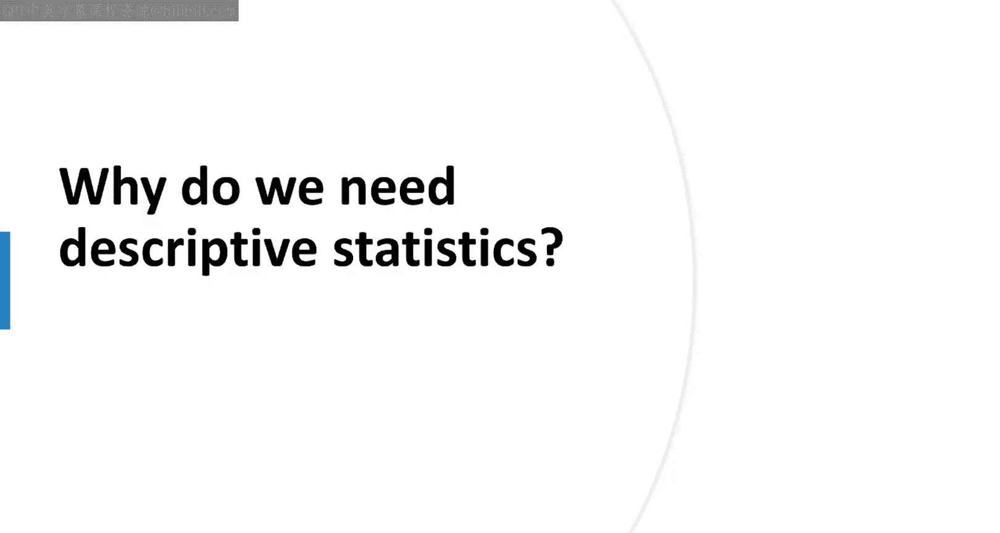
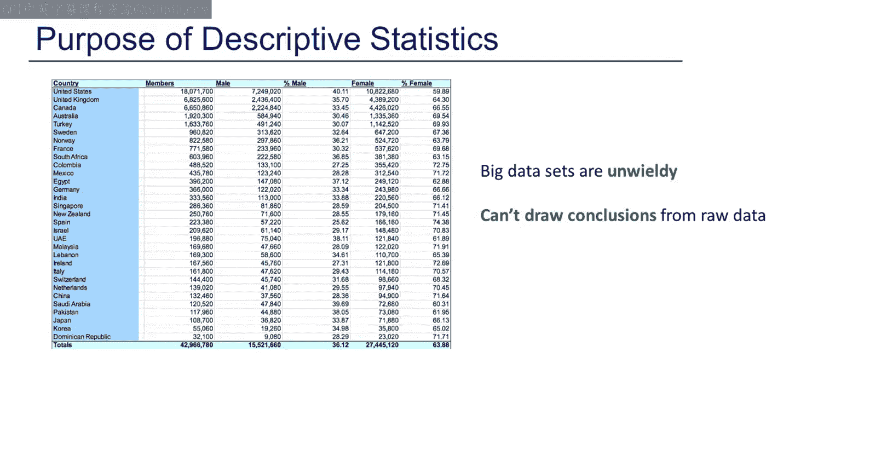
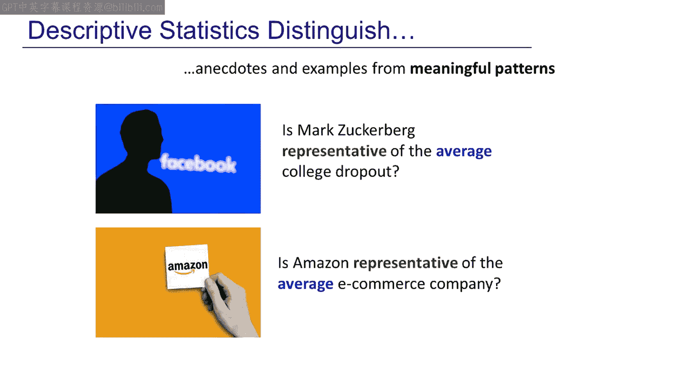
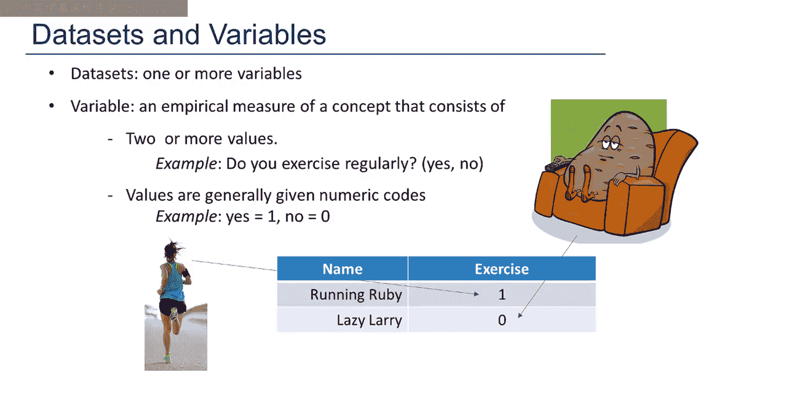

# 数据素养：P09：为什么我们需要描述性统计 📊

在本节课中，我们将要学习描述性统计的目的，理解统计如何帮助我们区分有意义的模式与异常情况，并准确定义统计学语境中的“变量”概念。

## 描述性统计的目的

上一节我们明确了学习目标，本节中我们来看看描述性统计的核心作用。

请看这张幻灯片上显示的数据，它包含了许多国家的Facebook会员信息，包括会员总数、男性会员数和女性会员数。尽管这个数据集规模较小且组织方式合理，但识别模式和得出结论仍然很困难。例如，很难直接比较印度和日本的Facebook会员情况。

现在，想象一个庞大得多的数据集。政府机构和私营部门组织会构建包含数十亿甚至数万亿观测值的数据集。仅仅盯着原始数据的电子表格，我们几乎无法从中学习到任何信息。相反，我们需要使用统计数据和可视化工具来总结原始数据集中的信息。

## 区分轶事与模式

在了解了描述性统计的总体目的后，你可能会想：为什么我们不能简单地从庞杂的数据集中挑选有趣的观测值，并更详细地研究这些案例呢？

以下是这个方法的局限性：
*   我们可以这样做，但无法确定我们研究的是**有代表性**的还是**无代表性**的观测值。
*   使用统计数据和数据可视化有助于我们区分有趣的轶事和有意义的模式。

举例来说，假设你想研究大学辍学生是否普遍能拥有成功的职业生涯，并且你想到Facebook的联合创始人兼首席执行官马克·扎克伯格可能是一个有趣的案例研究。诚然，扎克伯格先生有一段引人入胜的职业生涯故事，其中包括他从哈佛辍学。但扎克伯格先生的经历很可能**不能代表**普通大学辍学生的经历。如果我们假设扎克伯格先生是一个普通的大学辍学生，并据此得出关于学生是否应该辍学的一般性建议，那将是相当错误的。

同样，如果我们想研究电子商务行业，假设亚马逊公司能代表典型的电子商务公司也是不准确的。如果我们想了解什么因素造就了电子商务公司的成功，我们需要研究许多不同的公司，并从包含大量差异的数据集中学习。

因此，与其依赖那些不太可能代表我们所关心总体的有趣例子，我们将使用统计数据和数据可视化来发现有意义的模式。这些模式使我们能够得出准确的结论并生成可操作的建议。

## 数据集与变量

在深入探讨描述性统计（我们将在下一个视频中进行）之前，让我们先定义一些关键术语。我们之前使用过这些术语，现在让我们花一两分钟来精确讨论它们的含义。

一个**数据集**由一个或多个**变量**组成。一个变量是我们所关心研究概念的**经验性度量**。

在你的数据集中，每个变量都应该有一个**唯一的名称**。如果数据集中的两个不同变量共享一个名称，将会造成极大的混淆。

每个变量还应该有两个或更多的**值**。这一点极其重要。换句话说，一个变量**必须有变化**。如果一个变量只包含一个值，那它就是一个**常量**。例如，昨天的平均气温不是一个变量，它只有一个值，因此是一个常量。

相比之下，变量可以取两个或更多的值。考虑调查问题“你经常锻炼吗？”，受访者可以回答“是”或“否”。我们也可以想象一个取3个、4个，甚至无限多个值的变量。

变量以**概率**的方式呈现特定的值。以变量“性别”为例，对于任何给定的个体，其为男性的概率和其为女性的概率各约为50%。同样，对于任何个体，其经常锻炼的概率和不经常锻炼的概率也存在。我们可能不知道每个值的概率，但这没关系。重要的是，对于一组可能的值中的任何一个，变量取该值的概率**不为零**。

通常，为非数值变量值分配数字代码是有用的。例如，在关于锻炼的调查问题中，我们可能将“是”的回答赋值为1，将“否”的回答赋值为0。在这张幻灯片上，有一个包含两个观测值的表格。Run Ruby报告说她经常锻炼，因此她被赋值为1。相比之下，Lay Larry报告说他不经常锻炼，因此他被赋值为0。

在统计学中，变量及其组成的数据集，正是我们使用各种方法和工具进行分析的对象。

## 总结

本节课中我们一起学习了描述性统计的核心目的：**总结庞杂数据、区分有意义的模式与无代表性的轶事**。我们还准确定义了**数据集**和**变量**这两个关键概念，理解了变量必须具有**变化**，并且其取值具有**概率性**。掌握这些基础概念，是后续深入学习各种统计方法和可视化工具的第一步。