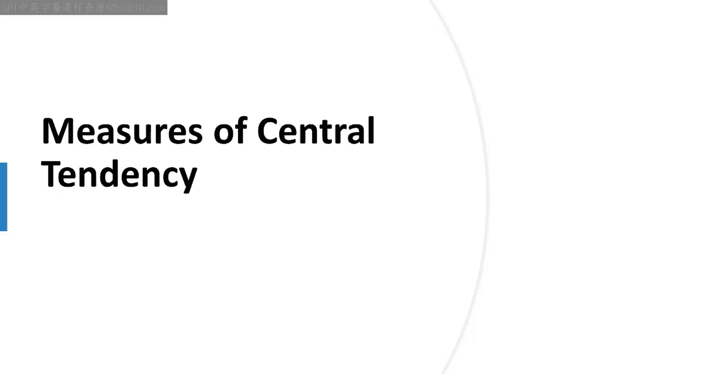
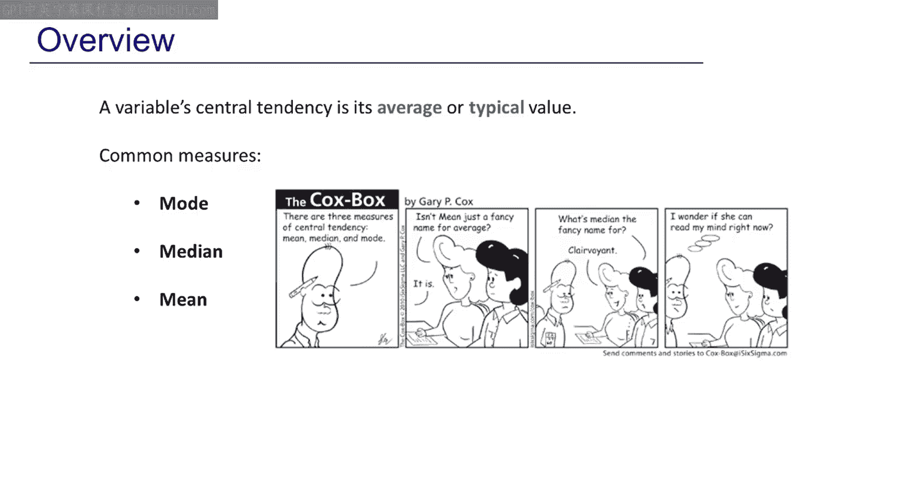
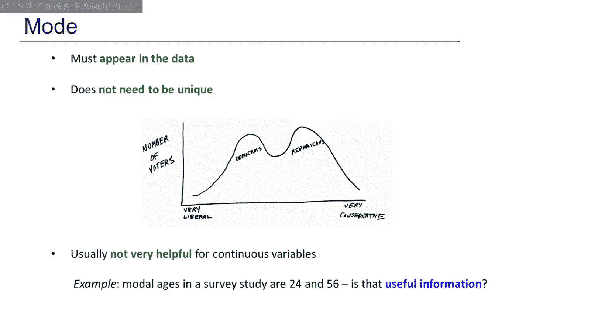
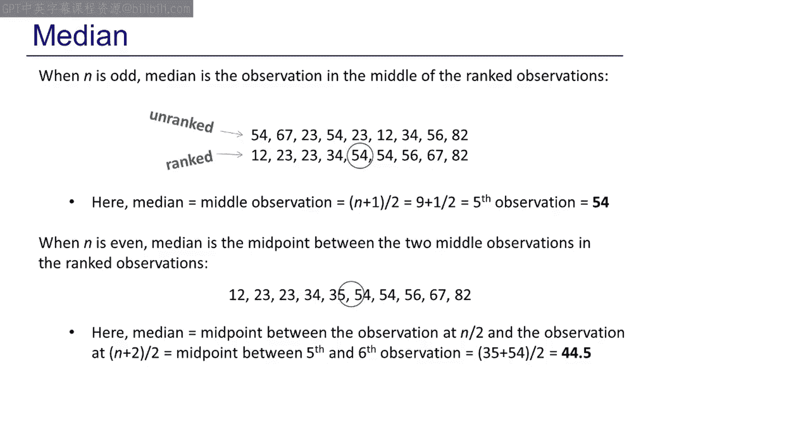
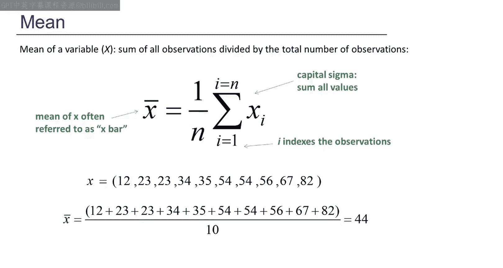
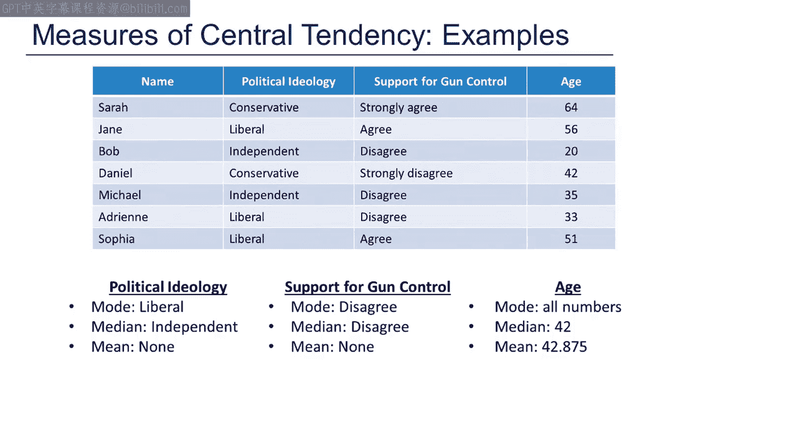

# 约翰霍普金斯大学《数据素养（数据⧸测量⧸回归⧸概率⧸毕业项目）｜Data Literacy》中英字幕（deepseek p10 9_集中趋势的度量.zh_en -BV1jXtMemEuh_p10-

Measures of central tendency。When you have a variable you'd like to analyze。

 you might first care about identifying the center of that variable。

 There are several different ways to measure a variable's central tendency。 By the end of this video。

 you should be able to calculate and interpret the three measures of central tendency， mode。

 median and mean。

Overview a variable central tendency is its average or typical value。

 The mode is the most common value in a variable。 Every single variable has a mode。 That said。

 the mode is not always the best measure of central tendency。

 I'll say more about why this is momentarily。 The median value of a variable is the value at which 50% of the observations fall below and 50% fall above。

 Some variables， like unordered categorical variables do not have a median。

 Only numerical or ordered categorical variables have a median。

 This is because the values of a variable， must have an objective order to be able to calculate the median。

The main value of a variable is the variable's arithmetic average。With categorical variables。

 researchers will sometimes assign numerical values to the categories to calculate mean values。

 We'll walk through a few examples at the end of the video。

Moode， let's spend a few minutes discussing the mode in more detail。 First。

 note that the mode of a variable must appear in the data。 Unlike the mean and the median。

 the modal value， by definition， must be held by at least one observation in the data set。Second。

 it's important to realize that the mode does not need to be unique。

 A variable can have multiple modes， meaning two or more values are equally popular。Further。

 researchers consider a variable to be bimodal if two values are approximately equal in popularity。

 In other words， if there are two values of a variable that are significantly more popular than the other values。

 but not exactly equal in popularity， we would still consider that variable to have a bimodal distribution。

For example， the graph on this slide is a sketch of the distribution of political ideology among US voters。

 As you might imagine， this distribution is bimodal。

 There are two values of political ideology around which most voters are clustered。

For some variables， however， the mode is not a useful summary measure。 Let's consider age。

 Suppose that I told you that in a recent survey study， the modal ages were 24 and 56。

 Would that information be useful， All that would tell you is that 24 and 56 were the most popular ages。

A better measure of central tendency for this variable might be the mean。

Median。Let's now discuss the median。When the sample size denoted by n is odd。

 the median value is the value of the observation that falls in the middle of the ranked observations。

 Take a look at the two lists of numbers toward the top of the slide。

 The first list contains 9 unraned numbers。 The second list contains the same9 numbers ranked。

 In the second list， we can see that the median value is 54 as 54 is the middle value。

 When the sample sizes even the median is the midpoint between the two middle observations in the ranked observations。

 Take a look at the list of numbers located toward the bottom of the slide。

 The list contains 10 numbers ranked。 The median is the midpoint between 35 and 54。

 The two middle numbers， which is 44。5。

Min。The mean value of a variable， say X is the sum of all of the observations divided by the total number of observations。

 This definition is captured by the formula displayed in the middle of the slide。

The formula states that x bar is equal to the sum of all observations in x。

 from I equals 1 to I equals n divided by n。For those who are unfamiliar with the use of the capital Sigma。

 let me explain。The sigma indicates that the researcher should sum up the values。

 Each individual observation is denoted by subscript I。

 The starting observation is indicated below the sigma。

 and the ending observation is indicated above the sigma。 So again。

 the formula on this slide indicates that all observations in X from I equals1 to I equals n should be summed up and then divided by n。

Let's look at an example。 Suppose x is equal to the values displayed on the slide。

 The mean denoted by x bar is equal to all values of x summed up and divided by the total number of observations。

 which in this case is 10。 So x bar in this case， is equal to 44。

Examples， let's look at the mode， median and mean for a few different variables。

 The small data set on this slide includes 7 observations and four variables。 nameme。

 political ideology， support for gun control legislation and age。

Political ideology is an ordered categorical variable。

Independent clearly falls between conservative and liberal。The mode of this variable is liberal。

 as there are three instances of this value。The median value is independent。

 If you lined up all the values， the middle value would be independent。

This variable does not technically have a mean。 You could， however。

 assign numerical values to the categories， and then compute a mean。For example。

 suppose we assigned liberal a value of one， independent， a value of 2 and conservative。

 a value of 3。 The mean would then be 1。86。Support for gun control legislation is also an ordered categorical variable。

 There is an objective order to the categories。 The mode of this variable is disagree。

 and the median is also disagree。Although this variable does not technically have a mean。

 we could likewise assign numerical values to the categories and compute one。

Age is a continuous variable。 The mode is all of the values in the dataset set。

 as they are all equally popular。As you can see， the mode is therefore not a particularly useful summary measure for this variable。

The median value of age in this data set is 42， and the mean value is 42。875。Moving forward。

 we'll discuss how to summarize a variable spread and dispersion。

