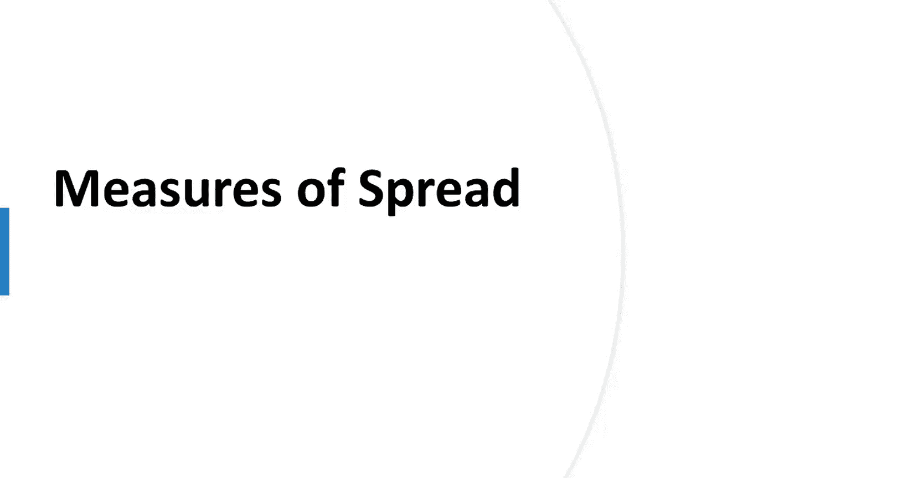
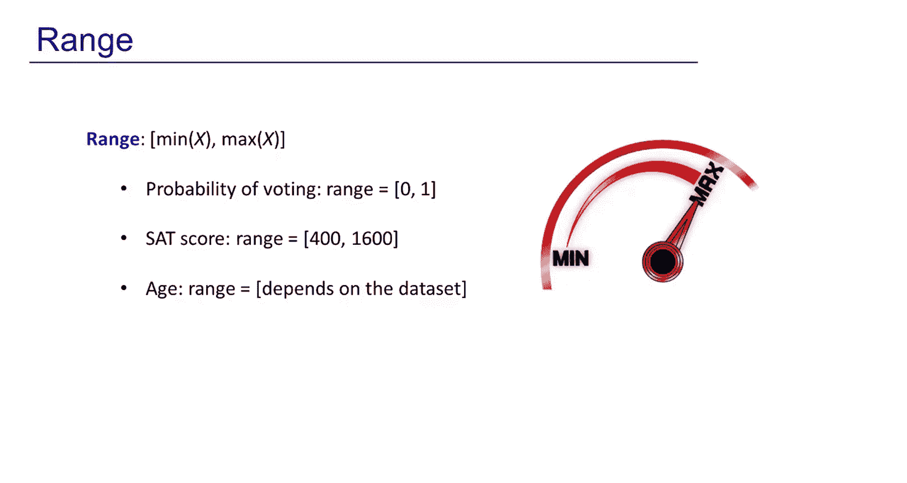
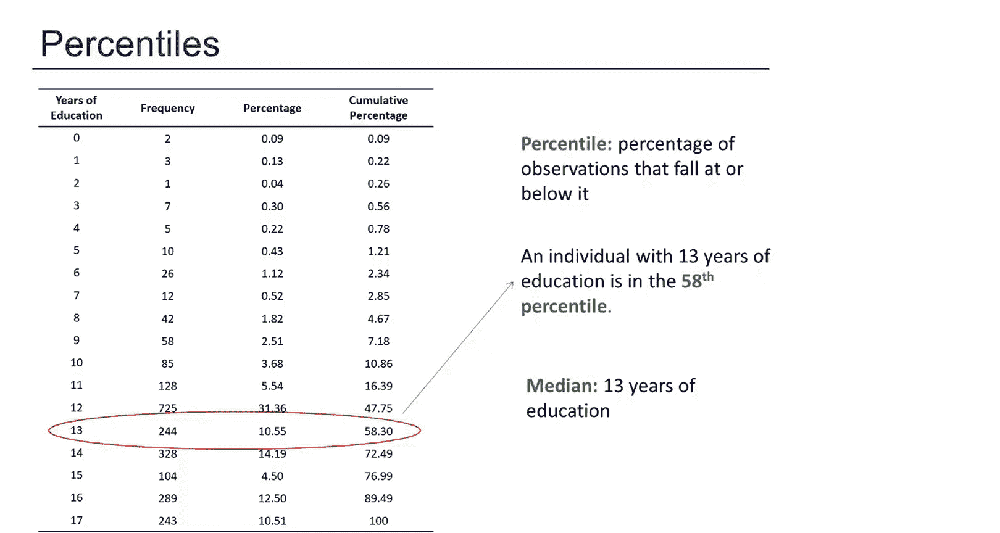
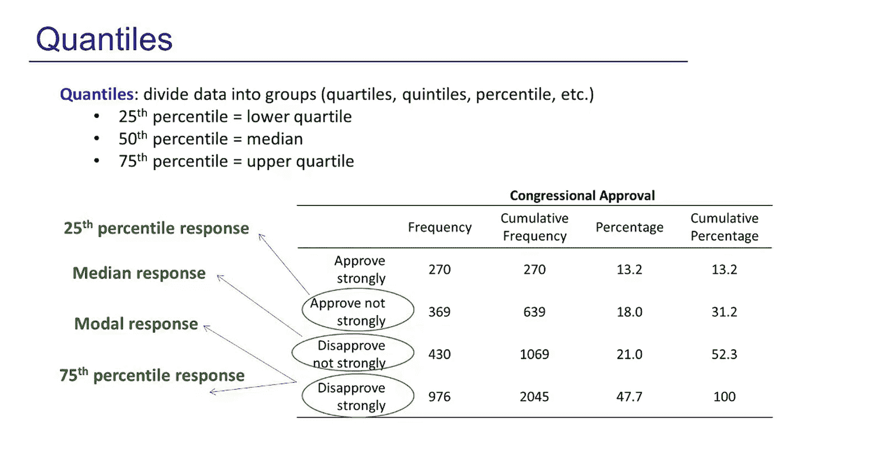
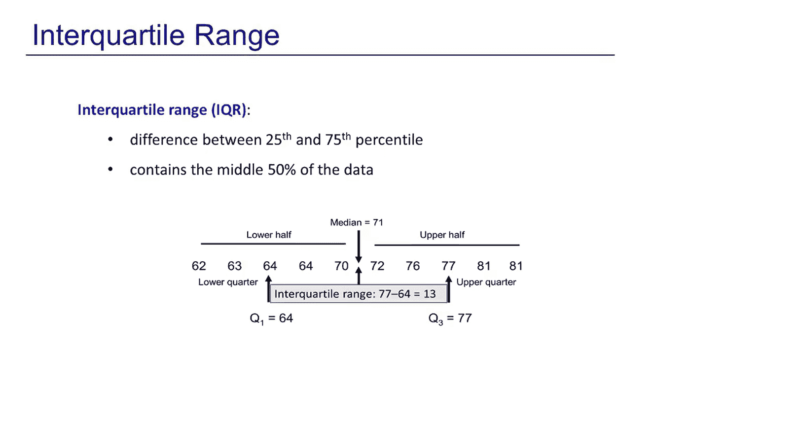
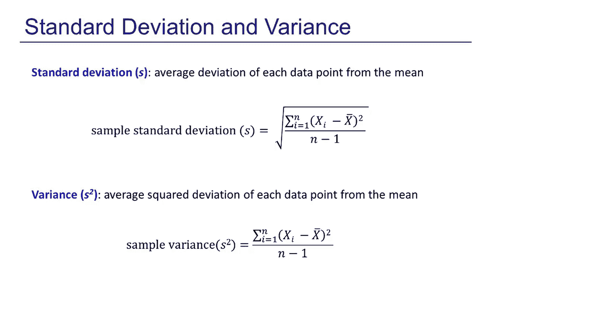

# 约翰霍普金斯大学《数据素养（数据⧸测量⧸回归⧸概率⧸毕业项目）｜Data Literacy》中英字幕（deepseek p11 10_离散程度的度量.zh_en -BV1jXtMemEuh_p11-

Measures of spread。 in addition to summarizing the center of a variable。

 It's also useful to summarize the spread of a variable。

 Measures of spread give us a sense of how clustered together or dispersed the values of the data points are relative to each other。

 By the end of this video， you should be able to calculate and interpret various measures of spread。

 including a variabless range， Periles， quantiles and standard deviation。

Range， the simplest， though extremely valuable measure of spread， is the range of a variable。

 which includes the minimum value and the maximum value of that variable。

 Some variables have ranges with set Minma and maxima。 A probability variable。

 such as the probability of voting ranges from 0 to 1 by definition。

 A person cannot have a probability of voting that is lower than 0 or greater than  one。Likewise。

 the SAT score has a predefined range of 400 points to 1，600 points。

Other variables don't have a predefined range。 The range of an age variable， for example。

 will depend on the data you have The range of an age variable in a data set about car usage。

 for example， might be between， let's say 16 and 95。

The range of an age variable in a data set about elementary school students might be between ages5 and 13。

Regardless， it's very useful to report the range of your variables when summarizing data。

Perscentiles， we can also summarize the spread of a variable in terms of percentiles。

 A percentile indicates the percentage of observations that fall at or below it。

 The median is actually just a particularly special percentile。

 The median is the 50th percentile at the median，50% of observations fall at or below it。

 The table on this slide presents the frequency， percentage distribution and cumulative percentage distribution for a years of education variable。

 The education variable reports each respondent's total years of education。😊。

The cumulative percentage column in the table displays the percentiles。 We can see， for example。

 that an individual with 13 years of education is in the 58th percentile。

 This means that 58% of respondents in the data set have 13 or fewer years of education。

This table also shows that 10 years of education is in the 10th percentile。

10% of respondents have 10 or fewer years of education。Let's turn to the median of the distribution。

We know that the median is the value at the 50th percentile。 Well， from this table。

 we can see that between 47。75% and 58。3% of respondents have 13 or fewer years of education。

This means that the 50th percentile of the distribution is 13 years of education。

Quantiles。Quantiles allow us to divide the data into groups quartiles divide the data into four groups。

 and quintiles divide the data into five groups。The 25th percentile is referred to as the first or lower quartile。

 The 50th percentile is referred to as the second quartile， or the median。

The 75th percentile is referred to as the third or upper quartile。

Let's examine this table of congressional approval。

The table summarizes a survey question that was administered to 2323 respondents。 The question asked。

 do you approve or disapprove of the way the US Congress has been handling its job。

Respondents were given four answer choices to choose from， approve strongly， approve not strongly。

 disapprove not strongly， and disapprovve strongly。

The cumulative percentage column allows us to draw conclusions about the percentiles of this distribution。

 Which response category is located at the 25th percentile。 Well。

 we know that approved strongly cannot be the 25th percentile response since only 13。

2% of respondents provided this response。We do know， however， that 31。

2% of respondents provided a response of approved not strongly or approved strongly。

 so the approved not strongly response falls at the 13。2 to 31。2 percentiles。

This means that the 25th percentile response is approved not strongly。

The modal response category is disapproved strongly。

 This response accounts for the greatest percentage of observations。

 The 75th percentile response is also disapprovveed strongly。

 as this response category accounts for the 52。3 through 100th percentiles。😊。

Inter quartile range。The inter quartile range is the difference between the 25th and 75th percentiles。

 This spread contains the middle 50% of data。The inter quartile range is a commonly used way to highlight whether the data are concentrated or dispersed。

 We discuss dispersion in more depth in the next video。

The graphic on this slide shows that the inter quartile range of the data listed is 77-64。

 which is 13。

Standard deviation and variance。The standard deviation is the most common single number that is used to summarize the spread of a variable。

In words， the sample standard deviation， which is an estimate of the population standard deviation。

 is the average deviation of each data point from the mean。

A higher standard deviation means the data are more dispersed。

The standard deviation is always a positive value， and its units are the same as the variable it is summarizing。

We can calculate the standard deviation of a variable by summing up all of the square deviations from the mean。

Dividing by the number of observations，-1， and then taking the square root of that value。

The variance is the square of the standard deviation。

It captures the average squared deviation of each data point from the mean。

The variance has several useful properties that are relevant to more advanced methods of analysis。

 such as regression analysis。 For the moment， take note of the close relationship between the standard deviation and the variance。

 and remember that they both measure the spread of a variable。

