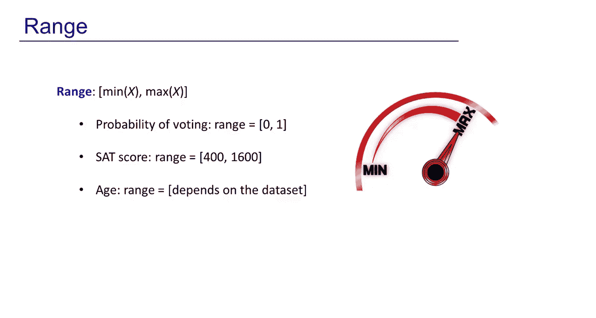
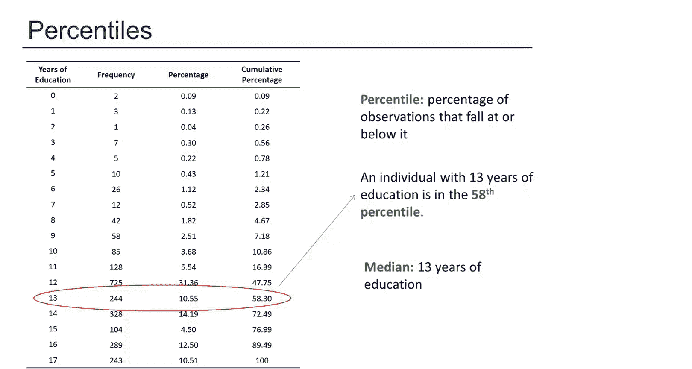
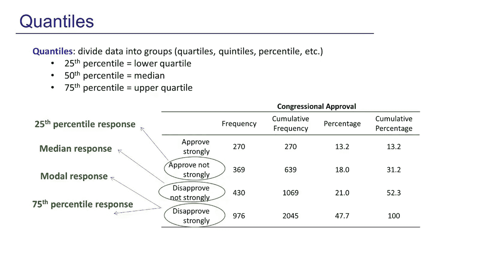
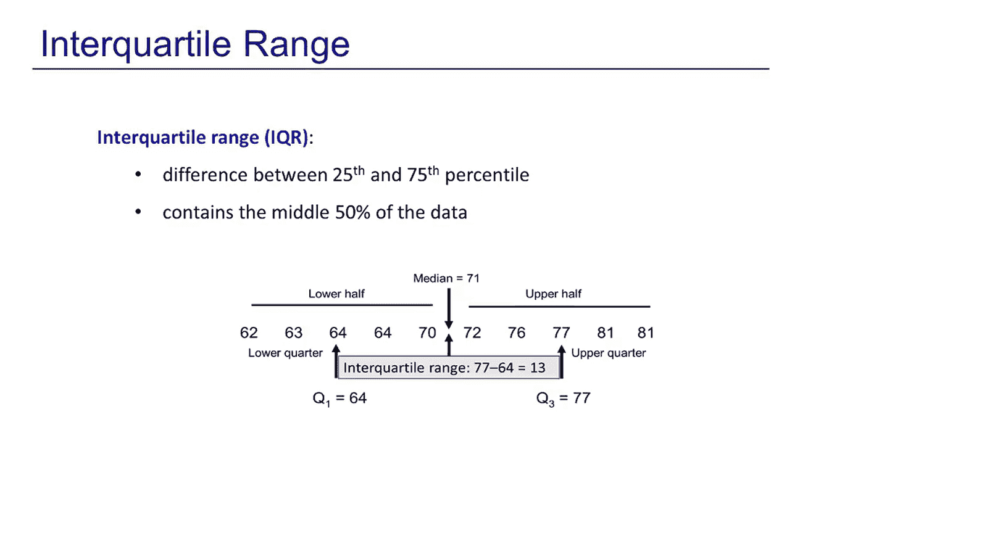
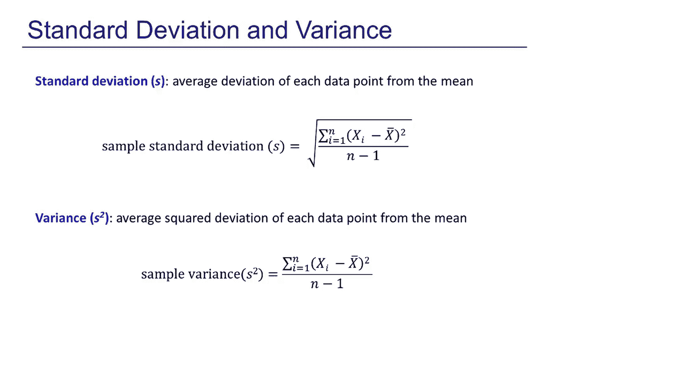

# 数据素养：10：离散程度的度量 📊

在本节课中，我们将要学习如何度量数据的离散程度。除了了解数据的中心位置，掌握数据的分散情况同样重要。离散程度的度量能让我们了解数据点是紧密聚集还是彼此分散。通过本课，你将能够计算并解释多种离散程度度量指标，包括变量的**全距**、**百分位数**、**分位数**和**标准差**。

## 全距 📏

上一节我们介绍了离散程度的概念，本节中我们来看看最简单的度量指标——全距。

全距是度量数据离散程度最简单但非常有价值的指标，它包含变量的**最小值**和**最大值**。

以下是关于全距的一些关键点：

*   有些变量的全距有固定的最小值和最大值。例如，**概率变量**（如投票概率）的定义范围是0到1。一个人的投票概率不可能低于0或高于1。同样，SAT分数的预设范围是400分到1600分。
*   其他变量则没有预设的范围。例如，一个关于汽车使用情况的数据集中，年龄变量的范围可能在16岁到95岁之间。而在一个关于小学生的数据集中，年龄变量的范围可能在5岁到13岁之间。
*   无论如何，在总结数据时报告变量的全距是非常有用的。

## 百分位数 📈

我们也可以使用百分位数来总结变量的离散程度。

一个百分位数表示**等于或低于**该值的观测值所占的百分比。中位数实际上就是一个特殊的百分位数——**第50百分位数**。在中位数处，50%的观测值等于或低于它。

让我们通过一个例子来理解。下表展示了一个“受教育年限”变量的频率、百分比分布和累积百分比分布。

| 受教育年限 | 频率 | 百分比 | 累积百分比 |
| :--- | :--- | :--- | :--- |
| ... | ... | ... | ... |
| 10 | ... | ... | 10.0% |
| 13 | ... | ... | 58.3% |
| ... | ... | ... | ... |

表中的累积百分比列显示了百分位数。例如，我们可以看到，拥有13年教育年限的个体处于**第58百分位数**。这意味着数据集中58%的受访者拥有13年或更少的教育年限。该表还显示，10年教育年限处于**第10百分位数**，即10%的受访者拥有10年或更少的教育年限。

现在来看分布的中位数。我们知道中位数是第50百分位数对应的值。从表中可以看出，介于47.75%和58.3%之间的受访者拥有13年或更少的教育年限。这意味着该分布的第50百分位数是13年教育年限。

## 分位数 📊

分位数允许我们将数据分成若干组。

以下是常见的分位数类型：

*   **四分位数**将数据分为四组。
    *   第25百分位数被称为**第一四分位数**或**下四分位数**。
    *   第50百分位数被称为**第二四分位数**，也就是**中位数**。
    *   第75百分位数被称为**第三四分位数**或**上四分位数**。
*   **五分位数**将数据分为五组。

让我们分析下面这个关于国会支持率的表格。该表总结了一个对2323名受访者进行的调查问题：“你是否赞成美国国会处理其工作的方式？”受访者可以从四个答案中选择：非常赞成、赞成但不强烈、不赞成但不强烈、非常不赞成。

| 回答类别 | 频率 | 百分比 | 累积百分比 |
| :--- | :--- | :--- | :--- |
| 非常赞成 | ... | 13.2% | 13.2% |
| 赞成但不强烈 | ... | 18.0% | 31.2% |
| 不赞成但不强烈 | ... | 21.1% | 52.3% |
| 非常不赞成 | ... | 47.7% | 100.0% |

累积百分比列使我们能够得出关于该分布百分位数的结论。

*   **哪个回答类别位于第25百分位数？** 我们知道“非常赞成”不可能是第25百分位数的回答，因为只有13.2%的受访者选择了这个答案。然而，我们知道有31.2%的受访者选择了“赞成但不强烈”或“非常赞成”，因此“赞成但不强烈”这个回答落在第13.2到31.2百分位数之间。这意味着第25百分位数的回答是“赞成但不强烈”。
*   **众数**（出现频率最高的）回答类别是“非常不赞成”，这个类别占观测值的百分比最大。
*   第75百分位数的回答也是“非常不赞成”，因为这个回答类别涵盖了第52.3到第100百分位数。

## 四分位距 🔍

四分位距是第25百分位数和第75百分位数之间的差值。这个范围包含了**中间50%的数据**。四分位距是一种常用的方法，用于突出数据是集中还是分散。我们将在下一个视频中更深入地讨论离散度。

本幻灯片上的图表显示，所列数据的四分位距是77 - 64 = 13。

## 标准差与方差 📐

**标准差**是用于总结变量离散程度最常见的单一数值。

用文字描述，**样本标准差**（它是总体标准差的估计值）是每个数据点与均值之间的平均偏差。**更高的标准差意味着数据更分散**。标准差始终是一个正值，其单位与它所总结的变量单位相同。

我们可以通过以下公式计算变量的标准差：

1.  首先，计算每个数据点与均值的**偏差**：`偏差 = 数据点值 - 均值`
2.  然后，将所有偏差**平方**并求和。
3.  接着，将这个总和除以（观测值数量 - 1），得到**方差**。
4.  最后，对方差取**平方根**，得到**标准差**。

用公式表示，样本标准差 `s` 的计算如下：
`s = sqrt( Σ(x_i - x̄)² / (n - 1) )`
其中：
*   `x_i` 代表每个数据点
*   `x̄` 代表样本均值
*   `n` 代表样本大小
*   `Σ` 表示求和

**方差**是标准差的平方。它衡量的是每个数据点与均值之间的平均**平方**偏差。方差具有一些有用的特性，这些特性与更高级的分析方法（如回归分析）相关。目前，请注意标准差和方差之间的密切关系，并记住它们都用于度量变量的离散程度。

---

本节课中我们一起学习了多种度量数据离散程度的方法。我们从最简单的**全距**开始，了解了数据的整体跨度。接着，我们探讨了**百分位数**和**分位数**，它们能帮助我们定位数据分布中的特定位置，例如中位数和四分位数。**四分位距**则专注于描述中间50%数据的范围。最后，我们介绍了最常用的**标准差**及其平方——**方差**，它们量化了数据点相对于均值的平均偏离程度。掌握这些度量指标，能够使你更全面、更精确地描述和比较不同数据集的分布特征。