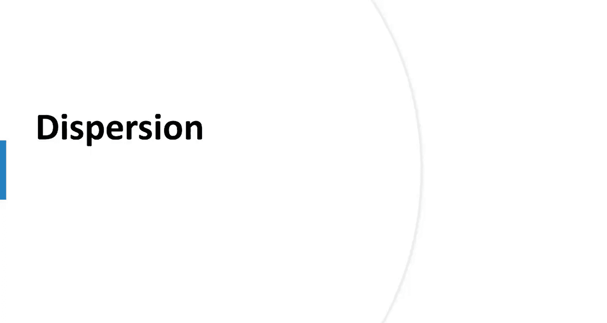
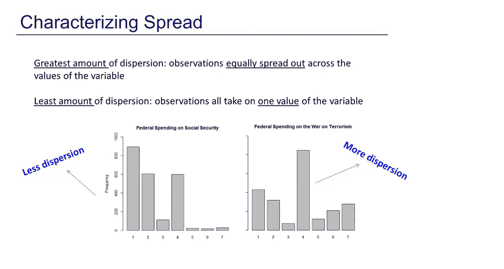
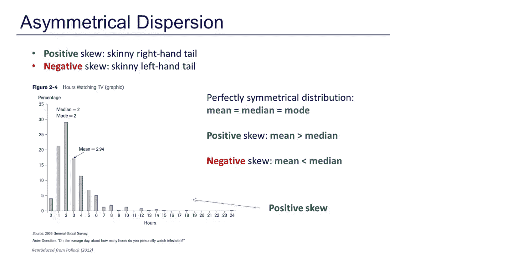

# 约翰霍普金斯大学《数据素养（数据⧸测量⧸回归⧸概率⧸毕业项目）｜Data Literacy》中英字幕（deepseek p12 11_离散度.zh_en -BV1jXtMemEuh_p12-

Dispersion up to this point， we've covered several important measures of central tendency and spread。

 You can summarize a variable central tendency using the mode， mean or medium。

 You can calculate locational measures such as variables 25th and 75th percentile。

 and you can summarize a variable spread using measures such as the inter quartile range and standard deviation。

In this video， we'll spend a few minutes characterizing a variable spread。By the end of this video。

 you should be able to describe the way in which a variable is distributed by summarizing its dispersion。

Characterizing spread。Dispersion refers to the way in which the data and a variable are distributed。

In a variable with the greatest amount of dispersion。

 all of the observations are equally spread out across the values of the variable。

In a variable with no dispersion， all of the observations take on one value of the variable。Remember。

 of course， that a variable must contain a non zero amount of dispersion to be useful in a statistical analysis。

A variable with no dispersion at all is not a variable， it's a constant。

This slide displays two bar plots。 On the left hand side。

 there is a bar plot of responses to a question about federal spending on Social Security。

 Responents were asked whether Social Security spending should be increased or decreased。

 and the response choices fall along a7 point scale。

 ranging from increased a great deal to decreased a great deal。

Notice that most of the responses are clustered on the left hand side of the graph。 In fact。

 97% of respondents gave a response of one，2，3， or four on the scale。

The federal spending on Social Security variable thus has dispersion。

 but it is less dispersed than the variable visualized in the graph on the right hand side of the slide。

The graph on the right is a frequency bar plot of responses to a question about federal spending on terrorism。

 noticeice that the responses are more spread out along the X axis。

There are a substantial number of responses at opposite ends of the scale。As a result。

 this variable is more dispersed。

Asymmetrical dispersion。In addition to discussing the amount of dispersion。

 we can also characterize the shape of the dispersion。If a distribution has a skinny right hand tail。

 we can say that the distribution has a positive skew。

If the distribution has a skinny left hand tail， we can say that the distribution has a negative skew。

The graph on this slide has a positive skew。 The observations are clustered around values located on the left hand side of the X axis。

In a perfectly symmetrical distribution， the mean， median and mode are all equal。

 The one exception to this rule is when the observations are exactly equally distributed among all values。

 in which case， the mode is equal to all values of the variable。With a skew distribution。

 the median and mean will be different。 This is because the mean is very sensitive to skewness。

 A positive skew pulls the mean above the median， and a negative skew pulls the mean below the median。

 Remember， you can change the mean to any number you want by adding a single number to a list of numbers。

 This is not true with the median。 Add an arbitrarily large number to a list of numbers only moves the median by half the distance between the original median and the next number in the ranked list。

As a result， the median is a more resistant or robust measure of central tendency。

