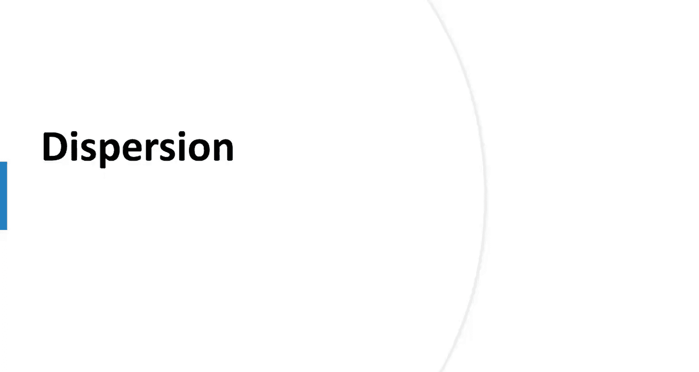
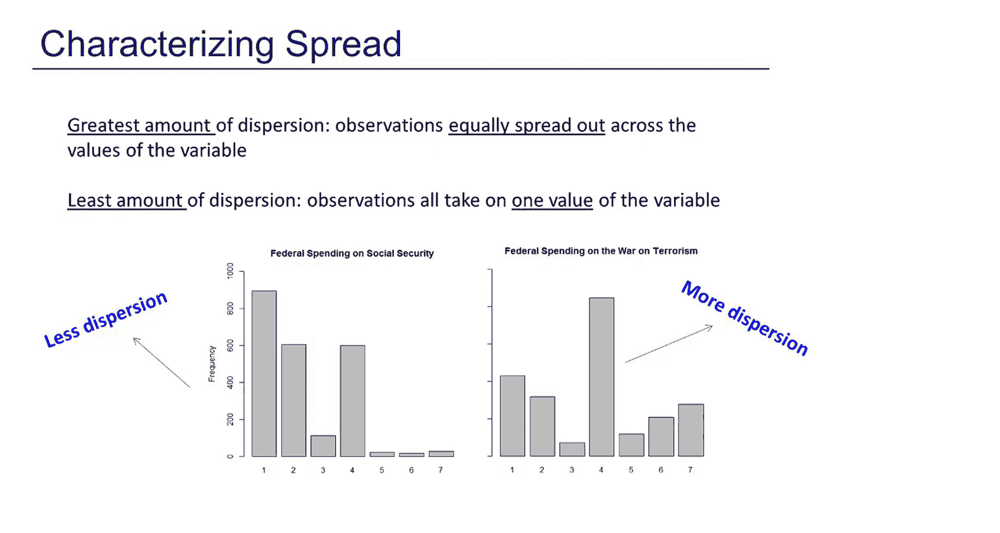
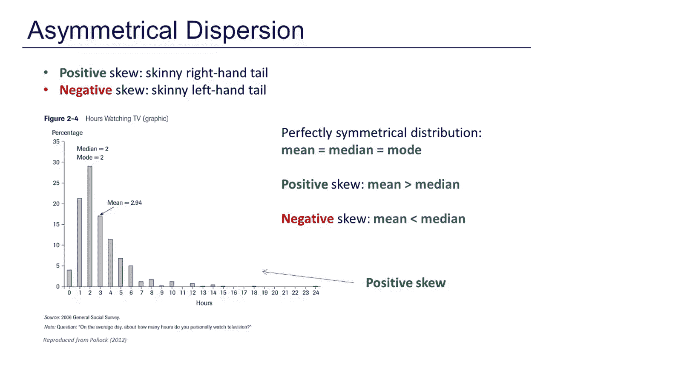

# 数据素养：P12：离散度 📊

在本节课中，我们将学习如何描述数据的离散程度。到目前为止，我们已经介绍了几个重要的集中趋势和离散程度的度量方法。你可以使用众数、均值或中位数来总结变量的集中趋势。你可以计算位置度量，例如变量的第25和第75百分位数。你也可以使用四分位距和标准差等度量来总结变量的离散程度。在本视频中，我们将花几分钟时间来描述变量的离散程度。通过本视频的学习，你应该能够通过总结其离散度来描述一个变量的分布方式。

## 描述离散程度

离散度指的是数据在变量中的分布方式。在一个离散度最大的变量中，所有的观测值都均匀地分布在变量的各个取值上。在一个没有离散度的变量中，所有的观测值都取变量的同一个值。当然，请记住，一个变量必须包含非零的离散度才能在统计分析中有用。一个完全没有离散度的变量不是一个变量，而是一个常数。

这张幻灯片展示了两张条形图。左侧的条形图展示了一个关于联邦社会保障支出的问题的回答。受访者被问及社会保障支出是应该增加还是减少，回答选项沿着一个7点量表分布，范围从“大幅增加”到“大幅减少”。请注意，大多数回答都集中在图表的左侧。事实上，97%的受访者在量表上给出了1、2、3或4的回答。因此，联邦社会保障支出变量具有离散度，但其离散程度低于幻灯片右侧图表中可视化的变量。

右侧的图表是一个关于联邦反恐支出问题的回答频率条形图。请注意，回答在X轴上分布得更广。在量表的两端都有相当数量的回答。因此，这个变量的离散度更大。

## 非对称离散度

除了讨论离散度的量，我们还可以描述离散度的形状。如果一个分布有一个细长的右尾，我们可以说该分布具有**正偏态**。如果分布有一个细长的左尾，我们可以说该分布具有**负偏态**。

这张幻灯片上的图表具有正偏态。观测值聚集在X轴左侧的值附近。在一个完全对称的分布中，均值、中位数和众数都相等。这条规则的一个例外是，当观测值在所有值中完全均匀分布时，此时众数等于变量的所有取值。

在偏态分布中，中位数和均值会不同。这是因为均值对偏态非常敏感。正偏态会将均值拉高到中位数之上，而负偏态会将均值拉低到中位数之下。请记住，你可以通过向一个数字列表中添加一个数字，将均值改变为你想要的任何数字。这对于中位数则不成立。向一个数字列表中添加一个任意大的数字，只会将中位数移动原始中位数与排序列表中下一个数字之间距离的一半。

因此，中位数是一种更具**抵抗力**或**稳健性**的集中趋势度量。

## 总结

本节课中，我们一起学习了如何描述数据的离散程度。我们了解到离散度描述了数据在变量中的分布范围。我们探讨了如何通过观察分布的形状（如偏态）来进一步描述离散度，并理解了均值对极端值敏感，而中位数则更为稳健。掌握这些概念有助于我们更全面地理解和总结数据集的特性。