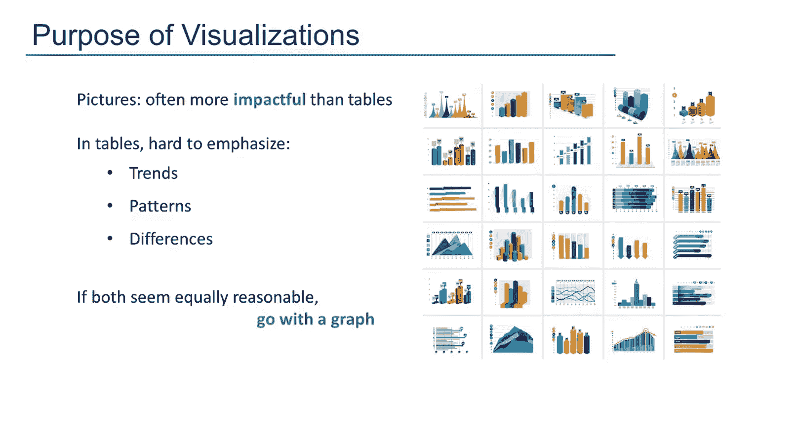
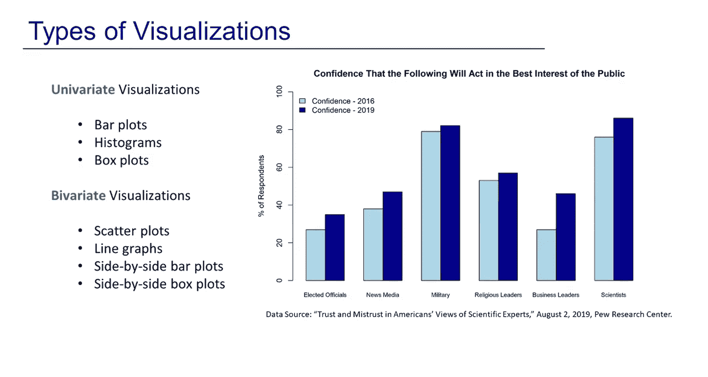
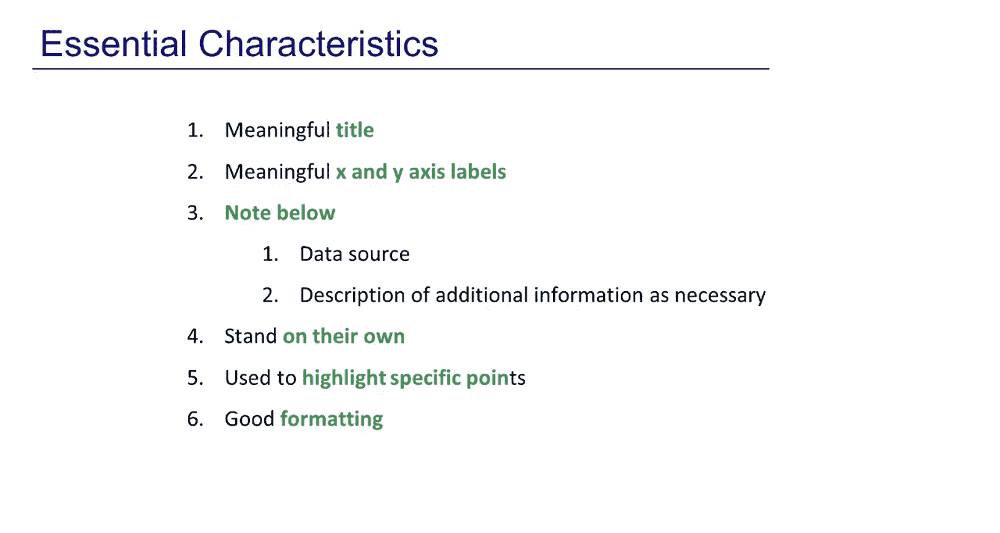

# 约翰霍普金斯大学《数据素养（数据⧸测量⧸回归⧸概率⧸毕业项目）｜Data Literacy》中英字幕（deepseek p13 12_良好可视化的要素.zh_en -BV1jXtMemEuh_p13-

Elements of good visualizations。Creating and interpreting visualizations is an essential skill for a data analyst Today。

 it is impossible to be an educated consumer of news。

 scholarly reports and research without knowing how to interpret graphs。 By the end of this video。

 you should be able to articulate the purpose of a visualization。

 Dising between different types of visualizations and enumerate the essential characteristics of a good data visualization。

Purpose of visualizations， While summary statistics， such as the mean， median and standard deviation。

 are extremely helpful for giving researchers and their audiences a sense of how a variable is distributed。

 graphphs can also serve this purpose， and sometimes much more effectively。

 A visualization often provides a much more intuitive description of a variable's distribution。

 including its center and spread。Further， it can be extremely difficult to highlight how a variable changes over time using a table of numbers。

 while it's certainly possible to construct a table that shows the values of a variable for， say。

 20 different years， a graph would portray any temporal trends or patterns in this variable much more effectively。

Lastly， it is hard to emphasize the differences between variables in a table。

 graphphs can usually underscore a point about differences between two or more variables much more effectively than numbers in a table。

In general， if both a table and a graph seem equally reasonable to you。

 choose to use a graph When created well， graphs are much more visually appealing and easier to interpret than a table packed with numbers。

Types of visualizations。 There are numerous types of visualizations。

 And this course will'll focus in particular on Uniivevariate， meaning single variable and byvari。

 meaning two variable visualizations。In terms of univevariate visualizations。

 we'll discuss how to create and interpret bar plots， histograms， and box plots。

In terms of bivariate visualizations， we'll discuss how to create and interpret scatter plots。

 line graphs， side by side bar plots and side by side box plots。 For example。

 the graph on this slide is a side by side bar graph that visualizes the confidence that Americans have in various groups of leaders。

 The light blue bars are from a 2016 survey， and the dark blue bars are from a 2019 survey。

 The data come from surveys conducted by the Pew Research center。

There are a couple of key conclusions we can draw from the graph。First， we can conclude that。

 in general， confidence increased in the years between 2016 and 2019。 across all groups of leaders。

 confidence levels were higher in 2019。Second， we can conclude that Americans have much more confidence in some groups of leaders than others。

 For example， Americans expressed a high level of confidence in scientific and military leaders and a comparatively lower level of confidence in elected officials and the news media。

These findings have implications for the health of a democracy。

 as we know that a sustainable democracy depends on civic trust。

Essential characteristics。While there are on numerous types of graphs。

 there are some key characteristics that every single graph should have to be effective。

You can create graphs in a variety of software programs such as Excel。

 R and Tableau these and other software programs allow you to control nearly every aspect of a graph's appearance。

When you are creating your own graphs， it is important that you take time to be sure that every component of the graph looks exactly the way you want it to。

 Don't let a software program's default guide how your visualization looks。First。

 every graph should have a meaningful title。 The title should convey the main point of the graph。

Second， every graph should have meaningful access labels， in this case。

 meaningful means understandable to the average reader as opposed to using strange variable names like Varr 1473 or other labels in the dataset set that are hard for a reader to interpret。

Third， every graph should include a note below the table that indicates the source of the data and includes any additional information that's necessary for a reader to interpret the graph properly。

 such as how a variable is measured or what an acronym stands for。Fourth。

 every graph should stand on its own， meaning a reader should be able to interpret a graph without reading the surrounding text and vice versa。

In other words， a reader should not need to refer to the surrounding text to make sense of a graph。

Fifth， a graph should be used to make a specific point。

 Papers and reports that are cluttered with too many graphs are not effective。

 An analyst should be judicious when deciding which graphs to include。

 This is why careful consideration should be given to the design of any particular graph to ensure that each one is as impactful as possible。

Lastly， graphs should be formatted。 Well。 This may seem like a simple and trivial point。

 but choices related to colors， font size and other formatting issues make a huge difference in the visual appeal of the graph。

As with many things， an excellent graph is one that is very easy to read and makes an important point about how the world works。

