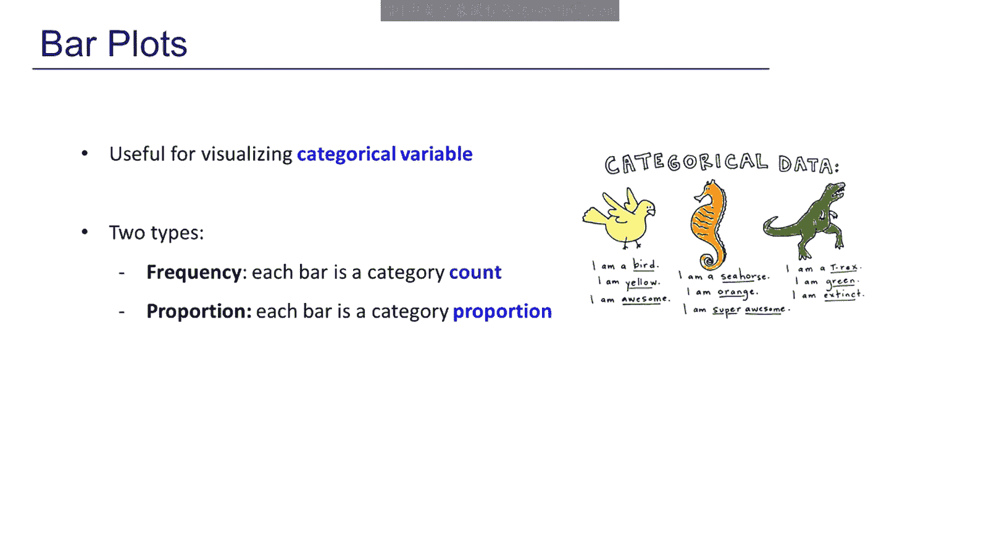
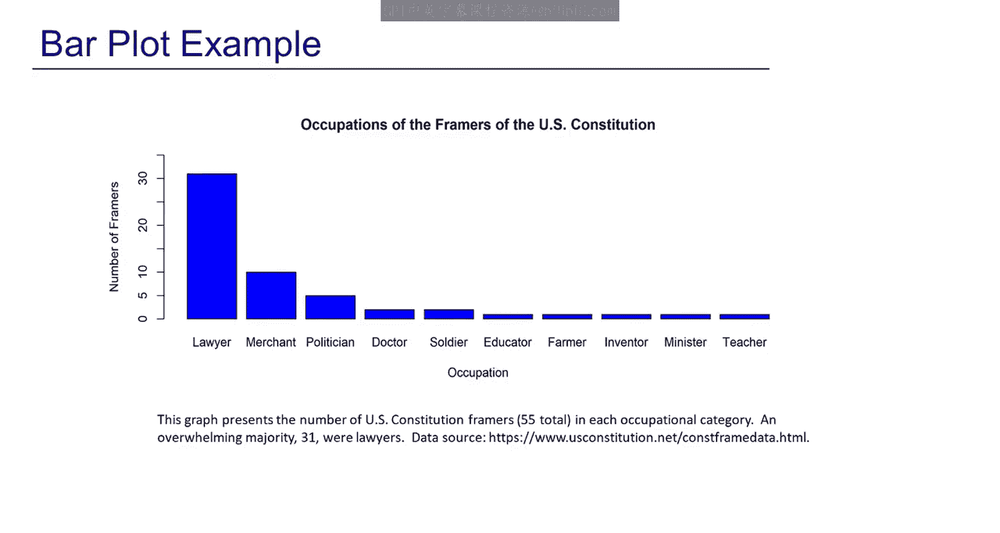
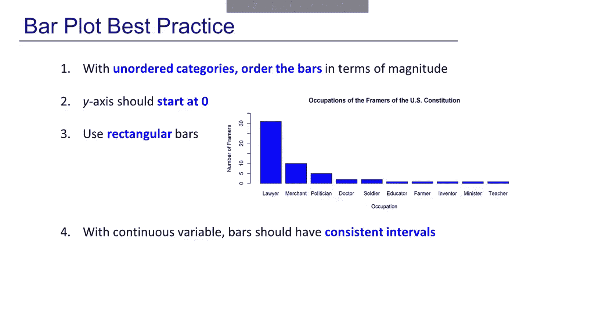
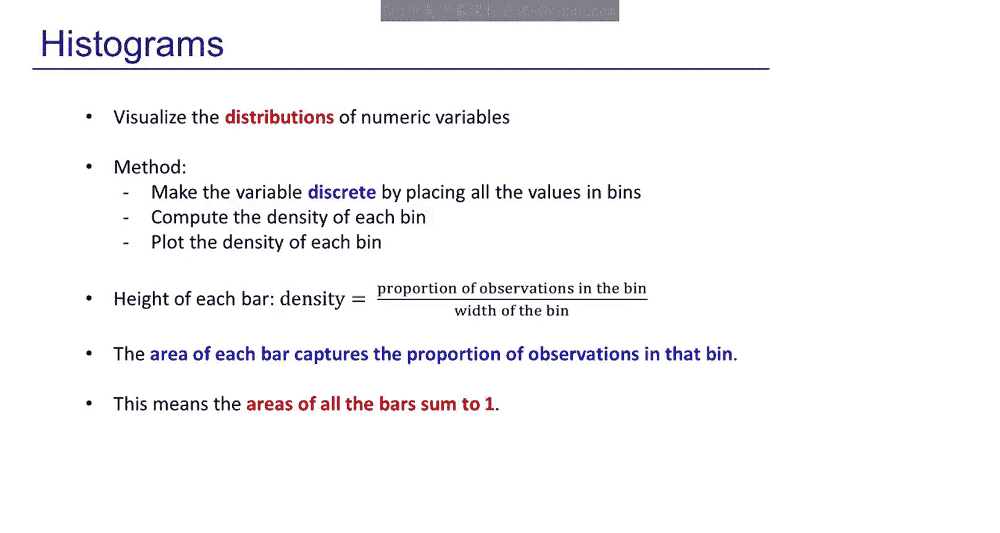
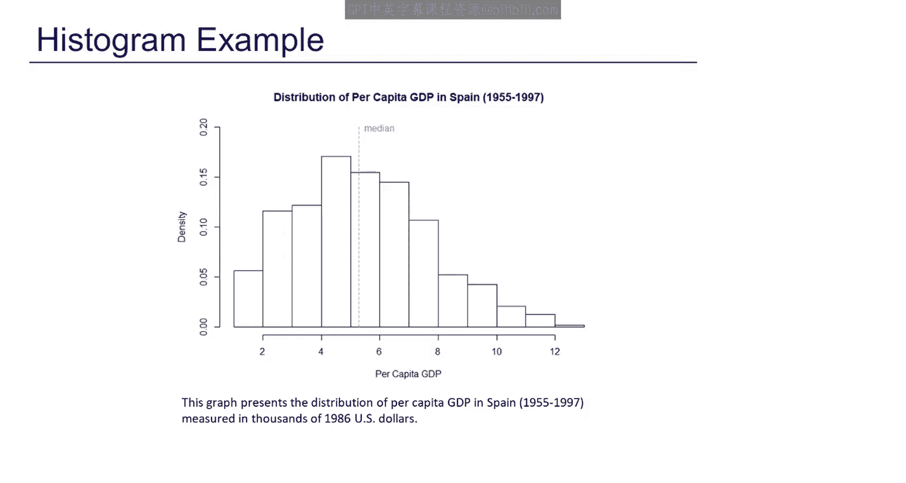
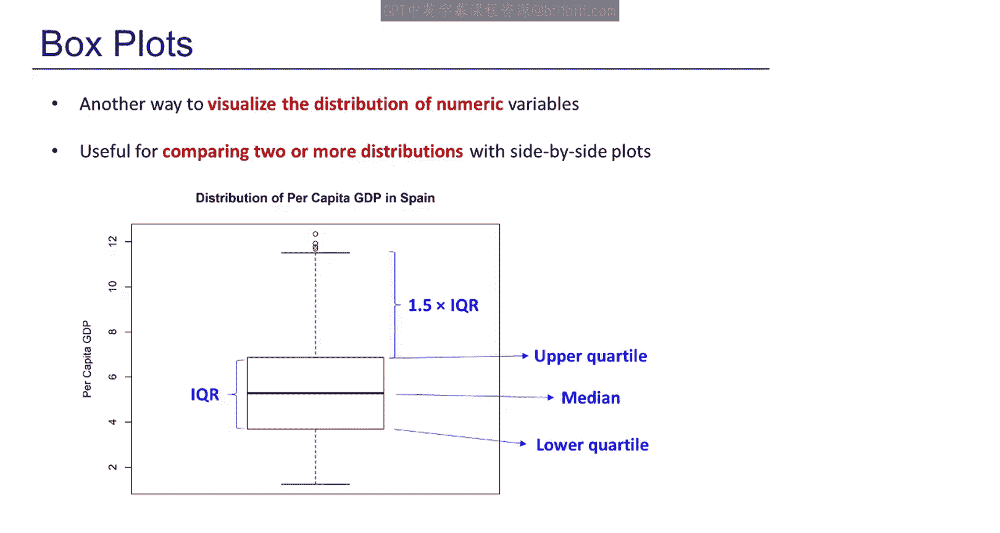
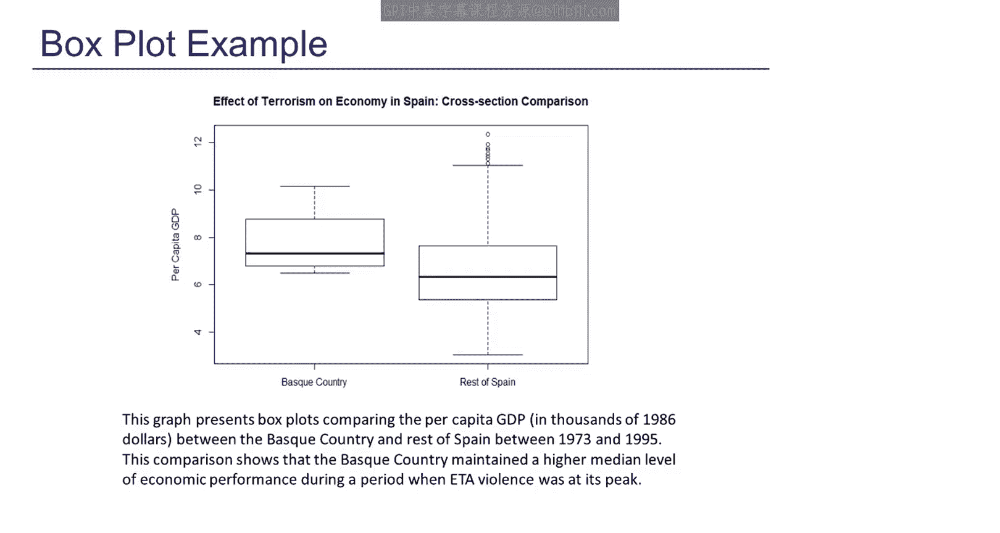

# 约翰霍普金斯大学《数据素养（数据⧸测量⧸回归⧸概率⧸毕业项目）｜Data Literacy》中英字幕（deepseek p14 13_条形图、直方图和箱线图.zh_en -BV1jXtMemEuh_p14-

Bar plots， histograms and box plots。Bar plots， histograms and box plots are three useful ways of visualizing Uniivariate data。

 By the end of this video， you should be able to interpret and evaluate these types of visualizations。

Bar plots。Bar plots are useful for visualizing categorical variables。 Va like gender， religion。

 political party identification and policy attitudes are frequently measured as categorical variables。

 For example， political party identification might have four categories， Republican， Democrat。

 independent and other。 The researcher typically constructs the categories as part of the research design。

There are two types of bar plots in a frequency bar plot， each bar is a category count。

 meaning each bar represents the number of units in each category in a proportion bar plot。

 each bar is a category proportion， meaning each bar represents the proportion of units that fall in each category of the variable。

Bar plot example This slide presents an example of a bar plot that shows the distribution of occupations held by the framers of the US Constitution。

Each bar shows the count of the number of framers that held that particular occupation。 For example。

 we can see that 31 of the 55 framers were lawyers。 Notice that the graph has a meaningful title。

 meaningful access labels， meaningful category labels， and an explanatory note at the bottom。

The explanatory note summarizes the main point of the graph。

Bar plot best practices。When designing and evaluating a bar plot。

 sometimes referred to as a bar chart， there are some important best practices to keep in mind。

 These guidelines ensure that the bar plot is easy to read and accurately reflects the underlying data。

First， if you are creating a bar plot with a variable that includes unordered categories。

 it is helpful to order the bars by their amount。 The graph on this slide is the same as the one on the previous slide。

 It shows the distribution of the occupations of the framers of the US Constitution。

There is no objective order to the occupation categories。

 so I've ordered the bars on the plot by their amount so the reader can easily see which occupations were held by the most framers and which occupations by the fewest。

Second， the Y axis should always start at 0。 bar plots that start with a baseline higher than 0 exaggerate the differences between categories。

Third， bar plots should use clean rectangular bars， avoid bars that have curved tops or 3D bars。

 it is difficult for a reader to compare bars in these cases。

 and a comparison of bar height is the purpose of a bar plot。

The graph on this slide adheres to these last two guidelines。

 the baseline is0 and the bars are rectangular。Fourth。

 if you are creating a barpl using a continuous variable。

 the intervals that you create should be consistent unless there is a very good reason to create inconsistently sized intervals。

 For example， imagine that you are creating a bar plot of birth weight to show the frequency of different weight categories for babies。

 It would be misleading to create one category that ranged from 5 to 51/ half and a second category that ranged from 51 a2 to 8。

 These intervals are not consistently sized。While these are not the only considerations。

 they are good guidelines to keep top of mind when creating and evaluating a barpl。

Histograms。A second type of plot that is useful for visualizing the distribution of a single variable is a histogram。

 This type of plot is useful for visualizing numerical or continuous variables。Variables like age。

 years of education， and temperature are examples of variables that are often visualized well with histograms。

To create a histogram， the first step is to make the variable discrete by placing the values into bins。

 The next step is to compute the density of each bin。

 which is equal to the proportion of observations in each bin divided by the width of the bin。

The last step is to plot the density of each bin。 The density is the height of each bar。In practice。

 of course， a statistical software package would perform these steps for you。

 though you can of course change the number of bins from the default。

The area of each bar in the histogram captures the proportion of observations that are in that bin。

 which means that the areas of all the bars sum to one。

As you'll recall back to when you learned calculus in high school or college。

 the area under a density curve sums to one。 A histogram is simply a density graph for discrete variables。

Histogram example。This slide presents a histogram that shows the distribution of real per capita GDP in Spain from 1955 to 1997。

 The height of each bar is the density of that bin。Note that there are clear access labels。

 an informative main title and an explanatory note below the graph。

Also note that the graph includes a dashed line that marks the median of the distribution。

 it can be helpful to add useful information like this to a graph。Overall。

 the graph allows the reader to easily visualize the center and spread of this per capita GDP variable。

Box plots。The third type of uvariate visualization that we'll discuss is the box plot。

 This is a useful plot for visualizing the spread of numeric variables。

It can be particularly useful for comparing two or more distributions side by side。

The box plot on this slide shows the distribution of per capita GDP in Spain measured in thousands of 1986 dollars。

 This is the same variable that was visualized as a histogram on the previous slide。

The box in the box plot contains 50% of the data ranging from the 25th percentile to the 75th percentile。

 The line in the center of the box represents the median value of the variable。

The dotted lines represent the data that fall within 1。

5 of the inter quartile range above the upper quartile and below the lower quartile。

The dots outside the ends of these dotted lines are the data that fall outside of that 1。

5 times IQR range。

Box plot example。As I mentioned， box plots can be useful for comparing two distributions。

 These two plots show the distribution of per capita GDP for the Basque region of Spain。

 as compared to the rest of Spain during the 1973 to 1995 time period。

This is the time period during which the ETA terrorist organization was extremely active in perpetrating terrible acts of violence。

By comparing the two plots we are conducting a cross section comparison。

 though here we are comparing the median values of per capita GDP rather than the mean values。

The plots show that the Basque region maintained a higher median level of economic performance during the time period under analysis。

 which on its face value would suggest that the E T terrorist activity did not negatively impact the Basque economy。

 Of course， we would want to perform a deeper analysis and control for relevant factors。

 before drawing this conclusion。Nonetheless， a box plot comparison can provide a useful snapshot of the data at hand and allow us to compare the distributions of two variables。

