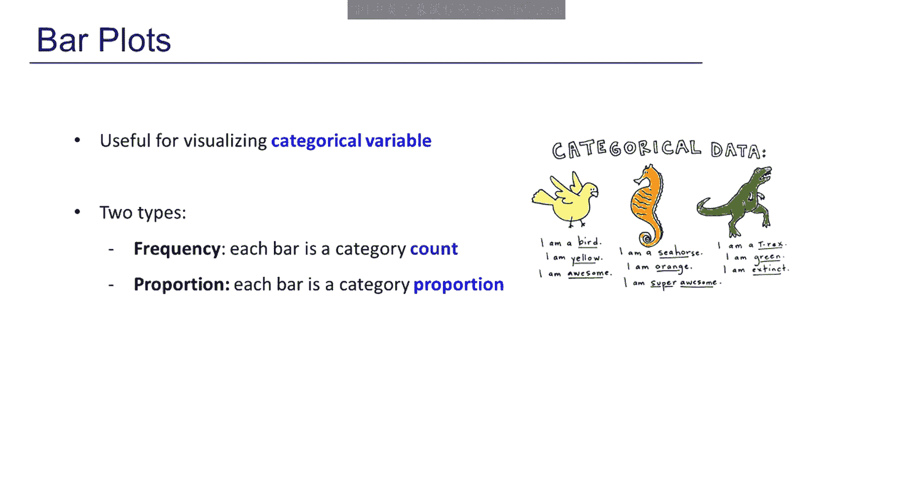
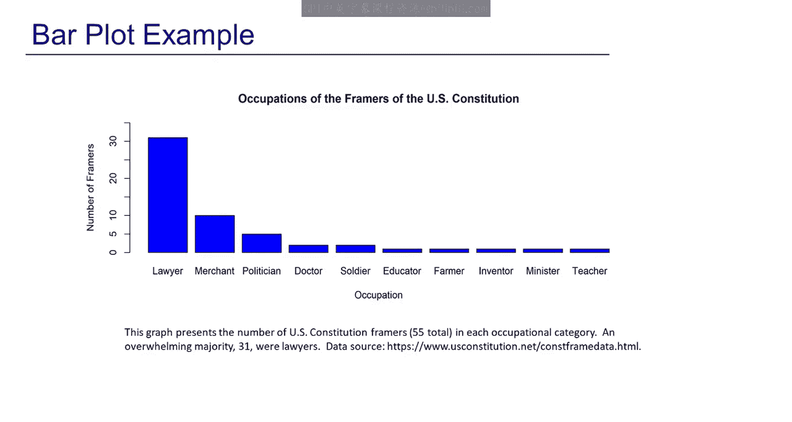
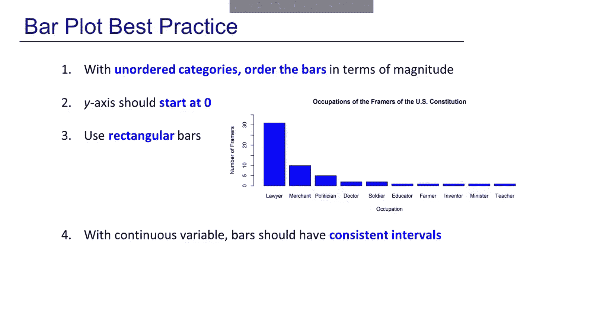
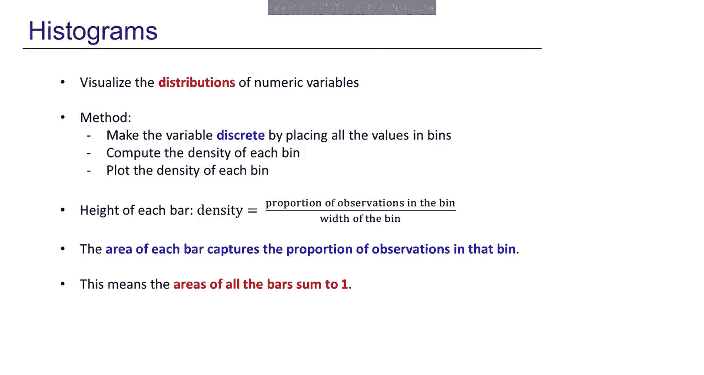
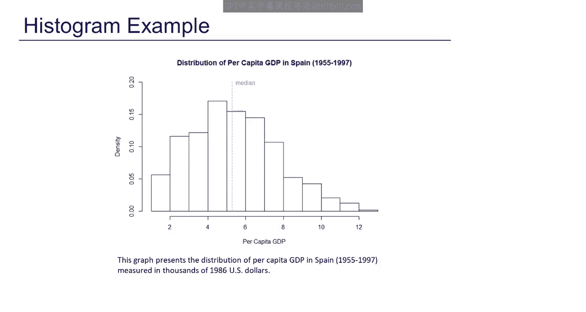
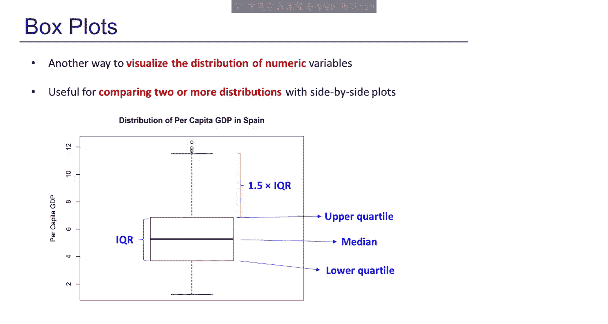
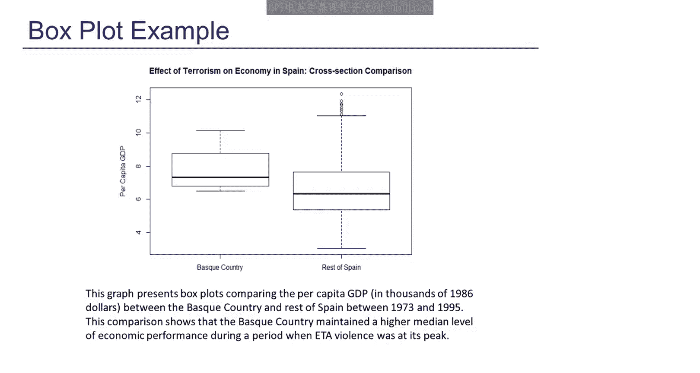

# 数据素养：P14：条形图、直方图和箱线图 📊

在本节课中，我们将要学习三种用于可视化单变量数据的重要图表：条形图、直方图和箱线图。通过学习，你将能够解读和评估这些类型的可视化图表。

## 条形图

条形图适用于可视化分类变量。像性别、宗教、政党认同和政策态度等变量通常被测量为分类变量。例如，政党认同可能有四个类别：共和党、民主党、独立人士和其他。研究者通常在研究设计中构建这些类别。

条形图有两种类型：在频数条形图中，每个条形代表一个类别的计数，即每个条形表示每个类别中的单位数量；在比例条形图中，每个条形代表一个类别的比例，即每个条形表示落在变量每个类别中的单位比例。

以下是条形图的一个示例。这张幻灯片展示了一个条形图示例，显示了美国宪法制定者的职业分布。每个条形显示了从事该特定职业的制定者数量。例如，我们可以看到55位制定者中有31位是律师。请注意，该图表有一个有意义的标题、有意义的坐标轴标签、有意义的类别标签，以及底部的解释性说明。该说明总结了图表的主要观点。

在设计或评估条形图（有时也称为条形图）时，有一些重要的最佳实践需要牢记。这些准则确保条形图易于阅读并准确反映基础数据。

以下是条形图的最佳实践指南：
*   **排序**：如果你创建的条形图包含无序类别，按数量对条形进行排序会很有帮助。本幻灯片上的图表与上一张幻灯片上的图表相同，显示了美国宪法制定者的职业分布。职业类别没有客观的顺序，因此我按数量对图表上的条形进行了排序，以便读者可以轻松地看到哪些职业的制定者最多，哪些职业的制定者最少。
*   **Y轴起点**：Y轴应始终从0开始。基线高于0的条形图会夸大类别之间的差异。
*   **条形样式**：条形图应使用简洁的矩形条。避免使用顶部弯曲的条形或3D条形，在这些情况下，读者很难比较条形，而比较条形高度正是条形图的目的。本幻灯片上的图表遵循了后两条准则：基线为0，且条形是矩形的。
*   **区间一致性**：如果你使用连续变量创建条形图，你创建的区间应该保持一致，除非有非常充分的理由创建大小不一致的区间。例如，假设你正在创建一个出生体重的条形图，以显示婴儿不同体重类别的频率。创建一个范围从5磅到5.5磅的类别，以及第二个范围从5.5磅到8磅的类别，这是具有误导性的。这些区间的大小不一致。

虽然这些并非唯一的考虑因素，但它们是创建和评估条形图时需要牢记的良好准则。

## 直方图

第二种用于可视化单个变量分布的有用图表是直方图。这种图表适用于可视化数值型或连续变量。像年龄、受教育年限和温度等变量，通常用直方图可以很好地可视化。

要创建直方图，第一步是通过将数值放入箱中来使变量离散化。下一步是计算每个箱的密度，其等于每个箱中观测值的比例除以箱的宽度。最后一步是绘制每个箱的密度。密度就是每个条形的高度。当然，在实践中，统计软件包会为你执行这些步骤，不过你当然可以更改默认的箱数。

直方图中每个条形的面积表示落在该箱中的观测值比例，这意味着所有条形的面积之和为一。正如你在高中或大学学习微积分时所回忆的那样，密度曲线下的面积之和为一。直方图本质上就是离散变量的密度图。

以下是直方图的一个示例。这张幻灯片展示了一个直方图，显示了西班牙从1955年到1997年人均实际GDP的分布。每个条形的高度是该箱的密度。请注意，图表有清晰的坐标轴标签、信息丰富的主标题以及图表下方的解释性说明。同时注意，图表包含一条虚线，标记了分布的中位数。在图表中添加此类有用信息会很有帮助。总体而言，该图表使读者能够轻松地可视化该人均GDP变量的中心和分布范围。

## 箱线图

我们将讨论的第三种单变量可视化图表是箱线图。这是一种用于可视化数值变量分布范围的有用图表。它特别适用于并排比较两个或多个分布。

本幻灯片上的箱线图显示了西班牙人均GDP的分布，以1986年千美元为单位。这与上一张幻灯片中可视化为直方图的变量相同。箱线图中的箱子包含了50%的数据，范围从第25百分位数到第75百分位数。箱子中心的线代表变量的中位数值。虚线代表落在上四分位数以上和下四分位数以下1.5倍四分位距范围内的数据。这些虚线末端之外的点是落在该1.5倍IQR范围之外的数据。

正如前面提到的，箱线图可用于比较两个分布。这两个图表显示了西班牙巴斯克地区与西班牙其他地区在1973年至1995年期间人均GDP的分布。这一时期正是ETA恐怖组织实施可怕暴力行为极为活跃的时期。通过比较这两个图表，我们正在进行横截面比较，不过这里我们比较的是人均GDP的中位数值，而非平均值。图表显示，在所分析的时间段内，巴斯克地区保持了较高的经济表现中位数水平，这从表面上看表明ETA的恐怖活动并未对巴斯克经济产生负面影响。当然，在得出这个结论之前，我们需要进行更深入的分析并控制相关因素。尽管如此，箱线图比较可以提供数据的有用概览，并允许我们比较两个变量的分布。

## 总结

本节课中我们一起学习了三种核心的单变量数据可视化方法：条形图、直方图和箱线图。条形图适用于展示分类变量的分布，直方图用于展示连续变量的密度分布，而箱线图则能清晰地展示数值变量的分布范围和中位数等关键统计量。掌握这些图表的解读和创建原则，是进行有效数据分析和沟通的重要基础。