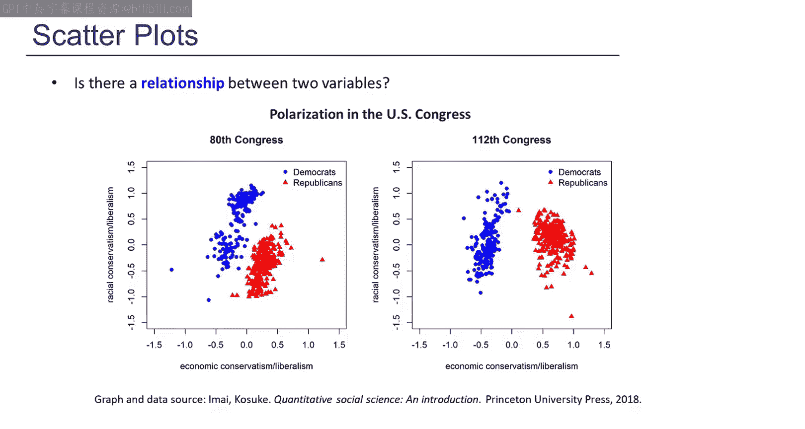
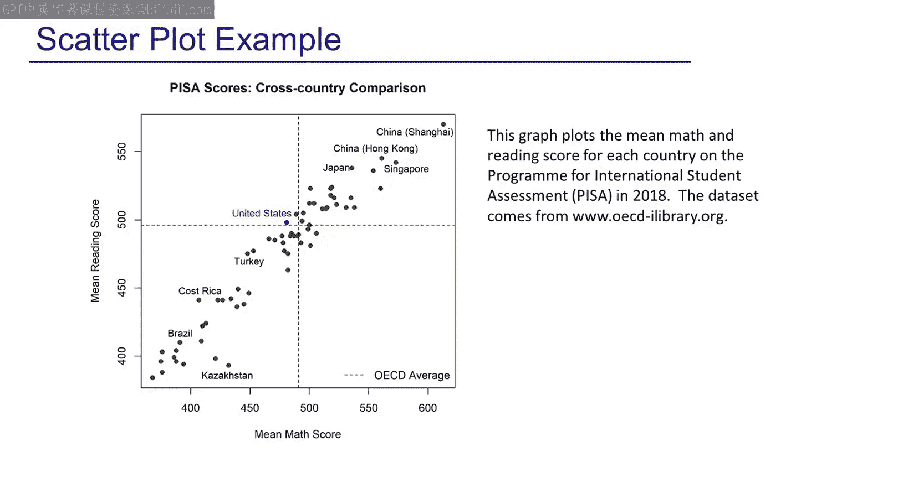
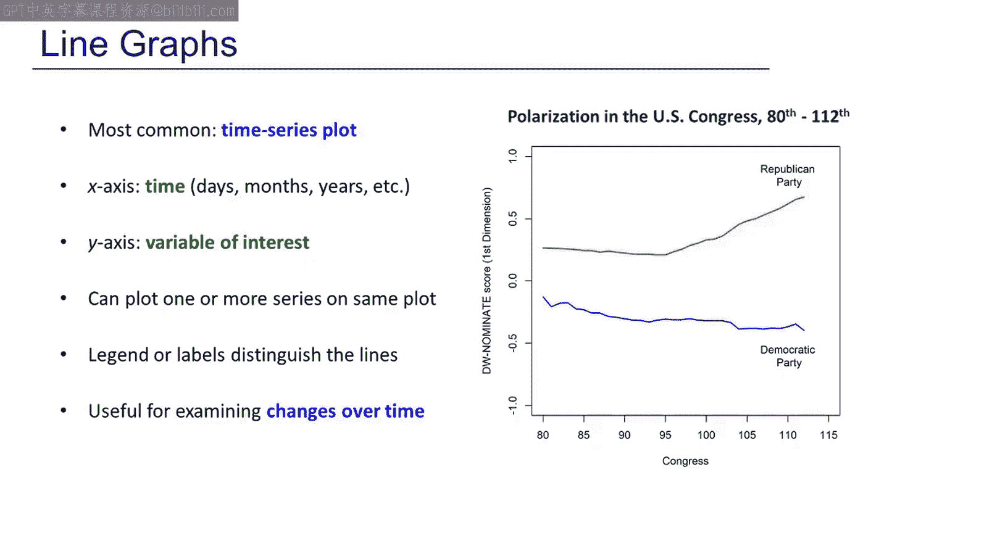
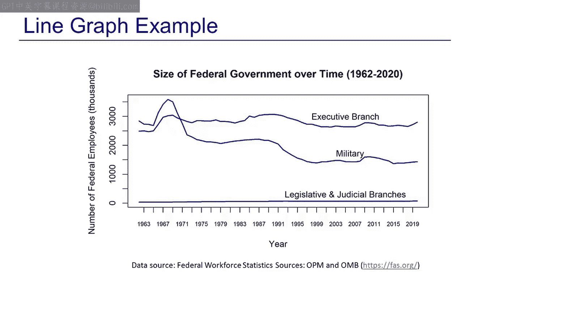
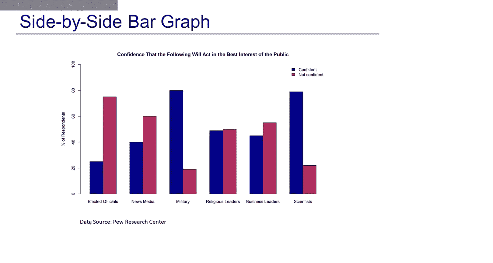
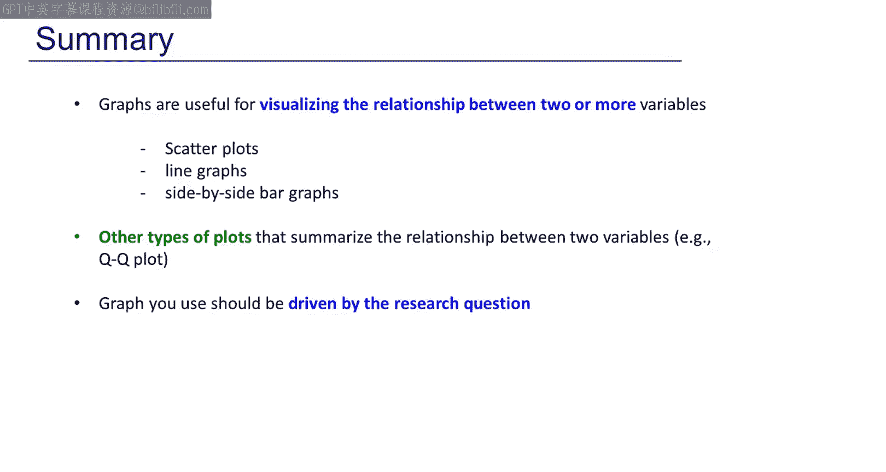

# 约翰霍普金斯大学《数据素养（数据⧸测量⧸回归⧸概率⧸毕业项目）｜Data Literacy》中英字幕（deepseek p15 14_散点图、折线图和并列条形图.zh_en -BV1jXtMemEuh_p15-

Scatter plots， line graphs and side by sidebar plots。

If your goal is to examine the relationship between two variables。

 you'll need to use a bivariate visualization tool。 By the end of this video。

 you should be able to interpret and evaluate several different bivariate visualization tools。

 including scatter plots， line graphs and side by side bar plots。

Scatter plots， I'm sure you've come across many scatter plots as they are widely used to display the relationship between two variables because they are impactful and easy to interpret。

In a scatter plot， one variable is plotted along the X axis。

 and the other variable is plotted along the Y axis。

 The graph visualizes the relationship between the two variables。

This slide presents two scatter plots to visualize polarization in the U。S Congress。

In the graph on the left， the racial liberal slash conservative scale is on the Y axis。

 and the economic liberal slash conservative scale is on the X axis。

This graph plots the distribution of Democratic members in blue and Republican members in red for the 80th Congress。

 which was from 1947 to 1948。There is certainly some variation within both parties。

 but the party clouds are fairly close to each other。

The graph on the right shows these distributions for the 112th Congress， which was from 2011 to 2012。

 over 60 years later。There are two important observations to make。

 The first is that the racial liberal slash conservative dimension is no longer an important factor in distinguishing Republicans from Democrats in the 112 Congress。

 The parties are similarly distributed along this dimension。

The second observation is that the parties are further apart on the economic liberal slash conservative dimension than previously。

Thus， the plots present evidence that the parties have become polarized with respect to this dimension in this particular comparison。

Taken together， the graphs provide insight into the way in which political polarization has developed in the U。

S Congress over time。

Scatter plot example。 This slide presents another example of a scatter plot。

 The graph titled Pisa scoreses cross country comparison presents the mean reading score for each country against the mean math score for each country。

 Psa is an international assessment that measures students' ability in reading。

 math and science every three years。The graph shows a strong relationship between a country's mean reading score and mean math score。

 indicating that students who perform well in one subject area are likely to also perform well in other subject areas。

 The graph also highlights the variation among countries in terms of their performance。

 Countries such as China， Japan and Singapore report the highest mean scores。

The dashed lines indicate the average scores among OECD countries。

 which are a group of 34 democratic countries with free market economies。

Notice that the US falls very close to the OECD reading and math averages。

Line graph， you might instead choose to use a line graph to visualize the relationship between two variables。

 The most common type of line graph is a time series plot。With a time series plot。

 time is plotted along the X axis。 time can be measured in a variety of ways， such as days。

 months or years。The Y axis plots a variable of interest。

You can imagine measuring nearly anything over time， such as health， trust in government。

 access to public transportation or air quality。You can plot multiple series on one time series plot to compare them when doing this。

 it's of course， important to either include a legend or labels to let the reader know which line refers to which series。

Overall， time series plots are valuable for examining changes in a variable over time and how changes for different variables compare to each other。

The example on the right shows the average DW nomininate score。

 which is a measure of political ideology for the Republican and Democratic parties in the US over time。

Notice that the lines diverge over time， which aligns with the pattern we observed on the previous scatter plots。

 This is therefore another way of displaying an increase in political polarization over time between the two parties。

Line graph example。 This slide presents another example of a line graph。

 This graph plots the size of the US federal government from 1962 through 2020。

 You can see that each line represents one sector of the federal government， the executive branch。

 which includes the Office of the president and all  employees of executive agencies。

 the military and those employed by both the legislative and judicial branches。

There are several notable observations。 First， it's striking how small the legislative and judicial branches are in size as compared to the executive branch。

 Many US citizens don't realize how few employees are working in these critical branches of government。

Second， you can see that the size of the federal government has changed somewhat over time。

 with a large increase in military employment during the Vietnam War and a relative decline in military employment since then。

Side by side， bar graph。In the video on Uniivariate relationships。

 we discussed how a bar plot can be used to display the distribution of a single categorical variable。

We can also use bar graphss， however， to display multiple variables using side by side bars。

This graph compares the percentage of survey respondents who feel confident versus not confident that various groups of leaders will act in the best interest of the public。

 The Navy blue bars show the percentage of survey respondents who expressed confidence in various groups of leaders。

 while the maroon bars show the percentage of survey respondents who indicated that they are not confident。

We see， for example， that the public expressed a high level of confidence that military leaders and scientists act in the best interest of the public。

 while the public has reservations that elected officials and the news media act in its best interest。

Summary to summarize， this video has focused on how graphs can be useful for visualizing the relationship between two or more variables。

 We discussed the different features of scatter plots。

 line graphs and side by side bar graphs for comparing different variables。There are， of course。

 other types of plots that are useful for comparing variables， such as QQ plots。

 which plot the quantiles of two variables against each other。In general。

 the particular graph you use should be driven by your research question and the point you want to make to your reader。

If you're trying to make an argument about changes over time， a line graph is likely the way to go。

If you're trying to demonstrate that two categorical variables have very different distributions。

 a side by side bar graph is likely the best option。This is a recurring theme。

 The statistical method or visualization tool you select should always be driven by the substantive question you're asking or the key point that you're trying to highlight for your reader。

