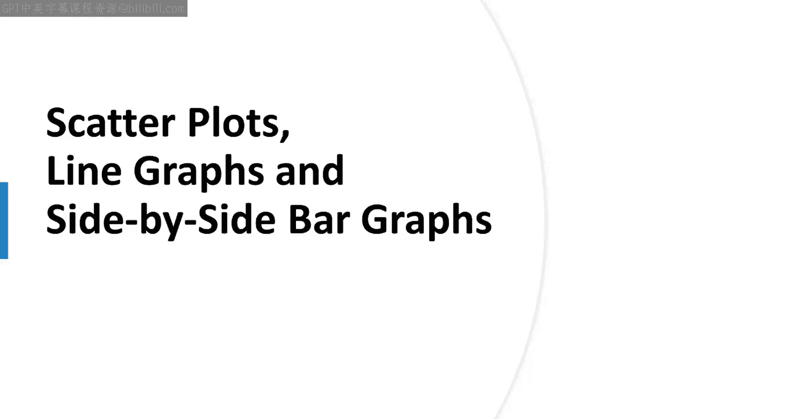
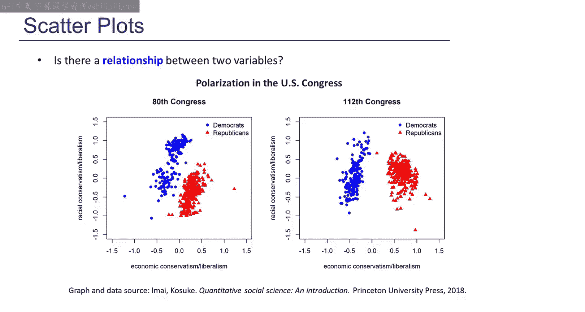
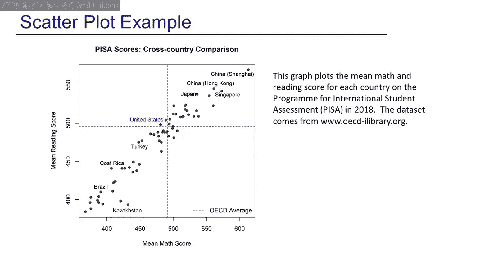
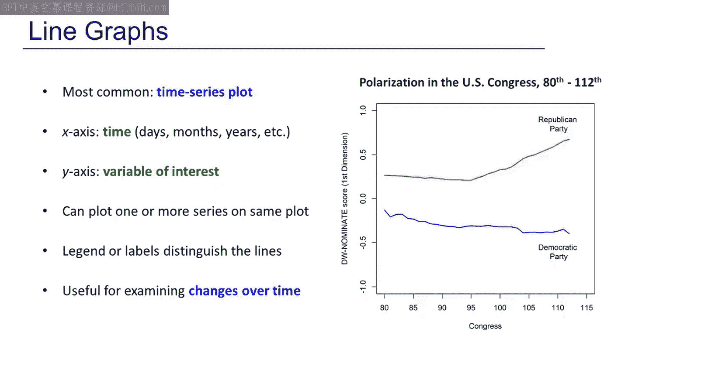
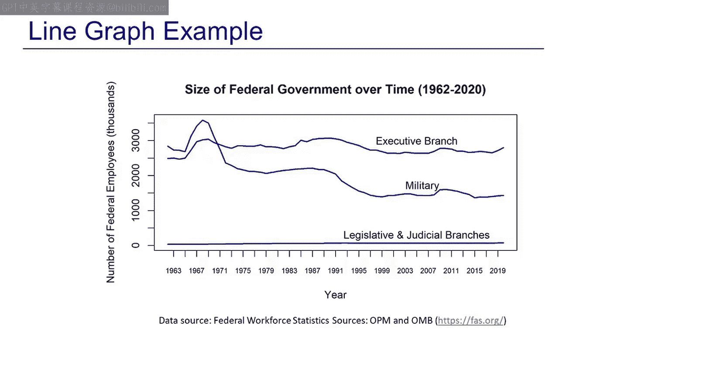
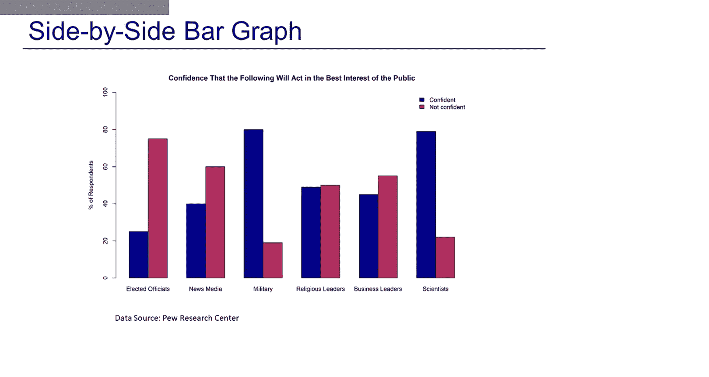
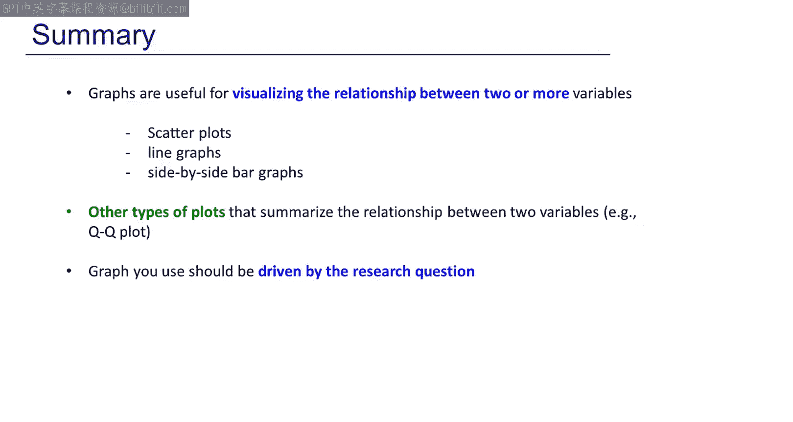

# 数据素养：14：散点图、折线图与并列条形图 📊

在本节课中，我们将学习如何利用三种主要的双变量可视化工具——散点图、折线图和并列条形图——来探索和展示两个变量之间的关系。掌握这些工具将帮助你更清晰地解读数据模式，并有效地向读者传达你的发现。

## 散点图

上一节我们介绍了双变量可视化的目标。本节中，我们来看看最常用的工具之一：散点图。散点图被广泛用于展示两个变量之间的关系，因为它效果直观且易于解读。

在散点图中，一个变量沿 **X轴** 绘制，另一个变量沿 **Y轴** 绘制。图形直观地展示了两变量之间的关系。

以下幻灯片展示了两幅用于可视化美国国会政治极化的散点图。

*   在左侧图表中，Y轴是种族自由/保守尺度，X轴是经济自由/保守尺度。
*   该图用蓝色点绘制了第80届国会（1947-1948年）民主党成员的分布，用红色点绘制了共和党成员的分布。
*   两党内部都存在一定差异，但两党的点云分布彼此相当接近。

右侧图表展示了60多年后，第112届国会（2011-2012年）的成员分布。我们可以得出两个重要观察：

1.  在种族自由/保守维度上，两党的分布相似，表明该维度在第112届国会中不再是区分两党的重要因素。
2.  两党在经济自由/保守维度上的距离比之前更远。

因此，这些图表提供了证据，表明在此特定比较中，两党在该维度上变得更为极化。综合来看，这些图表揭示了美国国会政治极化随时间发展的方式。

## 散点图示例

现在，让我们通过另一个例子来加深对散点图的理解。

这张幻灯片展示了另一个散点图示例。标题为“PISA分数跨国比较”的图表，将每个国家的平均阅读分数与平均数学分数进行对比。PISA是一项每三年进行一次的国际评估，用于衡量学生在阅读、数学和科学方面的能力。

该图表显示了一个国家的平均阅读分数与平均数学分数之间存在强相关关系，这表明在一个学科领域表现良好的学生，很可能在其他学科领域也表现良好。图表还突出了各国在表现上的差异，例如中国、日本和新加坡报告了最高的平均分数。

图中的虚线表示经合组织（OECD）国家的平均分数，这是一个由34个民主国家和自由市场经济体组成的团体。值得注意的是，美国的分数非常接近OECD的阅读和数学平均水平。

## 折线图

除了散点图，你还可以选择使用折线图来可视化两个变量之间的关系。最常见的折线图类型是时间序列图。

在时间序列图中，时间沿 **X轴** 绘制。时间可以用多种方式衡量，例如天、月或年。**Y轴** 则绘制感兴趣的变量。你可以想象测量几乎任何随时间变化的事物，例如健康状况、对政府的信任度、公共交通可达性或空气质量。

你可以在一个时间序列图上绘制多个序列以进行比较。当然，这样做时，必须包含图例或标签，让读者知道每条线对应哪个序列。

总的来说，时间序列图对于检查变量随时间的变化以及不同变量的变化如何相互比较非常有价值。

右侧的示例展示了美国共和党和民主党随时间变化的平均DW-NOMINATE分数（一种政治意识形态的度量）。请注意，两条线随时间推移而分叉，这与我们在之前散点图中观察到的模式一致。因此，这是展示两党间政治极化随时间加剧的另一种方式。

## 折线图示例

为了更具体地理解折线图的应用，我们来看另一个例子。

这张幻灯片展示了另一个折线图示例。该图绘制了从1962年到2020年美国联邦政府的规模。你可以看到每条线代表联邦政府的一个部门：行政部门（包括总统办公室和所有行政机构雇员）、军队，以及立法和司法部门的雇员。

有几个值得注意的观察结果：

1.  与行政部门相比，立法和司法部门的规模之小令人惊讶。许多美国公民没有意识到在这些关键的政府部门工作的雇员如此之少。
2.  你可以看到联邦政府的规模随时间发生了一些变化，在越南战争期间军事就业大幅增加，而此后军事就业相对下降。

## 并列条形图

在关于单变量关系的视频中，我们讨论了如何使用条形图来显示单个分类变量的分布。然而，我们也可以使用条形图，通过并列的条形来显示多个变量。

这个图表比较了认为不同群体的领导者会/不会为公众利益行事的调查受访者百分比。海军蓝色条形表示对各类领导者有信心的受访者百分比，而栗色条形表示表示没有信心的受访者百分比。

例如，我们看到公众对军队领导人和科学家为公众利益行事表达了高度信心，而对民选官员和新闻媒体是否为其利益行事则持保留态度。

## 总结

本节课中，我们一起学习了图表如何有助于可视化两个或多个变量之间的关系。我们讨论了散点图、折线图和并列条形图在比较不同变量时的不同特点。

当然，还有其他类型的图表可用于比较变量，例如 **QQ图**（它将两个变量的分位数相互对照绘制）。一般来说，你使用的具体图表应由你的研究问题以及你想向读者传达的观点所驱动。

*   如果你试图论证随时间的变化，折线图可能是最佳选择。
*   如果你试图证明两个分类变量具有非常不同的分布，并列条形图可能是最佳选择。

这是一个反复出现的主题：你选择的统计方法或可视化工具，应始终由你所提出的实质性问题或你试图向读者强调的关键点所驱动。