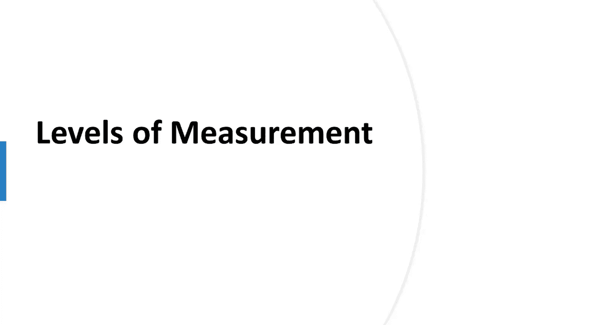
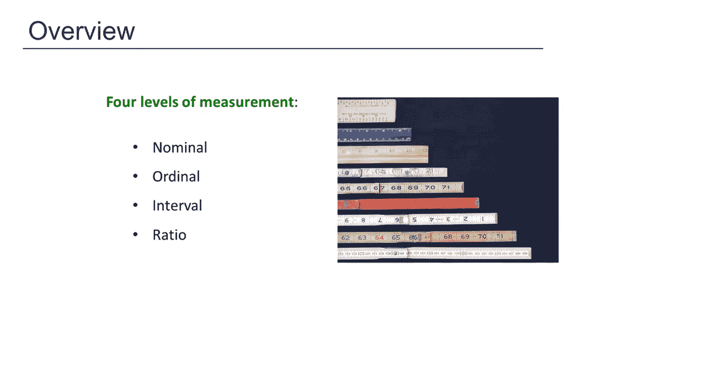
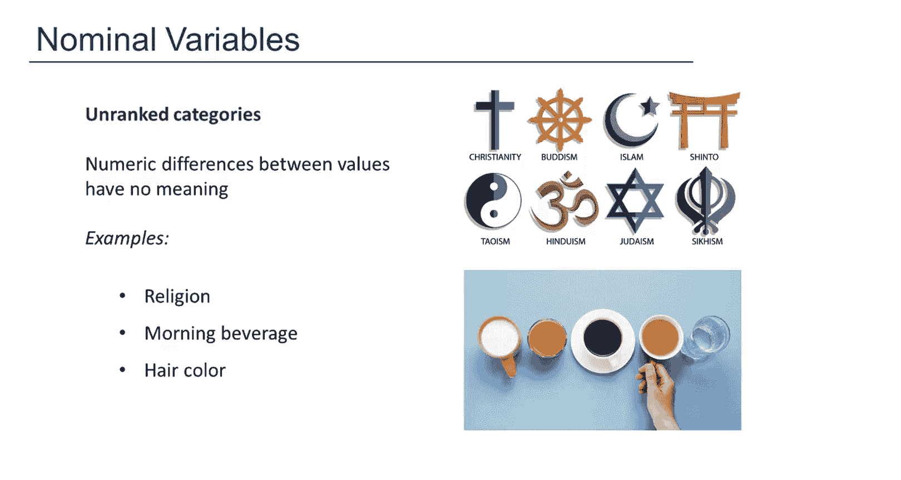
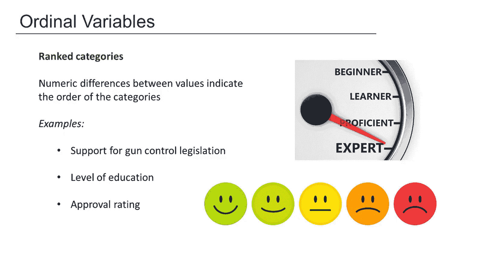
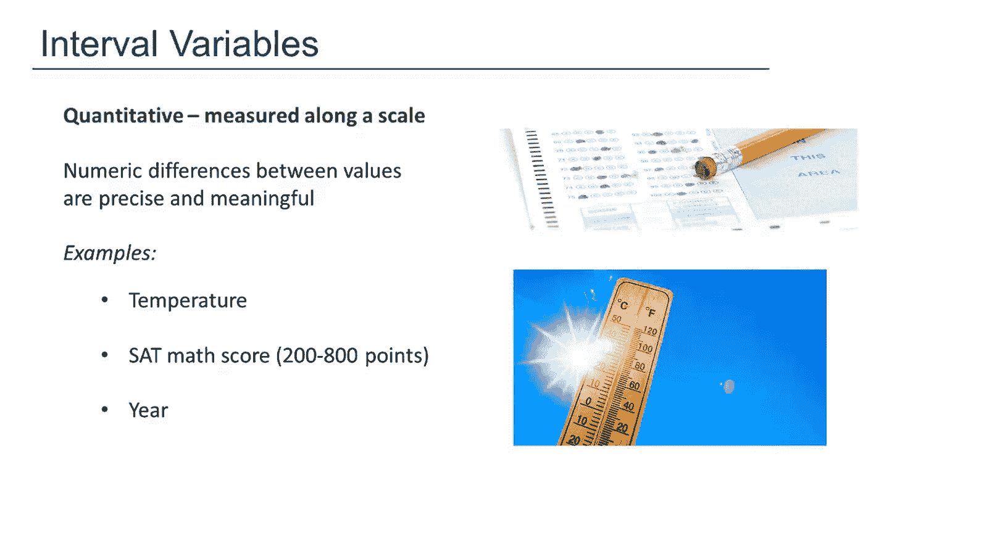
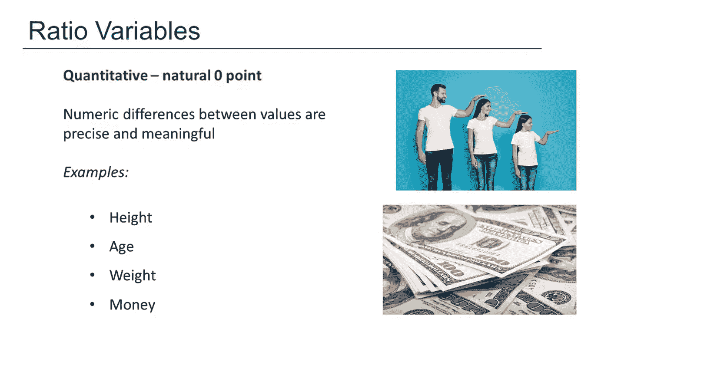

# 约翰霍普金斯大学《数据素养（数据⧸测量⧸回归⧸概率⧸毕业项目）｜Data Literacy》中英字幕（deepseek p17 1_测量水平.zh_en -BV1jXtMemEuh_p17-

Levels of measurement。Generally speaking， we think of variables as being either categorical or continuous。

 meaning the values are either qualitative or quantitative In this video。

 I'll introduce more precise ways to define variable types。

 These definitions refer to the way in which a variable is measured in order to apply the appropriate statistical method to a variable or set of variables。

 The researcher must understand the level at which those variables are measured。

 By the end of this video， you should be able to determine the level of measurement for a given variable。

Overview， there are four levels of measurement， nominal， ordinal， interval and ratio。

 Every variable should fall into one of these categories。 Often。

 the researcher determines the way in which to measure a concept of interest。

 such as education or exercise。In other words， it is usually the case that a concept can be measured in several ways。

 and the researcher makes a measurement decision based both on what information is needed to answer the research question and what is practical。

Nominal variables， a nominal variable is one with values that indicate unranked categories。

 The variable religion， for example， is a nominal variable。

 Suppose we create a religion variable that can take on the following values。 Christian， Jewish。

 Muslim， Hindu and other。 There is no objective order to these categories。

 It is helpful to assign numeric values to these categories。 but this is for the purpose of cleaning。

 manipulating and summarizing the data using a statistical software program。

 It does not mean that the numerical distance between each category has any meaning。

Suppose we assign the following numerical values to the religious affiliations。

 Christian would be assigned one， Jewish 2， Moslem 3， Hindu，4 and other 5。

These numbers might help us generate summary statistics and graphs in a software program。

 but they don't mean， for example， that Hinduism is twice as big as Judaism。

Other examples of nominal variables include a survey respondent's favorite morning beverage or hair color。

 the categories that you would create for these variables are unranked and there is no meaningful numeric distance between the categories。

Ordinal variables。An ordinal variable is one in which the values are ranked categories。

 In other words， for these variables， the numeric differences between values indicate the order of the categories。

 Imagine creating a gun control variable with the following values。 strongly support one。

 moderately support 2， moderately oppose 3 and strongly oppose 4。

 These categories have a clear objective order。 Again。

 we would want to assign these categories numerical values to generate summary statistics and graphs。

 While these numbers would indicate the order of the categories。

 the distance between the numbers would not have any meaning。

Other examples of ordinal variables include level of education where the categories might be less than a high school degree。

 high school degree， some college， college degree， etc， and a survey respondent's approval rating。

 such as an approval rating of an elected official。

 government program or customer service experience。

Interval variables。 interval variables are ones in which the numerical values are meaningful in a mathematical sense。

 They are inherently quantitative variables where the values are measured along a scale。

 The numeric differences between the values are precise and meaningful。

Common examples of interval variables include temperature， standardized test scores and year。

 The numeric distances between the values of these variables is meaningful。 For example。

 supposeose you are comparing the difference in feeling between an 80 degree Fahit day and a 20 degree day。

 The 60 degree difference is meaningful。60 degrees is a meaningful amount of temperature。

Or consider year， a difference of five years is a meaningful amount；

 years are measured along a quantitative scale of time。

Ratadio variables。 Lastly， ratio variables are quantitative as well。

 but these variables have a natural zero point。 An implication of this characteristic is that the ratio of 2 values of the variable is meaningful。

 Consider height， for example， Someone who is 6 feet tall is twice as tall as someone who is 3 feet tall。

Other examples of ratio variables include age， weight and money。

 Notice that the ratios of values of all of these variables are meaningful。$100， for example。

 is $10 times the amount of $10。Compare this property to interval variables。

 50 degrees is not twice as hot as 25 degrees， because temperature does not have an inherent zero point。

You can't have no temperature in the same way that something can have zero height or cost zero dollars。

Once you have a firm understanding of how to determine a variable's level of measurement。

 you'll be able to use the right statistical methods to analyze that variable。

