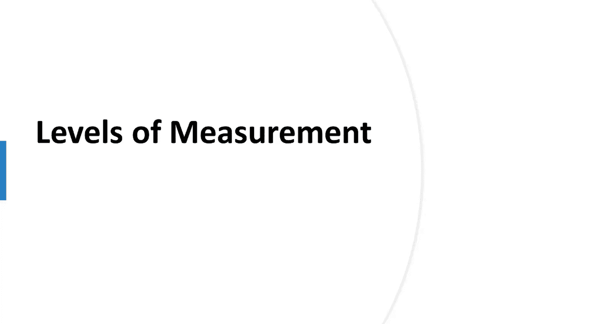
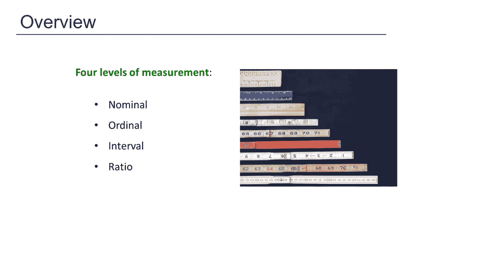
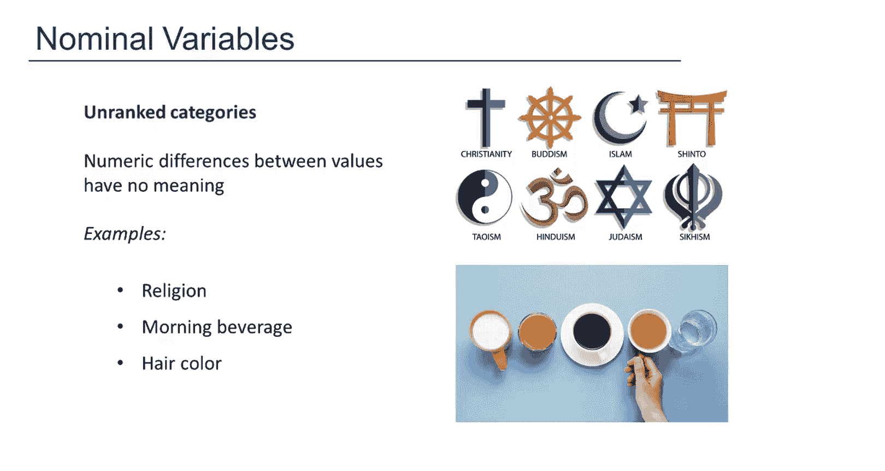
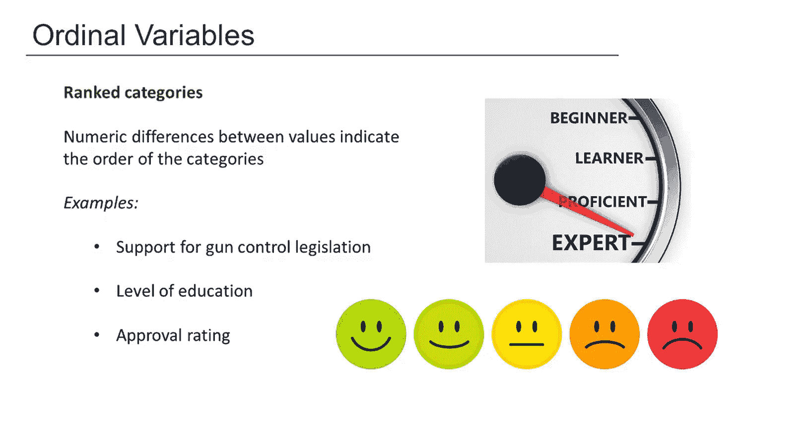
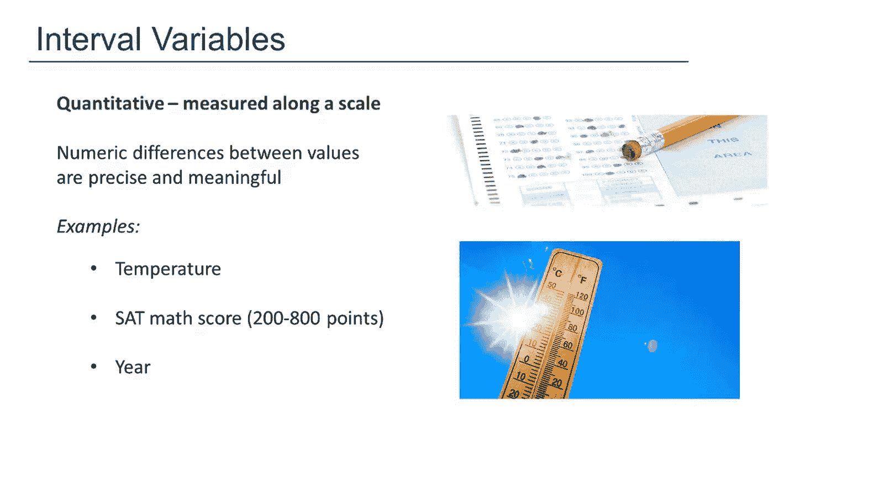
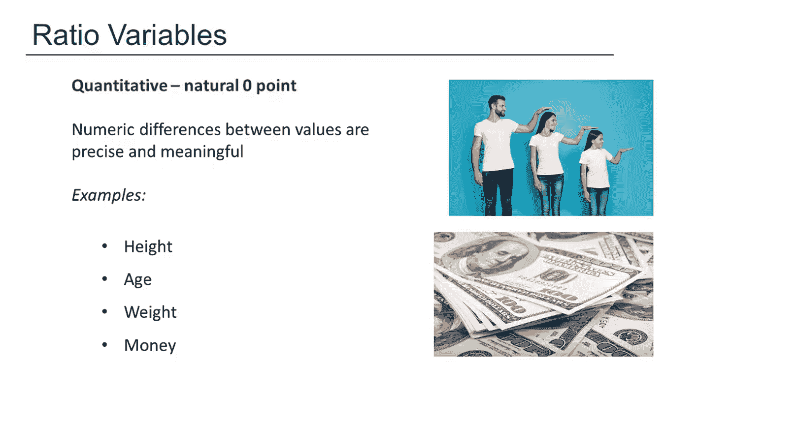

# 数据素养：1：测量水平 📊

在本节课中，我们将学习变量的测量水平。理解变量的测量水平对于选择正确的统计分析方法至关重要。我们将介绍四种主要的测量水平：定类、定序、定距和定比。

## 概述

变量通常被分为分类变量或连续变量，这意味着其取值是定性的或定量的。为了对变量或变量组应用适当的统计方法，研究者必须理解这些变量的测量水平。通过本课的学习，你将能够确定给定变量的测量水平。

测量水平共有四种：定类、定序、定距和定比。每个变量都应归属于其中一类。通常，研究者决定如何测量感兴趣的概念（如教育或锻炼）。换句话说，一个概念通常可以有多种测量方式，研究者根据回答研究问题所需的信息以及实际可行性来做出测量决策。

## 定类变量

定类变量的取值表示**无排序**的类别。变量“宗教信仰”就是一个定类变量。

假设我们创建一个宗教信仰变量，其取值可以是：基督教、犹太教、穆斯林、印度教、其他。这些类别之间没有客观的顺序。为这些类别分配数值有助于使用统计软件程序进行数据清理、操作和汇总，但这并不意味着类别之间的数值距离有任何意义。

以下是宗教信仰的数值分配示例：
*   `基督教 = 1`
*   `犹太教 = 2`
*   `穆斯林 = 3`
*   `印度教 = 4`
*   `其他 = 5`

这些数字可以帮助我们在软件中生成汇总统计数据和图表，但它们并不意味着，例如，印度教是犹太教的两倍大。

其他定类变量的例子包括：受访者最喜欢的早餐饮品或头发颜色。为这些变量创建的类别是无序的，类别之间没有有意义的数值距离。

## 定序变量

上一节我们介绍了无排序的定类变量，本节中我们来看看定序变量。定序变量的取值是**有排序**的类别。换句话说，对于这些变量，数值之间的差异表明了类别的顺序。

想象创建一个枪支管制态度变量，其取值如下：
*   `强烈支持 = 1`
*   `中度支持 = 2`
*   `中度反对 = 3`
*   `强烈反对 = 4`

这些类别有明确的客观顺序。同样，我们会希望为这些类别分配数值以生成汇总统计数据和图表。虽然这些数字能表明类别的顺序，但数字之间的距离没有任何意义。

其他定序变量的例子包括：
*   **教育水平**：类别可能是“低于高中学历”、“高中学历”、“一些大学教育”、“大学学历”等。
*   **受访者的认可度评级**：例如对民选官员、政府项目或客户服务体验的认可度评级。

## 定距变量

我们已经了解了定类和定序这两种分类变量，现在转向连续变量。定距变量是其数值在数学意义上具有意义的变量。它们是固有的定量变量，其值在尺度上测量。数值之间的差异是精确且有意义的。

定距变量的常见例子包括温度、标准化考试成绩和年份。这些变量数值之间的数值距离是有意义的。例如，假设你比较华氏80度和20度之间的感觉差异。60度的差异是有意义的，60度是一个有意义的温度量。

或者考虑年份，5年的差异是一个有意义的量；年份是沿着时间的定量尺度测量的。

## 定比变量

最后，定比变量也是定量的，但这些变量有一个**自然的零点**。这一特性的一个含义是，变量两个值的比率是有意义的。

以身高为例，一个6英尺高的人是3英尺高的人的两倍高。

其他定比变量的例子包括年龄、体重和金钱。请注意，所有这些变量值的比率都是有意义的。例如，100美元是10美元金额的10倍。将此属性与定距变量进行比较：50度并不是25度的两倍热，因为温度没有固有的零点。

你不可能“没有温度”，就像某物可以有零高度或花费零美元一样。

## 总结

本节课中，我们一起学习了变量的四种测量水平：定类、定序、定距和定比。定类变量表示无序类别，定序变量表示有序类别，定距变量表示数值距离有意义但无绝对零点的定量数据，而定比变量则表示既有有意义距离又有自然零点的定量数据。一旦你牢固掌握了如何确定变量的测量水平，就能够使用正确的统计方法来分析该变量。