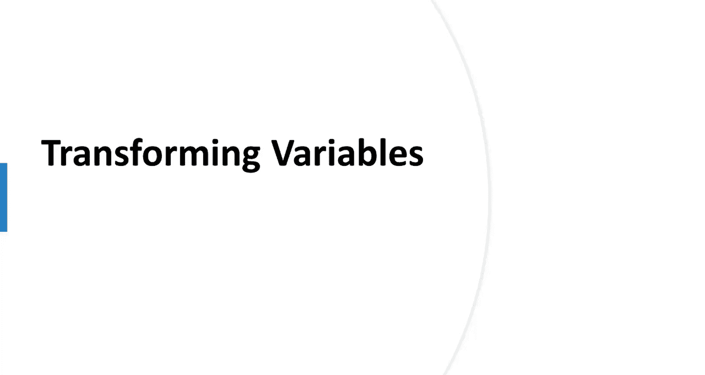
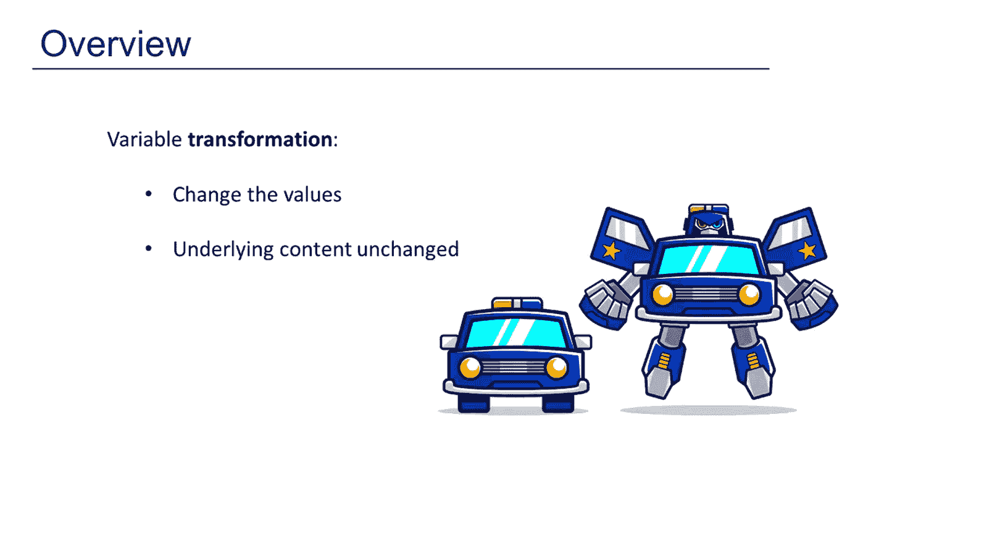
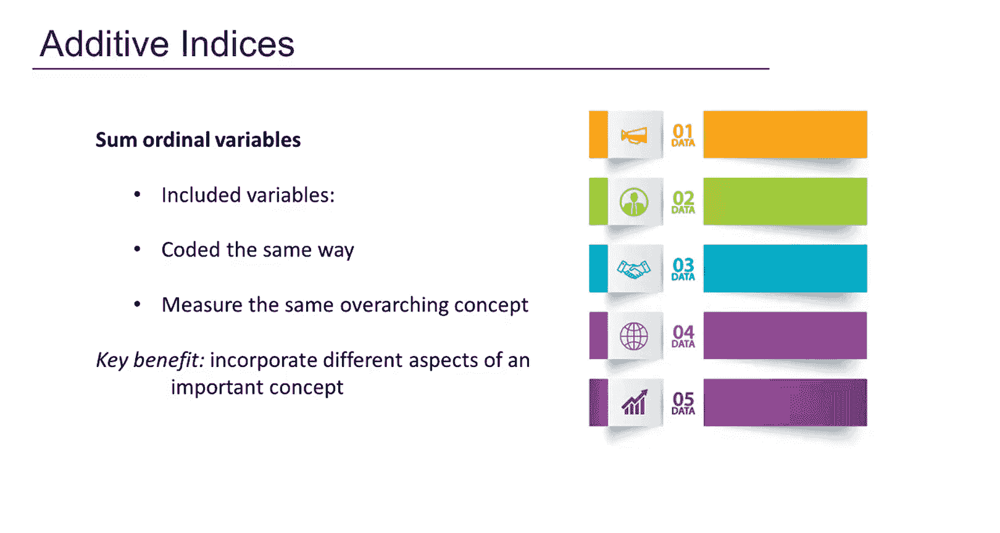
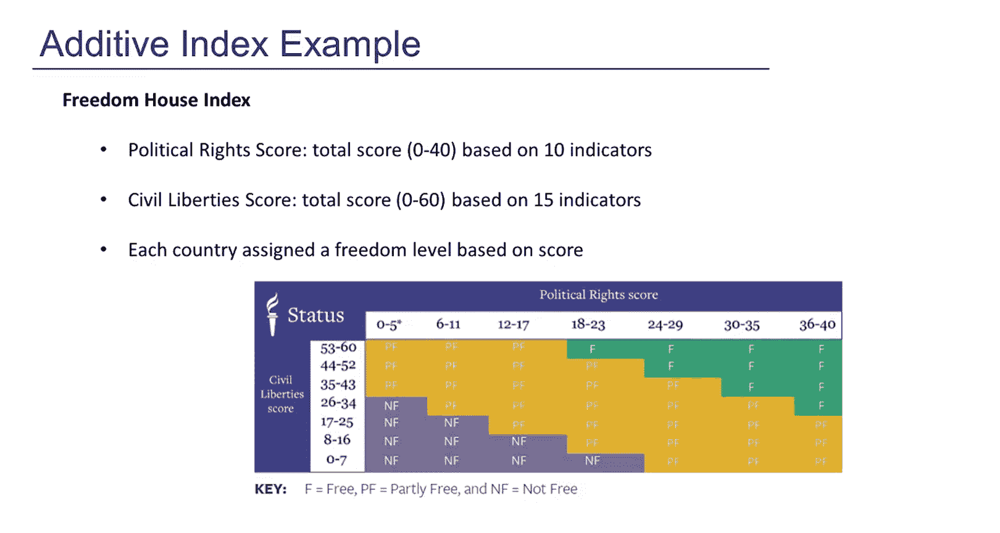
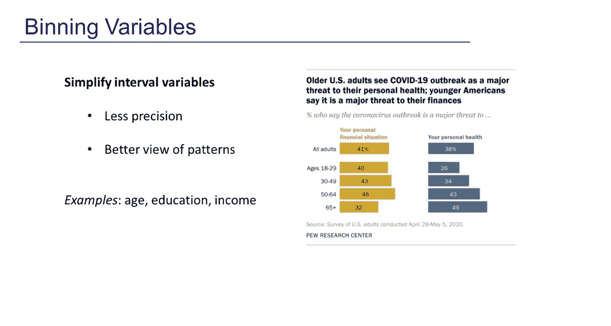
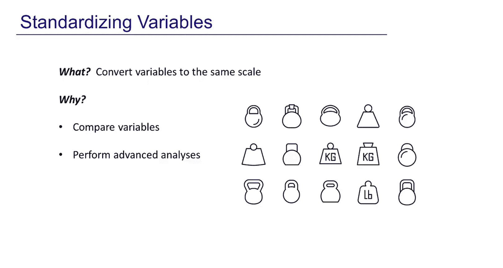

# 约翰霍普金斯大学《数据素养（数据⧸测量⧸回归⧸概率⧸毕业项目）｜Data Literacy》中英字幕（deepseek p18 2_变量转换.zh_en -BV1jXtMemEuh_p18-

Transforming variables when working with data， an analyst will often transform variables in some way。

 The analyst might combine some categories of a variable， for example。

 or even add multiple variables together。 This is done to facilitate a particular type of statistical analysis or to increase the ease of gleaning insights from the data。

By the end of this video， you should be able to identify and describe different methods of transforming variables to prepare them for analysis。

Overview。To transform a variable means to change the values of that variable。

 But this transformation does not change the underlying content in this video。

 we'll discuss three different ways of transforming variables。

 will cover the creation of additive indices， B variables and standardized variables。

 before diving in Imagine a data set that consists of hundreds of variables。

 which is increasingly common as the collection and storage of data becomes easier。

 You might have quantitative variables like age， years of education and household income。

 and also qualitative variables， such as policy attitudes。

 support for various public officials and confidence in various societal institutions。

Before diving into an analysis， it's likely that you'll need to manipulate much of this data。

 such as creating age categories or combining several policy attitude measures to create a single measure of public opinion for a large issue。

 such as immigration or health care。 Let's now walk through a few of these transformation types。

Additive indices， an additive index is created by summing together multiple ordinal variables。

 Remember that an ordinal variable is one that includes ranked categories such as a variable that measures a survey respondent' support for new gun control legislation。

😊，To create an additive index， the included variables must all be coded in the same way。 For example。

 suppose you have five different measures of public opinion with respect to five different issues related to satisfaction with the current health care system。

 such as price transparency and access to urgent care。

If each of these five measures uses the same scale， they can be added together。For instance。

 if each includes a seven point scale that ranges from strongly agree to strongly disagree。

 you could add the five measures together to create an index about the public satisfaction with the current healthcare system。

If， however， two of these variables use a five point scale for the answer choices。

 you would not be able to include them in the index。 Just as importantly。

 all of the measures in the index should measure some aspect of the overarching concept。

As an extreme example， you would not want to include a variable about satisfaction with schools in your index of the public satisfaction with the healthcare system。

The key benefit of creating an index is that you can incorporate several different aspects of an important concept into a single measure。

You can then use this measure to generate descriptive statistics， visualizations。

 or as part of a more advanced statistical analysis。

Additive index example， One popular example of an index is the Freedom House In。

 Freedom House is an organization that measures freedom in countries around the world。

 Freedom is a complex concept with many facets。 As a result， it is tricky to measure。

For each country， Freedom House creates a political rights score。

 which ranges from 0 to 40 and a civil liberty score， which ranges from 0 to 60。

The political rights score， which captures the extent to which a country's government grants political rights to its citizens。

 is determined by summing up points based on answers to questions in 10 different categories such as a country's electoral processes and political participation。

 For example， the electoral process category includes the following questions。

Is the head of government or other chief national authority elected through free and fair elections？

Are the national legislative representatives elected through free and fair elections？

Are the electoral laws and framework fair？The Civil Liberty score is similarly determined by summing up points based on questions that fall into 15 different categories。

 such as freedom of expression and organizational rights。

Based on their civil liberties and political rights scores。

 countries are then assigned one of three statuses， free， partly free or not free。

 The chart on this slide shows the status assigned to each score range pairing。

Binning variables。Another way to transform a variable is to create bins。

 This is a good method for simplifying an interval variable。

 although binning a variable makes the variable less precise。

 it also enables a researcher to see patterns。 Examples of variables that are commonly bin include age。

 education and income。The graph on the right hand side of the slide shows the percentage of US adults who see Covid-19 as a major threat to their health and finances by age。

 Note that the graph has age， Bi into four categories。 By binning the age variable。

 It is easy to see that there is a positive relationship between age and concern for one's health。

 and the relationship between age and concern for one's finances。

 increases for the first three age groups and then drops for the fourth。

It might be much more difficult to see these relationships if age was instead grafted by year instead of by range。

 as the trend would look bumpy。 Bining helps to smooth over the noise and reveal a pattern。

 if there is one， of course。

Standardizing variables。Lastly， a third method of transforming variables is to standardize them。

 This is done to convert variables to be on the same scale。 As a simple example。

 imagine that you have several variables that measure weight。 but some are in terms of pounds。

 and others are in terms of kilograms。 It makes sense to convert all of these variables to the same scale if you want to compare them。

Similarly， suppose you have several standardized tests。

 but each has a different range of possible scores。

 It would make sense to transform these test score variables such that you could compare them。

 such as by visualizing them on the same bar graph or line graph。

There are several different ways to standardize variables。For example。

 the Z score method means that each variable is transformed。

 such that it has a mean of 0 and a standard deviation of  one。

This is also called normalizing the data。In general。

 the purpose of standardizing variables is to compare them and to perform advanced analyses such as a principal component analysis or a clustering analysis。

 The key takeaway from this slide and the video is that an analyst can transform variables in a variety of ways to best answer the research question of interest。

