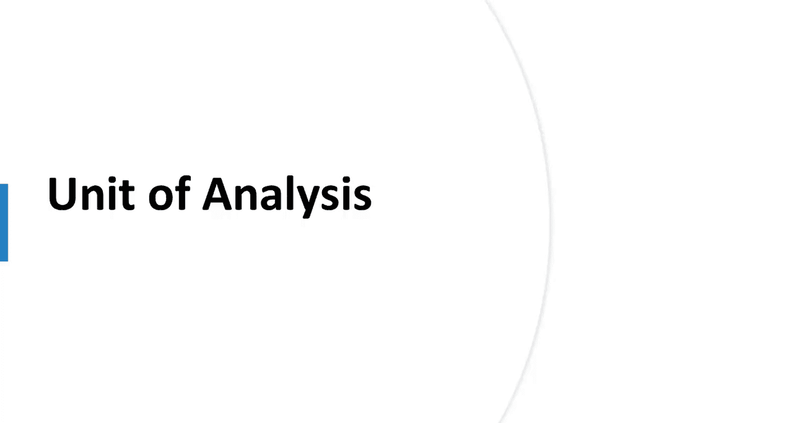
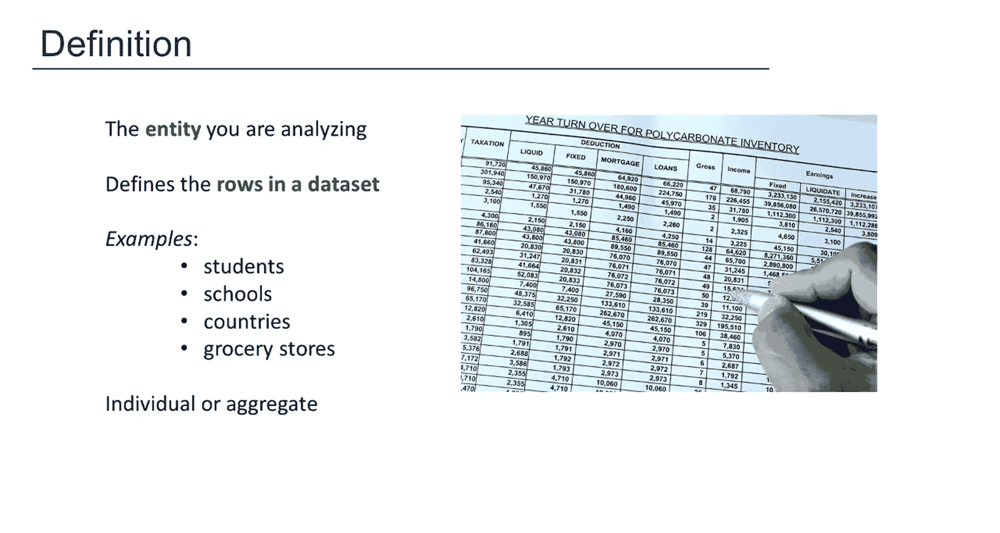
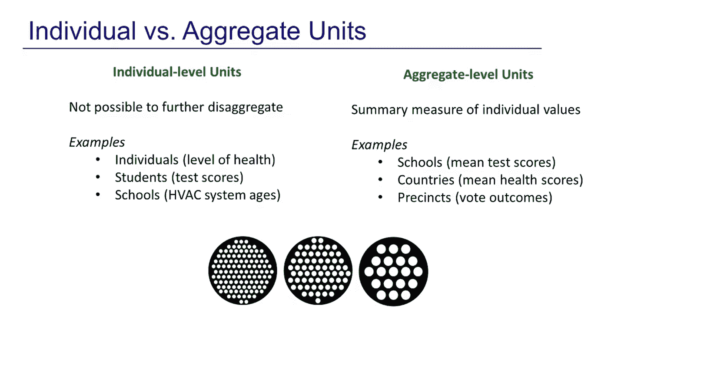
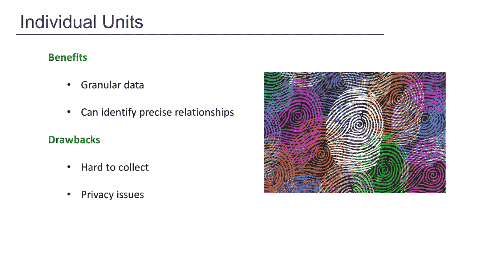
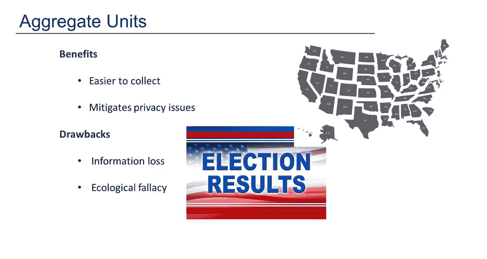
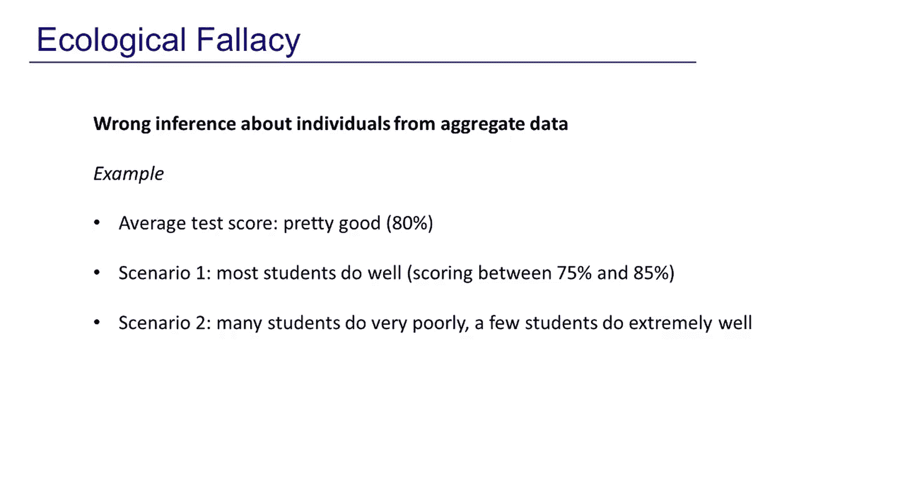
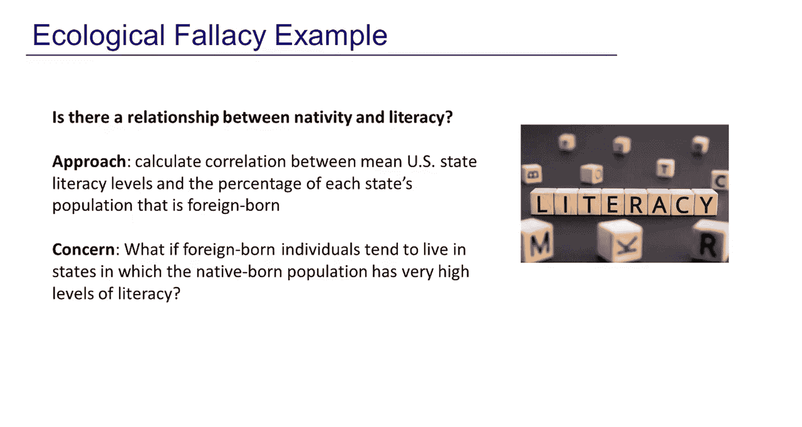

# 约翰霍普金斯大学《数据素养（数据⧸测量⧸回归⧸概率⧸毕业项目）｜Data Literacy》中英字幕（deepseek p19 3_分析单位.zh_en -BV1jXtMemEuh_p19-

Unit of analysis when working with the dataset set。

 it is imperative to identify the unit of analysis。 By the end of this video。

 you should be able to identify the unit of analysis in a data set。

 distinguish between individual level and aggregate level units and describe the advantages and disadvantages of each。

Definition， the unit of analysis is the entity that you want to describe or analyze in your research in a spreadsheet。

 the unit of analysis defines the rows in the data set。

 You might be interested in examining student academic achievement， for example， In this case。

 the unit of analysis is students。 You might instead examine units such as schools。

 Count or grocery stores。The unit of analysis is always the entity or thing that you are studying。

 There are a multitude of entity types that one could examine。

 Some entities are measured at the individual level。

 while others are measured at the aggregate level。 Let's take a deeper dive into these terms。

Individual versus aggregate units。 the defining feature of an individual level unit is that it cannot be further disaggregated。

 For example， suppose you are interested in individual level health。

 Your dataset set might include people with variables such as weight， height。

 blood pressure and frequency of exercise。 There is no smaller unit than a person that you could use to study people's health。

Likewise， if you are interested in studying the determinants of math and reading test scores。

 you would need a data set in which each row is a student， this is an individual level unit。

Now imagine that you want to examine HVAC systems in schools in each US state。

 each row in the data set might be one school with one HVAC system。In this case。

 you would consider the unit to be measured at the individual or non aggregated level。

 since it's not possible to disaggregate these units for the purpose of studying HVAC systems。

In contrast， an aggregate level unit is one where the variables are summary measures of individual values of the aggregated units。

Now， suppose you have a variable that lists the mean math test score for each school in US states。

 Schools are the unit of analysis， but in this case。

 it is an aggregate unit because the variables used are summary measures of the students within each school。

Other examples include countries or precincts where you are summarizing individual level data。

 such as individual health scores or individual vote choices。

There are benefits and drawbacks to each type of unit， let's explore these in more detail。

Individual units the benefit of using individual level units is that your data is granular and thus contains a lot of information。

You can use individual level data to identify precise relationships between variables of interest。

 such as the effect of a new medicine on curing a disease。 There are， however。

 some drawbacks to using individual level units。 It can sometimes be very difficult or even impossible to collect individual level data。

 Vote choice is a great example。 In the US， we use a secret ballot in individual' vote choice is not made public。

 but we， of course， know the election results for a precinct and higher levels of aggregation。

 such as congressional districts， states and the country as a whole。 related to this point。

 there are often privacy concerns with collecting and analyzing individual data related to sensitive issues like health care and education。

Even when individual level data is collected， it is sometimes only disseminated to researchers at an aggregated level。

Alternatively， the data might be anonymized to protect privacy。

 and there might even be some random noise purposefully added to the data set to ensure that individual privacy is protected。

Agregate units。Likewise， there are benefits and drawbacks to using aggregate level units。

On the plus side， aggregated data is often easier to collect。

It's easier to collect state level data than county level data on a variety of topics as there are 50 states in the US and approximately 3100 counties。

 Imagine collecting election results。 It is certainly easier to collect election results for 50 states than it is for all voting precincts in the US as there are over 100000 of these。

In addition， aggregation mitigates the privacy issues I mentioned earlier。

The cost of irrigation is information loss。 When you summarize information， you are， by definition。

 leaving out a lot of details。 A mean test score， for example。

 provides no information about the spread of those test scores。As a result。

 the use of aggregated data opens up the door to ecological fallacies。

 Let me explain what that means。

An ecological fallacy is an incorrect inference about individuals from aggregate data。

 Here's an example。 Sose you observe that the average test score for a large group of students is 80%。

 which is pretty good。Now， consider that there are two scenarios that align with this observation in scenario1。

 most of the students do well in the test， scoring generally between 75% and 85%。

In the second scenario， many students do very poorly， while a few students do extremely well。

One of these scenarios is accurate and one is incorrect。

 but it's impossible to know which is which based on the aggregated data alone。

 drawing the incorrect inference is an ecological fallacy。

Here's another example to help you understand the intuition behind this concept。

Suppose you want to examine whether there is a relationship between nativity and literacy。

In other words， you want to test whether native born individuals develop higher levels of literacy than foreign born individuals。

 One approach to answer this question would be to calculate the correlation between mean US state literacy levels and the percentage of each state's population that is foreign born。

The concern with this approach is that there is the possibility that foreign born individuals tend to live in states in which the native born population has very high literacy levels。

If this is the case， then you have an ecological fallacy problem。

 The aggregation is masking important variation and causing your inference to potentially be inaccurate。

The key takeaway point is that identifying your unit of analysis and designing your research with its benefits and limitations in mind will help you ensure a strong analysis。

