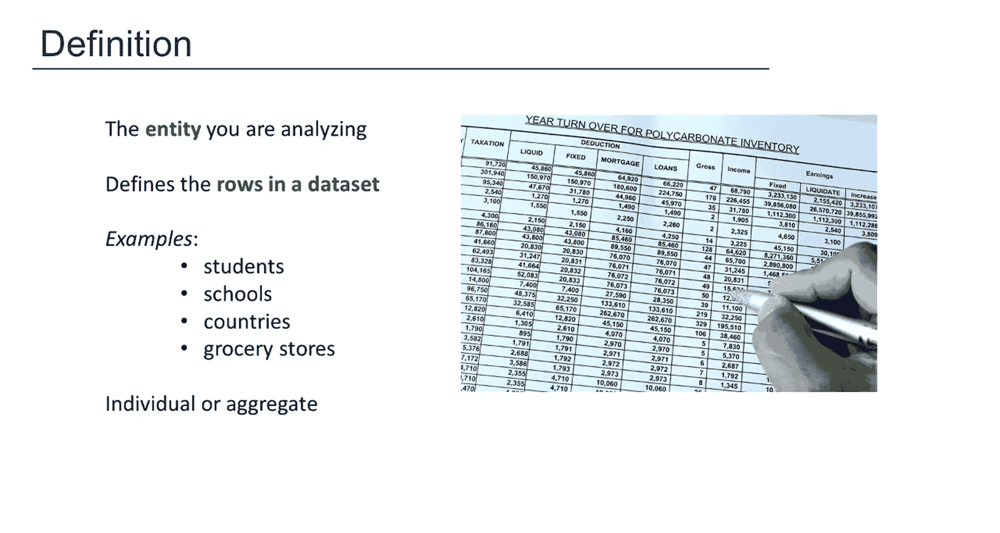
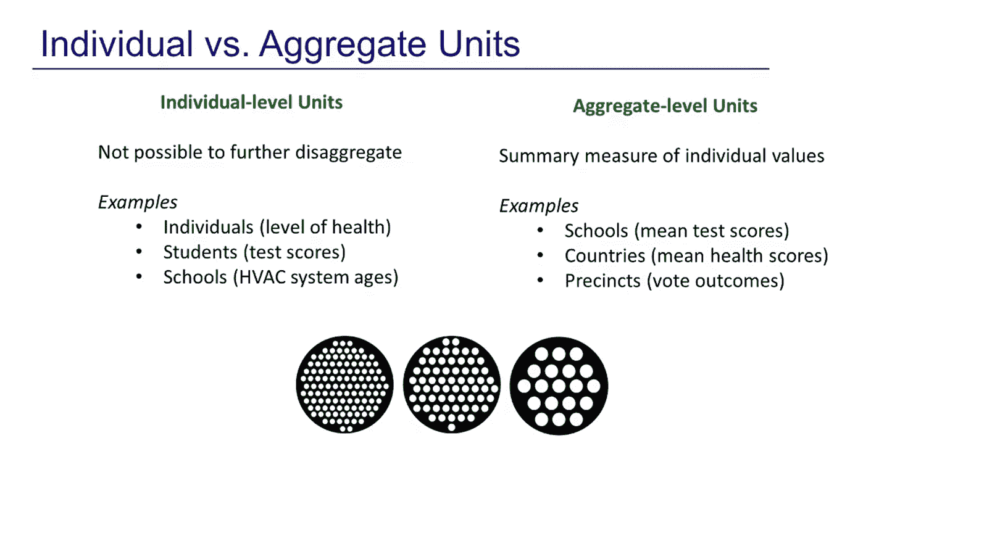
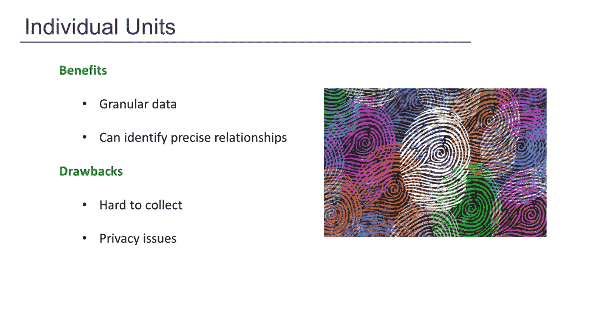
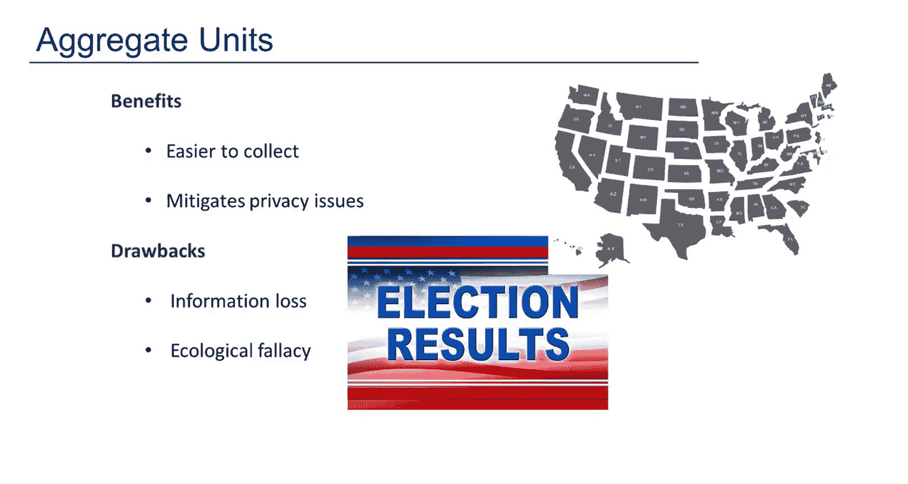
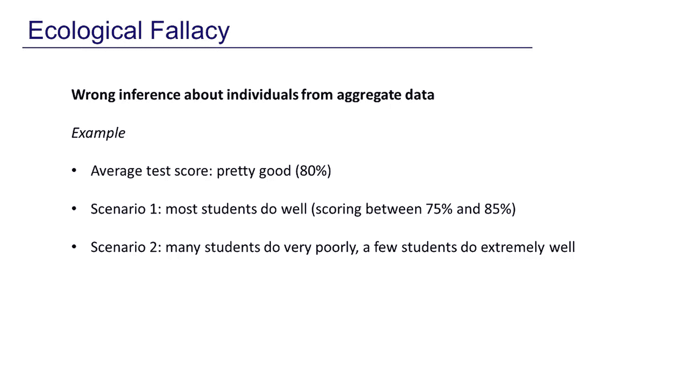
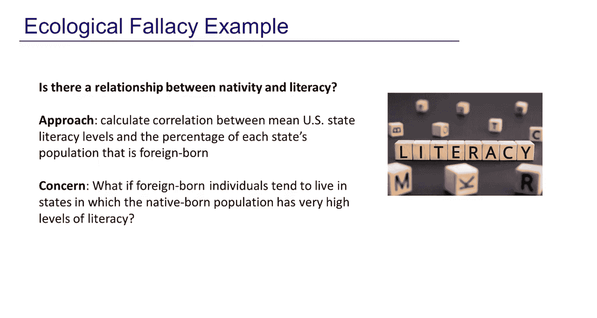

# 数据素养：3：分析单位 🔍

在本节课中，我们将要学习数据分析中的一个核心概念：**分析单位**。理解分析单位是正确解读和设计任何研究的基础。我们将明确其定义，区分个体层面与聚合层面的单位，并探讨各自的优缺点。

## 定义 📖

**分析单位**是你在研究中想要描述或分析的实体。在电子表格中，分析单位定义了数据集的**行**。

例如，如果你对学生的学业成绩感兴趣，那么分析单位就是**学生**。你也可以研究其他单位，如**学校**、**县**或**杂货店**。分析单位始终是你正在研究的那个实体或事物。

## 个体层面与聚合层面单位 📊

上一节我们介绍了分析单位的定义，本节中我们来看看它的两种主要类型：个体层面单位和聚合层面单位。

**个体层面单位**的核心特征是它**无法被进一步分解**。

例如，假设你关注个体健康水平。你的数据集可能包含个人，变量包括体重、身高、血压和锻炼频率。对于研究人的健康而言，没有比“个人”更小的单位了。

同样，如果你想研究数学和阅读测试成绩的决定因素，你需要一个每行代表一名学生的数据集，这就是个体层面的单位。

再设想你要研究美国各州学校的暖通空调系统。数据集中的每一行可能代表一所学校及其一套暖通空调系统。在这种情况下，由于无法为了研究暖通空调系统而将这些单位进一步分解，你也会将其视为个体或非聚合层面的单位。

**聚合层面单位**则不同，其变量是所聚合单位内部个体值的**汇总度量**。

现在，假设你有一个变量，列出了美国各州每所学校的数学平均测试成绩。学校是分析单位，但在这里，它是一个聚合单位，因为所使用的变量是每所学校内学生数据的汇总度量。

其他例子包括国家或选区，你正在汇总个体层面的数据，如个人健康评分或个人投票选择。

## 个体层面单位的优缺点 ⚖️

每种类型的单位都有其利弊，让我们更详细地探讨一下。

**个体层面单位的优点**在于数据非常**精细**，因此包含大量信息。你可以使用个体层面的数据来识别感兴趣变量之间的精确关系，例如一种新药对治愈某种疾病的效果。

然而，使用个体层面单位也存在一些**缺点**。有时收集个体层面的数据非常困难，甚至不可能。投票选择就是一个很好的例子。在美国，我们使用无记名投票，个人的投票选择不公开，但我们当然知道选区及更高聚合层面（如国会选区、州和整个国家）的选举结果。与此相关的是，收集和分析与医疗、教育等敏感问题相关的个体数据通常存在隐私担忧。即使收集了个体层面的数据，有时也仅以聚合层面分发给研究人员。或者，数据可能会被匿名化以保护隐私，甚至可能有意在数据集中添加一些随机噪声，以确保个人隐私得到保护。

## 聚合层面单位的优缺点 ⚖️

同样，使用聚合层面单位也有利弊。

**聚合层面单位的优点**在于，聚合数据通常**更容易收集**。就各种主题而言，收集州级数据比县级数据更容易，因为美国有50个州，而大约有3100个县。想象一下收集选举结果。收集50个州的选举结果肯定比收集美国所有投票区（超过10万个）的结果要容易得多。此外，聚合也缓解了前面提到的隐私问题。

**聚合层面单位的缺点**是**信息损失**。当你汇总信息时，根据定义，你会遗漏很多细节。例如，平均测试分数无法提供关于这些分数分布的任何信息。因此，使用聚合数据会为**生态学谬误**打开大门。让我解释一下这意味着什么。

## 生态学谬误 ⚠️

**生态学谬误**是指从聚合数据中对个体做出错误的推断。

以下是一个例子。假设你观察到一大群学生的平均测试分数是80%，这相当不错。现在，考虑有两种情况符合这一观察结果：
*   **情况1**：大多数学生考得不错，分数普遍在75%到85%之间。
*   **情况2**：许多学生考得非常差，而少数学生考得极好。

其中一种情况是准确的，另一种是不准确的，但仅凭聚合数据无法知道是哪一种。得出错误的推断就是一种生态学谬误。

以下是另一个例子，帮助你理解这个概念背后的直觉。

假设你想研究出生地与读写能力之间是否存在关系。换句话说，你想测试本土出生的人是否比外国出生的人发展出更高的读写能力。回答这个问题的一种方法是计算美国各州平均读写水平与该州外国出生人口百分比之间的相关性。

这种方法的担忧在于，可能存在这样一种可能性：外国出生的个体倾向于居住在那些本土出生人口读写能力非常高的州。如果是这种情况，那么你就遇到了生态学谬误问题。聚合掩盖了重要的变异，并可能导致你的推断不准确。

## 总结 📝

本节课中我们一起学习了**分析单位**。我们明确了分析单位是研究中想要分析的实体，它定义了数据集的每一行。我们区分了**个体层面单位**（不可再分）和**聚合层面单位**（个体值的汇总），并详细讨论了各自的优缺点。个体层面数据精细但收集困难且涉及隐私，聚合层面数据易于收集但会损失信息并可能导致**生态学谬误**。关键要点是：识别你的分析单位，并在设计研究时充分考虑其优点和局限性，这将有助于确保分析的严谨性。