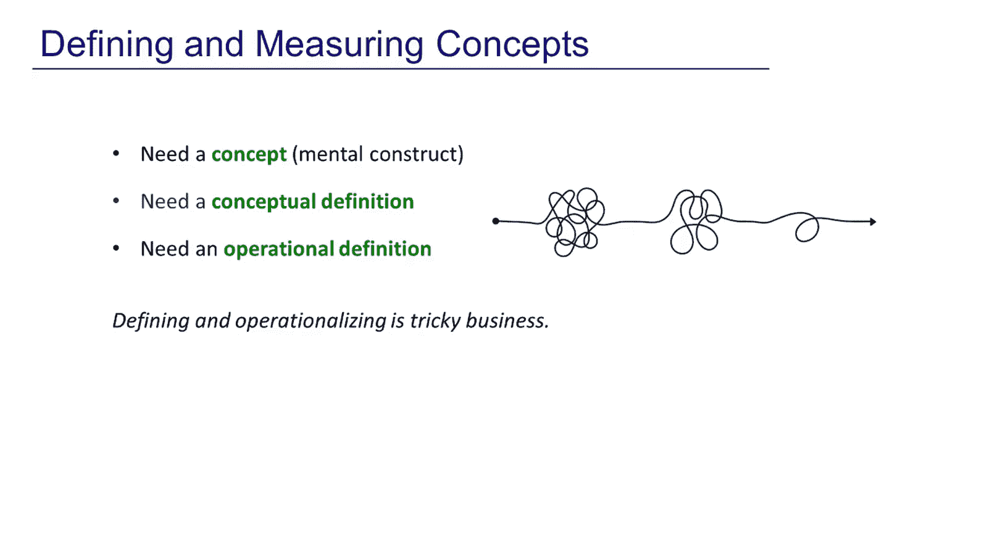
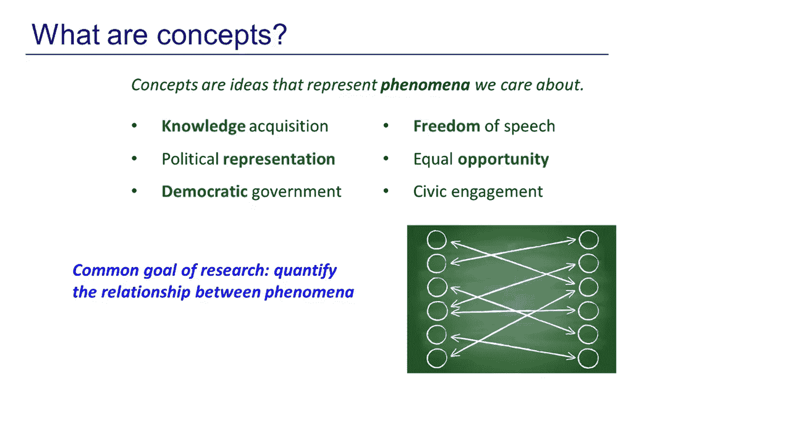
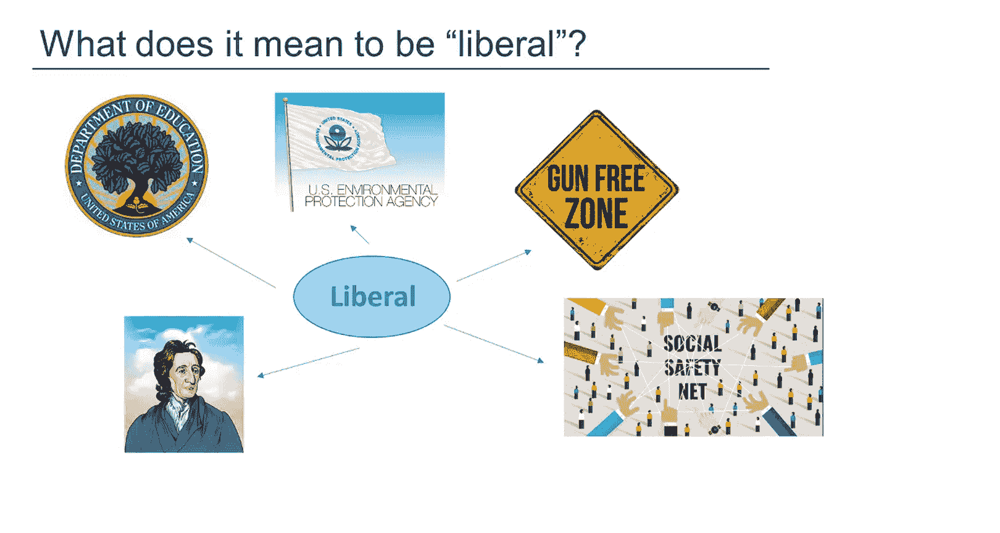
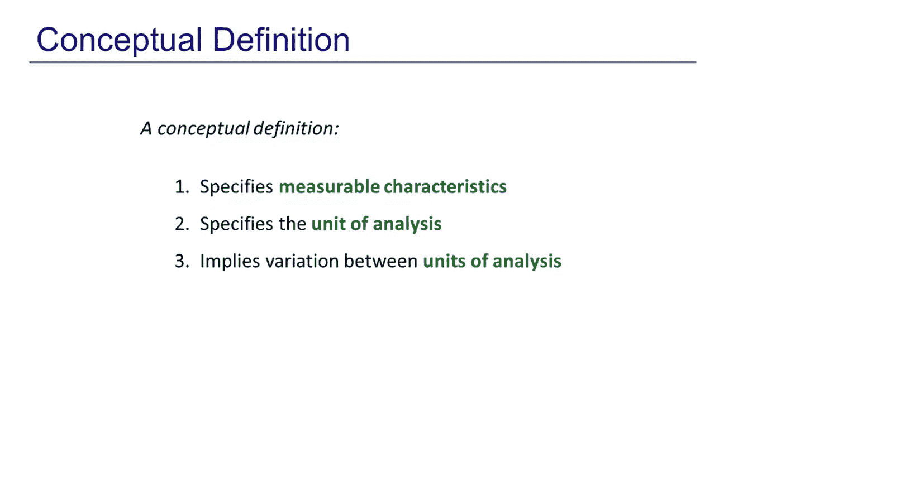
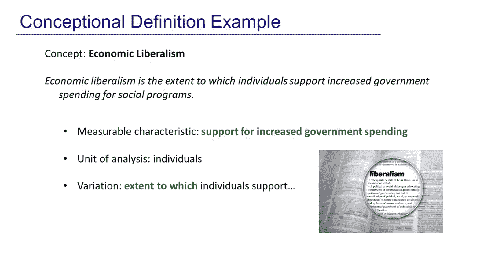
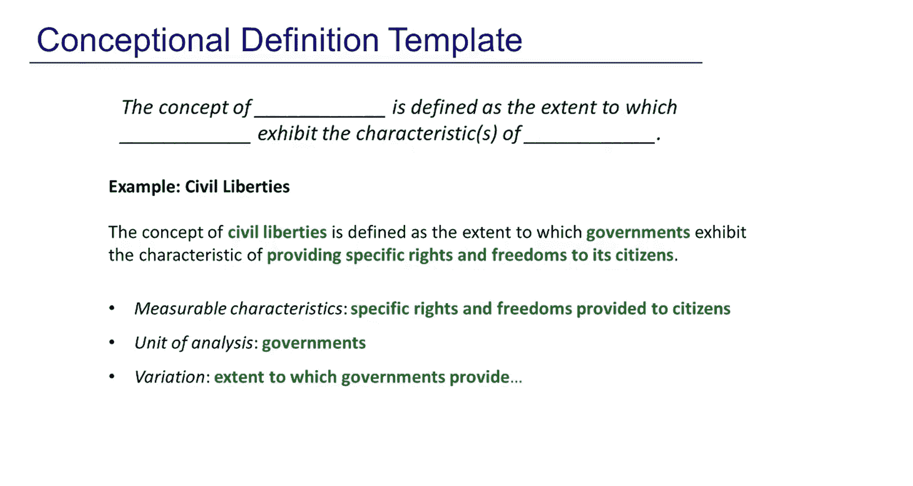
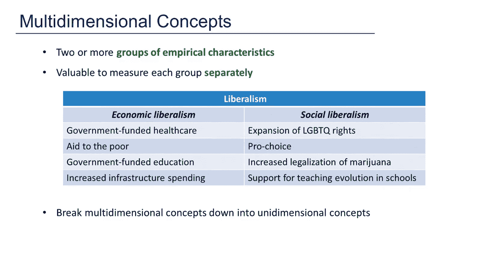
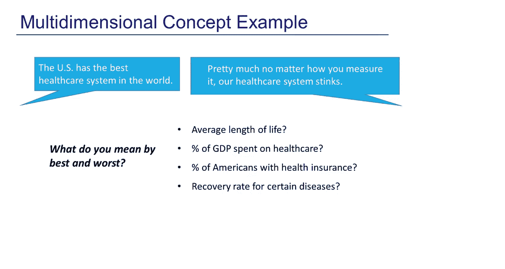

# 约翰霍普金斯大学《数据素养（数据⧸测量⧸回归⧸概率⧸毕业项目）｜Data Literacy》中英字幕（deepseek p20 4_概念定义.zh_en -BV1jXtMemEuh_p20-

Consexual definitions。In this module， we'll discuss how to define and measure concepts。

 Analyts are often interested in investigating hard to define or complex concepts such as health。

 equality and opportunity。By the end of this video。

 you should be able to develop a conceptual definition that you can then use to create an operational definition。

 which we'll discuss in the next video。Defining and measuring concepts。

 this slide presents an outline of the material covered in this module。 and later in the course。

 we'll begin in this video by discussing how to define a concept。

A concept is a mental construct that represents an idea or phenomenon that we care about。

 A concept could be something like political ideology， Libty。

 political participation or socioeconomic status。 We need to define the concepts we care about studying before we can proceed to think about how to measure these concepts。

 The definition of a concept should include one or more measurable attributes。

 as well as the unit of analysis。 After we have developed a definition of a concept。

 We can then develop an operational definition， which we'll cover in the next video。

Defining and operationalizing concepts is challenging。

 and we will discuss a few of the specific reasons why defining and operationalizing is tricky business later in the course。

What are concepts。First， let's take a step back and answer the question。

 What are concepts in the first place。 Well， as I've already said。

 concepts are ideas that represent phenomena we care about。

 A concept could be something like having a conservative ideology， being politically represented。

 being part of a Democratic government， protecting the freedom of speech。

 having a quality of opportunity or being civically engaged。

A common goal of research is to quantify the relationship between phenomena。

 but to be able to quantify this relationship， we must first define the concepts involved。

What does it mean to be liberal When you start to think about concepts。

 you may realize that some are much trickier to define than others。

 and some concepts are quite complicated。 Let's think about what it means to be liberal， for example。

 Well， if you are liberal， you might support the federal government taking a strong role in education。

 And so you might think the Department of Education deserves an increase in funding。

Or you might believe that the federal government has a responsibility to provide a social safety net to those who are struggling。

 or you might support an active Envi Protection agency。

Or you might believe that the country needs stronger gun control laws。

 or perhaps you want to define a liberal in a classical， Lock in sense。

 namely somebody who believes in private property， limited government and individual freedom。

 So which one of these attributes will you include in your definition。 One of them， a subset of them。

 All of them。These are decisions that a researcher must make and then must explain and justify when writing up the findings from the research。

Conceptual definition。Let's break down the components of a conceptual definition。

A conceptual definition does three things， and it is important that the definition accomplish all of these items。

In particular， a conceptual definition specifies measurable characteristics。

 the unit of analysis and implies that there is variation between the units of analysis。

 Let's walk through an example so you can see what I mean by each of these items。

Conceptual definition， example。Suppose that we want to define the concept of being economically liberal。

 We could define economic liberalism as the extent to which individuals support increased government spending for social programs。

In this definition， the measurable characteristic is support for increased government spending。Later。

 we can think about different ways of measuring this kind of support。

 such as by using survey questions。The unit of analysis in the definition is individuals。

 This means that the entity we care about is individuals。

There is also variation implied by this definition of the concept。

 We expect that individuals will vary in the extent to which they are economically liberal。

 The phrase extent to which implies variation。 So it's important to include this phrase in your conceptual definition。

If everyone were the same degree of economically liberal， for example。

 you could not examine whether a change in economic liberalism is associated with an outcome of interest。

 such as vote choice。

Conceptual definition template。This slide presents a template that you can use to construct good conceptual definitions。

The concept of blank is defined as the extent to which blank exhibit the characteristics of blank。

The first blank is where you would insert the concept that you're trying to define。

The second blank is where you would insert the unit of analysis。

 and the third blank is where you would list the measurable characteristics。Let's look at an example。

 Suppose you want to define the concept of civil liberties。 Well。

 you could say that the concept of civil liberties is defined as the extent to which governments exhibit the characteristics of providing specific rights and freedoms to their citizens。

The measurable characteristics in this definition are specific rights and freedoms provided to citizens。

 And later， you could think about different ways to actually measure these characteristics。

The unit of analysis in this definition is governments。

 and the variation is implied by the use of the phrase extent to which Governments provide。

 According to this definition， there is variation in the extent to which governments exhibit the characteristics of providing specific rights and freedoms to citizens。

Multidisional concepts。 Many concepts are multidimensional。

 Multidimensional concepts are concepts that consist of two or more groups of empirical characteristics。

 and by empirical， I mean， factual or observable。 If you have a multidimensional concept。

 it can be valuable to measure each group separately。 So， for example。

 liberalism could certainly be considered a multidimensional concept。

 And we might want to measure economic liberalism and social liberalism separately。

Some characteristics of economic liberalism might include support for government funded health care。

 support for providing aid to the poor support for government funded education and support for increased federal investments in infrastructure。

 Social liberalism， in contrast， is defined by a different set of measurable characteristics。

 We might define an individual as being socially liberal。

 If the person supports expanding LGBTQ rights is prochoice。

 Supports the increased legalization of marijuana or supports the teaching of evolution in schools。

The key is to break down multidimensional concepts into unidimensional concepts。

 when constructing conceptual definitions。

Multidisional concept， example。Healthcare is another example of a multidimensional concept。

 There are some people who believe that the US has the best health care system in the world。

 and there are others who believe the exact opposite。

 but to evaluate the quality of our health care system。

 you need to first determine what you mean by best and worst。

 How do we know if a health care system is the best or if it stinks。 Well。

 we could measure the average length of life in a country or the percentage of GDP spent on health care。

 we could measure the percentage of Americans with health insurance。

 or we could measure the recovery rate for certain diseases。

These measurable characteristics could be categorized into different groups。

 each of which represents a different dimension of the concept of health care。

The key takeaway point is that any analysis requires measurement。

 and good measures depend on crafting good conceptual definitions。

