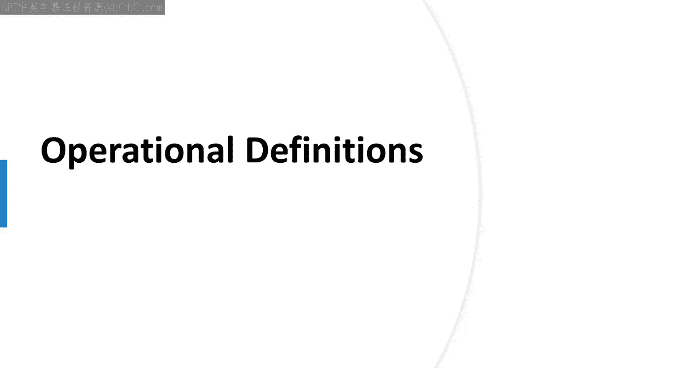
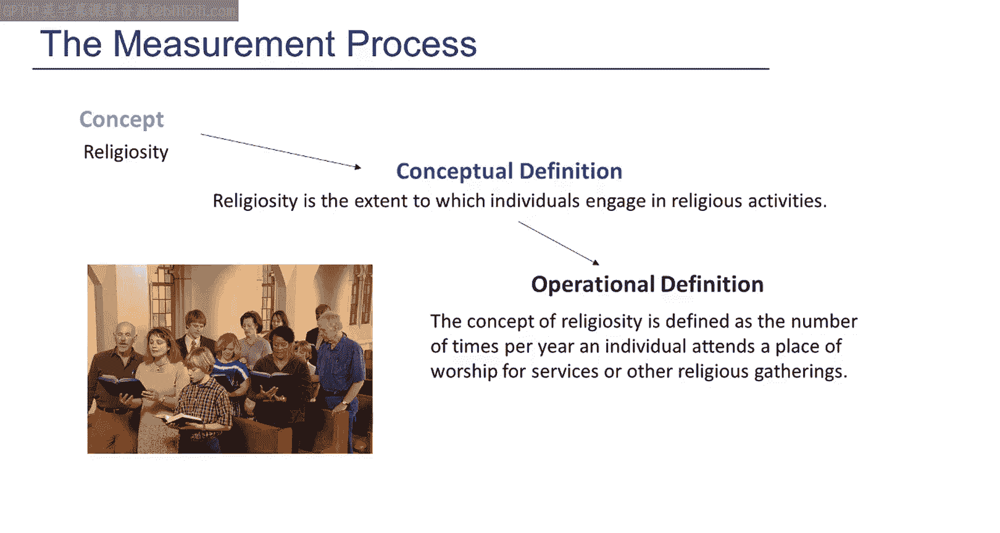
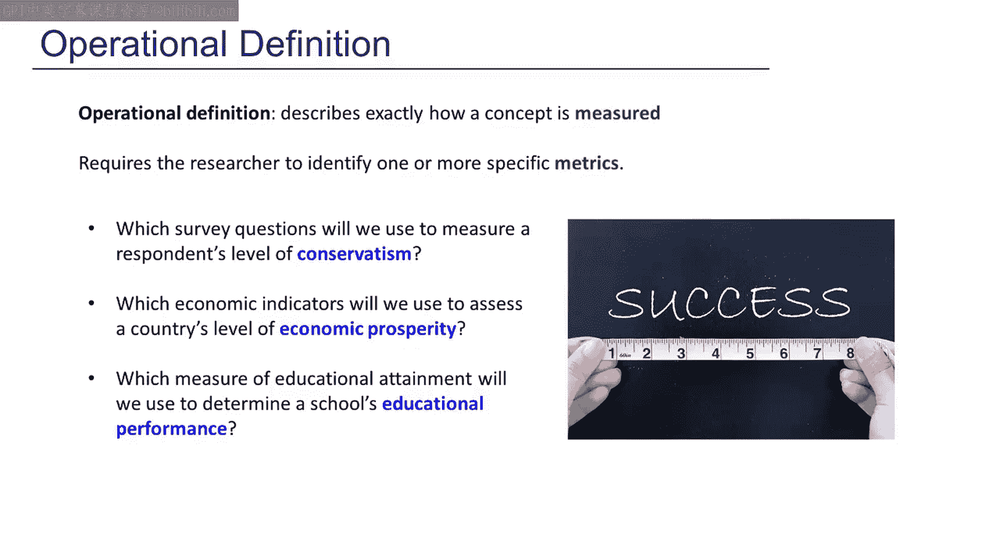
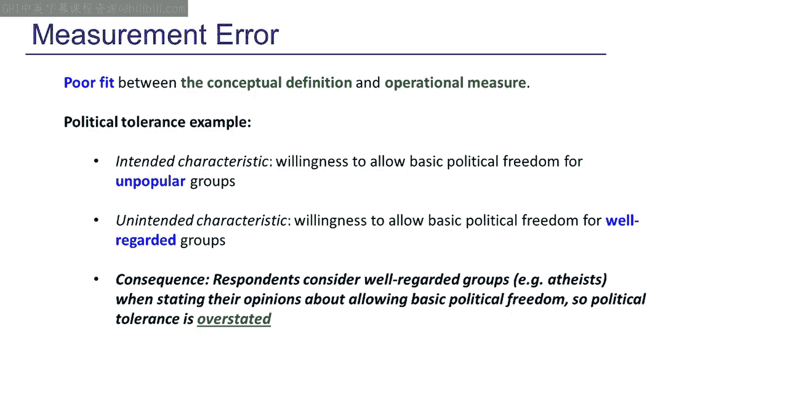

# 约翰霍普金斯大学《数据素养（数据⧸测量⧸回归⧸概率⧸毕业项目）｜Data Literacy》中英字幕（deepseek p21 5_操作定义.zh_en -BV1jXtMemEuh_p21-

Operational definitions Once you've developed a conceptual definition。

 the next step is to build an operational definition。By the end of this video。

 you should be able to construct and evaluate an operational definition for a concept of interest。

The measurement process。Let's take a moment to review where we are in the measurement process。

 In the previous video， we discussed concepts such as religiosity。

 We also discussed conceptual definitions。 We can define the concept of religiosity， for example。

 as the extent to which individuals engage in religious activities。😊。

The next step is to develop an operational definition。

 An operational definition for religiosity could be the number of times per year an individual attends a place of worship for services or other religious gatherings。

We could gather this information using a survey。 an operational definition specifies the way in which we plan to measure the concept that we are studying。

As I previewed， an operational definition describes exactly how a concept is measured。

An operational definition requires the researcher to identify one or more specific metrics。 So。

 for example， if you are studying conservatism， you might think about specific survey questions that you would use to measure a respondent's level of conservatism。

 if you are studying economic prosperity， you need to think about which specific economic indicators you will use to assess a country's level of economic prosperity。

 or if you are evaluating the educational performance of schools。

 you need to think about which measures of performance you will use to make this assessment。

Example， measuring political tolerance。 Let's examine the concept of political tolerance。

 Here is a reasonable definition of political tolerance。

 Pol tolerance is the extent to which individuals exhibit the characteristic of expressing a willingness to allow basic political freedoms for unpopular groups。

 This definition includes all of the necessary components of a conceptual definition。

 It includes the concept， which is political tolerance。 It includes the unit of analysis。

 which is individuals， and it includes a measurable characteristic， namely。

 the extent to which individuals express willingness to allow basic political freedoms for unpopular groups。

We can operationalize this concept using two survey questions， the first survey question might ask。

 should atheists， socialists， communists， and members of extremist groups be allowed to give public speeches？

Keep in mind that when this type of survey question is used。

 the question is repeated for each of the four unpopular groups。A second survey question might ask。

 should atheists， socialists， communists， and members of extremist groups be allowed to publish books？

Now， think about what these survey questions are capturing。 Are they， in fact。

 capturing individuals willingness to allow basic political freedoms for unpopular groups。If not。

 there might be some slippage between the conceptual definition and the operational definition of political tolerance。

Measurement error。Measurement error， which we will discuss in more detail in the fourth module of the course。

 occurs when there is a poor fit between the conceptual definition and the empirical or operational measure。

 The operational measure should capture intended characteristics， but not unintended characteristics。

Let's return to the political tolerance example。 The intended characteristic is individual's willingness to allow basic political freedoms for unpopular groups。

The unintended characteristic is individual's willingness to allow basic political freedoms for well regarded groups。

In the survey questions on the previous slide， respondents were asked about atheists For many respondents。

 atheists might not be an unpopular group， and in fact， they might be a highly regarded group。

 The consequence is that some respondents will be considering well regarded groups when answering the question。

 and thus， the prevalence of political tolerance among the respondents will be overstated。Hopefully。

 this video has given you a better sense of the importance of good operational definitions。

 but also why it is so challenging to create them。 When evaluating any piece of research。

 it is important to consider what is actually captured by the operational definitions employed and what is not。

