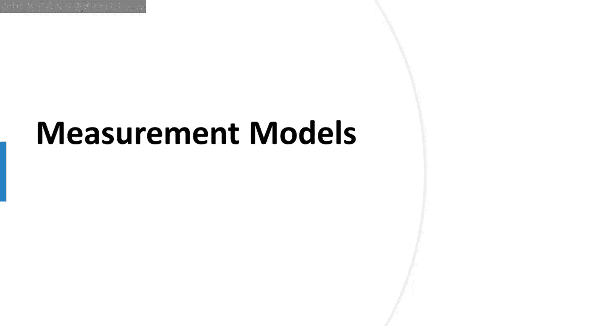
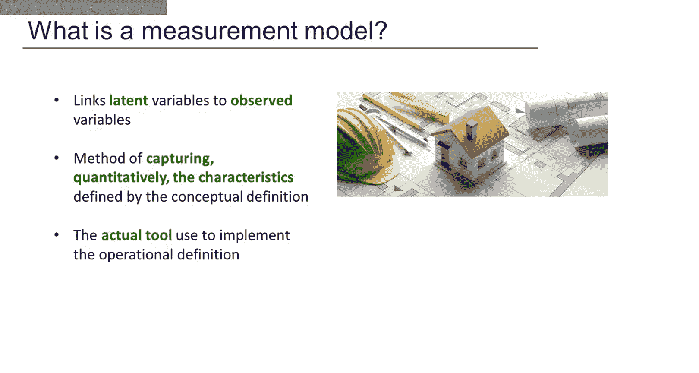
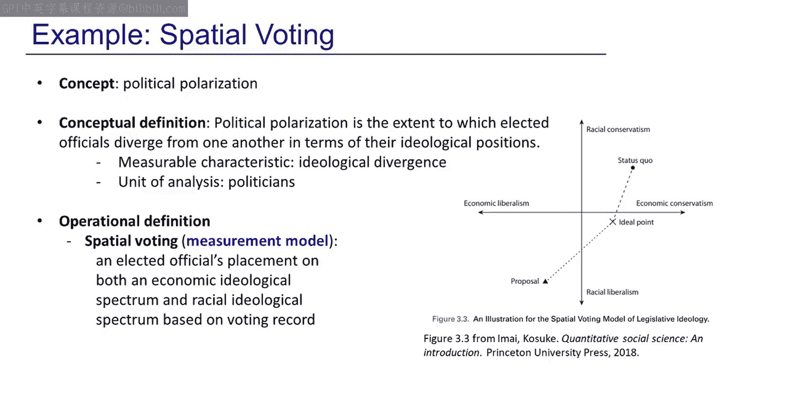
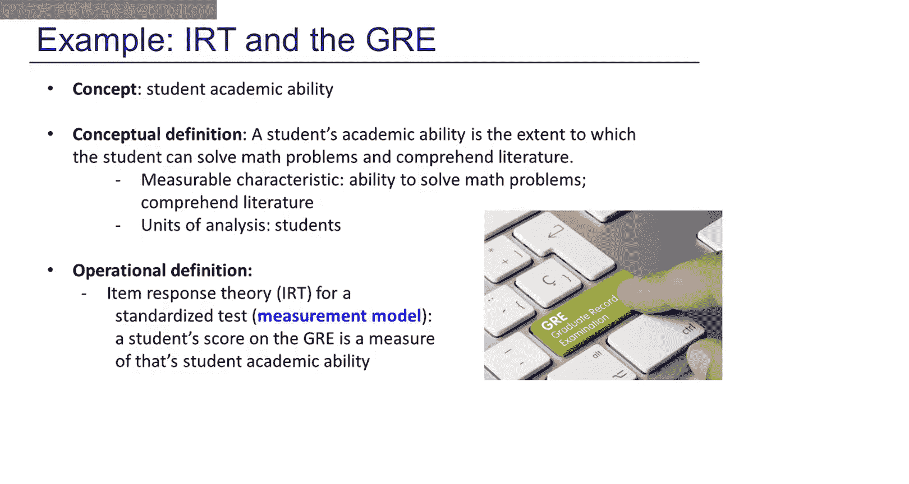
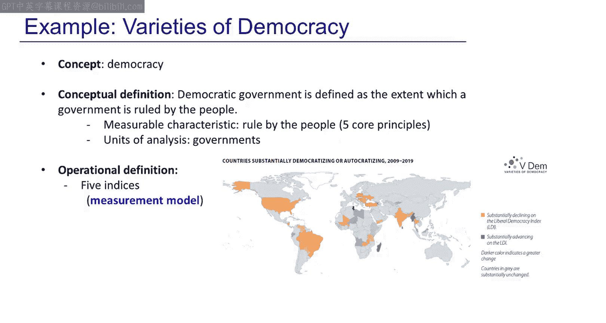

# 约翰霍普金斯大学《数据素养（数据⧸测量⧸回归⧸概率⧸毕业项目）｜Data Literacy》中英字幕（deepseek p22 6_测量模型.zh_en -BV1jXtMemEuh_p22-

Measurement models。Measurement models are the final outcome of crafting a good。

 conceptual and operational definition。 They are the tools or methods a researcher implements as a means of collecting quantitative information about a concept of interest。

By the end of this video， you should be able to articulate the purpose of a measurement model and identify the key components of a good model。

What is a measurement model。There are several different ways of describing and defining a measurement model。

 Let me walk through some of this language。 First， a measurement model can be thought of as a methodology that links latent variables to observed variables。

 latent variables are things we don't observe directly， like trust in government。

 a quality of opportunity and access to education。 These are the concepts we want to study。

 Observed variables are the manifestations of these concepts。 For example。

 we might observe survey respondents indicating that they approve of their elected officials。

 which is a measure of the latent variable trust in government。

 This survey question is the operationalization of trust in government。

Using slightly different terminology， we can say that a measurement model is a method of capturing quantitatively the characteristics defined by the conceptual definition。

In other words， it is the actual tool or instrument that is used to implement a researcher's operational definition。

The key takeaway is that a measurement model is a means of turning the operational definition of a concept into data。

Example， spatial voting。A popular measurement model used by political scientists to better understand legislators' ideologies is the spatial voting model。

Let's take a step back and walk through one way in which the spatial voting model can be used to better understand a phenomenon。

Suppose that you are interested in studying political polarization。 In other words。

 political polarization is your concept of interest。

A useful definition of this concept might be Pol polarization is the extent to which politicians diverge from one another in terms of their ideological positions。

This definition is useful because it includes a measurable characteristic。

 namely ideological divergence。 It also defines the unit of analysis， which in this case。

 is elected officials。 You could also imagine measuring the ideological divergence of citizens or even candidates who are up for election。

To operationalize this conceptual definition， we might employ a spatial voting model。

 which is a way of measuring ideological divergence。 We can refer to this as the measurement model。

In this case， the spatial voting model identifies the placement of each elected official on both an economic ideological spectrum and a racial ideological spectrum based on the official's voting record。

 Once you have the placement of each official， you can imagine visualizing the distance between officials or between groups of officials。

 such as between Democrats and Republicans。

A second example of a commonly used measurement model is item response theory and its use on the GRE test。

Suppose that you are interested in studying student academic ability。

 a good conceptual definition would be a student's academic ability is the extent to which the students can solve math problems and comprehend literature。

This definition includes measurable characteristics。

 namely the ability to solve math problems and comprehend literature。

 as well as the unit of analysis， which is students in this case。

To operationalize this conceptual definition， researchers have developed a measurement model called item response theoryory as applied to standardized tests。

 a test that is designed in accordance with item response theory presents the test taker with questions that increase in difficulty as questions are answered correctly and vice versa。

The GRE is an example of a test designed according to item response theoryory。

 and it is often used by graduate program admissions committees as a measure of students' academic ability。

Varieities of democracy is another useful measurement model for those who are interested in studying and comparing governments。

In this case， the concept of interest is democracy。

 We can define this concept as the extent to which a government is ruled by the people。

 This is a very short definition。 Of course， A more useful definition would expand on rule by the people。

 and identify the key principles， such as the holding of free and fair elections。

 participation of the citizenry and deliberative policy making and decision making。

These are measurable characteristics。The unit of analysis in this case is governments。

 while the varieties of democracy organization focuses on country level governments。

 you could imagine applying this measurement model to state or even municipal governments as well。

The conceptual definition is operationalized as five indices。

 There are 450 indicators that make up these indices。

 most of which are measured using questionnaires that are completed by country experts。

Analysts can then examine the data to categorize countries and observe trends in democratization over time。

 as seen in the graph on the right hand side of the slide。

There are numerous measurement models employed by data scientists。

 and researchers often create their own。Later in the course。

 we'll talk about how to evaluate these models in terms of their vulnerability for error。

 as well as their reliability and their validity。

