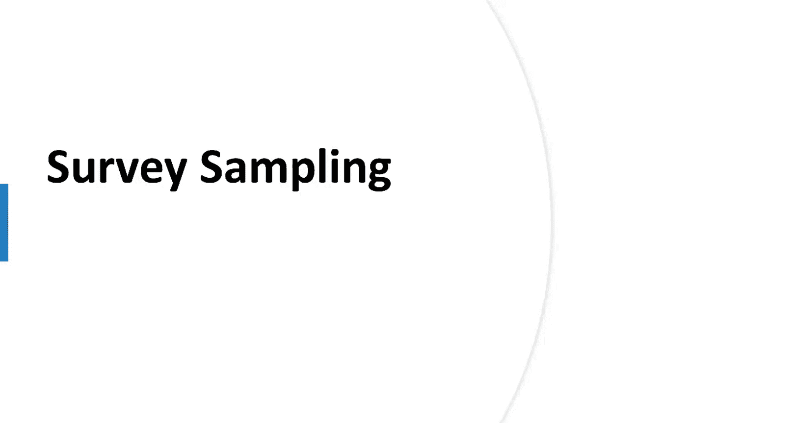
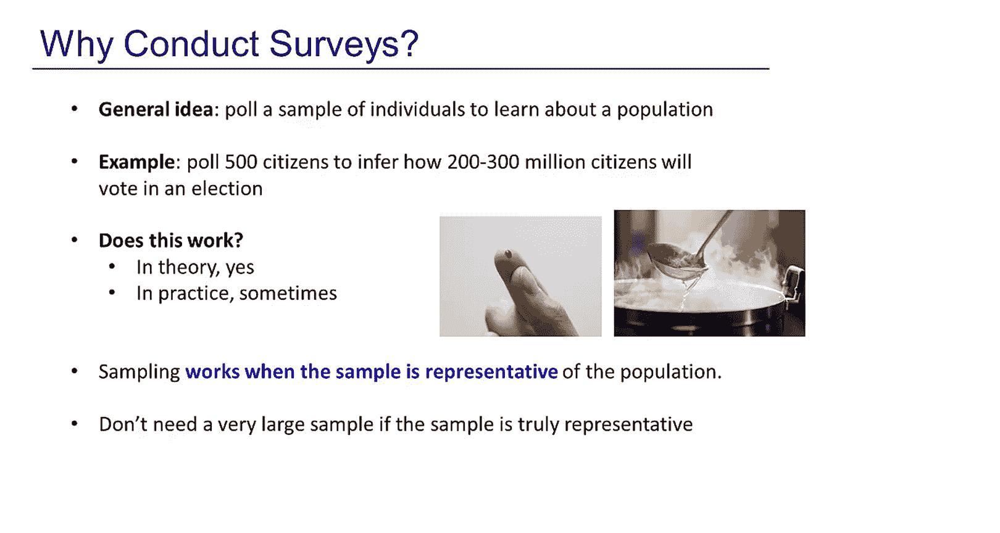
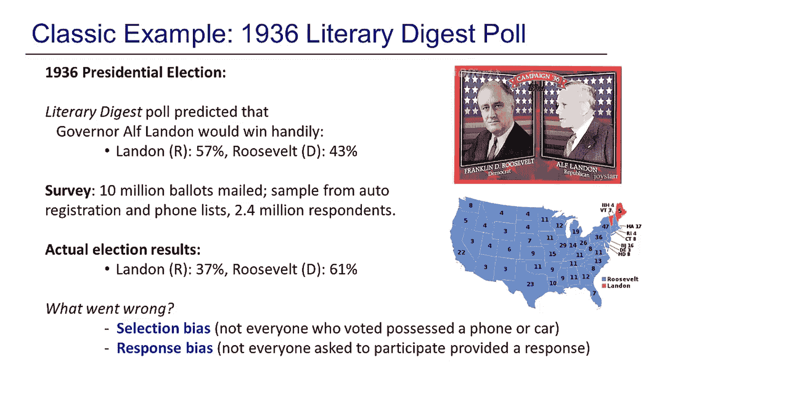
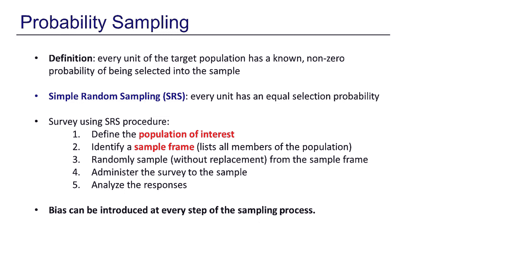
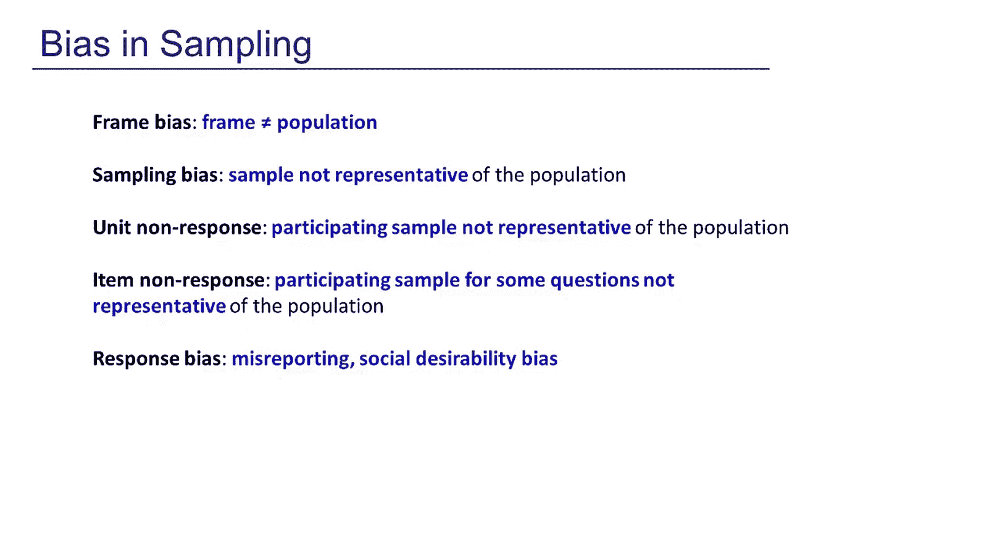
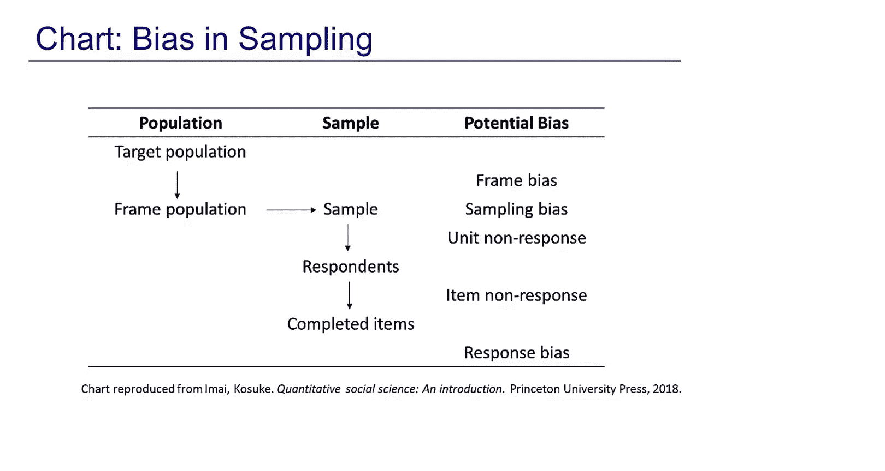
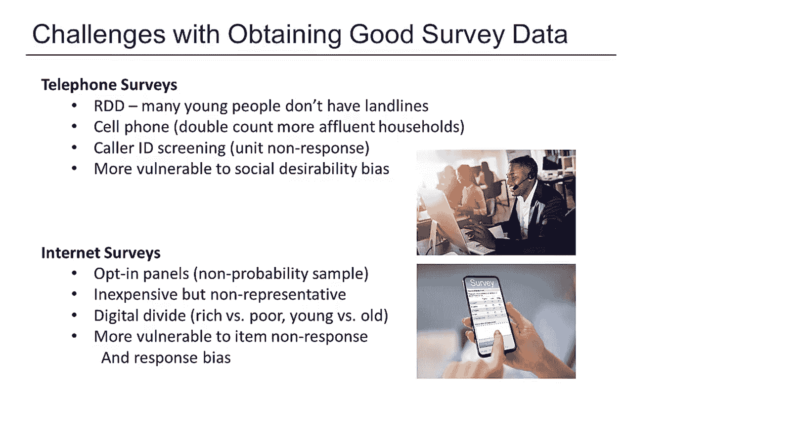

# 约翰霍普金斯大学《数据素养（数据⧸测量⧸回归⧸概率⧸毕业项目）｜Data Literacy》中英字幕（deepseek p23 7_调查抽样.zh_en -BV1jXtMemEuh_p23-

Survey sampling， surveyve sampling is a widely used approach to make inferences about populations。

 There is an extensive literature on survey methodology， and today。

 we have a strong understanding of the best practices for designing and administering surveys that yield meaningful findings。

 That said， there is ongoing research to identify improved methods for asking respondents about sensitive questions and hard to define concepts。

 It is a rich field of study that has a long history。

 Yet is constantly evolving in response to new research and technology。 By the end of this video。

 you should be able to articulate the purpose of survey sampling。

 enumerate the steps of the simple random sampling approach。

 and evaluate whether a survey sample is vulnerable to bias。

Let's first consider why researchers conduct surveys The general idea of a survey is to pull a sample of individuals or another type of entity to learn about a population。

 a common example is an election survey A poll might ask 500 respondents how they will vote in an upcoming election to draw inferences about how 200 to 300 million citizens will actually vote on Election Day。

Does this approach work， In theory， it works very well。

 A single drop of blood provides incredibly accurate information about a person's entire body。

 just like a spoonful of soup can provide a chef with accurate information about the taste of the soup in the whole pot。

😊，In practice， however， surveying can be quite challenging， as I'll explain in this video。

 surveying is vulnerable to several types of bias that may render the results inaccurate。In general。

 however， sampling works very well when the sample is representative of the population。

 just like a drop of blood or a spoonful of soup。When it's possible to obtain a representative sample。

 a researcher doesn't need a very large one to draw accurate inferences。

Let's look at a famous example of a dramatic failure of random sampling In the 1936 presidential election。

 Democratic incumbent Franklin D。 Roosevelt ran against Republican Chaenger Allf Landlandon。

During the campaign， literaryary Digest， a popular magazine at the time。

 conducted a poll to predict the outcome of the election。

The poll predicted that Land would receive 57% of the vote。

 and Roosevelt would receive 43% of the vote。These results suggested that Land would win the election by a wide margin。

The survey was administered by mailing 10 million ballots to a sample that was drawn from automobile registration lists and telephone number lists。

 there were 2。4 million people who responded to the poll， the large sample size 2。

4 million convinced the researchers at literary digest that they had a good sample。On Ele day。

 the actual results were far different from the poll's predicted results。

 Landin secured only 37% of the vote while Roosevelt swept the election with 61% of the vote。

So what do you think went wrong， Why was the poll inaccurate， Well。

 the poll suffered from both selection bias and response bias。

 The selection bias occurred because the sample was unrepresentative of the population of interest。

In 1936， not everyone owned an automobile or phone。

 the sample failed to include citizens who did not own an automobile or a phone。Further。

 these citizens were much more likely to support Roosevelt， as a result。

 the poll severely underestimated support for Roosevelt。In addition to selection bias。

 the poll suffered from response bias。 Suppose the 10 million ballots originally mailed was a perfect representative sample。

 The problem is that only 2。4 million or 24% of the sample members responded。

 If the group that responded is unrepresentative of the population。 then once again。

 the estimates will be biased。In this case， it's clear that the respondents were much more supportive of Land than the population。

When implemented correctly， probability sampling ensures that the sample is representative of the population of interest。

In a probability sample， every unit of the target population， which is defined by the researcher。

 has a known non zero probability of being selected into the sample。With simple random sampling。

 every unit has an equal probability of being selected。

To properly use a simple random sampling procedure。

 a researcher must first define the population of interest。

 a population can include individuals or other entities such as schools or hospitals。

After defining the population， the researcher should identify a sample frame which lists all members of the population。

The next step is to randomly sample from the sample frame in practice。

 sampling is usually done without replacement， meaning if a population member is selected into the sample。

 it cannot be selected into the sample a second time。Next。

 the researcher can administer the survey to the sample members。And finally。

 once the survey has been administered， the researcher can analyze the responses and present the results to relevant audiences。

Note that bias can be introduced at every step of the sampling process if an estimate is biased。

 it means that it differs on average from the true population value。

There are several types of bias that can plague the survey sampling process。 The first is frame bias。

 This occurs when the sampling frame does not include all members of the population and only those members of the population。

 This becomes problematic if the included members of the frame differ in relevant ways from the excluded members。

 In short， if the sampling frame is not equal to the population。

 the results are vulnerable to frame bias。Sampling bias occurs when members of the sampling frame are not randomly selected into the sample。

 again， this leads to a sample that is not representative of the population。

Now suppose you have identified an accurate sampling frame and created a true simple random sample using the frame if some members of this sample fail to respond to the survey。

 the research now has unit nonrespon。 In other words， when members of a sample don't participate。

 the survey is subject to unit nonrespon。 The result is that the participating sample is not representative of the population。

Okay， now suppose all members of the sample take the survey。

 but a few opt to skip particular questions。 this causes item nonre。

 This means that the participating sample for certain questions is not representative of the population。

Finally， let's suppose that all members of a sample take a survey and respond to all questions in the survey。

 the research may still be plagued by response bias。

 which means that some sample members don't answer questions accurately。

 This can occur for several reasons。 some sample members may misreport simply because of recall difficulty。

It also may be the case that respondents don't respond accurately because of social desirability bias。

 respondents may overre desirable behaviors like voting and exercising and underre undesirable behaviors like drug use。

As is hopefully now evident， it takes a very careful sampling and survey design to produce valid results。

This chart summarizes the sampling procedure and the potential bias at each stage frame bias may arise when identifying a sample frame from a target population sampling bias may arise when selecting a sample from the frame。

 unit nonres can be a problem when moving from the selected sample to the actual survey respondents and item nonres can be a problem when the participating sample members fail to answer one or more questions。

 Lastly， when answering questions， some respondents may not be accurate leading to response bias。

Finally， let's take a moment to consider some of the specific reasons why survey sampling can be so challenging when conducting a telephone survey。

 random digit dialing is useful as this approach captures both landline phones and cell phones。

 and we know that many young people don't have landline phones today Further random digit dialing captures unlisted numbers。

The challenge with cell phone numbers is that they usually are associated with one individual。

 whereas landline phones are associated with a household。

Including both landline phones and cell phones in a sample could potentially overcount affluent households。

 as the sample may include multiple cell numbers from the same household。

Another challenge with telephone surveys is that potential respondents may screen unknown numbers。

 which would result in unit nonres。Telephone surveys may also be more vulnerable to social desirability bias than internet surveys as respondents may feel pressured to give answers they think the interviewer wants to hear when speaking to a real live person。

Internet surveys are also widely used and they have their own set of advantages and disadvantages。

 many surveys today use optin panels， which are non probabilityb samples。

 an optin panel consists of a sample of respondents who have volunteered to take a survey。

If the optin panel differs in relevant ways， such as their demographics or opinions from the target population。

 the results will be biased。In general， internet surveys are much less expensive than telephone surveys。

 but are frequently less representative。 this is partly because of the digital divide that remains between the rich and the poor and between generations。

Lastly， internet surveys may be more vulnerable to response bias than telephone surveys respondents may be more likely to skip questions in an internet survey or fail to read questions in their entirety。

 in short， it's hard to control whether respondents fully complete an internet survey and at the pace at which they should complete the survey。

None of these issues are disqualifying， but they should be considered when a researcher is designing a survey and interpreting the findings。

