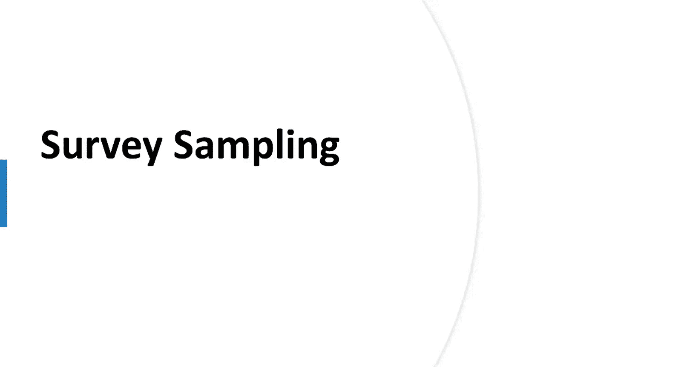
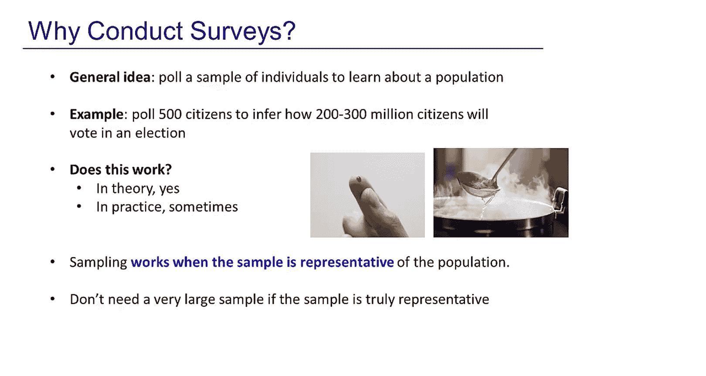
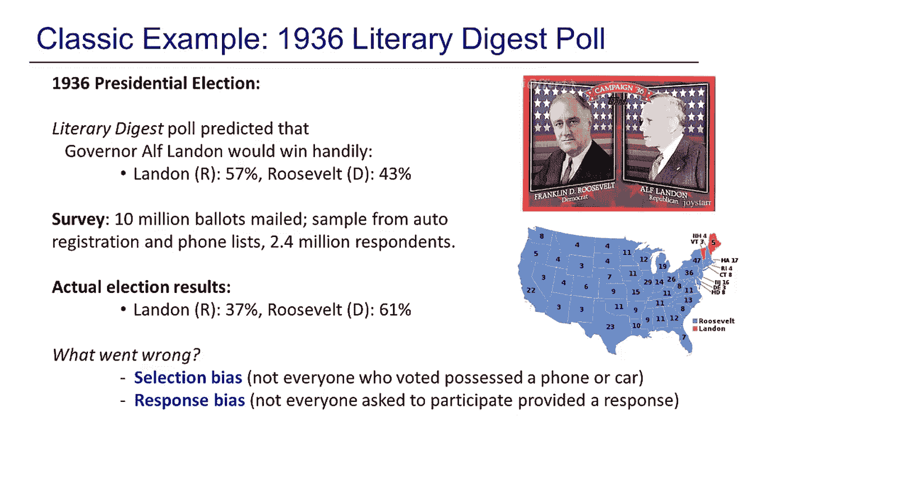
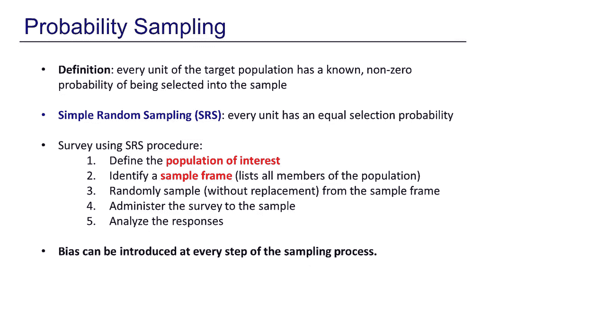
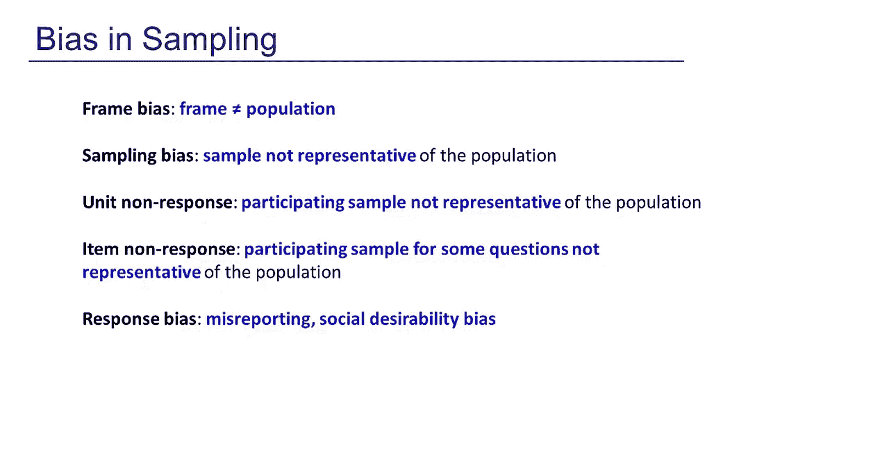
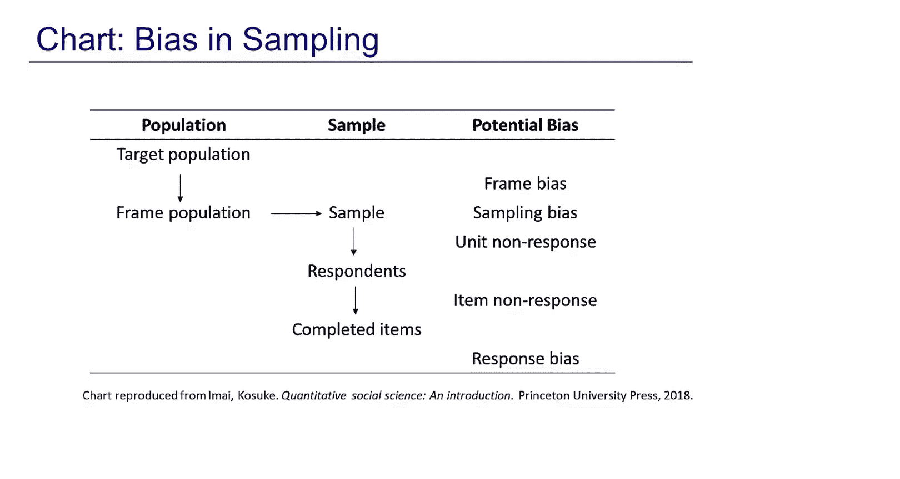
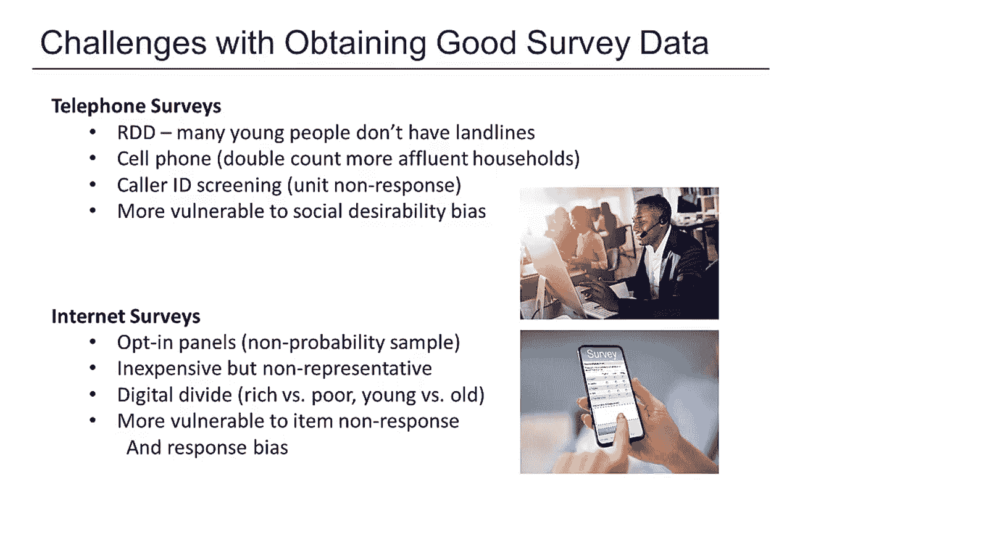

# 数据素养：7：调查抽样 📊

在本节课中，我们将要学习调查抽样的基本概念、目的、实施步骤以及可能遇到的偏差类型。调查抽样是一种广泛用于推断总体特征的方法。

## 为什么进行调查研究？ 🤔

上一节我们介绍了调查抽样的定义，本节中我们来看看研究人员为何要进行调查。调查的核心思想是从总体中抽取一个由个体或其他实体组成的样本，以了解该总体的特征。

一个常见的例子是选举调查。一项民意调查可能会询问500名受访者在即将到来的选举中将如何投票，以此来推断2亿至3亿公民在选举日的实际投票情况。

这种方法有效吗？理论上，它非常有效。就像一滴血能提供关于一个人全身状况的极其准确的信息，一勺汤也能让厨师准确了解整锅汤的味道。

然而，在实践中，调查可能相当具有挑战性，正如本视频将要解释的。调查容易受到几种类型的偏差影响，这些偏差可能导致结果不准确。

总的来说，当样本能够代表总体时，抽样效果就非常好，就像一滴血或一勺汤那样。当能够获得代表性样本时，研究人员不需要非常大的样本量就能得出准确的推断。

## 一个著名的失败案例：1936年总统选举 📉

让我们来看一个著名的随机抽样严重失败的例子。在1936年的总统选举中，民主党现任总统富兰克林·D·罗斯福对阵共和党挑战者阿尔夫·兰登。

竞选期间，当时流行的杂志《文学文摘》进行了一项民意调查来预测选举结果。该调查预测兰登将获得57%的选票，罗斯福将获得43%的选票。这些结果表明兰登将以较大优势赢得选举。

该调查通过向从汽车登记名单和电话号码名单中抽取的样本邮寄1000万张选票来进行。有240万人回应了这项调查。庞大的样本量（240万）使《文学文摘》的研究人员相信他们拥有一个好的样本。

然而在选举日，实际结果与调查预测结果大相径庭。兰登仅获得了37%的选票，而罗斯福以61%的选票横扫选举。

那么，你认为哪里出了问题？为什么调查不准确？这项调查同时遭受了**选择偏差**和**回应偏差**。

选择偏差的发生是因为样本不能代表所关注的总体现。在1936年，并非每个人都拥有汽车或电话。样本未能包含那些没有汽车或电话的公民。此外，这些公民更有可能支持罗斯福。结果，该调查严重低估了对罗斯福的支持率。

除了选择偏差，该调查还遭受了回应偏差。假设最初邮寄的1000万张选票是一个完美的代表性样本。问题是，只有240万（即24%）的样本成员做出了回应。如果做出回应的群体不能代表总体，那么估计值将再次出现偏差。在这个案例中，很明显，回应者比总体人口更支持兰登。

## 概率抽样与简单随机抽样步骤 📝

当正确实施时，概率抽样能确保样本代表所关注的总体现。在概率样本中，由研究者定义的目标总体中的每个单位，都有一个已知的非零概率被选入样本。

在**简单随机抽样**中，每个单位被选中的概率相等。

要正确使用简单随机抽样程序，研究人员必须遵循以下步骤：

以下是实施简单随机抽样的关键步骤：
1.  **定义目标总体**：首先，研究者必须定义所关注的总体现。总体可以包括个体或其他实体，如学校或医院。
2.  **确定抽样框**：定义总体后，研究者应确定一个列出总体所有成员的抽样框。
3.  **从抽样框中随机抽样**：下一步是从抽样框中随机抽取样本。在实践中，抽样通常采用**不放回**的方式进行，这意味着如果一个总体成员被选入样本，它就不能第二次被选中。
4.  **对样本成员实施调查**：然后，研究者可以对样本成员实施调查。
5.  **分析结果并呈现**：一旦调查完成，研究者可以分析回应并将结果呈现给相关受众。

需要注意的是，在抽样过程的每一步都可能引入偏差。如果一个估计值存在偏差，就意味着它在平均意义上与真实的总体值不同。

## 调查抽样中的偏差类型 ⚠️

上一节我们介绍了抽样的基本步骤，本节中我们来详细看看可能困扰调查抽样过程的几种偏差类型。

以下是主要的偏差类型及其定义：
*   **抽样框偏差**：当抽样框未能包含总体的所有成员，而只包含部分成员时发生。如果被包含在框内的成员与被排除的成员在相关方面存在差异，就会产生问题。简而言之，如果抽样框不等于总体，结果就容易受到抽样框偏差的影响。
*   **抽样偏差**：当抽样框的成员不是被随机选入样本时发生。这同样会导致样本不能代表总体。
*   **单位无应答**：假设你已经确定了一个准确的抽样框，并使用该框创建了一个真正的简单随机样本。如果该样本中的某些成员未能回应调查，研究就出现了单位无应答。换句话说，当样本成员不参与时，调查就容易受到单位无应答的影响。结果是，参与调查的样本不能代表总体。
*   **项目无应答**：现在假设样本的所有成员都参与了调查，但少数人选择跳过某些特定问题。这会导致项目无应答。这意味着对于某些问题，参与回答的样本不能代表总体。
*   **回应偏差**：最后，假设样本的所有成员都参与了调查，并回答了调查中的所有问题。研究仍可能受到回应偏差的困扰，这意味着一些样本成员没有准确地回答问题。这可能由多种原因造成。一些样本成员可能仅仅因为回忆困难而误报。也可能是受访者由于**社会期望偏差**而没有准确回应。受访者可能高报投票、锻炼等可取行为，而低报吸毒等不可取行为。

正如现在所希望的那样，要产生有效的结果，需要非常仔细的抽样和调查设计。

## 抽样过程与偏差总结图 📊

下图总结了抽样程序以及每个阶段潜在的偏差：
*   从目标总体确定抽样框时，可能出现**抽样框偏差**。
*   从抽样框中选择样本时，可能出现**抽样偏差**。
*   从选定的样本过渡到实际的调查受访者时，**单位无应答**可能是个问题。
*   当参与的样本成员未能回答一个或多个问题时，**项目无应答**可能是个问题。
*   最后，在回答问题时，一些受访者可能不准确，导致**回应偏差**。

## 调查抽样的具体挑战 📞💻

最后，让我们花点时间思考一下调查抽样之所以如此具有挑战性的一些具体原因。

在进行电话调查时，**随机数字拨号**很有用，因为这种方法能同时覆盖固定电话和手机，而且我们知道如今许多年轻人没有固定电话。此外，随机数字拨号还能捕获未列出的号码。

手机号码的挑战在于，它们通常与一个个体相关联，而固定电话则与一个家庭相关联。在样本中同时包含固定电话和手机，可能会重复计算富裕家庭，因为样本可能包含来自同一家庭的多个手机号码。

电话调查的另一个挑战是，潜在的受访者可能会屏蔽未知号码，这将导致单位无应答。与网络调查相比，电话调查也可能更容易受到社会期望偏差的影响，因为受访者在与真人交谈时，可能会感到压力，从而给出他们认为访问员想听的答案。

网络调查也被广泛使用，它们有自己的一系列优点和缺点。如今许多调查使用**自愿加入小组**，这是一种非概率样本。自愿加入小组由自愿参与调查的受访者样本组成。如果自愿加入小组在相关方面（如人口统计特征或观点）与目标总体存在差异，结果就会出现偏差。

总的来说，网络调查比电话调查便宜得多，但通常代表性较差。这部分是由于富人与穷人之间、不同代际之间仍然存在的数字鸿沟。

最后，网络调查可能比电话调查更容易受到回应偏差的影响。受访者在网络调查中可能更倾向于跳过问题，或者没有完整阅读问题。简而言之，很难控制受访者是否完全完成了网络调查，以及他们完成调查的速度。

这些问题都不是决定性的，但研究者在设计调查和解释结果时应予以考虑。

## 总结 ✨

本节课中我们一起学习了调查抽样的核心内容。我们了解到调查抽样的目的是通过代表性样本来推断总体特征。我们详细阐述了实施简单随机抽样的步骤：定义总体、确定抽样框、随机抽样、实施调查、分析结果。我们还深入探讨了可能影响调查准确性的多种偏差，包括抽样框偏差、抽样偏差、单位无应答、项目无应答和回应偏差，并通过历史案例了解了这些偏差的实际影响。最后，我们分析了电话调查和网络调查各自面临的挑战。理解这些原理对于设计和评估任何调查研究都至关重要。