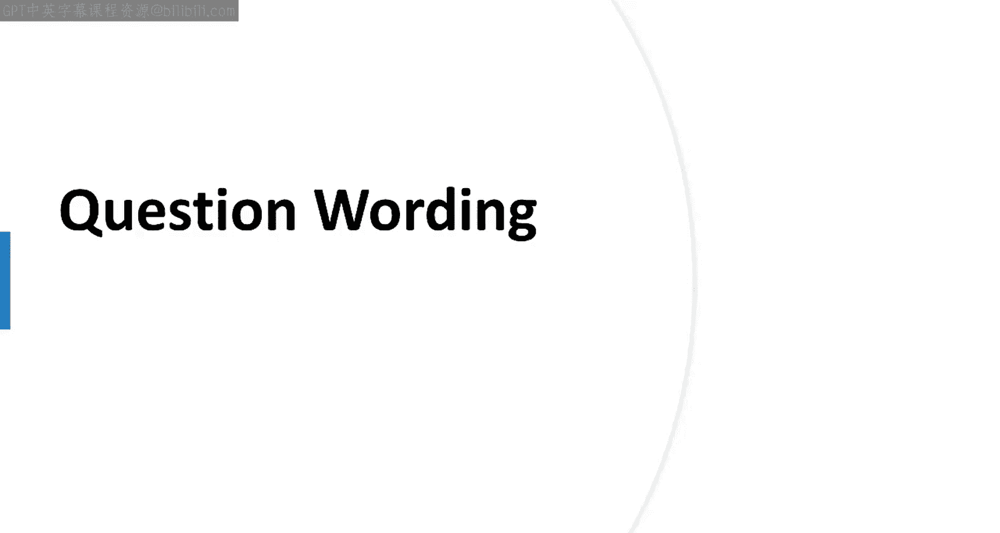
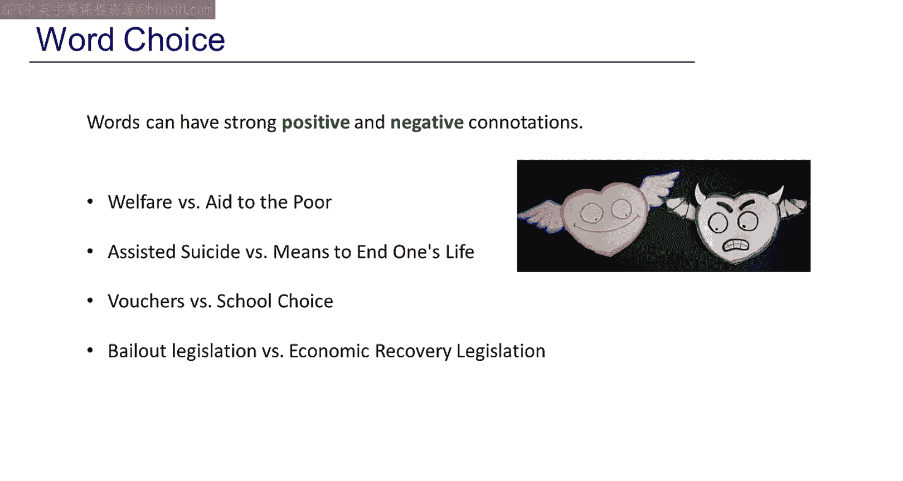
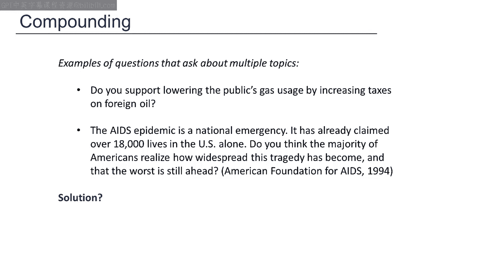
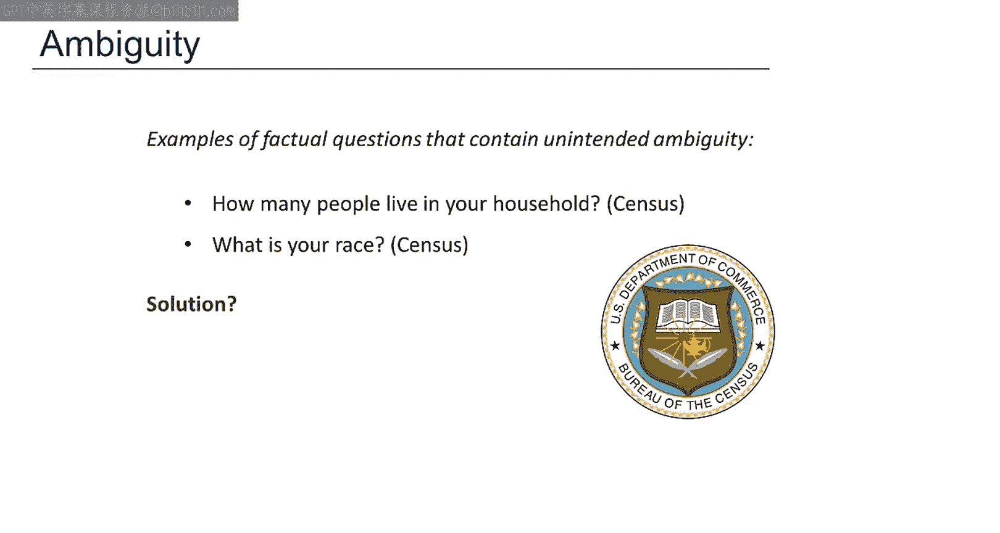
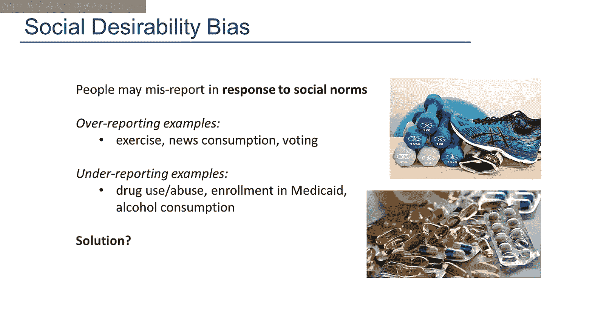
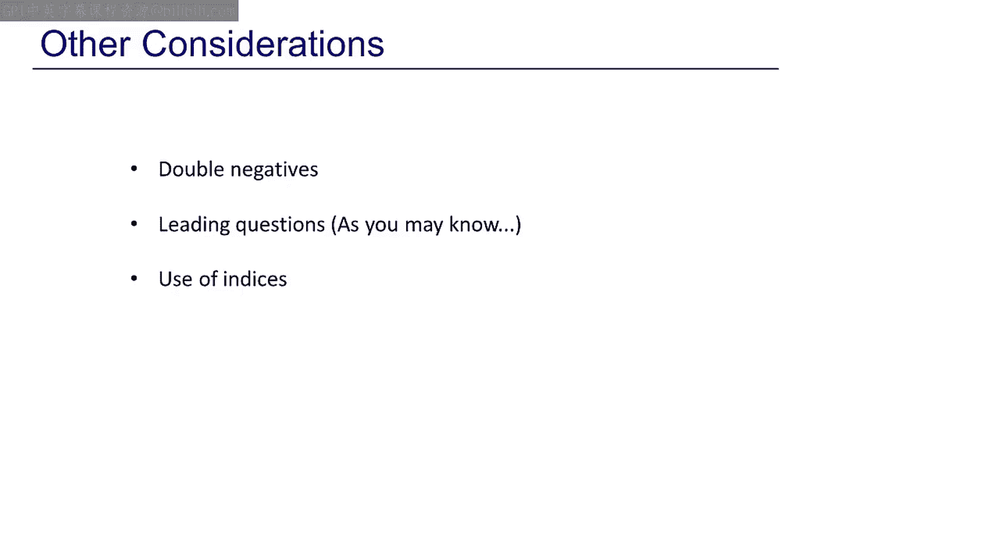

# 约翰霍普金斯大学《数据素养（数据⧸测量⧸回归⧸概率⧸毕业项目）｜Data Literacy》中英字幕（deepseek p24 8_问题措辞.zh_en -BV1jXtMemEuh_p24-

Question wording surveyve design is challenging。 A poor design easily leads to the collection of biased information。

 Luckily， however， there are decades of research that today's survey designers can leverage。

 There are widely agreed upon best practices for all aspects of survey design By the end of this video you should be able to design wellworded survey questions and evaluate survey questions based on the way in which they are worded。

Word choice。The decisions about which words to use in a question are important。

 Words can have very strong， positive and negative connotations。

 The specific words and labels used can significantly influence the survey findings。

 Consider the examples on this slide。 If you ask respondents about whether they think government should increase spending on welfare programs。

 you'll undoubtedly get far fewer respondents who express agreement with this policy proposal than if you ask the same respondents whether they think government should increase spending on programs that provide aid to the poor。

As another example， compare the phrases assisted suicide and means to end one's life Imagine using these phrases in a survey about doctor' role in caring for terminally ill patients。

Use of the first phrase would almost certainly garner less support than use of the second phrase。

 The same is true about using the term vouchers versus the phrase school choice in surveys about charter schools and private schools。

 These are loaded terms， and each conjures up very different ideas and sentiments。Or finally。

 imagine asking respondents about their support for bailout legislation versus economic recovery legislation。

 the use of these phrases with similar samples would undoubtedly reveal a very different set of preferences。

In general， more respondents are going to express support for economic recovery measures than for measures that refer to bailouts。

 even if the underlying legislation is the same。The takeaway point is that word choice in general。

 but specifically in survey questions， matters a lot。

Compounding。Another consideration when crafting survey questions is to avoid compounding。

 a compound question asks about multiple topics。 Consider the two examples on this slide。

The first question asks， do you favor reducing American use of gasoline by increasing taxes on foreign oil。

 Notice that this seemingly simple question is really asking two different things。 First。

 the question asks whether the respondent support lowering the public's gas usage。 Second。

 the question asks whether the respondent support this policy objective by increasing taxes on foreign oil。

 If a respondent indicates support， it is impossible to know whether that respondent agrees with the first part of the question。

 The second part of the question or both parts。 In consequence。

 it is hard to interpret the results and certainly makes advocating for policy based on these results difficult。

Let's turn to the second question。This question is from a survey administered in 1994 by the American Foundation for Aids。

 The question reads the Aids epidemic is a national emergency。

 It has already claimed over 18000 lives in the US alone。

 Do you think the majority of Americans realize how widespread this tragedy has become and that the worst is still ahead。

The first part of the compound question asks whether the majority of Americans believe AIidSs is widespread。

 and the second asks whether the majority of Americans believe the worst is still ahead。Again。

 if a respondent replies yes， the researcher can't know whether the respondent agrees with one or both of these statements。

The solution is to break each of these compound questions into two separate questions。

 an individual survey question should concisely ask about one issue。

Ambiguity。And while survey designers should strive to keep survey questions as short and clear as possible。

 they also need to avoid ambiguity。 Even simple， factual questions can contain unintended ambiguity。

 Take a look at these two simple questions from the US census。

 The first asks about the number of people who live in a respondent's household。

 While seemingly straightforward， There are many situations that make this question not so straightforward。

 What if someone is living in your house temporarily。 Does that person count。

 What about students who are away at college， or what if a member of your household splits time between two residences。

 You can imagine additional scenarios that would complicate the answer to this question。

The second question asks about the respondent's race。

 You can imagine multiracial respondents struggling with this question。 Rely。

 you can imagine some respondents wondering whether their response should reflect their exact genetic makeup or the one or more race categories that they see themselves as fitting into best。

In short， survey designers must balance the need to be concise with the equally important need to be unambiguous to the greatest extent possible。

To avoid ambiguity， survey designers can pretest their questions and add specificity where needed。

 we'll talk more about pretesting in the lesson on survey evaluation。

Social desirability bias Social desirability bias refers to the misreporting that occurs when respondents provide answers they perceive as aligning with social norms。

 For example， we know that respondents overreport socially desirable behaviors such as exercise。

 news consumption and voting。On the other hand， respondents underreport socially undesirable behaviors or stigmatized behaviors such as drug use and abuse。

 enrollment in government programs such as Medicaid and alcohol consumption。

Social desirability bias is an inherent problem when studying sensitive issues。

 one way to mitigate this bias is to preface the question in a way that reduces the pressure on the respondent to respond in a socially desirable way。

For example， when asking about voting， some polling firms now use the following wording votinging can be difficult and time consuming。

 and many people didn't have a chance to vote this past E day。

 Did you happen to vote research has found that this type of question yields a survey voter turnout percentage that more closely aligns with the actual turnout percentage then traditional voting questions。

Other considerations。Beyond the issues discussed in this video。

 there are other considerations you should take into account when writing and evaluating survey questions。

 First， it's important to avoid double negatives。 Consider the following question。

 Does it seem impossible to you that the Holocaust never occurred。

 even if you know the Holocaust occurred， It's hard to know how to answer this question when you first read it or hear it。

 particularly if you are moving through a survey quickly， as most respondents do。Second。

 it's important to avoid leading questions。 I'm sure you've all seen questions that begin with。

 as you may know， and then go on to provide the respondent with a piece of specific information。

 while this can sometimes be helpful and even necessary。

 it places a specific piece of information at the forefront of respondent' mind when they are answering。

 and this type of framing should be taken into account when interpreting and especially when presenting the results to an audience。

Finally， it's often a good idea to use an index to measure tricky concepts。

 such as political efficacy。 For example， imagine a political efficacy index made up of three questions。

 one， does the government care about what people like you think2。

 do you agree or disagree that voting is the only way people like you have any say？Three。

 do you agree or disagree that sometimes the government is so complicated that people like you can't really understand what is going on？

Even if one of these questions turns out to be problematic。

 the efficacy index as a whole might be useful since it relies on more than one question。

In conclusion， no survey or even survey question is perfect and completely invulnerable to bias。

 but survey designers can implement best practices to collect the best data possible。

