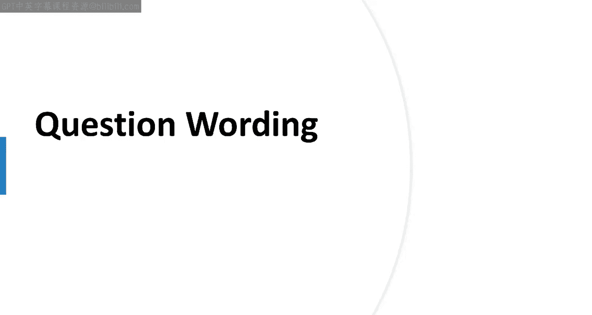
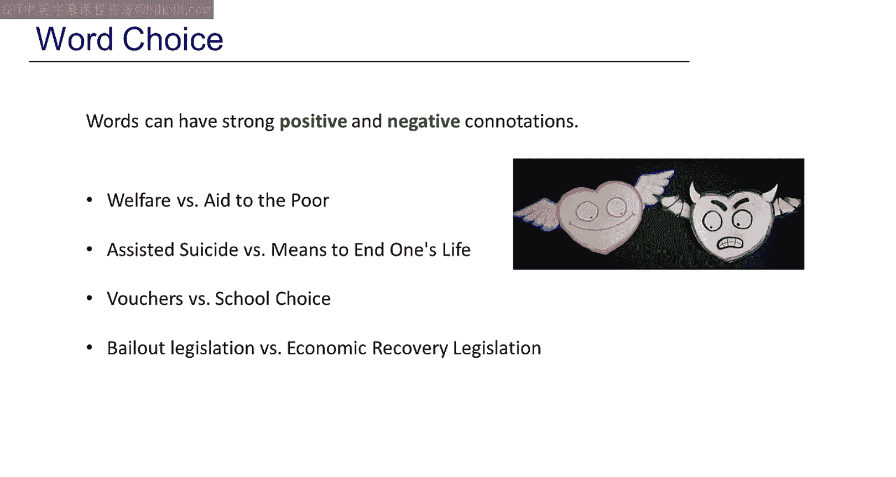
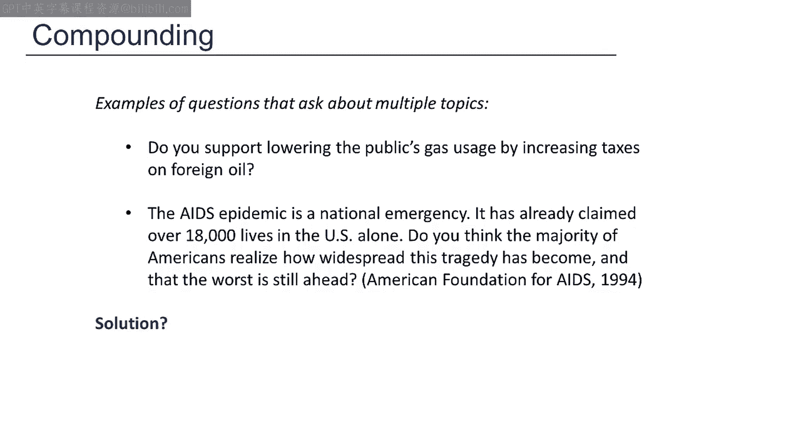
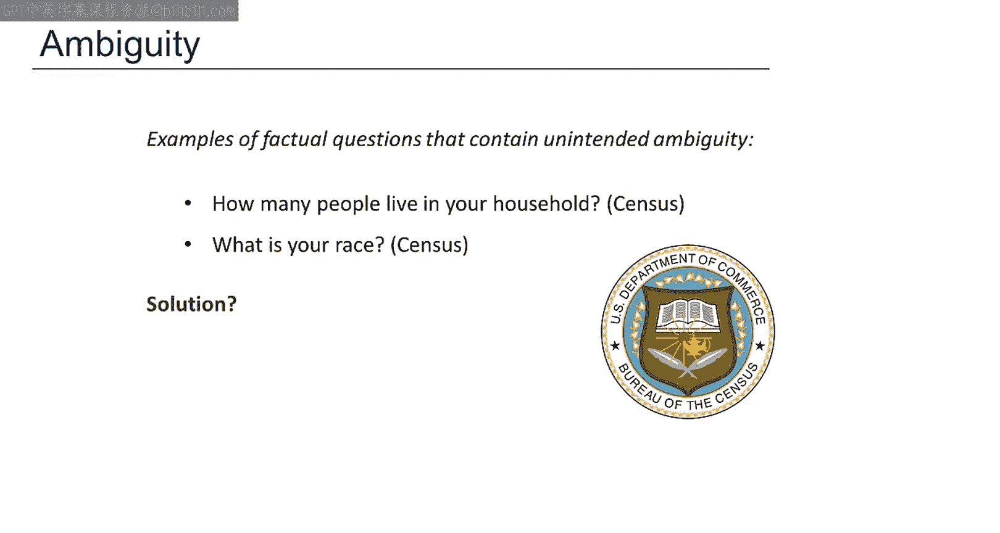
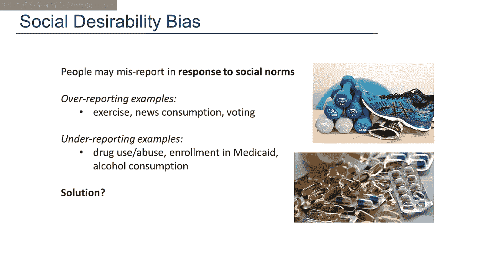
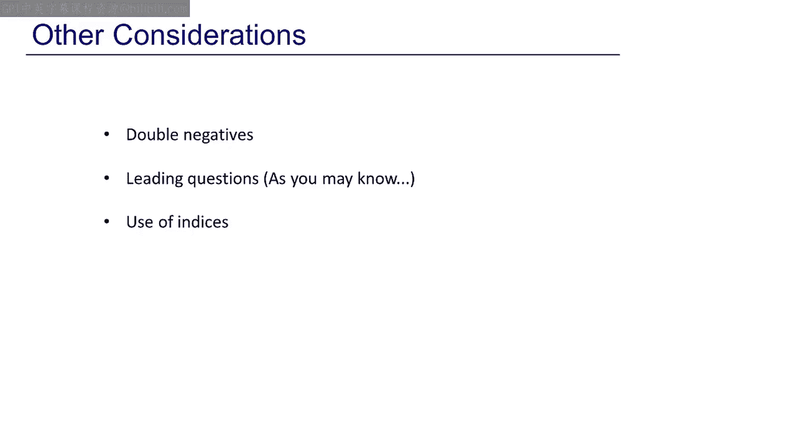

# 数据素养：8：问题措辞 📝

在本节课中，我们将学习如何设计措辞良好的调查问题，并学会基于措辞方式评估现有问题。问卷设计具有挑战性，糟糕的设计很容易导致收集到有偏差的信息。然而，幸运的是，有数十年的研究可供今天的调查设计者借鉴。在调查设计的各个方面，存在广泛认可的最佳实践。

## 词语选择 🗣️

上一节我们介绍了问题措辞的重要性，本节中我们来看看词语选择的具体影响。关于在问题中使用哪些词语的决定至关重要。词语可能带有非常强烈的正面或负面含义。所使用的具体词语和标签会显著影响调查结果。

以下是几个词语选择影响调查结果的例子：

*   **“福利项目” vs “援助贫困人口的项目”**：询问受访者是否认为政府应增加对“福利项目”的支出，与询问是否应增加对“援助贫困人口的项目”的支出相比，前者获得的赞同答复会少得多。
*   **“协助自杀” vs “结束生命的手段”**：在关于医生照顾绝症患者角色的调查中，使用“协助自杀”这一短语几乎肯定会比使用“结束生命的手段”获得更少的支持。
*   **“教育券” vs “择校”**：在关于特许学校和私立学校的调查中，使用“教育券”与“择校”这两个术语也会产生不同效果。
*   **“救助法案” vs “经济复苏法案”**：即使针对的是相同的样本群体，使用“救助法案”和“经济复苏法案”这两个短语进行调查，无疑会揭示出非常不同的偏好倾向。通常，支持“经济复苏措施”的受访者会比支持提及“救助”的措施的受访者更多，即使背后的立法内容相同。

关键要点是，词语选择，特别是在调查问题中，影响巨大。

## 复合问题 🔗

除了词语选择，在构思调查问题时，另一个需要考虑的因素是避免复合问题。复合问题是指在一个问题中询问多个主题。

以下是两个复合问题的例子：

*   **例子一**：“你是否赞成通过对进口石油增税来减少美国的汽油使用量？” 这个看似简单的问题实际上询问了两件事：1) 受访者是否支持降低公众的汽油使用量；2) 受访者是否支持通过对外国石油增税来实现这一政策目标。如果受访者表示支持，研究者无法知道他/她是同意问题的第一部分、第二部分，还是两部分都同意。因此，结果难以解释，基于这些结果进行政策倡导也必然困难。
*   **例子二**：“艾滋病疫情是一场国家紧急事件，仅在美国就已夺去超过18000条生命。你认为大多数美国人是否意识到这场悲剧的波及范围有多广，并且最坏的情况还在后头？” 这个复合问题的第一部分询问大多数美国人是否认为艾滋病传播广泛，第二部分询问大多数美国人是否认为最坏的情况还在后头。同样，如果受访者回答“是”，研究者无法知道他/她是同意其中一个陈述，还是两个都同意。

解决方案是将这些复合问题拆分成两个独立的问题。一个独立的调查问题应该简洁地询问一个议题。

## 模糊性 ❓

虽然调查设计者应努力使调查问题尽可能简短清晰，但也需要避免模糊性。即使是简单的事实性问题也可能包含意想不到的模糊之处。

以下是美国人口普查中的两个简单问题：

*   **问题一**：“有多少人住在您家？” 这个问题看似直接，但许多情况会使其变得不那么直接。例如：如果有人暂时住在你家，这个人算吗？在外地上大学的学生算吗？或者，如果你的家庭成员在两个住所之间分配时间怎么办？你可以想象更多会使回答复杂化的场景。
*   **问题二**：“您的种族是什么？” 可以想象，多种族受访者回答这个问题时会感到困惑。同样，一些受访者可能会思考他们的回答是应该反映他们确切的基因构成，还是反映他们认为自己最符合的一个或多个种族类别。

简而言之，调查设计者必须在保持简洁的需要与尽可能保持明确这一同等重要的需求之间取得平衡。为了避免模糊性，调查设计者可以对问题进行预测试，并在需要时增加具体说明。我们将在关于调查评估的课程中更详细地讨论预测试。

## 社会期望偏差 😇

社会期望偏差是指当受访者提供他们认为符合社会规范的答案时发生的误报。例如，我们知道受访者会过度报告社会期望的行为，如锻炼、新闻消费和投票。另一方面，受访者会少报社会不期望的行为或被污名化的行为，如吸毒和药物滥用、参加政府项目（如医疗补助计划）以及饮酒。

在研究敏感议题时，社会期望偏差是一个固有的问题。减轻这种偏差的一种方法是以一种减轻受访者以社会期望方式回答压力的措辞来引出问题。

例如，在询问投票情况时，一些民调机构现在使用以下措辞：“投票可能既困难又耗时，许多人在过去的选举日没有机会投票。您碰巧投票了吗？”研究发现，与传统投票问题相比，这种类型的问题得出的调查投票率百分比更接近实际投票率百分比。

## 其他注意事项 📋

除了本视频讨论的问题外，在撰写和评估调查问题时，还应考虑其他因素。

以下是其他需要注意的事项：

*   **避免双重否定**：考虑以下问题：“大屠杀从未发生过，这对您来说似乎不可能吗？”即使你知道大屠杀确实发生过，第一次读到或听到这个问题时也很难知道如何回答，特别是如果你像大多数受访者一样快速浏览调查时。
*   **避免诱导性问题**：我相信你们都见过以“正如您可能知道的那样”开头的问题，然后继续向受访者提供一条具体信息。虽然这有时可能有帮助甚至是必要的，但它将一条特定信息置于受访者回答时的思维前沿，在解释结果，尤其是向受众呈现结果时，应考虑这种框架效应。
*   **使用指数测量复杂概念**：使用指数来测量棘手的概念（如政治效能感）通常是个好主意。例如，想象一个由三个问题组成的政治效能感指数：1) 政府关心像您这样的人的想法吗？2) 您是否同意投票是像您这样的人表达意见的唯一方式？3) 您是否同意有时政府过于复杂，以至于像您这样的人无法真正理解发生了什么？即使其中一个问题存在问题，整个效能感指数可能仍然有用，因为它依赖于不止一个问题。

## 总结 📚

本节课中，我们一起学习了设计良好调查问题的关键原则。我们探讨了**词语选择**对受访者回答的显著影响，学习了如何识别和拆分**复合问题**以避免混淆。我们还讨论了避免**模糊性**的重要性，以及如何通过预测试和增加具体说明来应对。针对敏感话题，我们介绍了**社会期望偏差**的概念及其缓解方法。最后，我们补充了其他注意事项，如避免双重否定、诱导性问题，并建议使用**指数**来更可靠地测量复杂概念。

总之，没有哪个调查甚至调查问题是完美且完全不受偏差影响的，但调查设计者可以实施最佳实践，以收集尽可能好的数据。