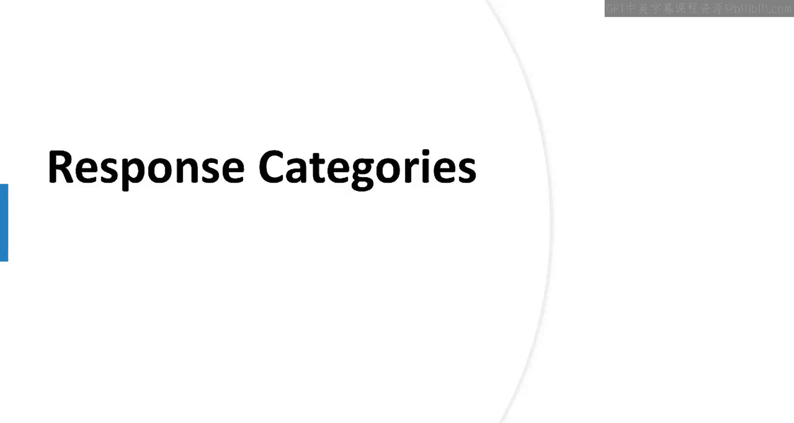
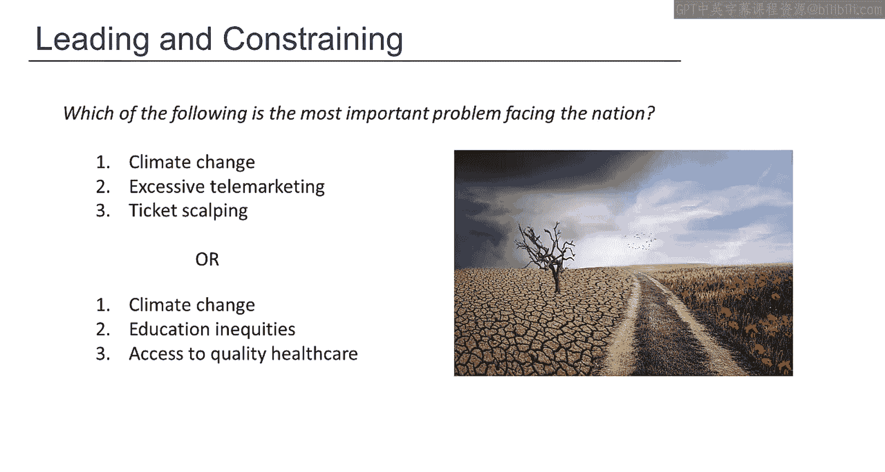
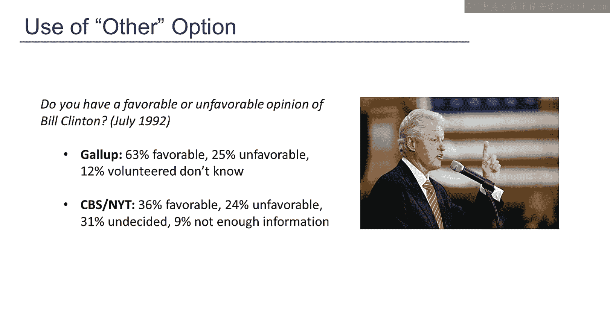
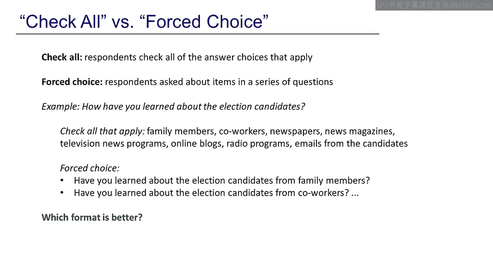

# 约翰霍普金斯大学《数据素养（数据⧸测量⧸回归⧸概率⧸毕业项目）｜Data Literacy》中英字幕（deepseek p25 9_回答类别.zh_en -BV1jXtMemEuh_p25-

Response categories in addition to focusing on developing the best question wording possible。

 survey designers should also pay close attention to the response categories they use and consider the advantages and disadvantages of different response options。

By the end of this video， you should be able to evaluate the response choices for a particular survey question。

Leading and constraining。The response choices given for any particular question can lead the respondent toward an answer choice。

 This is because by definition， the response choices often constrained or limit the survey respondent to that set of choices。

Consider the commonly used question， which of the following is the most important problem facing the nation？

Now， imagine that the set of answer choices includes climate change。

 excessive telemarketing and ticket scalping。 Obviously， this is an extreme example。

 but it underscores the point。 Given this set of choices。

 many respondents will select climate change， since many will perceive this as more of an important national problem than the other two options。

Now imagine the choices were the following， climate change。

 education inequities and access to quality health care。

 you can imagine much greater dispersion in respondents answers if these are the choices。

The takeaway is that the set of response choices given to respondents limits their options and can therefore sway the results if not designed appropriately。

Another consideration when designing response categories is whether or not to use the other option Take a look at the question on this slide。

 which was used in a July 1992 telephone survey when Bill Clinton was running to be president for the first time。

The question asked whether respondents had a favorable or unfavorable opinion of Bill Clinton。

The Gallup version of the question did not include a don't know option。

 whereas the CB B S New York Times version included both an undecided option and a not enough information option。

63% cent of the respondents to the Gallup survey reported holding a favorable opinion。

 and only 12 per cent of respondents， volunteered a don't no answer。 Remember。

 Bill Clinton was a relative newcomer to the national political stage at this point in time。

In contrast， only 36% of respondents to the CBS New York Times poll reported holding a favorable opinion。

 and 40% of respondents selected either the undecided or not enough information options。

This example highlights the importance of using an other or don't know option。

 particularly when it is quite understandable or reasonable for respondents to not have a fully formed opinion or response。

Check all versus forced choice Lastly， some survey questions allow respondents to select all that apply while other surveys instead divide these types of questions up into multiple forced choice questions let's walk through an example。

 supposeose a survey question asks respondents， how have you learned about the election candidates。

A check all that apply response might include the following answer choices， family members。

 coworkers， newspapers， news magazines， television news programs， online blogs， radio programs。

 and emails from the candidates In contrast， a forced choice response would walk through each of the above answer choices。

 asking respondents whether or not they learned about the election candidates from a particular source。

Experimental research has shown that respondents select more items with a forced choice response structure as a result this option is generally preferable。

 while it's more time consuming， the evidence suggests that it tends to yield better results。

As you can therefore see， there is some trade off between the goals of being clear。

 unambiguous and concise， as is often the case in quantitative research。

 analysts must use their best judgment and be transparent about the methodological choices they make。

