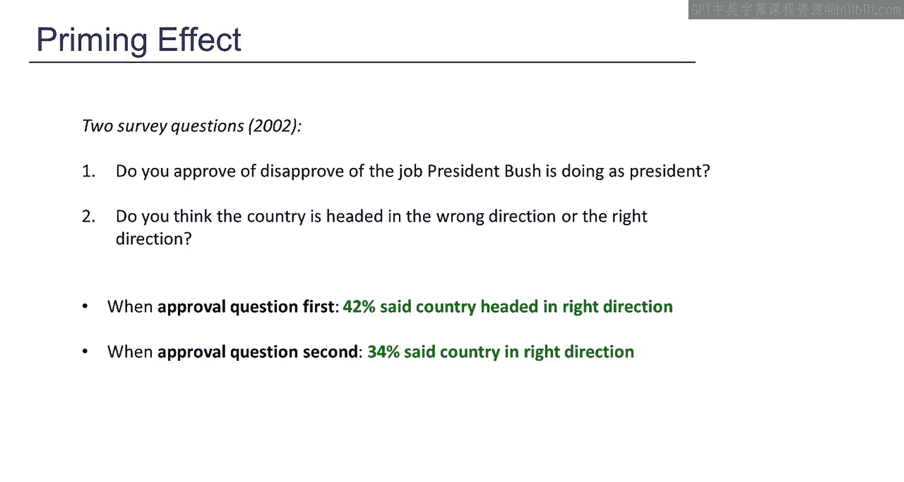
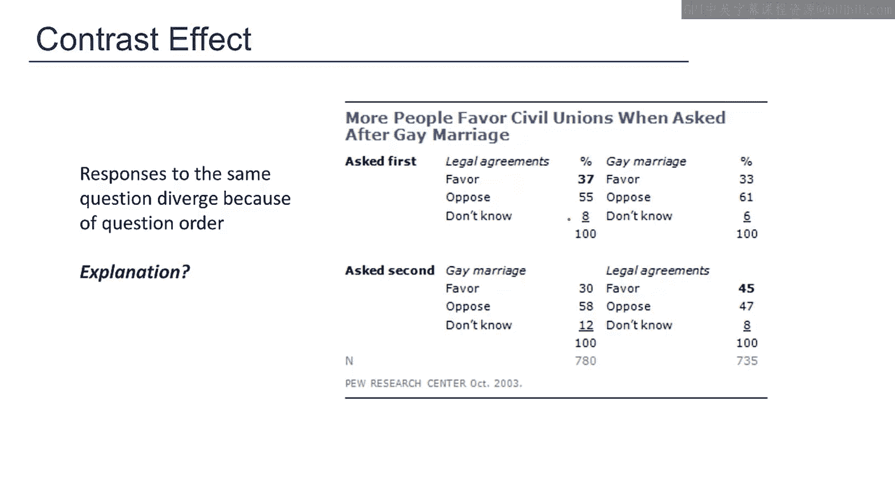
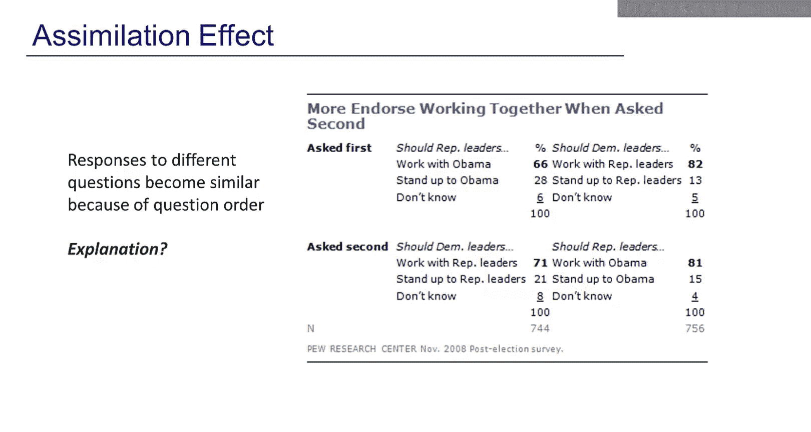

# 约翰霍普金斯大学《数据素养（数据⧸测量⧸回归⧸概率⧸毕业项目）｜Data Literacy》中英字幕（deepseek p26 10_问题顺序.zh_en -BV1jXtMemEuh_p26-

Question order。The third major element of survey design。

 in addition to question wording and response choices， is question order。

The order of the questions can influence the findings of a survey by the end of this video。

 you will be able to evaluate whether a survey's question order is vulnerable to priming。

 contrast or assimilation effects。

Priming effect。In a survey context， priming occurs when the researcher gives the respondent either purposefully or inadvertently。

 something in particular to think about when answering a question。Within a single research question。

 priming occurs when the question begins with a phrase such as， as you may know。

 respondents are specifically asked to consider that information when answering the question。

In terms of question order， priming can occur when respondents consider the issue or person highlighted in one question when they answer a subsequent question in the survey。

 Let's take a look at the example on the slide。These two questions were administered as part of an experiment in a 2002 survey。

 Half the respondents received question1 first， and half the respondents received question one second。

Question one reads，Do you approve or disapprove of the job President Bush is doing as president？

Question two reads， do you think the country is headed in the wrong direction or the right direction？

Among respondents who answered the approval question first。

 42% said the country was headed in the right direction。

Among respondents who answered the approval question second。

 34% said the country was headed in the right direction。

It's therefore clear that priming respondents to think specifically about President Bush when considering whether the country was headed in the right direction had a significant effect on the distribution of the responses。

Contrast effect。The order of survey questions can also create a contrast effect。

 a contrast effect occurs when the responses to the same question diverge owing to the question order。

Take a look at the table on this slide， which reports the findings from a survey experiment conducted by the Pew Research Center in 2003。

 The experiment asked each group two questions。 One。

 whether a gay couple should be allowed to enter into a legal agreement that gives them the same rights as a married couple and two。

 whether a gay couple should be allowed to marry when the legal agreements question was asked first。

 a similar percentage of respondents indicated support for both legal agreements and gay marriage。

In contrast， when the gay marriage question was asked first。

 the difference in support between legal agreements and gay marriage was 12 percentage points。

 Moreover， we see an8 percentage point difference in support for legal agreements between the two experimental groups。

 again， highlighting the divergence and responses based on question order。

Assimilation effect。An assimilation effect is the opposite dynamic。

 It occurs when responses to different questions become similar because of question order。

 Take a look at the example on this slide。The table shows experimental evidence from a survey conducted after the 2008 US election。

 one group was asked whether Republican leaders should work with President Obama or stand up to him。

 and then asked whether Democratic leaders should work with Republican leaders or stand up to them。

The other group was asked these same questions in the reverse order。

Among the group that was first asked about the Democratic leaders working with Republican leaders and then asked about Republican leaders working with President Obama。

An overwhelming majority supported bipartisanship， 82% and 81% respectively。

When the order was reversed， support for bipartisanship was lower and more divergent。

66% and 71% respectively， This shows that the question order and in particular。

 not leaving with President Obama LED to an assimilation of responses。

The key takeaway point from this video is that the order of the questions can influence the results in powerful ways。

 just as question wording and the choice of response categories can。

 a survey designer must pay close attention to these three categories of design and those interpreting survey results must likewise consider the role that each plays in influencing the findings。

