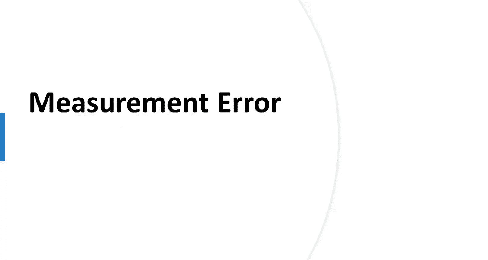
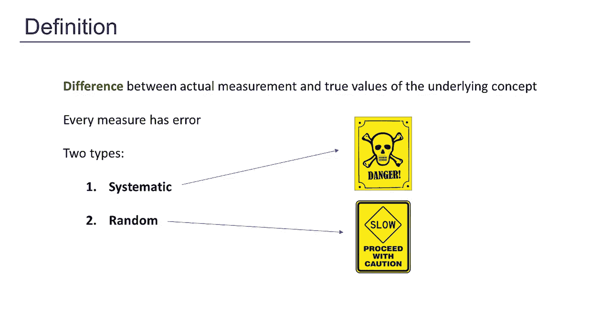
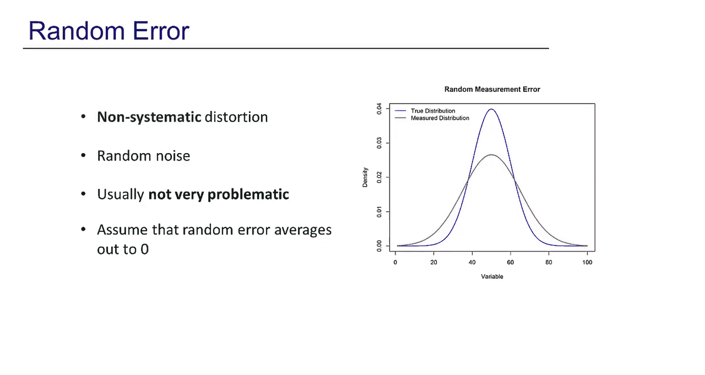
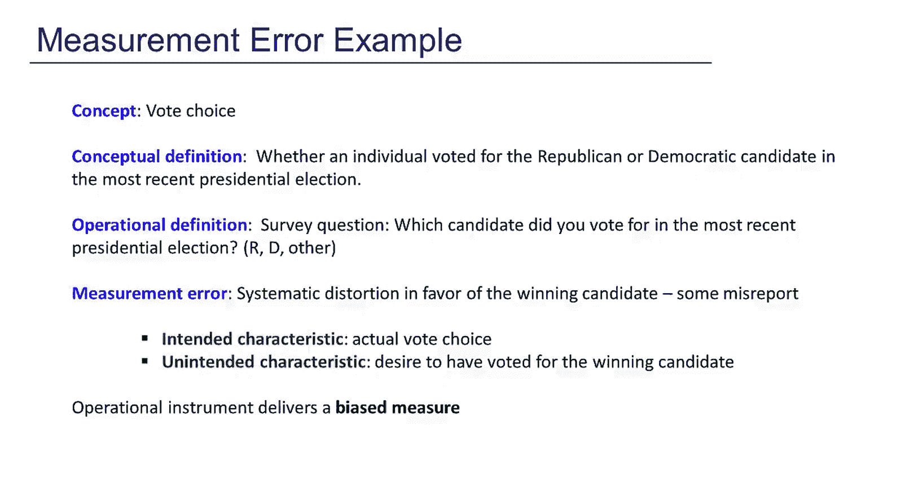
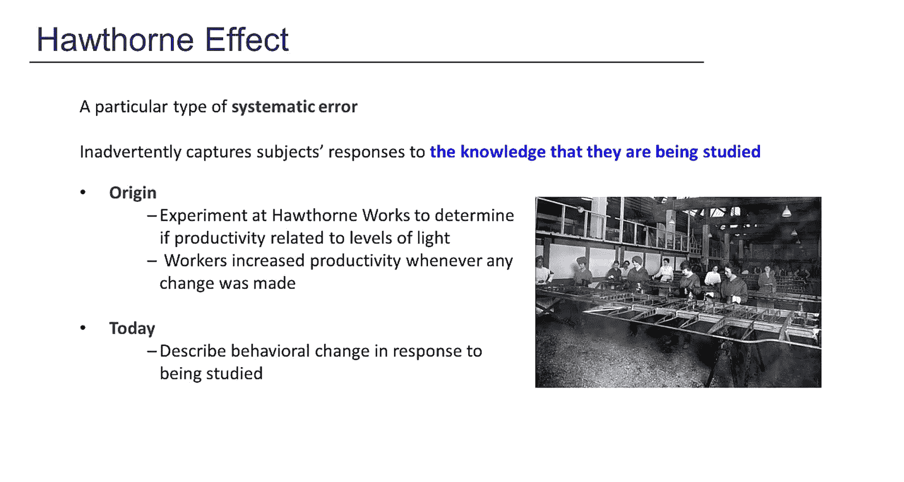
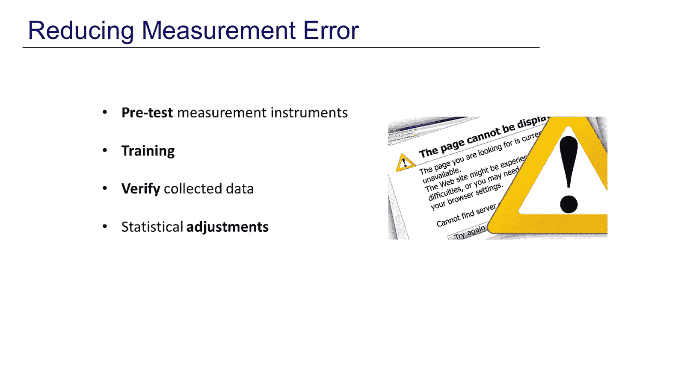

# 约翰霍普金斯大学《数据素养（数据⧸测量⧸回归⧸概率⧸毕业项目）｜Data Literacy》中英字幕（deepseek p27 12_测量误差.zh_en -BV1jXtMemEuh_p27-

Measurement error。Despite careful efforts to develop thoughtful conceptual definitions。

 operational definitions， and measurement instruments。

 researchers inevitably must cope with measurement error By the end of this video。

 you should be able to describe and identify different types of measurement error and discuss a few useful ways for mitigating this error。

Definition measurement error is the difference between the actual measurement of a concept and the true values of the concept for a population。

As we discuss measurement error， keep in mind that every measure has error in it。

 measurementsurement error is inevitable， and it doesn't necessarily undermine your results。

The key to dealing with measurement error is to identify the type of error at hand and then address that error with an appropriate approach。

 There are two types of measurement error， systematic error and random error。

 systematic error is generally far more problematic than random error for reasons that I'll explain momentarily。

Nonetheless， there are strategies for mitigating both types of error。

Systematic measurement error is sometimes referred to as measurement bias， as with any type of bias。

 measurement bias can produce inaccurate findings。Systematic measurement error occurs when there is chronic distortion in the data。

 This means that the empirical measure consistently mismeasures the concept you're studying。

 System measurement error is problematic because on average， the measure will always be wrong。

 and by wrong， I mean that it will always fail to measure what you think it's measuring。

Recall the political tolerance example from our discussion of operational definitions In that example。

 a researcher sought to test how survey respondents felt about protecting political freedoms for unpopular groups。

 but the survey question may have inadvertently captured respondents' feelings about protecting political freedoms for generally uncontroversial groups such as atheists leading to an overstatement of respondents level of political tolerance。

 This is systematic measurement error as the level of political tolerance expressed by respondents is likely to be consistently overstated。

 rather than overstated by some while understated by others。Take a look at the graph on the right。

 The blue line shows the distribution of the true values of a variable that a researcher wants to measure。

 While the red line shows the measure distribution for that variable。

Notice that the peaks of the two distributions， which are the average values of those distributions are different。

In other words， the average value of the measured distribution does not equal the average value of the true distribution。

This means the measurement tool suffers from systematic measurement error， and in this case。

 the measurement tool underestimates the true values。Random measurement error， in contrast。

 is chaotic and non systematic。 Rand measurement error is generally considered to be less worrisome than systematic measurement error。

 This is because we assume that random measurement error averages out to 0。

With random measurement error， the measure is sometimes overstated and sometimes understated。

 but on average， it is correct。Take a look at the graph on the right。 again。

 the blue line is the true distribution， while the red line is the measured distribution。

Notice that the peaks of the two curves are over the same number。

 This means that the average value of the two distributions is the same。 They have the same mean。

The red distribution is more spread out， meaning it has some random noise added to it。

 but on average， it is correct。

Let's take a closer look at a measurement error example。

 Suppose that you want to study the concept of vote choice。

 Let's define this concept as whether an individual voted to support the Republican or Democratic candidate in the most recent presidential election。

 We can operationalize this concept using a survey question。 Suppose we ask respondents。

 Which candidate did you vote for in the most recent presidential election。

The answer choices being the Republican candidate， the Democratic candidate， or other。

Voting behavior scholars have shown that with survey questions like this。

 we tend to observe systematic distortion in favor of the winning candidate。

What this means is that respondents frequently misreport their true vote in favor of the winning candidate。

 In this example， the intended characteristic is respondents' actual vote choices。

 and the unintended characteristic is respondent' desire to have voted for the winning candidate。

 The unintended characteristic leads voters to misreport their actual vote choice。As a result。

 this operational instrument will deliver a biased measure again and again。

The Hawthorne effect is a specific type of systematic error。

 The Hawthorne effect occurs when a researcher inadvertently captures subjects responses to the knowledge that they are being studied。

 The term originates from an experiment that was conducted at Hawthorn works。

 which produced telephone parts。 The purpose of the experiment was to determine if productivity among workers was related to the level of light in the factory。

 Researchers observed that workers increased their productivity， whenever any change was made。

 meaning whether or not the light was increased or decreased。

 Researchers later realized that it was the knowledge of being studied that increased workers' productivity。

 not the amount of light they were given。 Today， the term is used to describe behavioral changes in response to being studied。

 As an example， think about teachers participating in a class size experiment。

 Teacher assigned to both small and large classes， might work extra hard because they know they are part of a study。

 And as a result， the researcherser might conclude， perhaps incorrectly。

Class size is not related to academic performance。There are several ways to reduce measurement error。

 First， a researcher can pretest the measurement instruments。

 We discussed this extensively in the video on survey evaluation。

 Pretesting often brings to light problems with the research protocol that can lead to measurement error。

 Second， a researcher can ensure that those who are assisting with the measurement process receive adequate training。

Survey interviewers or administrators， for example。

 should be trained in how to use the survey instrument properly and how to address issues that arise。

 such as questions from respondents。Third， a researcher should verify collected data data entry problems are another avenue for measurement error。

 typing in numbers incorrectly or copying and pasting numbers incorrectly can lead to error。

A researcher should be sure to examine a data for these types of errors。

 such as numbers that are outside of a variable's possible range of values。Lastly。

 there are some statistical tools a researcher can use to mitigate the effects of measurement error。

 For example， a researcher can impute missing data or calculate measures of uncertainty that account for the presence of measurement error。

 These tools can be very useful， though they do require that the researcher develops a firm understanding of the specific type and character of the measurement error that plagues the data set under study。

