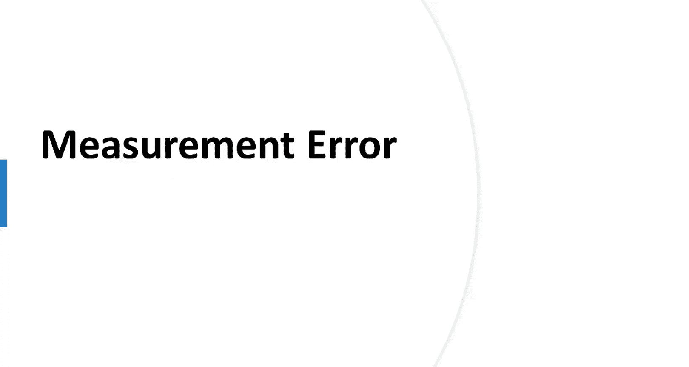
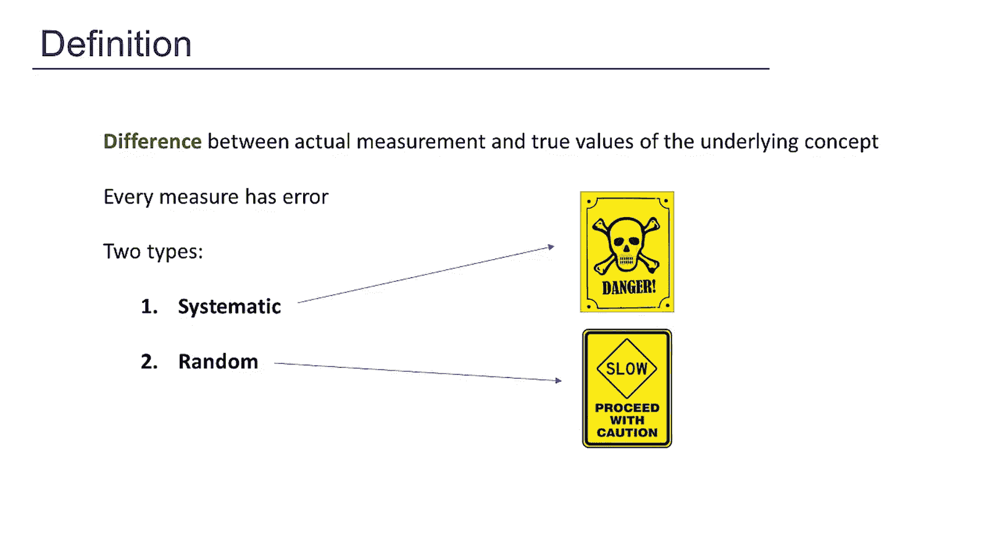
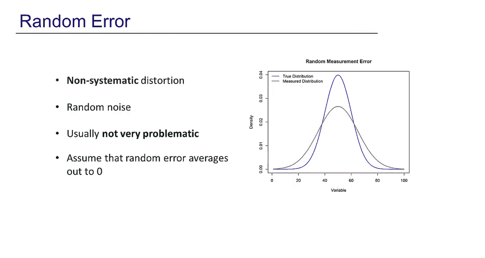
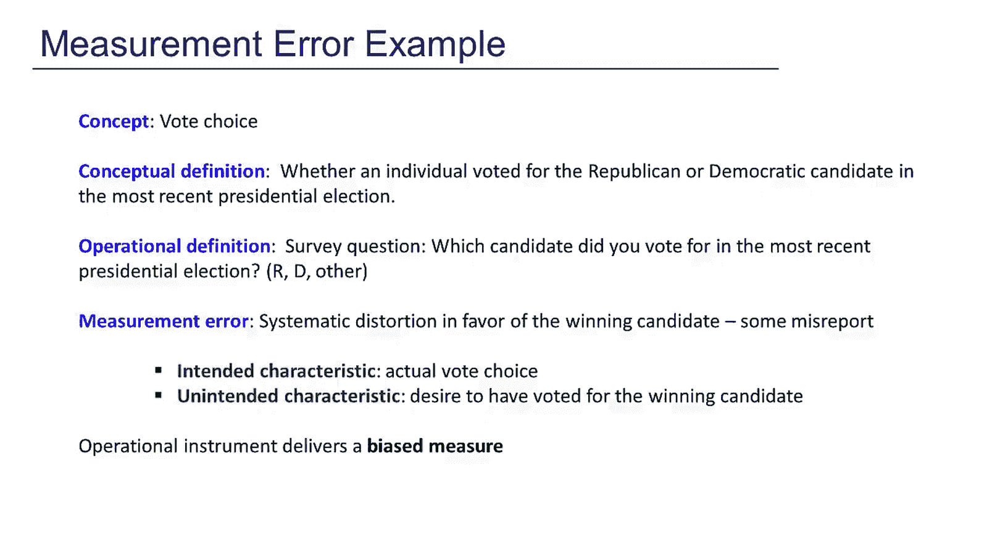
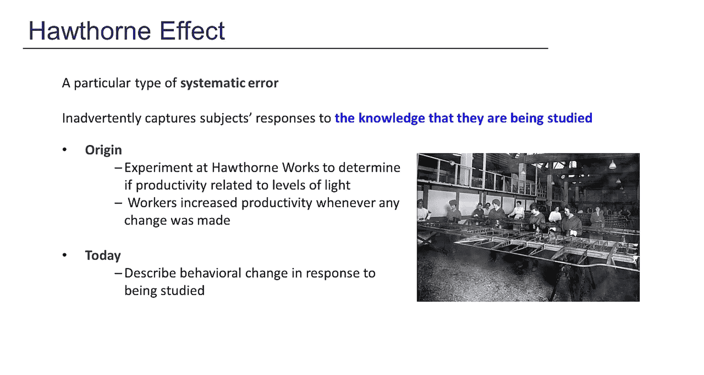
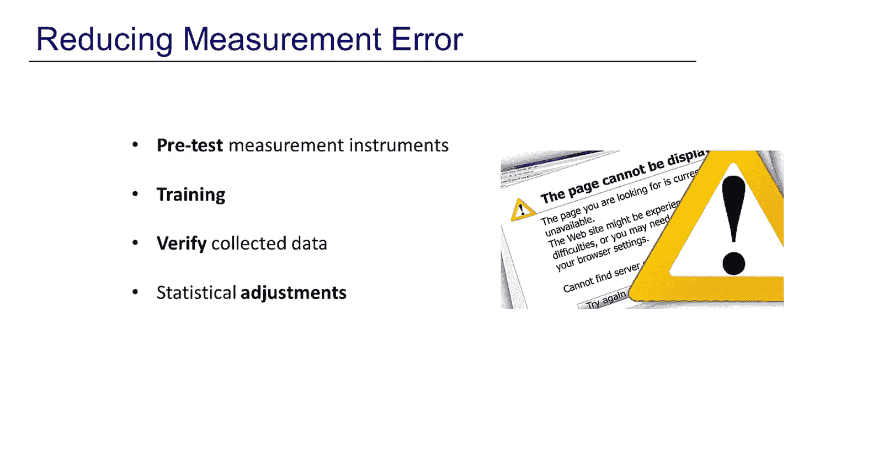

# 数据素养：P27：测量误差 📏

在本节课中，我们将要学习测量误差。尽管研究者们会努力制定深思熟虑的概念定义、操作定义和测量工具，但他们不可避免地需要应对测量误差。通过本节内容，你将能够描述和识别不同类型的测量误差，并讨论几种减轻此类误差的有效方法。

## 测量误差的定义

测量误差是指对一个概念的实际测量值与该概念在总体中的真实值之间的差异。

在讨论测量误差时，请记住，每一项测量都包含误差。测量误差是不可避免的，但它不一定会破坏你的研究结果。处理测量误差的关键在于识别当前误差的类型，然后用适当的方法解决它。

## 测量误差的类型

测量误差主要有两种类型：系统误差和随机误差。系统误差通常比随机误差问题更大，原因稍后会解释。尽管如此，我们仍有策略来减轻这两种误差的影响。

### 系统误差

系统测量误差有时被称为测量偏差。与任何类型的偏差一样，测量偏差可能导致不准确的发现。当数据中存在长期扭曲时，就会发生系统测量误差。这意味着经验测量会持续地错误衡量你所研究的概念。

系统测量误差之所以成问题，是因为平均而言，测量结果总是错误的。这里的“错误”是指它总是无法测量你认为它正在测量的东西。

回想一下我们在讨论操作定义时提到的政治宽容度例子。在那个例子中，研究者试图测试调查受访者对保护不受欢迎群体的政治自由的感受，但调查问题可能无意中捕捉了受访者对保护一般无争议群体（如无神论者）政治自由的感受，从而导致对受访者政治宽容度的高估。这就是系统测量误差，因为受访者表达的政治宽容度很可能被持续高估，而不是被一些人高估而被另一些人低估。

请看右侧的图表。蓝线显示了研究者想要测量的变量的真实值分布，而红线显示了该变量的测量值分布。请注意，两个分布的峰值（即这些分布的平均值）是不同的。换句话说，测量分布的平均值不等于真实分布的平均值。这意味着测量工具存在系统测量误差，并且在这个例子中，测量工具低估了真实值。

### 随机误差

相比之下，随机测量误差是混乱且非系统性的。随机测量误差通常被认为比系统测量误差更不令人担忧。这是因为我们假设随机测量误差平均值为0。在随机测量误差的情况下，测量值有时被高估，有时被低估，但平均而言是正确的。

请看右侧的图表。同样，蓝线是真实分布，红线是测量分布。请注意，两条曲线的峰值在同一个数字上。这意味着两个分布的平均值是相同的，它们具有相同的均值。红色分布更加分散，意味着它加入了一些随机噪声，但平均而言，它是正确的。

## 测量误差示例

让我们更仔细地看一个测量误差的例子。假设你想研究“投票选择”这个概念。我们将这个概念定义为：个人在最近的总统选举中是否投票支持了共和党或民主党候选人。

我们可以使用一个调查问题来操作化这个概念。假设我们问受访者：“在最近的总统选举中，你投票给了哪位候选人？”答案选项是：共和党候选人、民主党候选人或其他。

投票行为学者已经表明，对于这类调查问题，我们倾向于观察到有利于获胜候选人的系统性扭曲。这意味着受访者经常错误地报告他们的真实投票，转而报告他们投给了获胜的候选人。

在这个例子中，预期的特征是受访者的实际投票选择，而非预期的特征是受访者希望自己投给了获胜候选人的愿望。这个非预期的特征导致选民错误地报告他们的实际投票选择。因此，这个操作化工具将一次又一次地提供有偏差的测量结果。

## 霍桑效应

霍桑效应是一种特定类型的系统误差。当研究者无意中捕捉到研究对象因知道自己正在被研究而产生的反应时，就会发生霍桑效应。

这个术语起源于在霍桑工厂（生产电话零件）进行的一项实验。实验的目的是确定工人的生产率是否与工厂的照明水平有关。研究者观察到，无论做出何种改变（无论是增加还是减少照明），工人的生产率都会提高。研究者后来意识到，是“知道自己被研究”这一事实提高了工人的生产率，而不是他们获得的光照量。

如今，这个术语被用来描述因被研究而产生的行为变化。举个例子，想想参与班级规模实验的教师。被分配到小班和大班的教师，可能会因为知道自己是一项研究的一部分而格外努力。结果，研究者可能会得出（可能是错误的）结论：班级规模与学业成绩无关。

## 减少测量误差的方法

有几种方法可以减少测量误差。

以下是几种主要策略：

1.  **预测试测量工具**：我们之前在关于调查评估的视频中详细讨论过这一点。预测试通常能揭示可能导致测量误差的研究方案问题。
2.  **确保测量协助人员得到充分培训**：例如，调查访问员或管理员应接受培训，学习如何正确使用调查工具以及如何处理出现的问题，例如受访者的疑问。
3.  **验证收集的数据**：数据录入问题是测量误差的另一个途径。错误地输入数字或错误地复制粘贴数字都可能导致误差。研究者应确保检查数据是否存在此类错误，例如超出变量可能取值范围的数字。
4.  **使用统计工具**：研究者可以使用一些统计工具来减轻测量误差的影响。例如，研究者可以**插补缺失数据**，或者**计算考虑到测量误差存在的不确定性度量**。这些工具可能非常有用，但它们要求研究者对所研究数据集中存在的测量误差的具体类型和特征有深入的了解。

## 总结

本节课中，我们一起学习了测量误差。我们了解到，测量误差是测量值与真实值之间的差异，它分为**系统误差**（持续性的偏差）和**随机误差**（非系统性、平均值为零的波动）。系统误差，如霍桑效应，对研究结果的威胁更大。为了应对测量误差，我们可以采取预测试工具、培训人员、验证数据和使用统计方法等策略。理解并妥善处理测量误差，是确保研究数据质量和结论可靠性的关键一步。