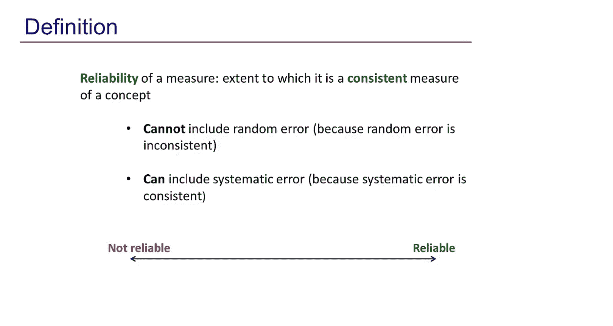
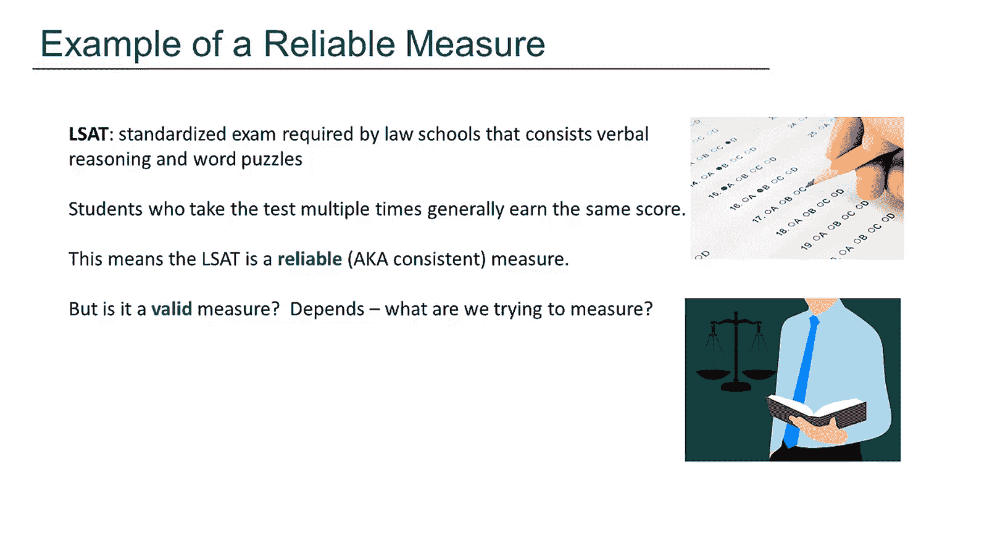
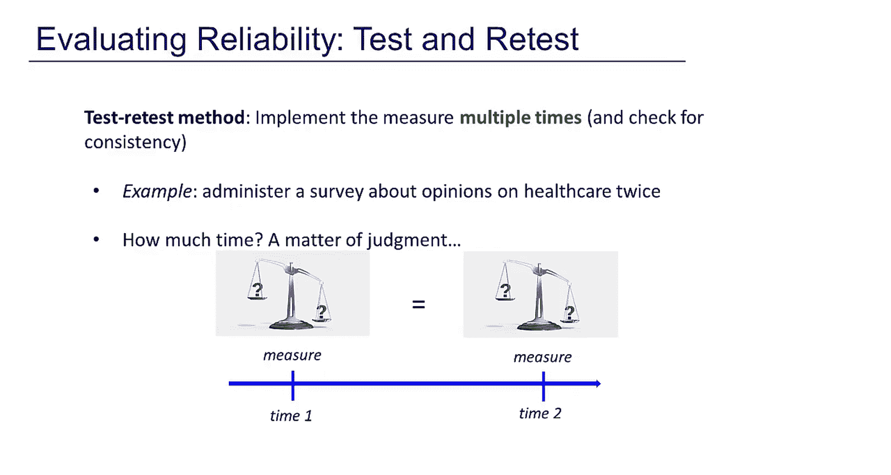
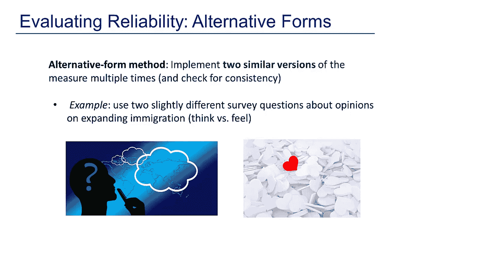
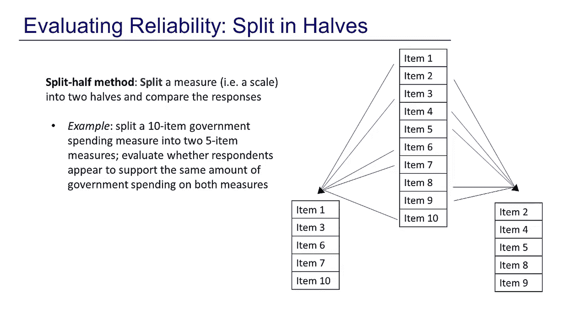

# 约翰霍普金斯大学《数据素养（数据⧸测量⧸回归⧸概率⧸毕业项目）｜Data Literacy》中英字幕（deepseek p28 13_可靠性.zh_en -BV1jXtMemEuh_p28-

Reliability， reliability and validity are two important ways that we can evaluate the quality of a measure In this video。

 we'll focus on reliability While the next video in this module will cover validity。

 By the end of this video， you should be able to determine whether a measure is reliable and identify an appropriate approach for reliability testing that fits the data you have。

😊，The reliability of a measure is the extent to which it is a consistent measure of the concept。

 Note that a reliable measure cannot include random measurement error because by definition。

 random measurement error is inconsistent。 it skews the measure in different directions each time a measurement is taken。

A reliable measure， however， can include systematic measurement error。

This is because systematic measurement error is consistent。

 it skews the measure in the same direction each time a measurement is taken。

A reliable measure that includes systematic error just means that the measure is consistently wrong。

 Reliability， therefore， is all about consistency。It's important to think of reliability as a continuum；

 a measure is not simply reliable or unreliable， it has a degree of reliability at the end of the video we'll cover some different ways to assess the level of the reliability of a measure。

Let's look at an example of a reliable measure。 The LAT is a standardized exam that is required by law schools and consists of verbal reasoning and word puzzles。

 Even when students take the LAT multiple times， they generally earn about the same score。

 This means that the LAT is a reliable or consistent measure。 But is it a valid measure。

 While that depends。 What is the LsAT trying to measure。

 Is it trying to measure how successful somebody will be at practicing law。

 or it is a general measure of intelligence。 The answers to these and related questions tell us about the validity of the measure。

 which we'll discuss in more detail in the next video。 One key takeaway point from this example。

 However， is that reliability does not always equal validity。 a measure can be consistent。

 even if it isn't capturing exactly what you want it to。

There are several different ways to evaluate the reliability of a measure with the test retest method。

 the researcher implements the measure multiple times and checks for consistency。 A researcher。

 for example， might administer a survey about opinions on healthcare care twice to the same respondents and then compare the answers。

 if the survey is reliable， the answers from the two administrations should be the same。

With the test retest method， the researcher must answer the question。

 how much time should I wait between administering the same survey to the same people。

 This is a matter of judgment。 There is no right answer。 In general。

 a week in between administering the survey seems reasonable。

This method is also frequently used to assess testing instruments；

 Imagine you are a child psychologist and you want to create a test to measure children's level of self-esteem in various areas to evaluate the reliability of the test you could administer the same test twice spaced one week apart。

If the test results are the same or at least highly correlated。

 you have evidence that the test is a reliable instrument。

Another method of evaluating reliability is to use alternative forms。

With the alternative form method， the researcher implements two similar versions of a measure multiple times。

 and then checks for consistency between them。As an example。

 think about two slightly different survey questions used to measure opinions on expanding immigration。

In one version of the question， a researcher might ask respondents what they think about expanding immigration into their country。

 while another version might ask respondents how they feel about expanding immigration into their country。

 The researcher could then examine the extent to which the one word change altered survey responses。

 similar responses would indicate that the question is not sensitive to this word change。

 and thus the survey question can be considered reliable。

Finally， with the split half method， the researcher splits a measure such as a scale into two halves and then compares the responses。

 for example， imagine a trust in government measure that is made up of 10 different items。

 each item is a survey question that asks respondents about a different facet of trust in government。

 such as whether they believe public officials act in the best interest of the country and whether they believe the election processes are fair。

The researcher could then split the  ten0 item measure into two5 item measures and evaluate whether respondents express the same level of trust for both measures。

If the two five item measures are highly correlated。

 that provides evidence that the various indicators of trust are reliable。

 and it is therefore reasonable to combine them into a single measure of trust in government。

To conclude， reliability is a critical feature of a measure。

 it would be deeply concerning if a measure yielded very different results each time it was implemented。

 a reliable measure is one that captures the same information each time it is implemented。

