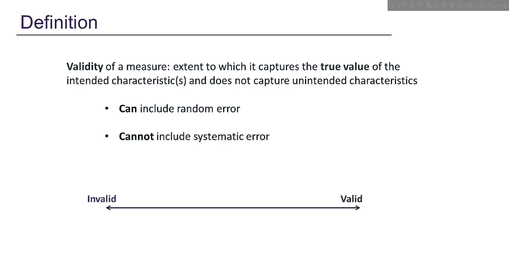
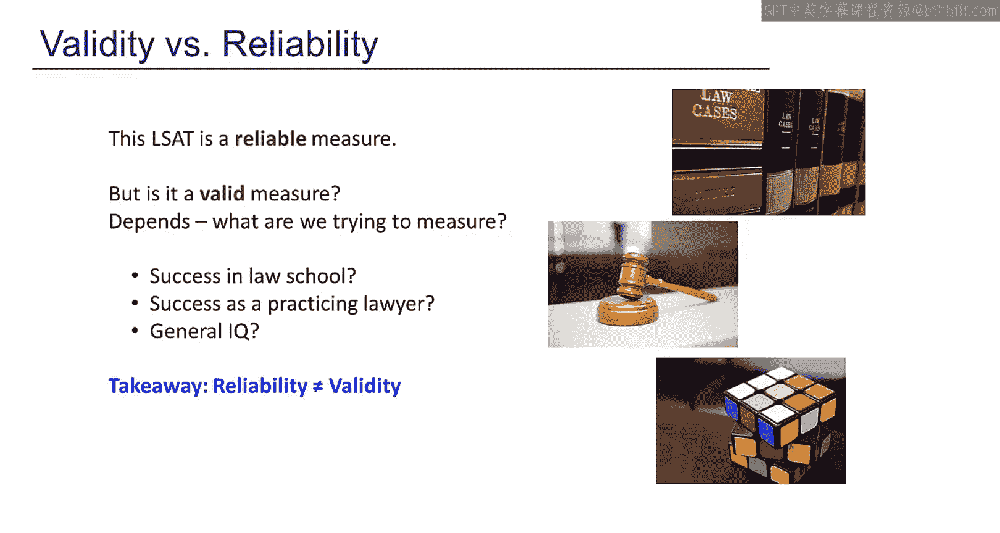
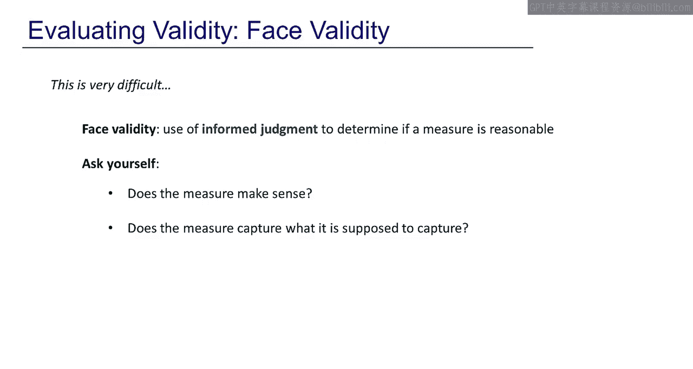
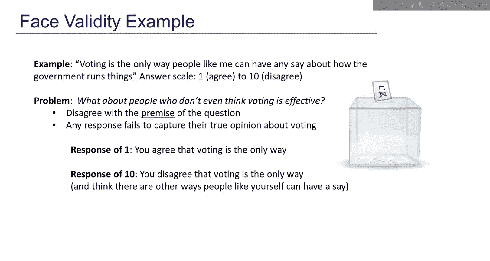
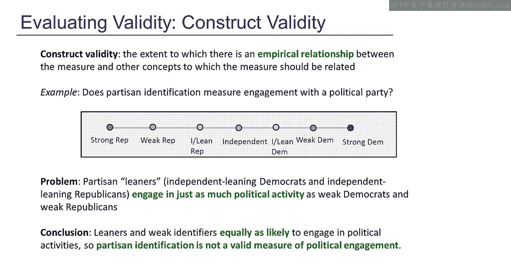
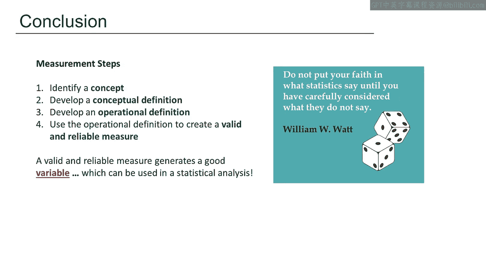

# 约翰霍普金斯大学《数据素养（数据⧸测量⧸回归⧸概率⧸毕业项目）｜Data Literacy》中英字幕（deepseek p29 14_有效性.zh_en -BV1jXtMemEuh_p29-

Validity， as I noted at the beginning of the previous video。

 reliability and validity are the most important metrics to use when evaluating the quality of a measure。

 whereasas the previous video focused on reliability， This one focuses on validity。

 By the end of this video， you should be able to evaluate whether a measure is valid and distinguish between reliability and validity。

😊，Validdity measures the extent to which a measure records the true value of the intended characteristic and does not capture unintended characteristics。

A valid measure， therefore， can include random measurement error。

 but it cannot include systematic measurement error。

 This is because systematic error shifts the measured mean value away from the true value。

 whereas random error does not cause this shift。Like reliability， validity is a continuum。

 A measure is not invalid or valid。 It has a degree of validity。 Some measures are quite valid。

 while others are less valid。 In other words， some measures may be close to the truth。

 while other measures may be further away from the truth。

Let's return to the LSAT example from the previous video。

 we talked about how the LSAT is a reliable measure， meaning it is a consistent measure。

 Students who take the test multiple times tend to earn approximately the same score each time。

But is the LSAT a valid measure well that depends first we need to identify what we're trying to capture。

 are we trying to measure success in law school， are we trying to measure how successful somebody will be at practicing law。

 are we trying to measure general IQ？It's not immediately clear that the LSAT provides an answer to any of these questions。

 the extent to which it does provide an answer to one of these questions tells us about the validity of the LSAT with respect to that question。

The LsAT， for example， might be a valid measure of success in law school。

 but an invalid measure of general IQ。 The takeaway point from this example is that reliability does not always equal validity。

A measure can be reliable， but invalid， and likewise， a measure can be unreliable， but valid。

Although it can be difficult to test for validity， it's important to do the best job we can to ensure that the measures we use in our research are as valid as possible。

We can determine face validity using our informed judgment。To determine face validity。

 simply ask yourself the question。 Does this measure seem reasonable， Does the measure make sense。

 Does the measure capture what it is supposed to capture。In short。

 a measure is valid on its face if it seems like a reasonable measure for the concept at hand。

Let's look at an example。Suppose you have the survey question。

 voting is the only way people like me can have any say about how the government runs things。

 and people are asked to respond on a scale from one to 10。

 where one means the respondent agrees with the statement。

 and 10 means the respondent disagrees with the statement。

The problem is that there might be respondents who don't even think voting is effective。

 These respondents， in other words， disagree with the premise of the question。

 If these people respond to the question in any way。

 then the survey question will fail to capture their true opinions about voting。

If they provided response of one， they are agreeing that voting is the only way that people like them can have any say about how the government runs things。

 If they give a response of 10， they are disagreeing that voting is the only way and implying that there are other ways that people like them can have a say in how the government runs things。

 Neither of these responses captures their true opinion， which is that voting itself is ineffective。

We can also try to evaluate the construct validity of a measure。To evaluate construct validity。

 we can examine the empirical relationship between a measure and other concepts to which the measure should be related。

 For example， we might wonder whether partisan identification is a valid measure of the extent to which individuals engage with politics。

 In other words， is partisanship， a measure of political engagement。 If so。

 we would expect party identifiers to be more politically active than independence and party leaners。

Our measure is a seven point partisanship scale that includes strong identifiers， weak identifiers。

 independent leaners， and independents。The problem with using partisanship as a measure of political engagement is that partisan leaners。

 namely independent leaning Democrats and independent leaning Republicans。

 engage in just as much political activity as weak Democrats and weak Republicans。

Past research shows that partisan leaners go to political meetings， display political buttons。

 contribute to campaigns， and engage in other political activities just as frequently as weak Democrats and weak Republicans。

The conclusion， therefore， is that leaners and weak identifiers are equally as likely to engage in political activities。

 So partisan identification is not a valid measure of political engagement。

 If partisan identification was a valid measure of political engagement。

 then we would expect identifiers and even weak identifiers to engage in more political activity than leaners。

Conclusion。We've talked about a lot of important definitions and research issues in this module。

 and in this course on measurement as a whole， we've discussed how to identify concepts。

 develop a conceptual definition， develop an operational definition。

 and how to use an operational definition to identify valid and reliable measures。

 Once you have a valid and reliable measure， you finally have a good variable。

 And with a set of good variables， you can finally perform a statistical analysis。

