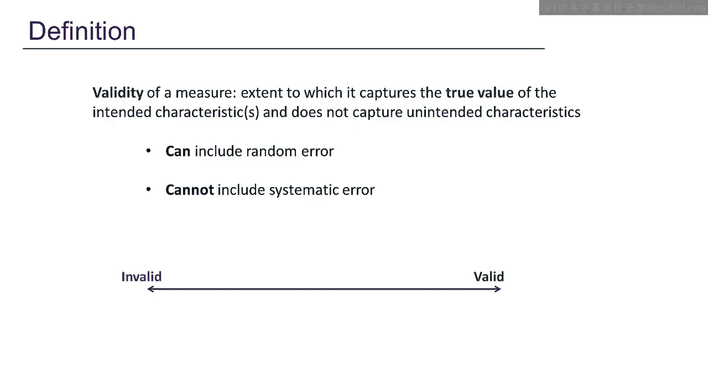
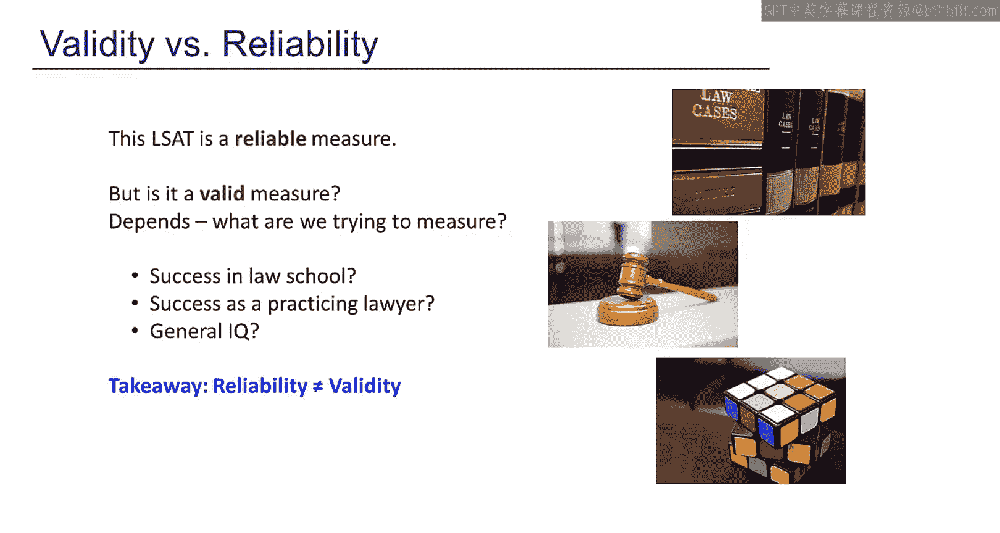
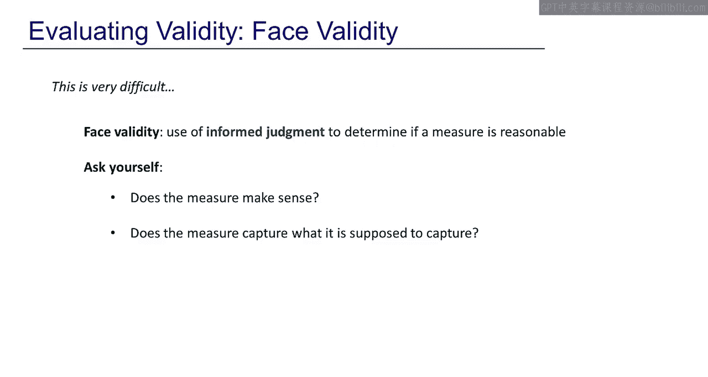
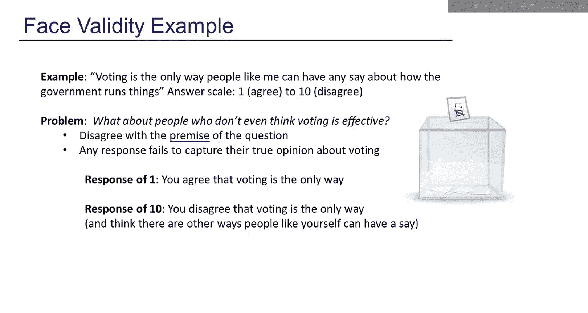
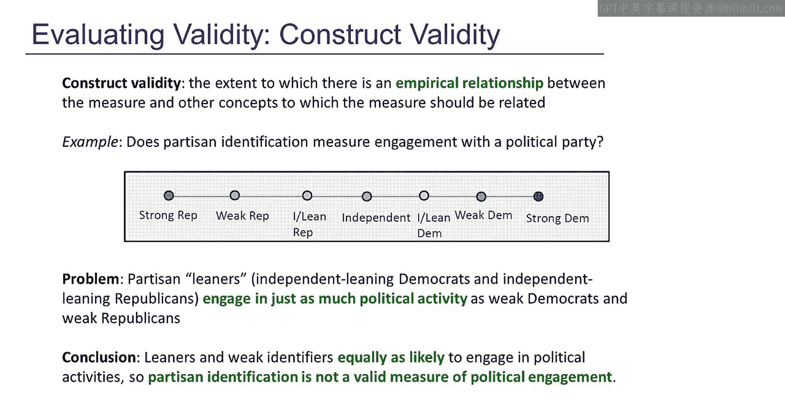
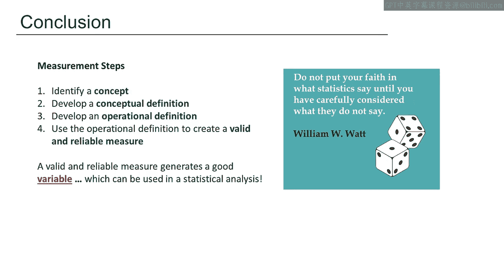

# 数据素养：2.4：有效性 📏

在本节课中，我们将要学习测量学中另一个至关重要的概念——有效性。上一节我们介绍了信度，本节中我们来看看有效性，并理解两者之间的区别。

有效性衡量的是一个测量工具能在多大程度上记录目标特征的真实值，并且不捕捉非预期的特征。因此，一个有效的测量可以包含**随机测量误差**，但不能包含**系统测量误差**。这是因为系统误差会使测量均值偏离真实值，而随机误差不会导致这种偏移。

与信度一样，有效性也是一个连续体。一个测量并非“无效”或“有效”，而是具有一个有效性的程度。有些测量相当有效，而另一些则有效性较低。换句话说，有些测量可能接近真相，而另一些测量可能离真相较远。

---

## 信度与有效性的关系 🔄

让我们回到上一节提到的LSAT（法学院入学考试）的例子。我们谈到LSAT是一个可靠的测量，意味着它具有一致性。学生多次参加考试，每次得分大致相同。

但LSAT是一个有效的测量吗？这首先取决于我们试图捕捉的是什么。我们是在试图衡量法学院的成功吗？是在衡量某人从事法律职业的成功程度吗？还是在衡量一般智商？LSAT是否能为这些问题提供答案并不明确。它在多大程度上能为其中一个问题提供答案，就告诉我们LSAT相对于该问题的有效性。

例如，LSAT可能是衡量法学院成功的一个有效指标，但却是衡量一般智商的一个无效指标。这个例子得出的要点是：**信度并不总是等于有效性**。一个测量可以是可靠的但无效的，同样，一个测量可以是不可靠但有效的。

---

## 如何评估有效性？ 🧐

尽管测试有效性可能很困难，但尽我们所能确保研究中使用的测量尽可能有效是非常重要的。

我们可以利用我们的专业判断来确定**表面效度**。要确定表面效度，只需问自己一个问题：这个测量看起来合理吗？这个测量有意义吗？这个测量捕捉到了它应该捕捉的东西吗？简而言之，如果一个测量对于手头的概念来说似乎是合理的，那么它就具有表面效度。

以下是评估表面效度时可以考虑的几个方面：
*   测量项目是否清晰、无歧义？
*   测量内容是否直接针对所研究的概念？
*   从常识角度看，测量方式是否恰当？

---

## 表面效度示例：投票态度调查 📊

让我们看一个例子。假设你有一个调查问题：“投票是像我这样的人对政府如何运作有发言权的唯一方式。”要求受访者在1到10的范围内回答，其中1表示受访者同意该陈述，10表示受访者不同意该陈述。

问题在于，可能有些受访者甚至不认为投票是有效的。换句话说，这些受访者不同意问题的前提。如果这些人以任何方式回答这个问题，那么该调查问题将无法捕捉到他们对投票的真实看法。

如果他们给出1的回应，他们是在同意“投票是像我这样的人对政府如何运作有发言权的唯一方式”。如果他们给出10的回应，他们是在不同意“投票是唯一方式”，并暗示还有其他方式可以让像他们这样的人对政府如何运作有发言权。这两种回应都没有捕捉到他们的真实观点，即投票本身是无效的。

---

## 评估构念效度 🧩

我们也可以尝试评估一个测量的**构念效度**。为了评估构念效度，我们可以检查一个测量与其他相关概念之间的经验关系，该测量理论上应与这些概念相关。

例如，我们可能想知道党派认同是否是衡量个人政治参与程度的有效指标。换句话说，党派属性是政治参与度的衡量标准吗？如果是这样，我们会预期党派认同者比独立人士和党派倾向者更积极地参与政治。

我们的测量是一个七点党派属性量表，包括强烈认同者、弱认同者、独立倾向者和独立人士。使用党派属性作为政治参与度测量指标的问题在于，党派倾向者（即倾向于民主党的独立人士和倾向于共和党的独立人士）参与的政治活动与弱民主党人和弱共和党人一样多。

过去的研究表明，党派倾向者参加政治会议、展示政治徽章、为竞选捐款以及参与其他政治活动的频率与弱民主党人和弱共和党人相同。因此，结论是：倾向者和弱认同者参与政治活动的可能性相同。所以，党派认同并不是衡量政治参与度的有效指标。如果党派认同是衡量政治参与度的有效指标，那么我们会预期认同者（甚至是弱认同者）比倾向者参与更多的政治活动。

---

## 总结 📝

本节课中我们一起学习了有效性的核心概念。我们了解到，有效性关注的是测量是否“测对了东西”，即能否准确反映目标构念。它与信度（测量是否“测得稳定”）不同，两者是评价测量质量的两个独立且重要的维度。

我们探讨了评估有效性的方法，包括通过专业判断评估表面效度，以及通过检验测量与其他相关变量之间的经验关系来评估构念效度。

在本模块以及整个关于测量的课程中，我们讨论了许多重要的定义和研究问题。我们讨论了如何识别概念、制定概念性定义、制定操作性定义，以及如何使用操作性定义来识别有效和可靠的测量。一旦你拥有了一个有效且可靠的测量，你最终就得到了一个好的变量。而拥有一组好的变量，你终于可以进行统计分析。