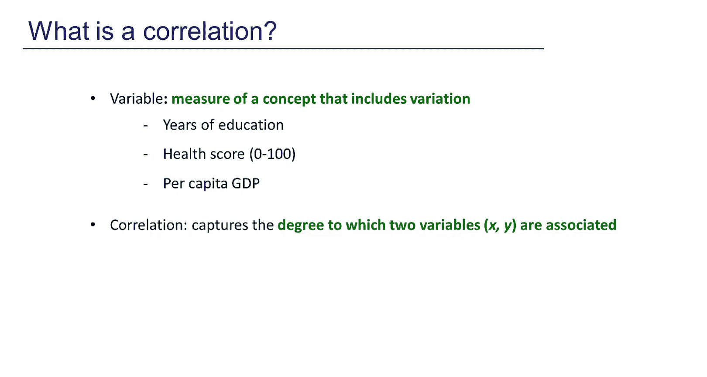
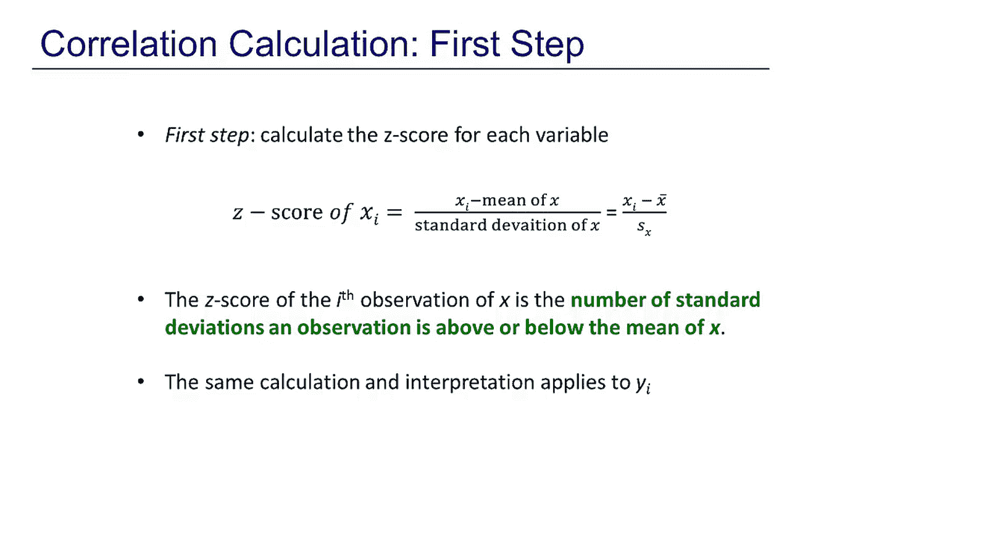
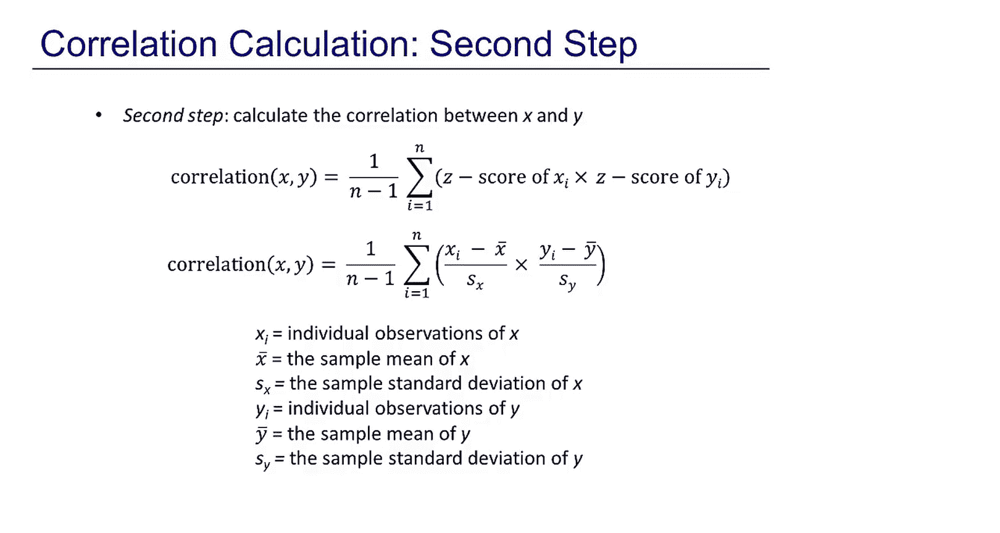
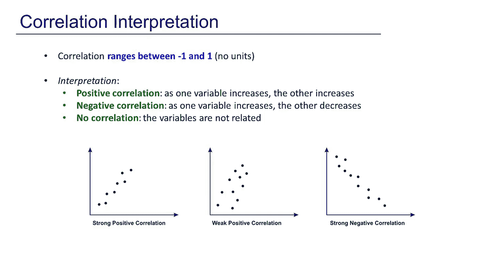
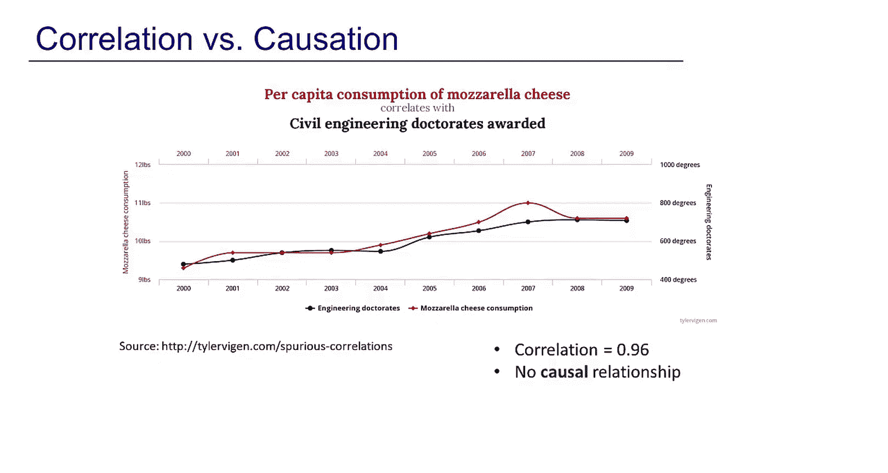
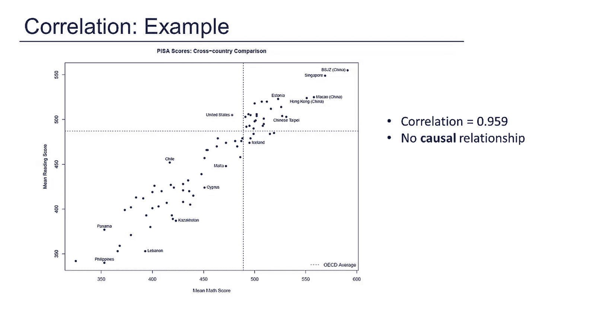
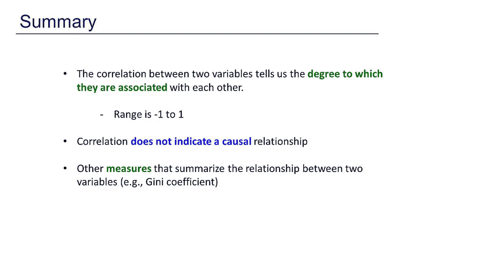

# 约翰霍普金斯大学《数据素养（数据⧸测量⧸回归⧸概率⧸毕业项目）｜Data Literacy》中英字幕（deepseek p31 1_相关性.zh_en -BV1jXtMemEuh_p31-

Correlation。In the first course of the data literacy specialization。

 we discussed different ways to describe the center and spread of data。In this course。

 we'll move ahead to discussing how to quantify the relationships in data。By the end of this video。

 you should be able to calculate and interpret the correlation between two variables。

Although it's unlikely you would ever need to calculate the correlation between two variables by hand。

 it's valuable to think through how a correlation is calculated in order to better understand what this measure captures。

 Let's dive in。

Let's briefly define a variable before talking about the correlation between two variables。

 A variable is a measure of a concept。 Note that a variable must include variation by definition。

 If a measure consists of only one number， it's not a variable。 It's a constant。

 The speed of light for example， is a constant， not a variable。

Common examples of variables include years of education。

 individual health scores measured on a scale of let's say。

 0 to100 and per capita GDP for a list of countries A variable is composed of multiple observations。

A correlation captures the degree to which two variables are associated with each other。

 it's common to refer to variables using letters， for example。

 we might have two variables x and Y and wish to calculate the correlation between them。

There are two steps to calculating the correlation between x and y。

 The first step is to calculate the z score for each observation of x and each observation of y。

The z score of each observation of x is that value of x minus the mean of x divided by the standard deviation of x。

 recall from the first course in the data literacy specialization that the standard deviation of a variable is the average deviation of each observation from the variables mean。

So this means that the z score of the Ih observation of x is the number of standard deviations and observation is above or below the mean of x。

 The same is true for all values of y。 Again， this is not something you would ever need to calculate by hand。

 but thinking through the equations should help you develop a better intuitive understanding of correlation。

The second step in calculating the correlation between x and y requires you to multiply each pair of z scores。

 sum up these values and divide by the number of observations minus1。

You can see the equations here on the slide。 The top equation shows the calculation in terms of z scores。

 and the second equation has the z score formulas written out in terms of x and Y。To restate。

 take a look at the second equation， we take each x values's deviation from the mean of x and divide by the standard deviation of x。

 We then take each y values's deviation from the mean of y and divide by the standard deviation of y。

We then multiply these values together and add up the results for all of the observations。

 We then divide this sum by the number of observations， -1。Conceptually。

 correlation takes into account the spread of both variables and the size of the data set。Again。

 you can easily calculate a correlation in a statistical software program。

 but it's worth spending some time thinking about how this measure is calculated。

A correlation always falls between negative1 and 1。

 where negative1 is a perfect negative correlation and one is a perfect positive correlation。

 with a correlation of1， all of the x and y points would fall exactly along a 45 degree positively sloped line。

With a correlation of negative  one， all of the X and Y points would fall exactly along a 45 degree。

 negatively sloped line。The closer the correlation is to 0， the weaker the relationship。

 If there is no relationship between the two variables that you're studying。

 the correlation coefficient will be exactly 0。The graphs at the bottom of this slide display some examples of correlations。

 The first graph displays a strong positive correlation。

 The second graph displays a weak positive correlation， and the third graph displays a strong。

 negative correlation。

It's extremely important to distinguish between correlation and causation。

 which is an issue we'll return to many times throughout the course。This graph， for example。

 plots per capita consumption of mozzarella cheese over time against the number of civil engineering doctorates awarded over time。

Notice that the two lines follow a similar pattern。 and， in fact。

 the correlation between them is quite high at 0。96。 It would be ridiculous， however。

 to conclude that there is a causal relationship between these two variables。

 Evid of a strong correlation is not evidence of causality。

 Correlation is simply a measure of whether two variables are associated。

 not whether one causes the other。

The graph on this slide highlights another example of a high correlation between two variables。

 even though there is not a causal relationship。The graph is a scatter plot of country's mean math and mean reading scores on the program for international Student Asses。

The strong positive correlation tells us that if a country's students tend to perform well on the math exam。

 they are also likely to perform well on the reading exam。 This doesn't mean， however。

 that performance on one of these exams has a causal effect on performance on the other exam。

 Instead， both reading and math scores are likely driven by other factors。

 such as educational and socioeconomic resources provided to students in each country。

To summarize， remember that the correlation between two variables tells us the degree to which they are associated with each other。

 and it can range from negative 1 to one。A correlation， even a strong one。

 does not indicate causality。Beyond correlation， there are other measures that you can explore and use to summarize the relationship between two variables。

 A genie coefficient， for example， is often used to calculate inequality。

 such as income inequality for a particular population。In short。

 as you move forward in your development as a data analyst or consumer of data。

 you may need to learn about additional measures of association between variables for your work。

