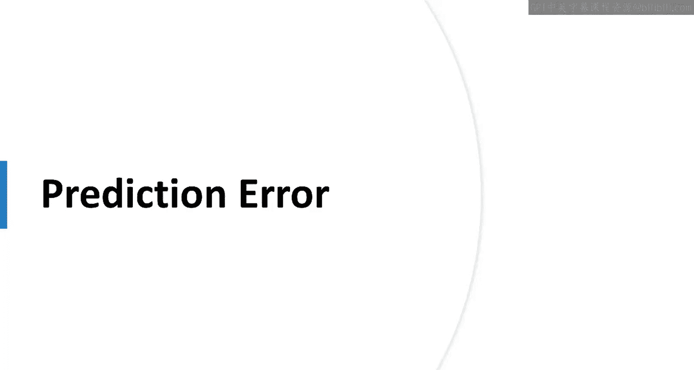
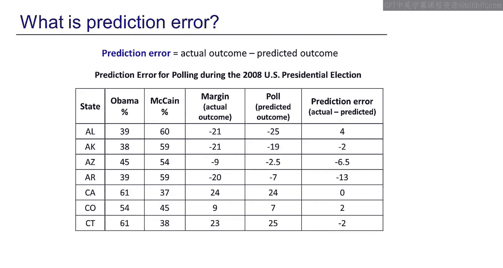
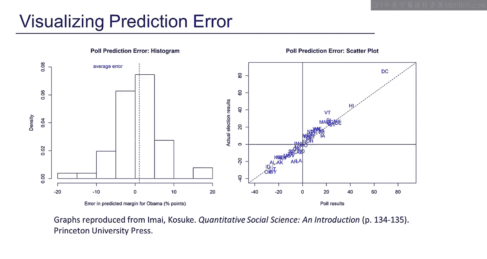
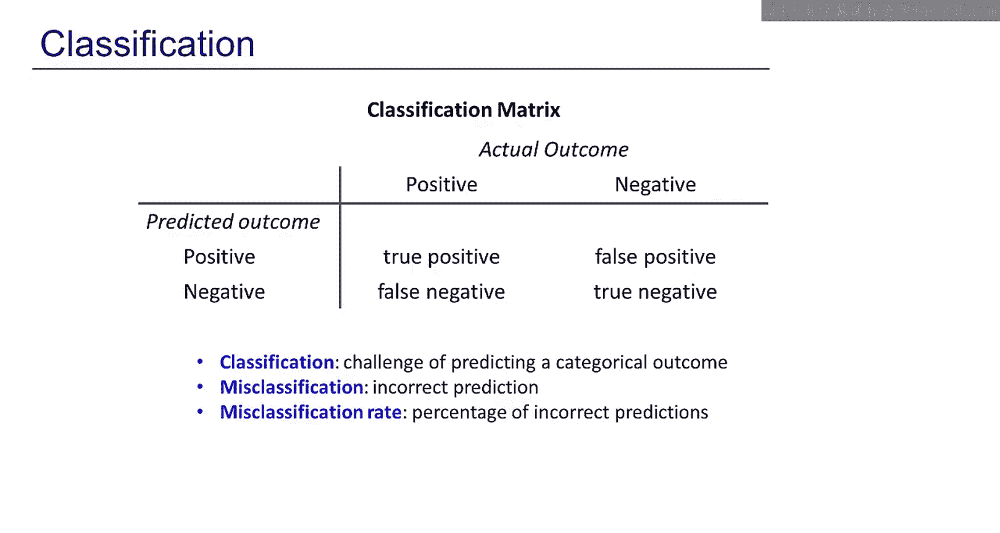
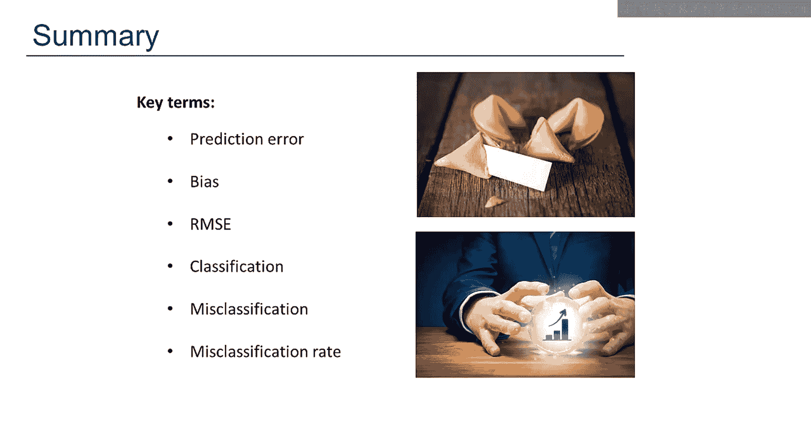

# 约翰霍普金斯大学《数据素养（数据⧸测量⧸回归⧸概率⧸毕业项目）｜Data Literacy》中英字幕（deepseek p32 2_预测误差.zh_en -BV1jXtMemEuh_p32-

Prediction error Fr， the goal of examining the relationship between two variables is prediction。

 A researcher or analyst seeks to use one variable to predict a second variable。

 Prediction is used across all aspects of the social and life sciences。

 Political scientistsists frequently try to predict election outcomes。

 Economists try to predict market outcomes。 Sociologists try to predict how disruptive events such as wars and pandemics will change social behavior。

Scientists try to predict how a drug will work against a disease， with nearly all predictions。

 however， there is some degree of error， and there are various ways to measure and describe this error。

By the end of this video， you should understand the key terms associated with making predictions and be able to calculate and interpret the errors surrounding those predictions。

The prediction error is the actual outcome， which is what we observe minus the predicted outcome。

 This is relatively easy to see if we think about predicting elections。

 The table on this slide shows the percentage of votes received by Barack Obama and John Mccain in seven states in the 2008 US presidential election。

The margin is the actual difference in the percentage of votes received in each state。

 The predicted outcome shows the predicted margin， which is derived from a combination of polling results in those states。

 The prediction error is therefore the actual margin minus the predicted margin。

 A prediction error of four percentage points。 In this case。

 means that John Mccain won the state by four more percentage points than predicted。

 or put another way， President Obama lost the state by four more percentage points than predicted。

A prediction error of negative two percentage points means that John McCain lost the state by two percentage points less than predicted。

 or President Obama won the state by two percentage points less than predicted。

The bias of a prediction is defined as the average prediction error。 If the bias is 0。

 then we can say that the prediction is unbiased。 If the bias is anything other than0。

 either negative or positive， then the prediction is biased。

 A prediction can have a strong bias or a weak bias。

 depending on the magnitude of the prediction error。

We can calculate the poll bias of the seven states listed on the previous slide by summing up the prediction errors and dividing by 7。

 the number of states。 You can， of course， calculate the overall poll bias for all 50 states。

 I've only included 7 here for clarity。 The poll bias for these 7 states is negative 2。

5 percentage points。 This means that， on average， for these  seven states。

 the polls predicted that President Obama won by 2。5 percentage points less than predicted。

 This is fairly small。 which suggests that the polls for these states were not terribly biased。😊。

One concern with the prediction error is that large positive errors cancel out large negative errors。

 For this reason， it's useful to calculate the root mean squared error。

 This measure is the average magnitude of the prediction errors。 In this case。

 we square each of the seven prediction errors add them together。

 divideivide by7 and then take the square root of that number。

 Here we see that the root mean squared error is 5。8。

 which tells us that the average size or magnitude of the prediction errors is 5。8。

 which suggests that the poles might have been more inaccurate than the bias calculation indicated。

It can also be useful to visualize the prediction error using the bar graph and scatter plot techniques we discussed previously in this specialization。

 This gives us a better sense of the distribution of the error。

 The graph on the left is a histogram of the prediction error with the average errors shown by the dashed blue line。

 This graph includes the errors for all 50 states and D C for this election。

 While there were large positive and negative errors in some states。

 It's clear that most errors were near 0。 The graph has a bell curve shape centered close to 0。😊。

We can also visualize the prediction error by plotting the actual election results against the poll results。

 notice that most of the errors fall along the 45 degree line。

 which again is evidence that most of the errors were fairly close to zero。

The challenge of predicting a categorical outcome is called classification。

 With respect to the election example， the classification challenge is predicting whether Obama or Mccain wins for each state。

 If the prediction is incorrect， it is termed a misclassification。

In the earlier table of seven states， all seven predictions accurately predicted the winner。

 meaning the classification rate for these seven states is 100%。

An incorrect negative prediction is called a false negative。

 while an incorrect positive prediction is called a false positive。For example。

 suppose we define Obama winning as a positive outcome， not because of any normative assumption。

 just as a way of categorizing the possible outcomes。 In that case。

 Missouri would be a false positive。 The polls there predicted that Obama would win Missouri， but he。

 in fact， lost the popular vote in that state。

In summary， this video covered the key terms and measures used when evaluating a prediction。

 we discussed the prediction error， which is the actual outcome minus the predicted outcome。

The bias is the average prediction error。The root mean squared error is the average magnitude of the prediction error。

Classification refers to the challenge of accurately predicting a categorical outcome and misclassification occurs when a categorical prediction fails。

Finally， the misclassification rate is the percentage of accurate classifications for a given set of predictions。

As we move forward， we'll be discussing prediction in the context of a regression model。

 which allows us to quantify the expected effect of one variable on another regression models are a key tool for predictive modeling。

