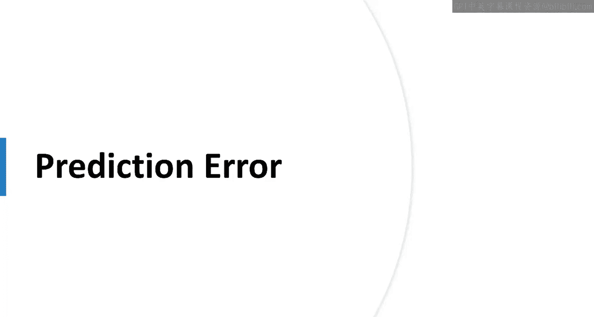
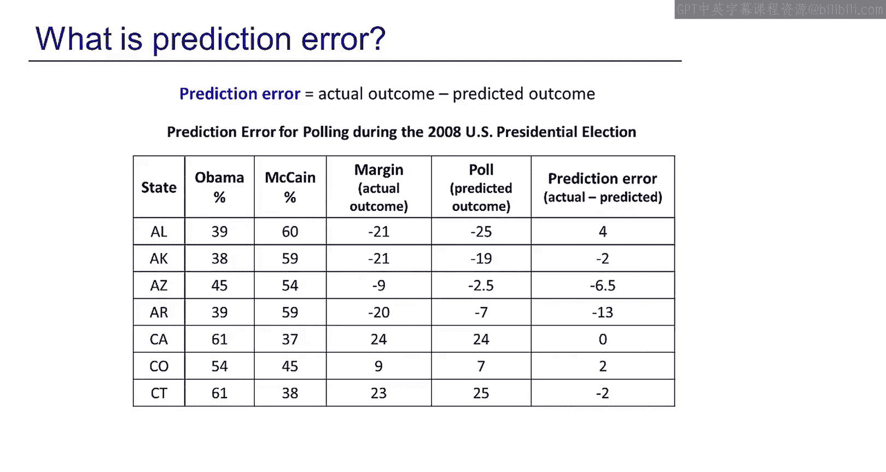
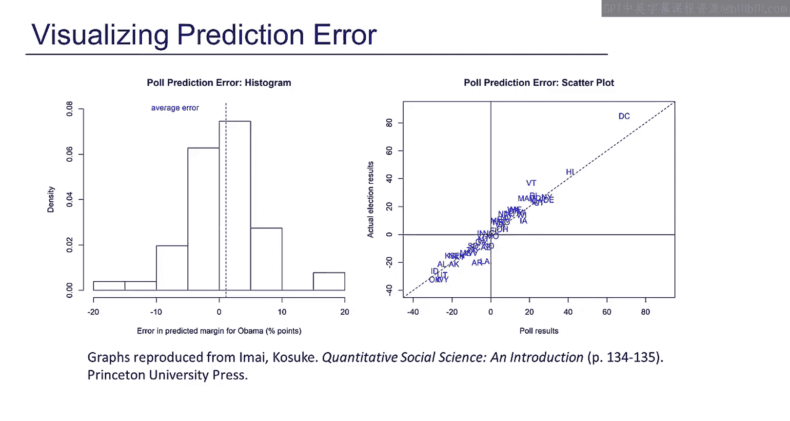
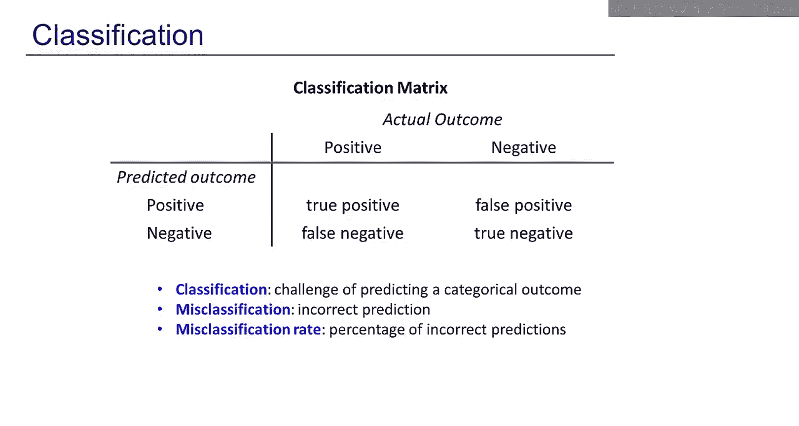
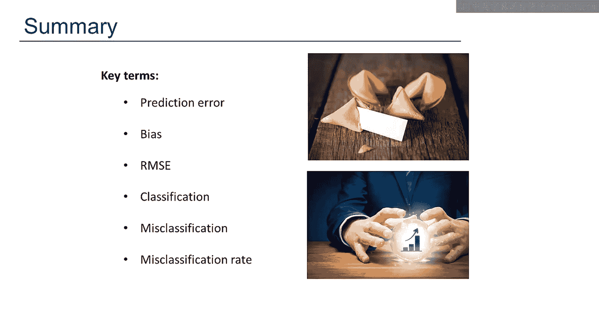

# 数据素养：2：预测误差 📊

在本节课中，我们将学习预测误差的核心概念。当我们试图用一个变量预测另一个变量时，预测结果与实际结果之间总会存在差异。我们将探讨如何衡量、描述和理解这种差异，并介绍相关的关键术语和计算方法。

## 预测的目的与误差的存在

上一节我们介绍了变量间关系的基础，本节中我们来看看预测的具体应用。研究两个变量之间关系的一个主要目的是进行预测。研究人员或分析师试图用一个变量来预测第二个变量。

预测广泛应用于社会科学和生命科学的各个领域。
*   政治学家经常尝试预测选举结果。
*   经济学家尝试预测市场结果。
*   社会学家尝试预测战争和疫情等破坏性事件将如何改变社会行为。
*   科学家尝试预测药物对疾病的疗效。

然而，几乎所有的预测都存在某种程度的误差。有多种方法可以衡量和描述这种误差。

在本视频结束时，你应该理解与进行预测相关的关键术语，并能够计算和解释围绕这些预测的误差。

## 预测误差的定义与计算

预测误差是实际观测结果减去预测结果。如果我们考虑预测选举，就相对容易理解这个概念。

以下幻灯片上的表格显示了2008年美国总统大选中七个州的巴拉克·奥巴马和约翰·麦凯恩获得的选票百分比。“实际差额”是每个州实际获得的选票百分比之差。“预测结果”显示了预测的差额，这是根据这些州的民意调查结果综合得出的。

因此，预测误差就是实际差额减去预测差额。
*   一个**4个百分点**的预测误差意味着约翰·麦凯恩在该州赢得的百分比比预测高出4个百分点，或者换句话说，奥巴马总统在该州输掉的百分比比预测高出4个百分点。
*   一个**-2个百分点**的预测误差意味着约翰·麦凯恩在该州输掉的百分比比预测少2个百分点，或者奥巴马总统在该州赢得的百分比比预测少2个百分点。

预测误差的公式为：
**预测误差 = 实际结果 - 预测结果**

## 预测偏差

预测的**偏差**定义为平均预测误差。
*   如果偏差为**0**，则可以说预测是**无偏的**。
*   如果偏差是**0以外的任何值**（无论是负值还是正值），则预测是**有偏的**。

根据预测误差的大小，预测可能存在强偏差或弱偏差。

我们可以通过将预测误差相加并除以州的数量（7个）来计算上一张幻灯片中列出的七个州的民意调查偏差。当然，你也可以计算所有50个州的总体民意调查偏差，这里为了清晰只包含了7个。这7个州的民意调查偏差为**-2.5个百分点**。这意味着，平均而言，对于这七个州，民意调查预测奥巴马总统赢得的百分比比实际预测少2.5个百分点。这个偏差相当小，表明这些州的民意调查并没有严重的偏差。

## 均方根误差

预测误差的一个问题是，大的正误差和大的负误差会相互抵消。因此，计算**均方根误差**很有用。这个度量是预测误差的平均幅度。

在这种情况下，我们将七个预测误差各自平方，相加，除以7，然后取该数字的平方根。这里我们看到均方根误差为**5.8**，这告诉我们预测误差的平均大小或幅度是5.8个百分点。这表明民意调查可能比偏差计算所显示的更不准确。

均方根误差的计算步骤如下：
1.  计算每个预测误差：`误差 = 实际值 - 预测值`
2.  将每个误差平方：`误差²`
3.  求所有误差平方的平均值：`平均值 = Σ(误差²) / n`
4.  取平均值的平方根：`RMSE = sqrt(平均值)`

## 误差的可视化

使用我们之前在本专项课程中讨论过的条形图和散点图技术来可视化预测误差也很有用。这让我们能更好地理解误差的分布。

*   左边的图表是预测误差的直方图，蓝色虚线表示平均误差。该图表包含了本次选举中所有50个州和华盛顿特区的误差。虽然有些州存在较大的正误差和负误差，但很明显大多数误差都接近0。图表呈钟形曲线形状，中心接近0。
*   我们也可以通过绘制实际选举结果与民意调查结果的对比图来可视化预测误差。请注意，大多数误差都落在45度线附近，这再次证明大多数误差都相当接近零。

## 分类预测的挑战

预测分类结果的挑战称为**分类**。就选举示例而言，分类挑战是预测每个州是奥巴马获胜还是麦凯恩获胜。如果预测不正确，则称为**错误分类**。

在之前七个州的表格中，所有七个预测都准确预测了获胜者，这意味着这七个州的**分类准确率**为100%。

*   不正确的负面预测称为**假阴性**。
*   不正确的正面预测称为**假阳性**。

例如，假设我们将奥巴马获胜定义为正面结果（并非出于任何规范性假设，仅作为对可能结果进行分类的一种方式）。那么，密苏里州就是一个**假阳性**。那里的民意调查预测奥巴马会赢得密苏里州，但他实际上在该州输掉了普选。

## 总结与展望

本节课中我们一起学习了评估预测时使用的关键术语和度量方法。

*   我们讨论了**预测误差**，即实际结果减去预测结果。
*   **偏差**是平均预测误差。
*   **均方根误差**是预测误差的平均幅度。
*   **分类**指的是准确预测分类结果的挑战。
*   **错误分类**发生在分类预测失败时。
*   最后，**错误分类率**是给定一组预测中准确分类的百分比。

随着课程的深入，我们将在回归模型的背景下讨论预测，这使我们能够量化一个变量对另一个变量的预期影响。回归模型是预测建模的关键工具。