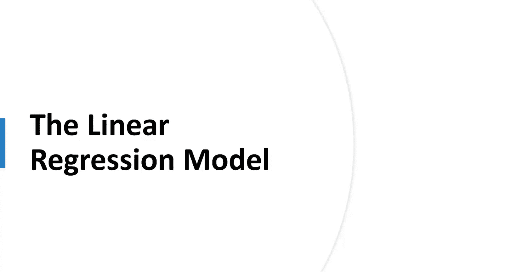
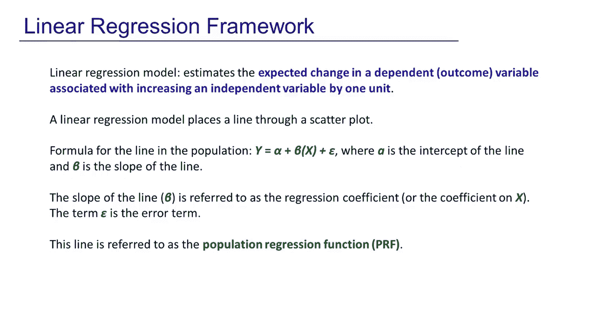
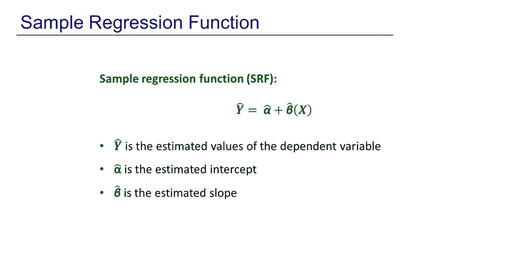
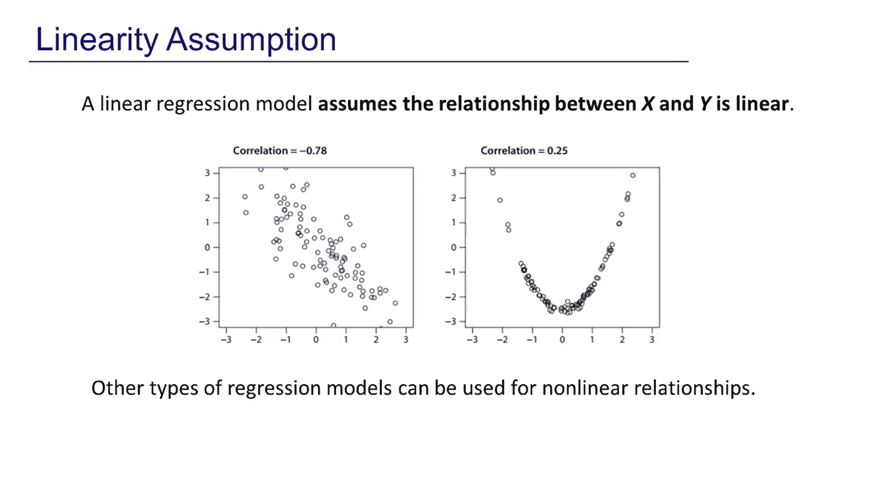
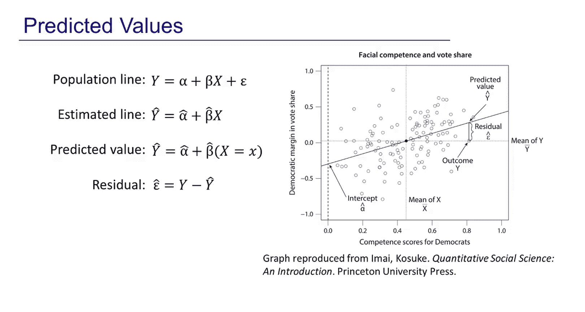
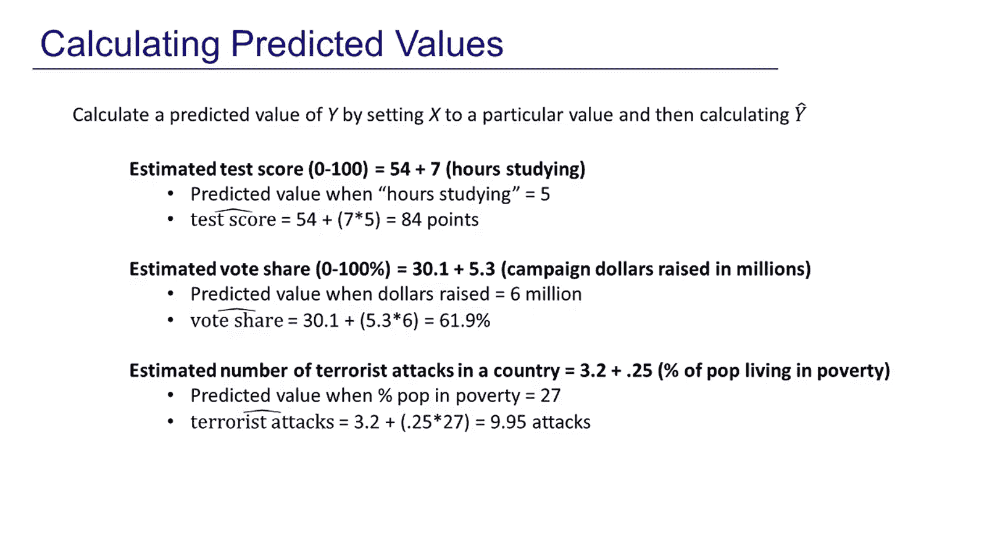

# 约翰霍普金斯大学《数据素养（数据⧸测量⧸回归⧸概率⧸毕业项目）｜Data Literacy》中英字幕（deepseek p33 3_线性回归模型介绍.zh_en -BV1jXtMemEuh_p33-

The linear regression model， while correlations and scatter plots provide relatively simple ways of comparing two variables and even generating predictions。

 it is often necessary to estimate a more precise relationship。

 A linear regression model is an essential tool that statisticians use to quantify how a change in one variable is associated with a change in another variable。

In this video， I'll introduce the linear regression model。 Reion is a powerful analytical technique。

 and there are numerous types of regression models that each make a different set of assumptions。

 We'll start at the very beginning。 Of course， and begin by creating and interpreting a model with one independent variable and one dependent variable。

 This is called a bivariate regression model。😊，By the end of this video。

 you should be able to describe the sample and population regression models as well as calculate predicted values using an estimated model。

A linear regression model allows us to calculate the expected change in a dependent or outcome variable that is associated with increasing the independent variable by one unit。

This is accomplished by placing a line through a scatter plot。

We'll talk about exactly how a statistical software program knows where to place the line a bit later in the course。

It's important to recognize that for any regression model， there is a population regression function。

 a PRF， and a sample regression function， an SRF。These functions are simply lines。

 The PRF is the hypothesized line， and the SRF is the actual line that we calculate using the data we've collected。

The formula for the population regression function is y equals alpha plus beta x plus epsilon。

 where alpha is the intercept of the line， and beta is the slope of the line。

 The slope of the line is referred to as the regression coefficient or the coefficient on x。

 Remember that y is the dependent variable。 Sometimes called the outcome variable。

 and x is the independent variable。The term epsilon is referred to as the error term。

 We include this term in the population regression function as a reminder that x is not a perfect predictor of y。

 Think back to the scatter plots you've seen， Even with a strong correlation。

 The points do not fall perfectly along a line。 The extent to which the points deviate from a line is captured by the error term。

The population regression function is a model of how we think X and Y are related to each other in the population。

After we've specified a PRf， we can use data to calculate a sample regression function。

 The formula for the sample regression function is Y hat equals alpha hat minus beta hat times x。

 Y hat includes the estimated values of the dependent variable。 Alpha hat is the estimated intercept。

 and beta hat is the estimated slope。

As is indicated by the name， a linear regression model assumes that there is a linear relationship between x and Y。

 Take a look at the two graphs on the slide。In the graph on the left hand side。

 it looks fairly reasonable to place a negatively sloped line through the data。

 This line would provide a valuable representation of the data。 Now。

 look at the graph on the right hand side。Notice that the data form a tight U shape。

 a line through these data in contrast seems inappropriate。

There are nonlinear models that we can use for nonlinear data。 This course， however。

 will focus on linear models。Once you have a firm foundational understanding of regression analysis。

 you'll be able to easily familiarize yourself with more advanced regression tools that might be the best fit for the particular data set you're analyzing。

Once you've estimated a regression model， you can use it to calculate predicted values。

 Take a look at the four equations presented on this slide， As we've already discussed。

 the first equation is the population regression function。

 and the second is the sample regression function。The third equation shows how to compute a predicted value using the sample regression function。

To do this， you simply set the independent variable x to a particular value and then calculate the estimated value of y。

We'll walk through a few examples of how to calculate predicted values in a moment。

After you have a sample regression function， you can also calculate the residuals。

 Each data point has a residual， which is the vertical distance from that point to the regression line。

 Some residuals will be negative and some will be positive since the regression line runs through the middle of the data cloud。

😊，In equation form， a residual is equal to the actual value of y minus the estimated value of y。

The graph on this slide shows a scatter plot of survey participants perceived competence of Democratic candidates based on their pictures and those candidates electoral performance。

 The line is a regression line。 Notice the different features of the line。

 The intercept is where the line crosses the y axis。

A residual is the difference between the observed value of y for a particular data point and the predicted or estimated value of y for that data point。

As a side note， the terms predicted， estimated and fitted are often used interchangeably。

 A predicted value， estimated value and fitted value often refer to the same thing， namely Y hat。

As I noted， we can calculate a predicted value of y by setting x to a particular value and then calculating Y hat。

Let's look at the first sample regression function on this slide。

 which states that a student's estimated test score is equal to 54 plus7 times hours spent studying。

 we can calculate the predicted test score when our studying equals 5 by setting x equal to 5。

In this case， then， the predicted test score is 84 points。

Now look at the second sample regression function， which states that a candidate's estimated vote share is equal to 30。

1 plus 5。3 times the amount of money that a candidate raised in millions of dollars。

If we set x equal to6， meaning 6 million campaign dollars raised， the predicted vote share is 61。9%。

The last sample regression function states that the estimated number of terrorist attacks in a country is equal to 3。

2 plus 0。25 times the percent of the population in that country living in poverty。

 If we set x equal to 27%。 the predicted number of terrorist attacks in a country is 9。95 attacks。

Remember to always include the units of the dependent variable when interpreting a predicted value。

In this video， we've used the intercept and slope coefficient in an estimated model to calculate a predicted value。

 We'll talk more specifically about how to interpret the values of the intercept and slope coefficient in the next video。

