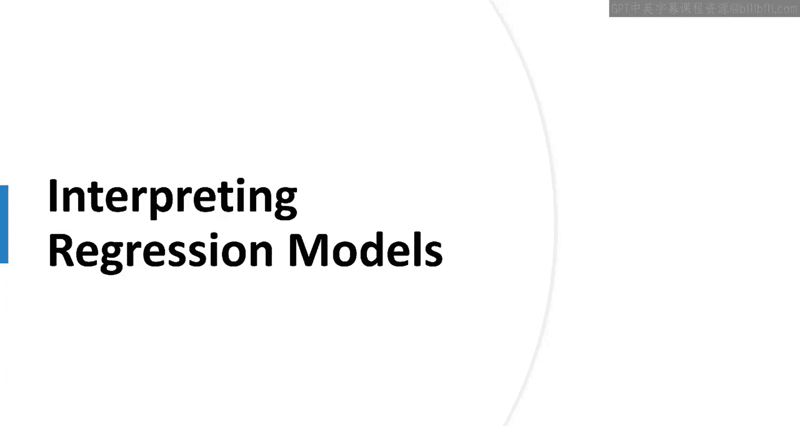
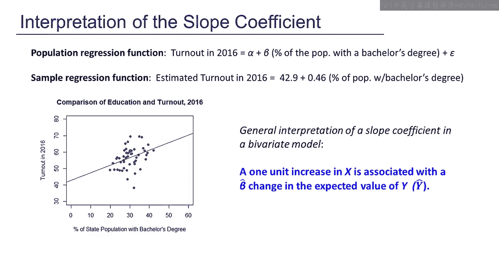
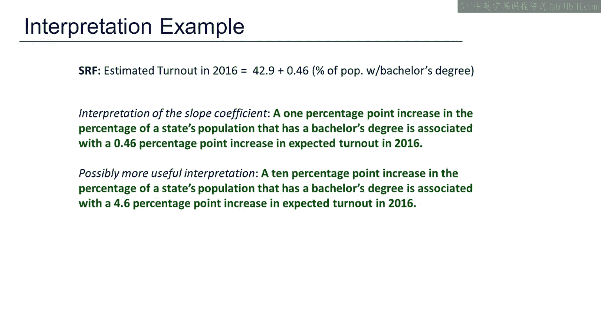
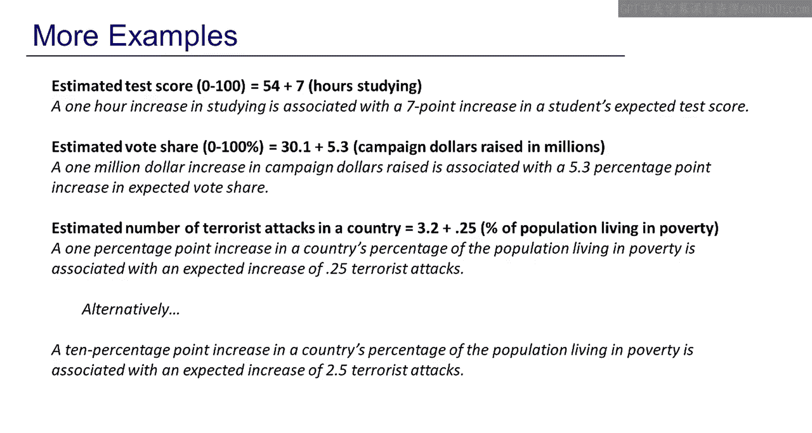
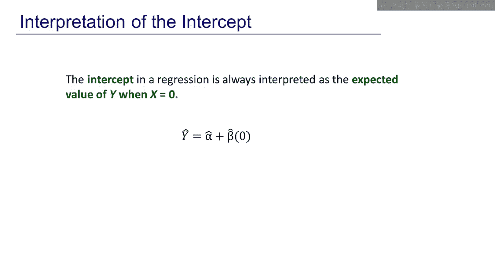
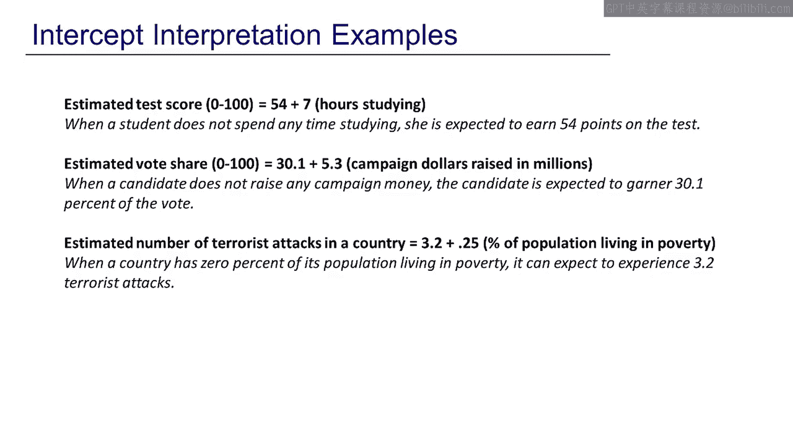

# 约翰霍普金斯大学《数据素养（数据⧸测量⧸回归⧸概率⧸毕业项目）｜Data Literacy》中英字幕（deepseek p34 4_回归模型解释.zh_en -BV1jXtMemEuh_p34-

Interpreting regression models。Once you've specified an estimated linear regression model。

 the next step is to make sense of the results。 In the previous video。

 we discussed how to calculate predicted values of the dependent variable using an estimated model。

In this video， we'll discuss how to interpret the estimated slope and inter intercept。

By the end of this video， you should be able to discuss the real world meaning of an estimated slope coefficient。

 which quantifies the relationship between the independent and dependent variable。In addition。

 you should be able to discuss the real world meaning of a model's intercept。

 which is the value of the dependent variable when the independent variable equals 0。 Let's dive in。

Let's walk through an example that will demonstrate how to interpret the results of a linear regression model。

Suppose we want to calculate the effect of a state's population with a bachelor's degree on its level of voter turnout in the 2016 presidential election。

This means we hypothesize that turnout in 2016 is equal to alpha plus beta times the percentage of a state's population with a bachelor's degree。

 plus some error， this is the population regression function。

If we have a data set that includes these two variables。

 we can go ahead and estimate this regression function。

Suppose I estimate the model using a statistical software program and determine that a state's estimated 2016 turnout is equal to 42。

9 plus 0。46 times a state's percentage of the population with a bachelor's degree。

This is the sample regression function。 The intercept is 42。9。

 and the coefficient on the independent variable is 0。46。Take a look at the graph on this slide。

 I've plotted the sample regression function onto a scatter plot of the data points。

 The intercept of the line where the line intersects。 the Y axis is 42。9。

 and the slope of the line is 0。46。Just by looking at the line。

 we can see that we've estimated a positive relationship between educational attainment and turnout。

 Let's now use these estimates to describe this relationship more precisely。😊，In a bivariate model。

 the slope coefficient is always interpreted as follows。

A one unit increase in x is associated with a beta hat change in the expected value of y。

 which is y hat。

On this slide， I've copied the sample regression function at the top。

 Let's use the interpretation template to make sense of the slope coefficient。

To interpret the slope coefficient， we would say that a one percentage point increase in the percentage of a state's population that has a bachelor's degree is associated with a 0。

46 percentage point increase in expected turnout in 2016。Now。

 a one percentage point increase in a state's population that has a bachelor's degree is a fairly small change。

 We can make the interpretation more meaningful to a reader by multiplying the change in X and the effect on y by 10。

In other words， we can say that a 10 percentage point increase in the percentage of a state's population that has a bachelor's degree is associated with a 4。

6 percentage point increase in expected turnout in 2016。

This interpretation is more meaningful to the average reader or average member of an audience。

Let's spend a bit more time practicing how to interpret slope coefficients。

 since knowing how to do this is extremely important。

Suppose you have an SRF in which students estimated test scores are equal to 54 plus 7 times hour spent studying。

 How would you interpret this slope coefficient， You would say that a one hour increase in studying is associated with a seven point increase in a student's expected test score。

Now suppose you have an SRF in which a political candidate's estimated vote share is equal to 30。

1 plus 5。3 times campaign dollars raised in millions。

We would interpret the slip coefficient by saying that a $1 million increase in campaign dollars is associated with a 5。

3 percentage point increase in expected vote share。Finally。

 how would you interpret the slope coefficient in an SRF in which the estimated number of terrorist attacks in a country is equal to 3。

2 plus 。25 times the percentage of the country's population living in poverty。

 you would say that a  one percentage point increase in a country's percentage of the population living in poverty is associated with an expected increase of 0。

25 terrorist attacks。If the term 0。25 terrorist attacks is confusing。

 you could multiply the relevant numbers by say 10。

 so you could say that a 10 percentage point increase in a country's percentage of the population living in poverty is associated with an expected increase of 2。

5 terrorist attacks。

Now let's discuss how to interpret the intercept in a regression model。

 The intercept is always interpreted as the expected value of y， the dependent variable， when x。

 the independent variable is equal to 0。This is easily visible in equation form。

 the estimated intercept alpha hat is the expected value of y when we plug in zero for x。

Let's practice with the same sample regression functions we used previously。

Suppose you have your SRF in which a student's expected test score is equal to 54 plus7 times hour spent studying。

 we would interpret the intercept by saying that when a student does not spend any time studying。

 the student is expected to score 54 points on the test。

Now turn to the SRF in which a candidate's estimated vote share in an election is equal to 30。

1 plus 5。3 times campaign dollars raised in millions。

 we can interpret the intercept by saying that when a candidate does not raise any money。

 the candidate is expected to garner 30。1% of the vote。

What about an SRF in which the estimated number of terrorist attacks in a country is equal to 3。

2 plus 0。25 times the percentage of the population living in poverty？

The intercept in this model means that when a country has0% of its population living in poverty。

 it can expect to experience 3。2 terrorist attacks。Sometimes the intercept is not meaningful。

 This occurs if it is not meaningful for x to take on the value of 0。For example。

 if you're examining the relationship between age and income。

 it's not particularly valuable to know the predicted income for someone who is zero years old。

The key takeaway point from this video is that interpreting the estimates from a regression model in a meaningful way。

 such that a reader or audience member can draw conclusions and implications from the results is an essential component of the analytical process。

