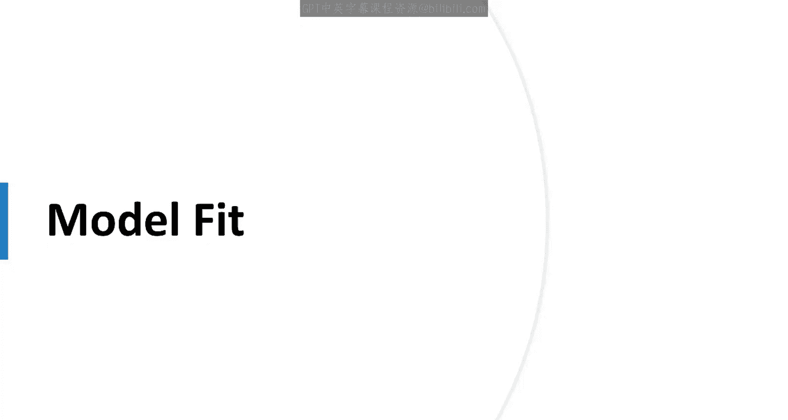
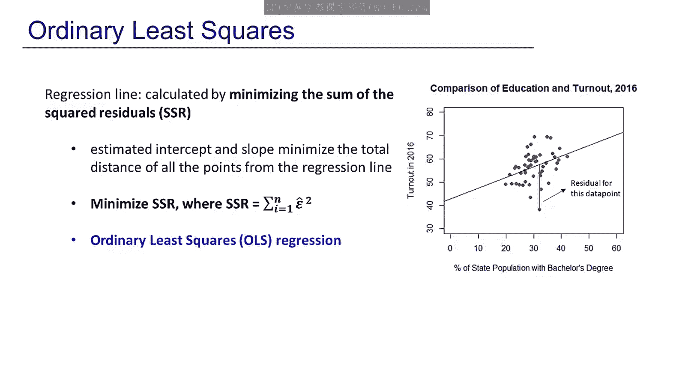
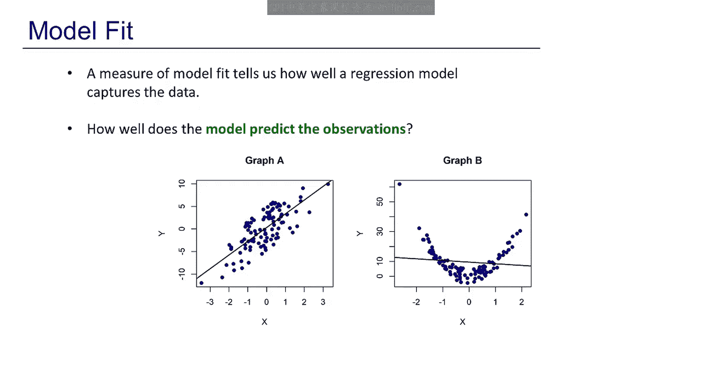
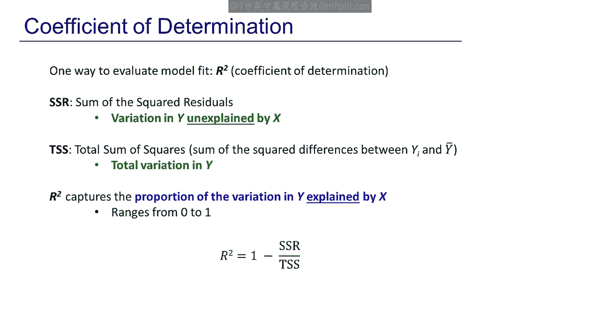
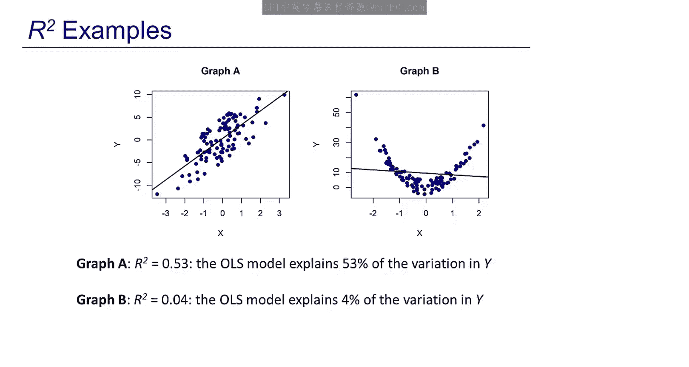
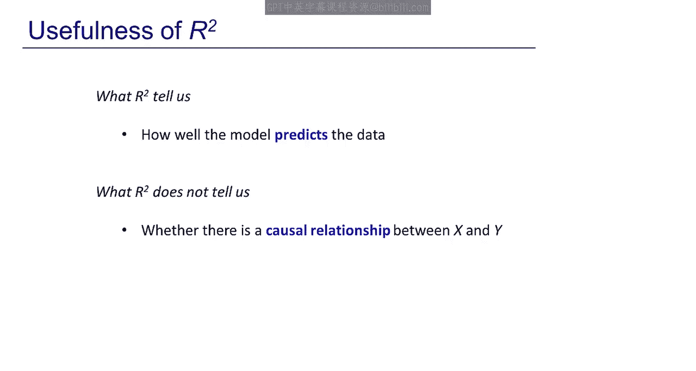

# 约翰霍普金斯大学《数据素养（数据⧸测量⧸回归⧸概率⧸毕业项目）｜Data Literacy》中英字幕（deepseek p35 5_模型拟合.zh_en -BV1jXtMemEuh_p35-

Model fit， while it's quite straightforward to place a line through data。

 it can be tricky to evaluate whether or not that line is a good fit。

How can we be confident that the line is a good model for the data we're trying to summarize and the outcome we're trying to predict？

This video will introduce the ordinary least squares method of fitting a regression line and one common measure of model fit called R squared。

 By the end of this video， you should understand the intuition behind the ordinary least squares approach and the value and limitations of the R squared measure of model fit。

Ordinary least squares。In practice， an analyst uses a statistical software package to estimate regression coefficients。

Nonetheless， it's valuable to develop some intuition about how these quantities are calculated。

 This helps with evaluating whether a regression model is the right tool for a particular data set or research question。

Remember those residuals we discussed earlier in the course， as a reminder。

 a residual is the difference between the actual value of y and the predicted value of y for each data point。

In the graph on the right， the red line shows the residual for one particular data point。

 each data point has a residual。The estimated regression line is calculated by minimizing the sum of the squared residuals。

In layman's terms， the estimated intercept and slope coefficient minimize the total distance of all the points from the regression line。

Put even more simply， we're looking for the line that is most centered in the data。

Estimating a regression model in this way is referred to as ordinary least squares or OLS regression。

Again， analysts don't typically calculate intercepts and coefficients by hand。

 but you certainly could using matrix algebra and a fair amount of pencil and paper。

Once we've estimated a regression model， we can evaluate whether that model is indeed a good fit for the data。

A measure of model fit tells us how well our regression line captures the underlying data。

 But another way， the measure tells us how well the model predicts the observations。

Take a look at the graphs A and B on this slide， both are scatter plots with ordinary least squares regression lines。

 just by eyeballing the graphs， you can see that the line on graph A appears to be a much better fit for the data than the line on graph B。

In graph A， the data appeared to have a linear pattern， as the value of x increases。

 the value of y increases at a constant rate。In contrast。

 the data in Gra B appear to follow a U shape。As a result。

 a linear model does not appear to be a great fit for the data。

We can summarize these observations that we've just made using the R squared measure。

R squared， which is also called the coefficient of determination， is one measure of model fit；

 There are other measures as well， which will be covered later in the course and later in the data literacy specialization。

Let's walk through the calculation of the r squared value to give you some intuition about what exactly this measure means。

To calculate r squared， we need to calculate the sum of the squared residuals and the total sum of squares。

Let's start with the sum of the squared residuals abbreviated as SSR。

 This measure is calculated by adding up all of the squared residuals from the model。

 Remember that a residual is the difference between why and why hat。Substantively。

 the SSR captures the variation in y that is unexplained by x。

 since residuals are the difference between the observed values of y and the predicted values of y。

Now let's turn to the total sum of squares abbreviated TSS。

The TSS is calculated by adding up the square differences between each value of y and the mean of y。

 This measure captures the total variation in y。If we divide the SSR by the TSS。

 we get the percentage of variation in y that is unexplained by X。If we subtract this value from 1。

 we get the percentage of the variation in y that is explained by x。In other words。

 we have the percentage of the variation of the outcome variable that is captured by the model。

Because r squared is a percentage， it ranges from  zero to 1。

 Let's walk through a couple of examples。

Here we return to graphs A and B。 the R squared value for the regression line in graph A is 0。53。

 We would interpret this value by saying that the OLS model explains 53% of the variation in y。

The R squared value for the regression line in graph B is 0。04。

 We would interpret this value by saying that the Os model in this case explains 4% of the variation in Y these values align with our initial eyeball assessment。

 A line is a much better fit for the data in graph A than the data in graph B。

It's very important to keep in mind what the r squared value tells us and does not tell us。

The R squared value tells us how well the model captures or predicts the data at hand。As a result。

 this measure of fit is extremely useful for developing models where the goal is prediction。

 such as trying to predict how many hospital beds will be needed for a disease outbreak or how many teachers will be needed in the next school year。

The r squared value， however， does not tell us anything about causality。

 It does not tell us whether there is a causal relationship between x and y To establish causality。

 we need to establish that the model is free from bias。

 a topic will address in our discussion of multivariate regression。As we move forward。

 keep in mind that there is no single measure of model fit that tells you whether a regression model is good or bad。

Analysts consider multiple measures and aspects of the results when determining whether a particular model is a good representation of the relationship under study。

While it would be very easy if we could rely on a single measure to evaluate our regression models。

 this is simply not possible。Each indicator of model quality that we will discuss has its advantages and limitations。

