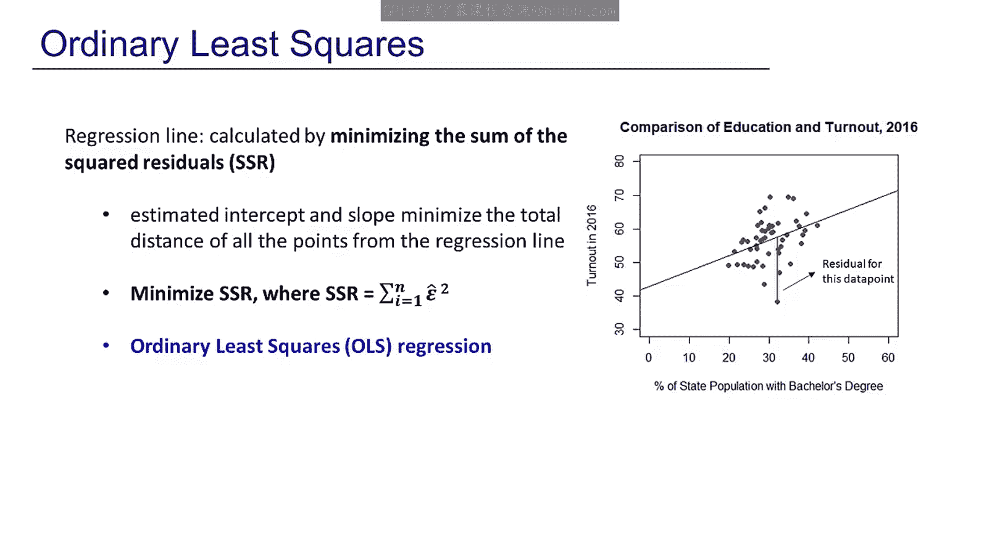
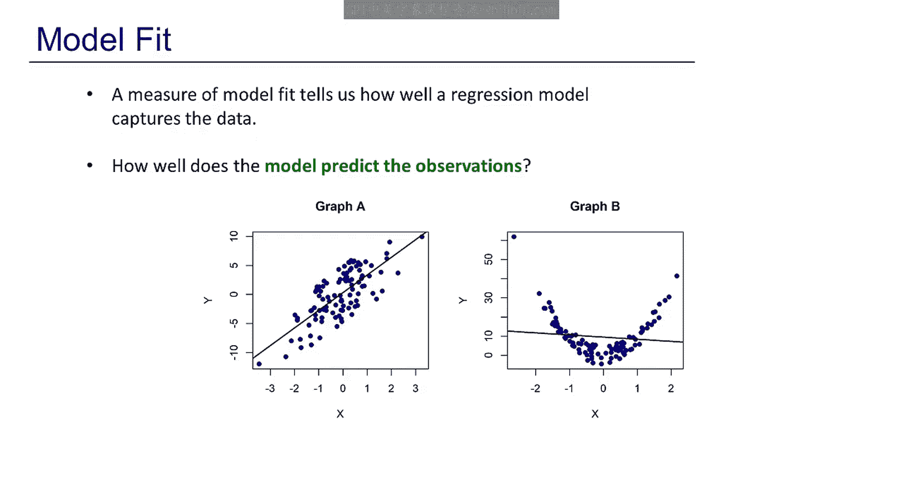
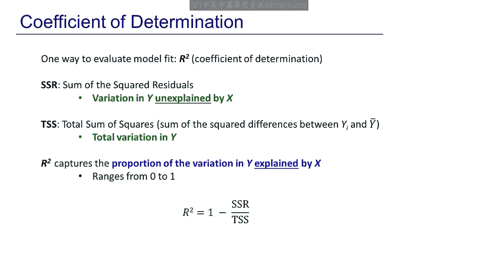
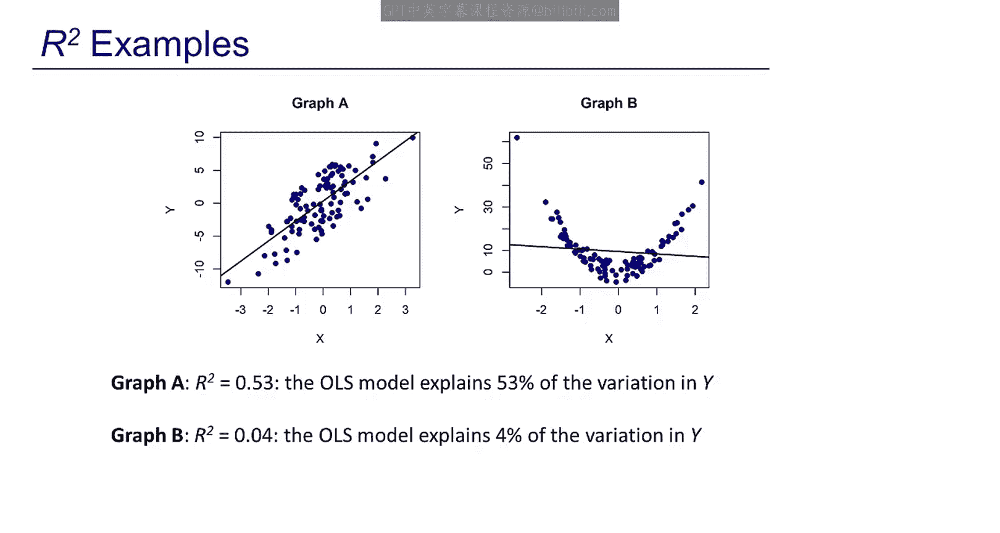
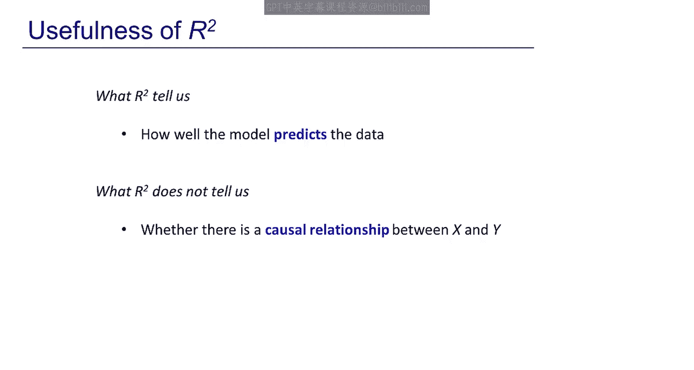

# 数据素养：5：模型拟合 📊

在本节课中，我们将学习如何评估一条回归线是否很好地拟合了数据。我们将介绍普通最小二乘法（OLS）拟合回归线的原理，以及一个常用的模型拟合度量指标——R平方。通过本节课，你将理解OLS方法背后的直观思想，以及R平方指标的价值与局限性。

## 普通最小二乘法（OLS）🔍

上一节我们介绍了回归分析的基本概念，本节中我们来看看如何具体找到那条“最佳”的回归线。在实践中，分析师通常使用统计软件包来估计回归系数。然而，了解这些数值是如何计算出来的，对于评估回归模型是否适用于特定数据集或研究问题非常有价值。

还记得我们在课程早期讨论过的残差吗？残差是每个数据点的实际y值与预测y值之间的差异。在右侧图表中，红线显示了一个特定数据点的残差，每个数据点都有一个残差。

估计回归线的计算方法是**最小化残差平方和**。通俗地说，估计的截距和斜率系数使得所有数据点到回归线的总距离最小。更简单地说，我们寻找的是最“居中”于数据的那条线。以这种方式估计回归模型被称为**普通最小二乘法**或**OLS回归**。

再次强调，分析师通常不会手动计算截距和系数，但理论上你可以使用矩阵代数和大量的纸笔计算来完成。

## 评估模型拟合度 📈

一旦我们估计了一个回归模型，就可以评估该模型是否确实很好地拟合了数据。模型拟合度度量告诉我们回归线捕捉底层数据的程度，或者说，模型预测观测值的表现如何。

请看本页幻灯片上的图表A和B，两者都是带有普通最小二乘回归线的散点图。仅通过目测，你就可以看出图表A中的线似乎比图表B中的线对数据的拟合好得多。

在图表A中，数据呈现线性模式：随着x值增加，y值以恒定速率增加。相反，图表B中的数据似乎遵循U形。因此，线性模型似乎不太适合这些数据。

我们可以用R平方度量来总结我们刚刚做出的这些观察。

## R平方度量 🧮

R平方，也称为决定系数，是模型拟合度的一种度量。本课程及数据素养专项课程后续还会介绍其他度量指标。

让我们逐步了解R平方值的计算过程，以便你直观理解这个度量的确切含义。

要计算R平方，我们需要计算**残差平方和**与**总平方和**。

首先从**残差平方和**开始，缩写为SSR。该度量通过将模型中的所有残差平方相加来计算。记住，残差是y与y_hat之间的差值。实质上，SSR捕捉了y中未被x解释的变异，因为残差是y的观测值与预测值之间的差异。

现在来看**总平方和**，缩写为TSS。TSS通过将每个y值与y的均值之差的平方相加来计算。这个度量捕捉了y的总变异。

如果我们用SSR除以TSS，就得到了y的变异中未被X解释的百分比。如果我们用1减去这个值，就得到了y的变异中被x解释的百分比。换句话说，我们得到了结果变量的变异中被模型捕捉的百分比。

因为R平方是一个百分比，它的范围从0到1。让我们看几个例子。

## R平方示例 📊

这里我们回到图表A和B。图表A中回归线的R平方值为0.53。我们可以这样解释这个值：OLS模型解释了y中53%的变异。图表B中回归线的R平方值为0.04。我们可以这样解释：在这种情况下，OLS模型仅解释了y中4%的变异。这些数值与我们最初的目测评估一致：直线对图表A数据的拟合度远好于对图表B数据的拟合度。

## R平方的解读与注意事项 ⚠️

非常重要的一点是，要记住R平方值告诉我们什么，以及不告诉我们什么。

R平方值告诉我们模型捕捉或预测当前数据的程度。因此，这个拟合度度量对于开发以预测为目标的模型极其有用，例如试图预测疾病爆发需要多少医院床位，或下个学年需要多少教师。

然而，**R平方值并不告诉我们任何关于因果关系的信息**。它不告诉我们x和y之间是否存在因果关系。要确立因果关系，我们需要确保模型没有偏差，这是我们在讨论多元回归时会涉及的话题。

随着学习的深入，请记住，没有一个单一的模型拟合度度量可以告诉你一个回归模型是好是坏。分析师在确定特定模型是否很好地代表了所研究的关系时，会综合考虑结果的多个度量和方面。虽然如果我们能依赖单一度量来评估回归模型会非常方便，但这根本不可能。我们将讨论的每个模型质量指标都有其优点和局限性。

## 总结 ✨

本节课中，我们一起学习了如何评估回归模型的拟合度。我们介绍了普通最小二乘法（OLS）通过最小化残差平方和来寻找最佳拟合线的原理。我们重点学习了R平方（决定系数）这一重要指标，它表示模型解释的结果变量（y）变异的百分比。高的R平方值通常意味着模型拟合较好，但我们必须谨记，R平方仅衡量预测能力，而非因果关系。评估模型需要综合多种指标和背景知识。