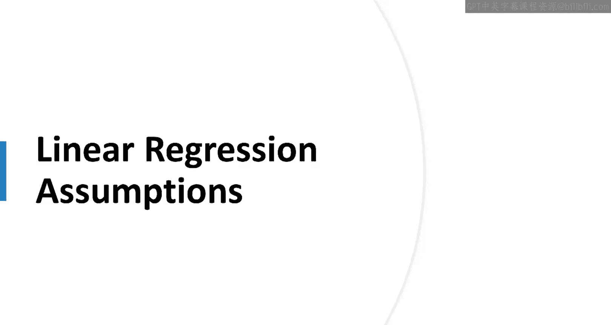
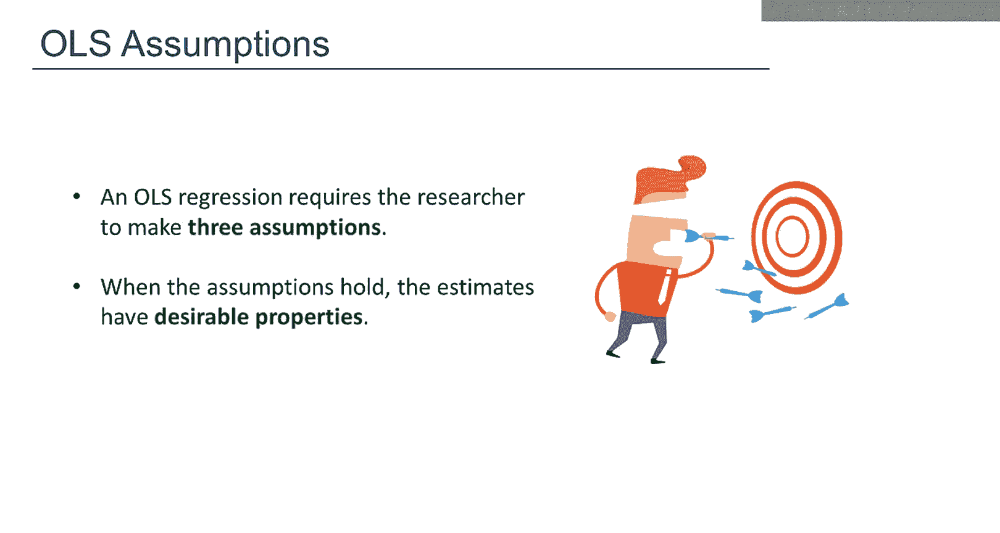
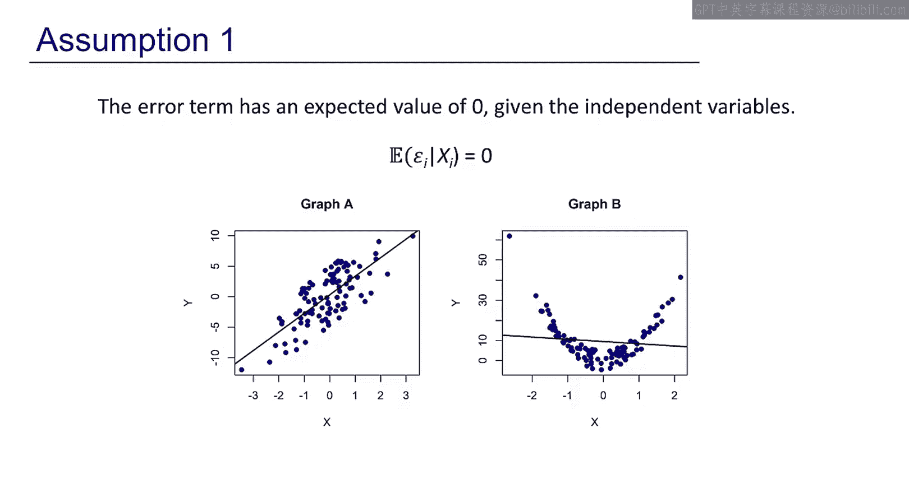
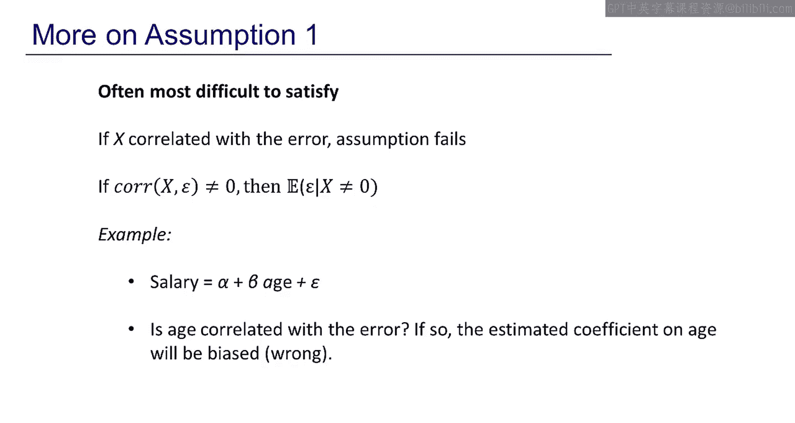
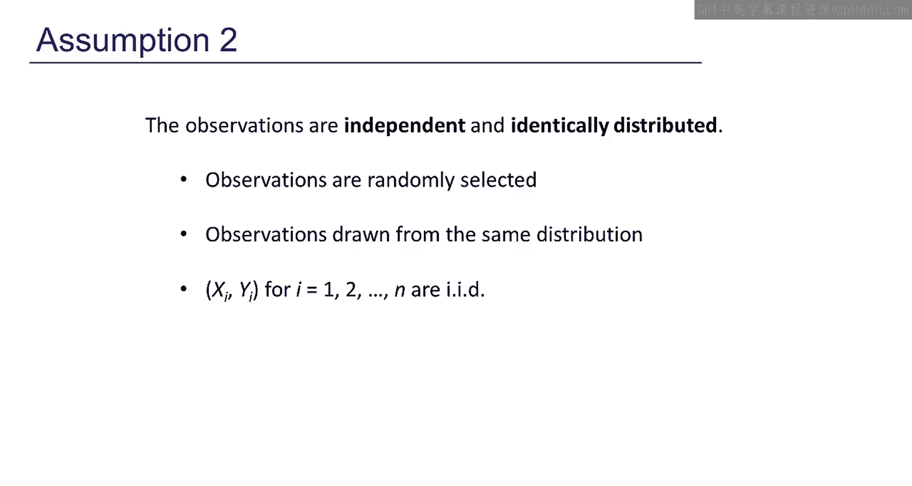
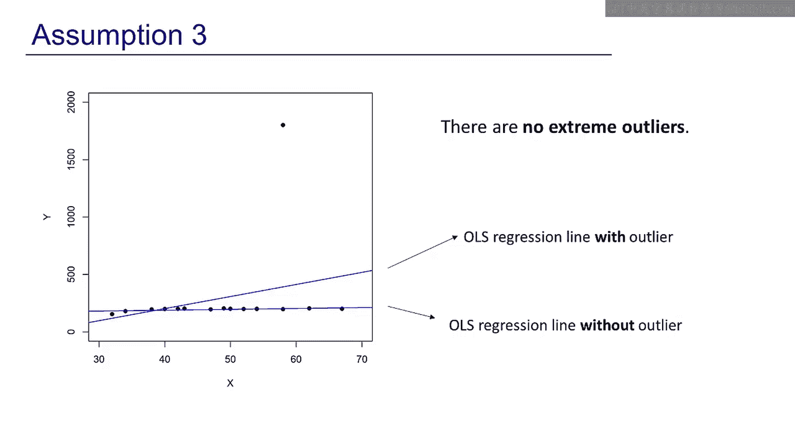
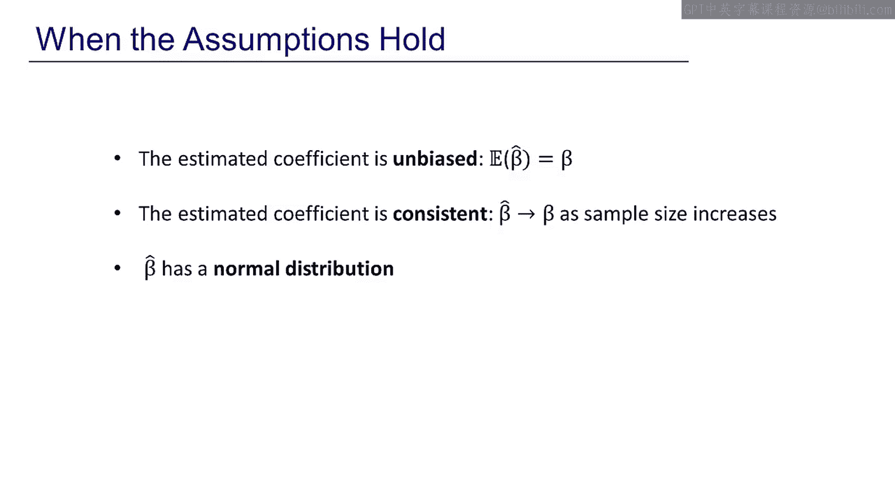

# 约翰霍普金斯大学《数据素养（数据⧸测量⧸回归⧸概率⧸毕业项目）｜Data Literacy》中英字幕（deepseek p36 6_线性回归假设.zh_en -BV1jXtMemEuh_p36-

Linear regression assumptions。There are several assumptions an analysts must make when performing a regression analysis。

If the assumptions are not met， then we should question the results from an estimated regression model。

By the end of this video， you should be able to determine whether a regression model has met all of the necessary assumptions and articulate the importance of these assumptions for drawing meaningful conclusions from the findings。

The OLS assumptions。There are three specific assumptions a researcher must make to estimate a good regression model when these assumptions hold。

 the estimated coefficients have desirable properties。

 which I'll discuss toward the end of the video。If one or more of the assumptions does not hold。

 the researcher should not use an OLS regression model。

It may be that the researcher needs to use a different type of regression model。

 such as a nonlinear model。Or the researcher might need to exclude observations from the analysis before estimating the model。

 or collect new data altogether before estimating the regression model。

Assumption 1， the first OL S assumption states that the error term has an expected value of 0。

 given the independent variables in the model。In other words， for any given value of x。

 our best guess should be that the residual is zero。

This occurs when we have included all the necessary variables in the model。

We'll talk more about how to know when this has been achieved later on in the course in our discussion of multivariate regression models。

Take a look at the two graphs at the bottom of the slide。

 which we examined in our discussion about the importance of linearity。

This assumption is essentially a restatement of the linearity assumption。In graph A。

 the data points are approximately evenly distributed around the regression line。

 which means that the expected value of the residual for any particular value of x is 0。In graph B。

 we see that the data points are not evenly distributed around the regression line。

The data points systematically deviate away from the line。 In this case， they have a quadratic shape。

For low and high values of x， the expected value of the residuals is positive。

 whereas for values in the middle range of x， the expected value of the residuals is negative。

As a result， Gra B violates the first OLS assumption。

Let's spend a few more moments discussing Asstion1。

 as it's often the most difficult of the three assumptions to satisfy。

If the independent variable of interest in a regression model is correlated with the error。

 then assumption 1 fails。In formalal notation form。

 if the correlation between x and the error term is not0。

 then the expected value of the error term given x will not equal 0。

 meaning assumption 1 is violated。Let's walk through an example。

Suppose you want to run a model in which an individual's age predicts their salary。

Do you think the age variable is correlated with the error term in this regression， Why？ Well。

 age is likely related to experience， for example， which is a determinant of salary。

Individuals who have more work experience are likely to have a higher salary。

We can imagine other variables that are likewise correlated with age and are determinants of salary。

 such as say， communication skills or the size of one's professional network。

If these correlations indeed exist， then the estimated coefficient on age for the bivariate model on this slide will be biased。

 which means it's wrong。In the next module， we'll talk about how a researcher can address these concerns using a multivariate regression model。

Assumption 2。Assumption 2 states that the observations in a data set are independent and identically distributed。

This means that the observations are selected randomly and that each observation is drawn from the same population。

Imagine selecting a sample by surveying 10 of your closest friends and then asking each friend to recommend 10 additional survey respondents。

All of the respondents in the survey are likely to be similar in important ways。

 which will cause the sample to be unrepresentative of the population。To prevent this type of bias。

 the observations in a data set should be selected independently of each other。

The third bullet point is the formal notation for this assumption。

It states that all of the observations from1 to n should be IID。

 which is short for independent and identically distributed。

Assumption 3， the third assumption in OLS regression states that there are no extreme outliers in the dataset set。

This is because an extreme outlier can dramatically alter the regression line。

In the graph on this slide， take a look at the data point located near the top。

Notice that the regression line that excludes this data point is flat。

 which suggests that there is no relationship between x and Y。

The regression line that includes the data point， however。

 has a positive slope indicating a positive relationship between x and Y。Thus。

 the decision to include or exclude an outlier can have a meaningful impact on this substantive conclusion。

When the three OLs assumptions hold， the estimated coefficients have desirable properties。

 In particular， the estimated coefficients will be unbiased， consistent， and normally distributed。

An unbiased coefficient is one that is accurate， On average。

 a consistent coefficient is one that approaches the true value of the parameter as the sample size increases。

Finally， a normally distributed coefficient allows us to calculate useful measures of uncertainty。

 which is a topic that we'll cover in the fourth and final course of the data literacy specialization。

