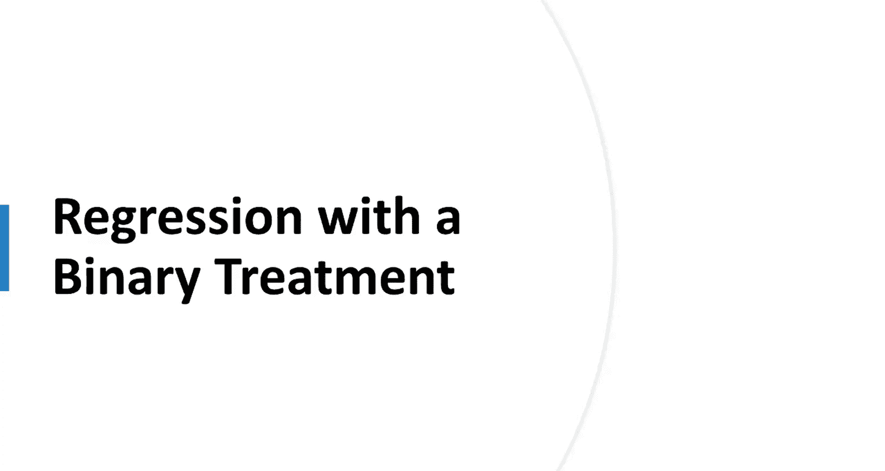
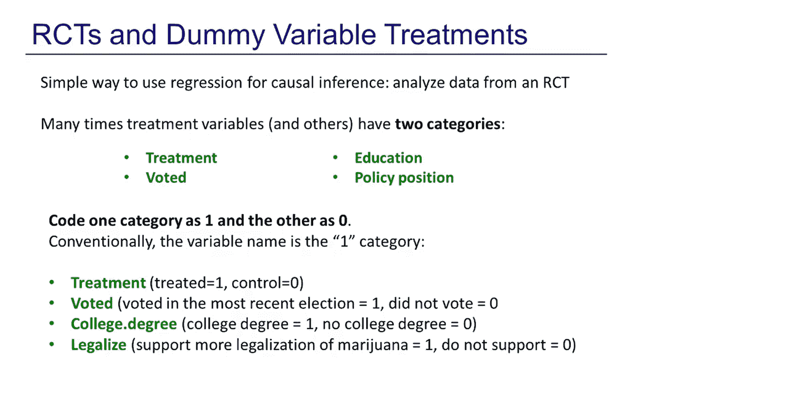
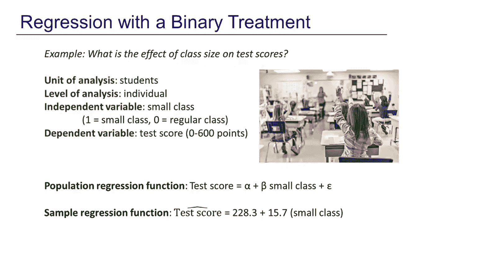
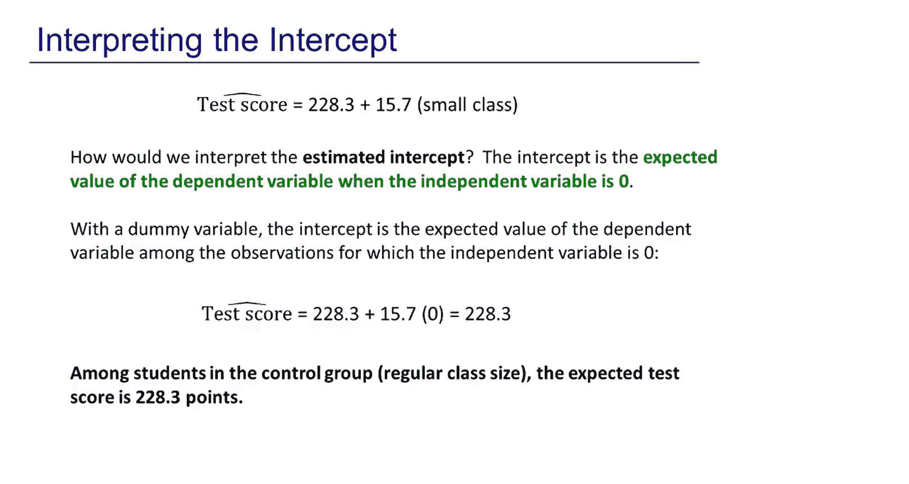
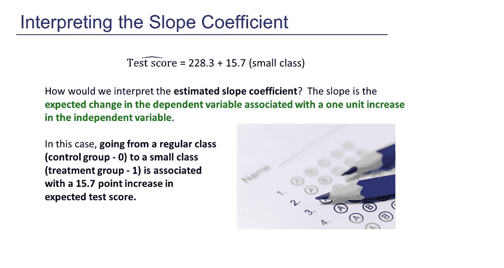
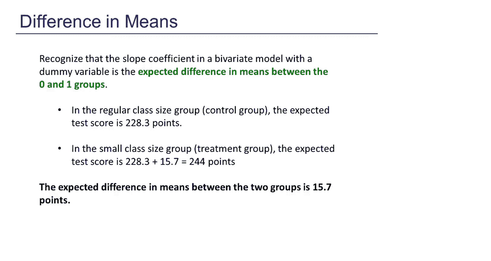
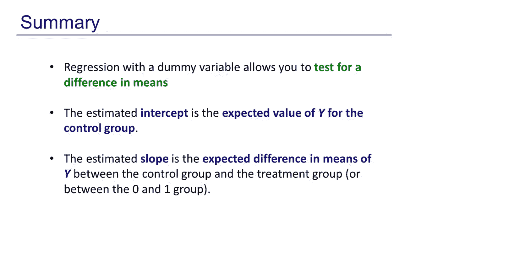

# 约翰霍普金斯大学《数据素养（数据⧸测量⧸回归⧸概率⧸毕业项目）｜Data Literacy》中英字幕（deepseek p37 7_二元处理变量的回归.zh_en -BV1jXtMemEuh_p37-

Regression with a binary treatment variable。 thus far。

 we've discussed how regression models can be used to quantify the relationship between two variables and the assumptions that must be met to ensure the results are unbiased and consistent。

We will continue our discussion of bivariate regression by examining the particular case where the independent variable is binary。

 meaning it takes on two values，0 and 1。By the end of this video。

 you should be able to construct a regression model with a binary treatment variable and interpret the results。

 Let's get started。

RRCTs and dummy variable treatments。Earlier in the data literacy specialization。

 we discussed how randomized controlled trials are extremely useful for conducting causal studies because the treatment is randomly assigned to participants。

 we can easily estimate the effect of the treatment using a regression model。

Many times treatment variables， as well as other variables have two categories。

 these are called dummy variables。 For example， the variable treatment might have two categories。

 a control group and a treatment group。As does a variable that captures whether or not an individual voted or did not vote in the most recent election。

It's important to recognize that many times a researcher chooses to define a variable as a dummy。

Variables such as education and an individual's policy position can be defined in various ways。

 We could treat these variables as continuous variables or variables with more than two categories。

 or we can construct them to be dummies。For example。

 we can categorize individuals as either having a college degree or not having a college degree and as either supporting or opposing a particular policy position。

With dummy variables， it is helpful for reasons that you'll see when we interpret the coefficients to code one category as 1。

 and the other category as zero。Conventionally， researchers named the variable according to the one category。

 Let's walk through a few examples。We might create a dummy variable treatment in which members of the treatment group are coded as one。

 and members of the control group are coded as zero。Or we might create a variable called voted。

 in which those who voted in the last election are coded as one。

 and those who did not vote are coded as zero。For a variable called college degree。

 college degree earners would be assigned to one， and those without a college degree would be assigned to zero。

Lastly， for a variable called legalalize， we could assign one to those who support increased legalization of marijuana and a zero to those who do not support this policy position。

Regression with the binary treatment variable。Now that you know what a dummy variable is。

 let's walk through an example of a bivariate regression model in which the independent variable is a dummy。

The research question is， what is the effect of class size on test scores？

There has been a substantial amount of experimental research conducted to answer this question before moving forward。

 let's identify the key components of the question。The unit of analysis in this case is students。

 Each row in the data set is an individual student， as opposed to a class or a school。

The independent variable is the treatment。 In this case， being in a small class。

 Students were randomly assigned to either be in a small class or regular size class。

 Students in the treatment group， namely those assigned to a small class are coded as one for the treatment variable。

 Students assigned to the control group， namely those assigned to a regular size class。

 are coded as0 for the treatment variable。The dependent variable is student' performance on a math and reading test。

 the test score variable has a range of 0 to 600 points。The population regression is as follows。

 a student's test score equals alpha plus beta times class size plus the error term。As a reminder。

 the population regression function specifies the hypothesized relationship between the independent and dependent variable。

Now if we have actual data， we can go ahead and calculate the sample regression function。

I've done this using a data set and estimated the following SRF。

A student's expected test score equals 228。3 plus 15。7 times the small class variable。

Now let's make some sense of these estimates。Now that we have a sample regression function。

 we can interpret the results。Let's start with the estimated intercept。

 Re that the intercept is the expected value of the dependent variable when the independent variable is 0。

So with a dummy independent variable， the intercept is the expected value of the dependent variable among the observations for which the independent variable is zero。

If we plug zero into the independent variable in our SRF。

 we can see that a student's expected test score is 228。3。

This means that among students in the control group， namely those assigned to regular size classes。

 the expected test score is 228。3 points。

Now， let's turn to the slope coefficient， which is the coefficient on small class。

 The slope coefficient is the expected change in the dependent variable associated with a one unit increase in the independent variable。

In this case， the independent variable has two values， 0 and 1。

 so a one unit change means going from 0 to one， which in this case means going from a regular size class to a small class。

The slope coefficient can therefore be interpreted as follows。

 going from a regular size class to a small class is associated with a 15。

7 point increase in expected test score。To summarize。

 when you have a regression with a dummy independent variable。

 the intercept is the expected value of the dependent pen variable when the dummy equals 0。

 and the slope coefficient is the expected difference between the expected value of the dependent variable between the0 and one group。

I'll repeat this again at the end of the lecture since these are two core takeaway points。

Difference in means。Let me restate the last point by spending another minute talking about the slope coefficient in this SRF。

The slope coefficient in a bivariate model with a dummy independent variable is the expected difference in means between the zero and1 groups。

The model tells us that among those in the regular class size group， the control group。

 the expected test score is 228。3 points。The model also tells us that among those in the small class size group。

 the treatment group， the expected test score is 228。3 plus 15。7 for a total of 244 points。

So the expected difference in means between the two groups is 15。7 points。

Feel free to pause the lecture and take as much time as you need to walk through these concepts。

 as you can see， the math itself is quite easy， but it may take a few minutes to get comfortable with the idea that the intercept is the expected value of y when the dummy is0 and the slope is the expected difference in y between the zero group and the one group。

Summary this video has walked you through how to estimate and interpret a regression model with the dummy variable。

 which allows you to test for a difference in means between the two groups of the dummy。

The estimated intersect is the expected value of y， the dependent variable for the control group。

 the estimated slope is the expected difference in the means of y between the control group and the treatment group。

 or between the0 and one group。Moving forward， we'll talk about how to add more variables to a regression model and interpret the coefficients in a multivariate context。

