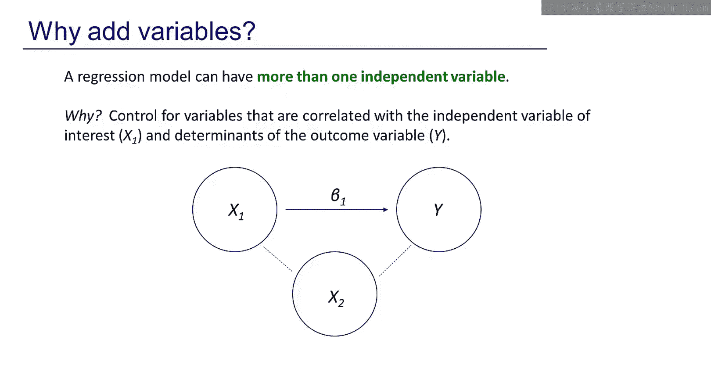
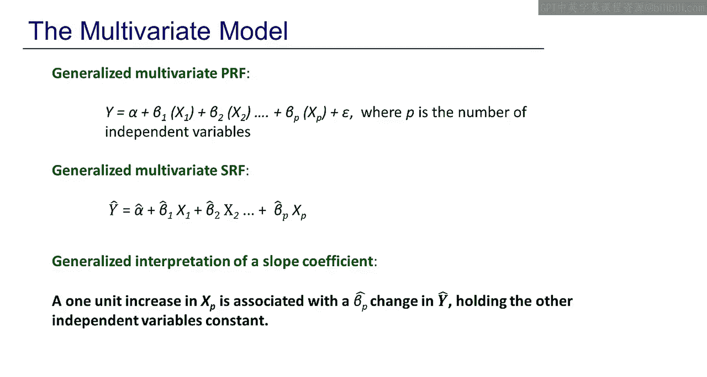
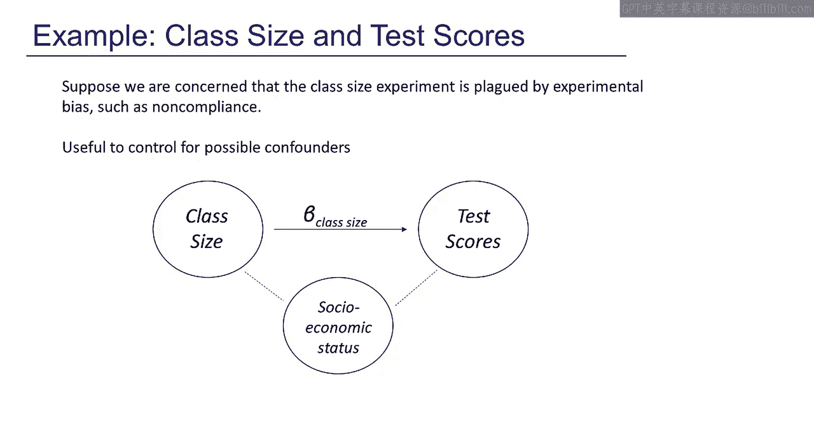
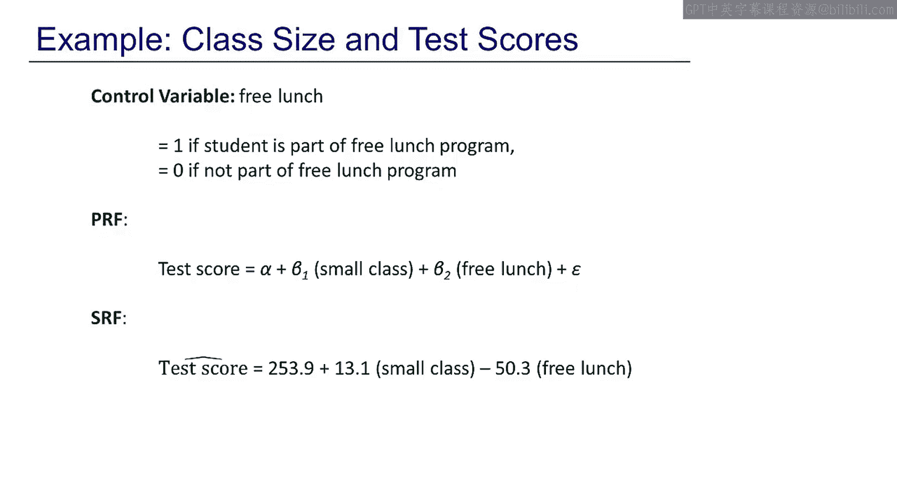
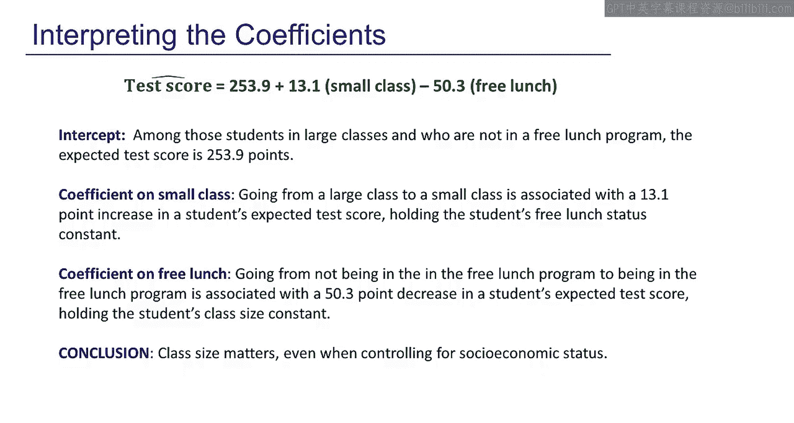
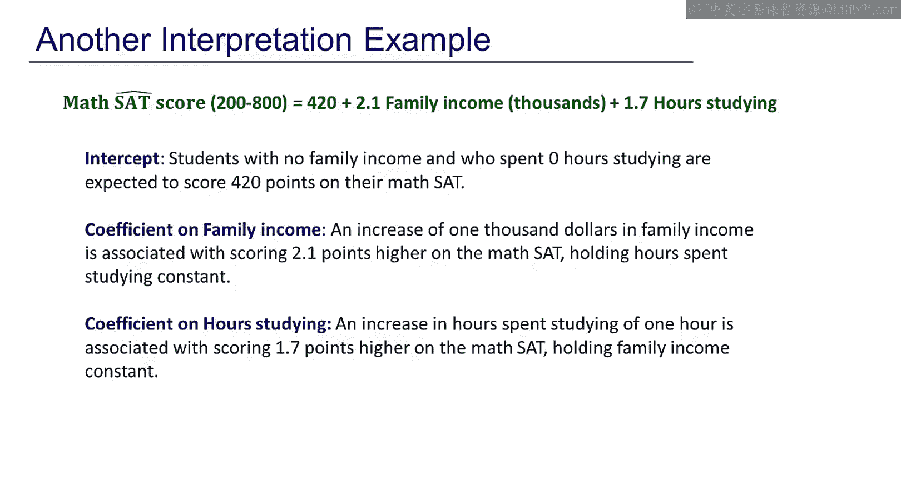
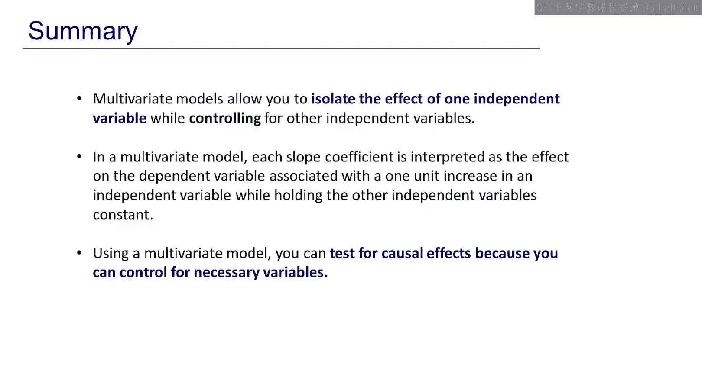

# 约翰霍普金斯大学《数据素养（数据⧸测量⧸回归⧸概率⧸毕业项目）｜Data Literacy》中英字幕（deepseek p38 8_构建与解释多元模型.zh_en -BV1jXtMemEuh_p38-

Constructing and interpreting a multivariate model。

The challenge with bivariate regression models is that we can't control for possible confounders。

 In other words， what if we think that a third variable explains some or all of the relationship between our independent variable of interest and the dependent variable。

In these cases， we must use a multivariate model， which is simply a regression model that includes multiple independent variables。

Typically we'll refer to the independent variable we care about as the independent variable of interest and the other independent variables as control variables。

By the end of this video， you should be able to draw conclusions from the results of a multivariate regression model。

 Let's get started。

As I previewed， a regression model can have more than one independent variable；

 let's consider why this is valuable。By adding in additional independent variables generally referred to as control variables。

 we can control for variables that are correlated with the independent variable of interest and determinants of the outcome variable。

The graphic on this slide shows that we care about estimating the effect of x1 on y。

 This effect is captured by beta 1。 but notice that there is a correlation between x1 and x 2 and a relationship between x 2 and Y。

 In this case， it's important to control for x 2。 In a regression that estimates the effect of x1 on Y。

 In a moment， we'll walk through an example。

First， however， let's discuss the general formula for a population regression function and sample regression function for a multivariate model。

The PRf is as follows。 y equals alpha plus beta 1 times x1 plus beta 2 times x2 all the way through beta p times xp plus the error term where p is the number of independent variables with five independent variables。

 for example， you would have five slope coefficients。The formula for the SRF is as follows。

 Y hat equals alpha hat plus beta1 hat times x1 plus beta 2 hat times x2 through beta P hat times X P。

 You can see that these formulas are simply extensions of the bivariate formulas that we discussed previously。

The next step is to interpret the intercept and each slope coefficient in the SRF。 General speaking。

 we interpret a slope coefficient in a multivariate model by saying that a one unit increase in Xp is associated with a beta hat P change in Y hat。

 holding the other independent variables constant， the intercept as usual。

 is interpreted as the value of y hat when all of the independent variables equals0。

Let's walk through an example by returning to the class size experiment。

 Suppose we are concerned that the experiment is plagued by some type of experimental bias。

 such as noncompliance。 You can imagine， for example。

 that some parents really wanted to put their students into smaller classes and so did not adhere to their treatment assignment。

One resulting hypothesis might be that students from higher socioeconomic backgrounds were disproportionately in the smaller classes。

Take a look at the graphic。 We want to estimate the effect of class size on test scores。

 but owing to non-compliance in the experiment， it may be that there is a correlation between a student's class size and the student's socioeconomic background and we know from previous research that socioeconomic background is related to test scores。

 As a result， it's important to control for socioeconomic status when estimating the effect of class size on test scores。

One way to operationalize socioeconomic status is with the variable free lunch。

 this variable takes a value of one if a student is part of the free lunch program and zero if the student is not part of the free lunch program。

If we include this control variable in the model， our PRF is test score equals alpha plus beta 1 times small class plus beta 2 times free lunch plus the error term。

And the SRF， which I calculated using a statistical software program and a data set。

 is test scorere hat equals 253。9 plus 13。1 times small class minus 50。3 times free lunch。

Now let's make some sense of these coefficient estimates。

The SRF is at the top of the slide as a reminder。We can interpret the intercept by saying that among those students in large classes and who are not in a free lunch program。

 the expected test score is 253。9 points。The coefficient on class size。

 which is our independent variable of interest， is interpreted in the following way。

 we would say going from a large class to a small class is associated with a 13。

1 point increase in a student's expected test score， holding a student's free lunch status constant。

Now let's interpret the coefficient on the control variable。

 we would say that going from not being in the free lunch program to being in the free lunch program is associated with a 50。

3 point decrease in a student's expected test score， holding the student's class size constant。

Now that we have interpreted the estimates， what can we conclude about the relationship between class size and test scores？

While our model tells us that even after controlling for student socioeconomic status。

 there remains a positive relationship between class size and test scores with students in smaller classes expected to receive higher test scores。

Keep in mind that this model may be incomplete， there may be additional control variables that we should include to ensure that our coefficient on class size is accurate。

 meaning unbiased。

This slide provides some additional interpretation examples to help you get the hang of it。

 Take a look at the SRF。In this model， a student's estimated math SAT score。

 which ranges from 200 to 800 points， is equal to 420 plus 2。1 times family income plus 1。

7 times hours spent studying Family income is measured in thousands of dollars。

We would interpret the intercept by saying that students with no family income and who spent zero hours studying are expected to score 420 points on their math SAT。

Remember， the intercept is the expected value of the dependent variable when all of the independent variables equals 0。

We can interpret the coefficient on family income by saying that an increase of $1。

000 in family income is associated with scoring 2。1 points higher on the math SAT。

 holding hours spent studying constant。Recognize that a $1。

000 increase is a one unit increase in the family income variable because that variable is measured in thousands。

Lastly， we can interpret the coefficient on hour studying by saying that an increase in hour spent studying of one hour is associated with scoring 1。

7 points higher on the mathth SAT， holding family income constant。

To summarize， the key advantage of multivariate models is that they allow you to isolate the effect of one independent variable while controlling for other independent variables。

In a multivariate model， each slope coefficient is interpreted as the effect on the dependent variable associated with the one unit increase in an independent variable while holding the other independent variables constant。

In a causal context， we can use a multivariate regression model because we can control for necessary variables。

 meaning potential confounders。Moving forward， we'll further discuss how to specify and evaluate a multivariate model。

