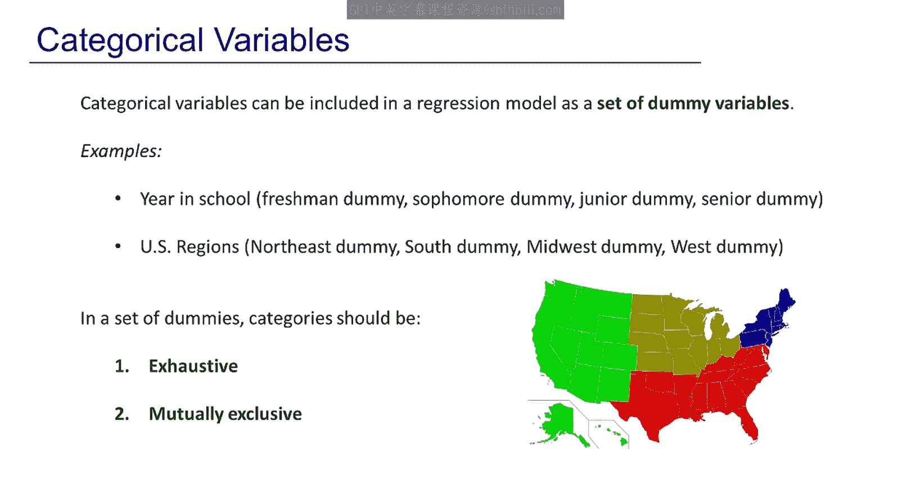
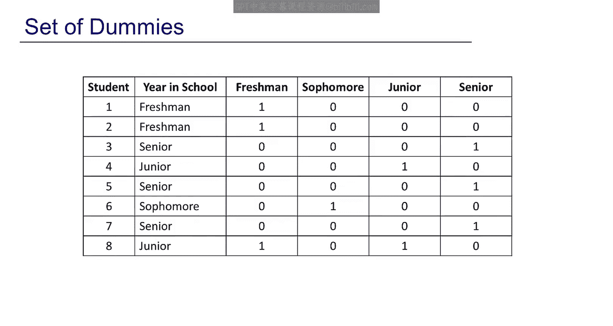
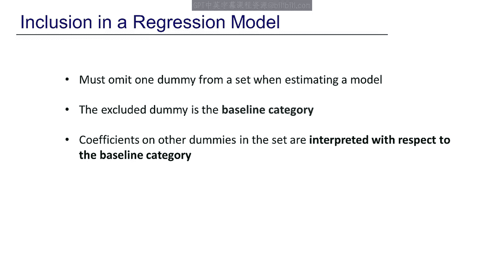
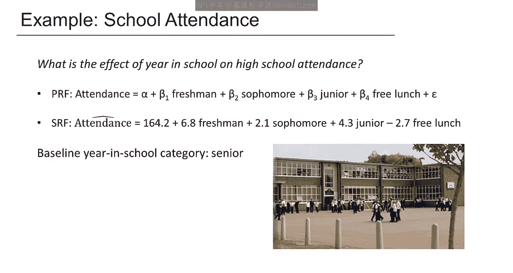
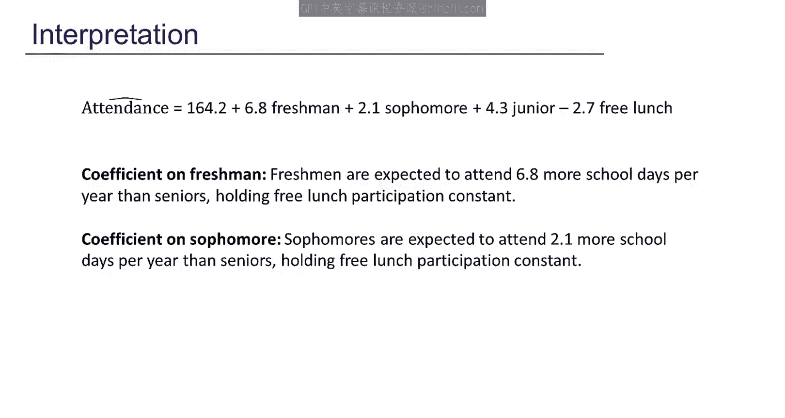
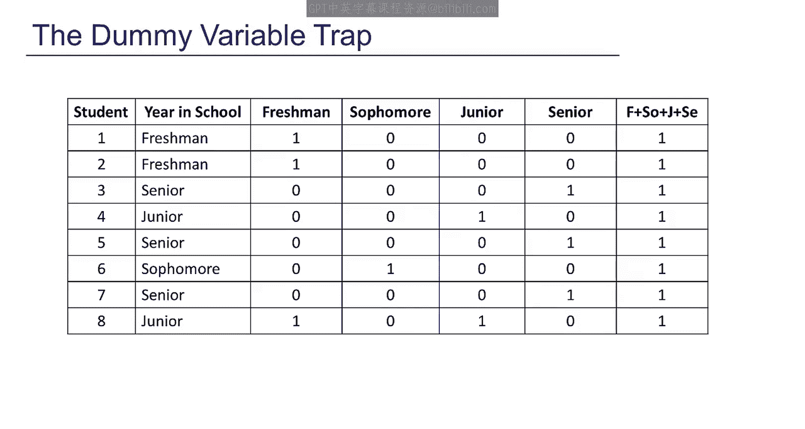
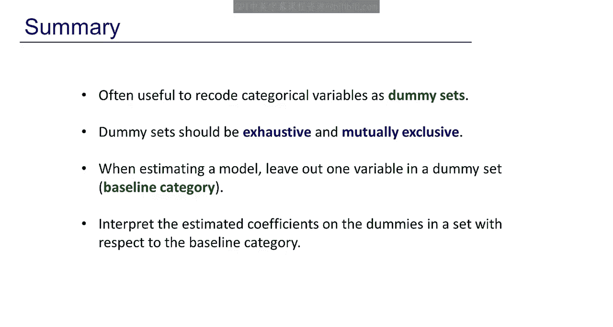

# 约翰霍普金斯大学《数据素养（数据⧸测量⧸回归⧸概率⧸毕业项目）｜Data Literacy》中英字幕（deepseek p39 9_虚拟变量集.zh_en -BV1jXtMemEuh_p39-

Dummy variable sets。 It's often the case that researchers wish to include categorical variables in their models。

 One way to do this is to create a dummy variable for each category and then include these dummies in a regression model。

 By the end of this video， you should be able to interpret an estimated regression model that includes one or more dummy variable sets。

 In the next video， we'll discuss why using a dummy variable is valuable in this context。

Categorical variables。As I noted， categorical variables can be included in a regression model as a set of dummy variables。

 For example， we might have a data set in which high school students are the unit of analysis。

 and we want to include a measure of students year in school。 We could create four dummy variables。

 one for freshmen， one for sophomores， one for juniors and one for seniors。

Or we might want to include a measure of the region of the US in which each student lives To do this。

 we could create four dummies， one for the northeast， one for the south。

 one for the Midwest and one for the West。To create a set of dummies for a categorical variable。

 the categories of the variable must be exhaustive and mutually exclusive。

 Exhausive means that the categories include all possible options。

 Every observation must fall into one category。 mutualually exclusive means that each observation can only fall into one category。

 and observation can't be part of multiple categories。As an example。

 imagine that the year in school variable listed above did not include a senior category。

 The categories would then not be exhaustive， or imagine if the region variable included both West and Pacific West。

 Some students who live in Washington State might accidentally be placed in both categories。

 in which case the categories would not be mutually exclusive。

To create a set of dummy variables for a categorical variable。

 the researcher creates a dummy for each category， this slide includes a table with eight observations from a larger data set。

Each observation is a student。 The year in school variable indicates each student's year， freshman。

 sophomore， junior or senior。 The next four columns show a dummy variable for each category。

 For each observation， One of the dummies is set to  one and the others are set to 0。 For example。

 Take a look at student number 2。 This student is a freshman。

 So the freshman dummy variable is set to one。 While the other dummies are set to 0。 Now。

 take a look at student number 6。 This student is a sophomore。 So the sophomore dummy is set to one。

 and the others are set to 0。😊。

Let's now discuss how to include a set of dummy variables in a regression model to do so。

 you must omit one of the dummies from the set。I'll explain why this is in a moment。

 The excluded dummy variable is called the baseline category。

 and the coefficients on the other dummies in the set are interpreted with respect to the baseline category。

The researcher can choose which category to omit， usually the researcher selects the lowest or highest category。

 since the other coefficients are interpreted with respect to that category。In short。

 the selection of the baseline category only matters in terms of making the interpretation of the coefficients as meaningful as possible。

 I think you'll see what I mean when we walk through an example。

Suppose we want to answer the question， what is the effect of year in school on high school attendance。

 we might specify a model in which we regress a student's attendance measured as number of days attended during the previous school year on the freshman。

 sophomore and junior variables。We might also include a measure of socioeconomic status in the model。

 in this case， we have a free lunch dummy variable where one indicates that the student participates in the school's free lunch program。

I've included both the PRF and SRF here on the slide。

 You can see that the SRF includes the estimates for the intercept and slope coefficients。

Note that the baseline category for the year in school dummy set is senior。

Now let's interpret some of these estimates。I've posted the SRF back at the top of the slide for clarity。

What is the interpretation of the coefficient on the freshman dummy？

This estimate tells us that freshmen are expected to attend 6。

8 more school days per year than seniors， holding free lunch participation constant。

Note three things about this interpretation。The coefficient is interpreted with respect to the baseline category。

 The units of the dependent variable are included in the interpretation。

And we noted that the control variable is held constant。

Now let's interpret the coefficient on Sophomore， this estimate tells us that sophomores are expected to attend 2。

1 more school days per year than seniors， holding free lunch participation constant。

We would interpret the coefficient on junior in a similar way。The dummy variable trap。

This table helps to explain why it's necessary to omit one dummy from a set when running a regression model。

The math that underlies the calculation of the regression coefficients is called matrix algebra。

 and this math can't be performed if one of the supposed variables is a constant。

 or if a linear combination of a set of variables is a constant。

Take a look at the last column in the table in which I've summed up the values of the four dummies in the year in school set。

Notice that the column is made up of all ones。This makes sense since each observation falls into one and only one category。

 the problem is that the sum of these four dummies is a constant， namely a column of ones。

 So the full set cannot be included in a regression model。

 Remember that variables must include variation。 If you try to include a full set of dummies in a regression model。

 the statistical software program you were using would either give you an error message or more likely arbitrarily drop one of the dummies from the set。

A similar situation arises if you try to include a variable。

 that is a linear combination of another variable。For example。

 imagine you have a variable that measures educational attainment in terms of years。

 and you then create a new variable that is equal to the educational attainment variable plus five years。

In other words， every observation in the new variable simply has five added to its original value。

If you were to try and include both measures in a regression model。

 your statistical software program would either give you an error message or would automatically drop one of the variables from the model。

Every variable in your model must include variation and must be independent。

 meaning it's not a linear combination of another variable。

To summarize the key takeaway points， note that it's often useful to recode categorical variables as dummy sets。

 We'll discuss exactly why this is the case in the next video。

 Dmmy sets should be exhaustive and mutually exclusive。

 meaningan each observation is set to one for one of the dummies in the set and 0 for the other dummies in the set。

When estimating a regression model with a set of dummies。

 you must omit one of the dummies from the set。 The omitted category is referred to as the baseline category。

 and the estimated coefficients on the dummies in the model are interpreted with respect to this category。

Going forward， we'll compare this approach with simply including a categorical variable in a model as a linear variable。

