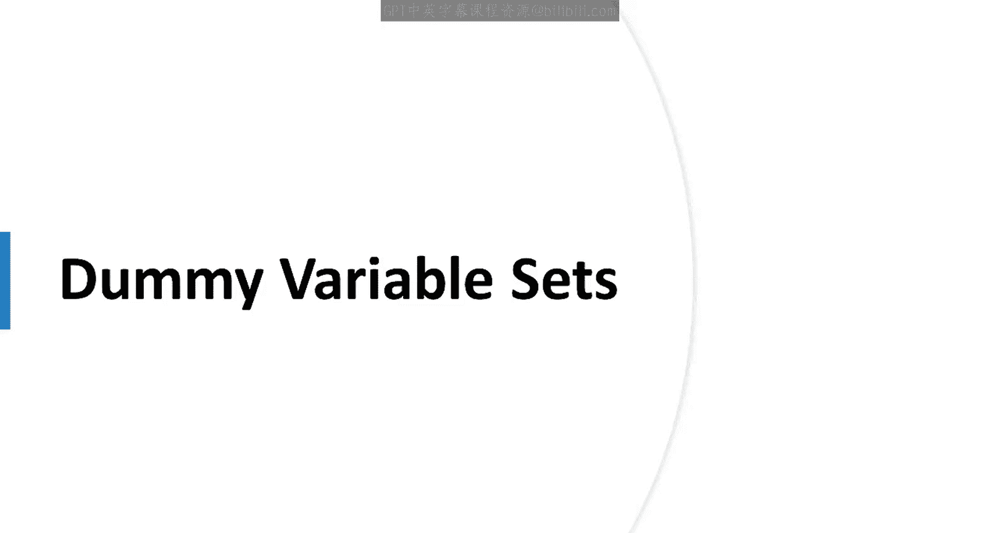
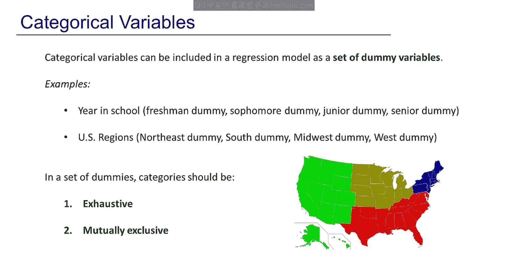
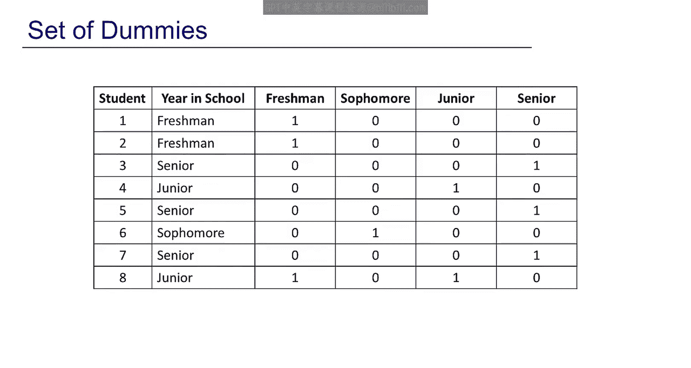
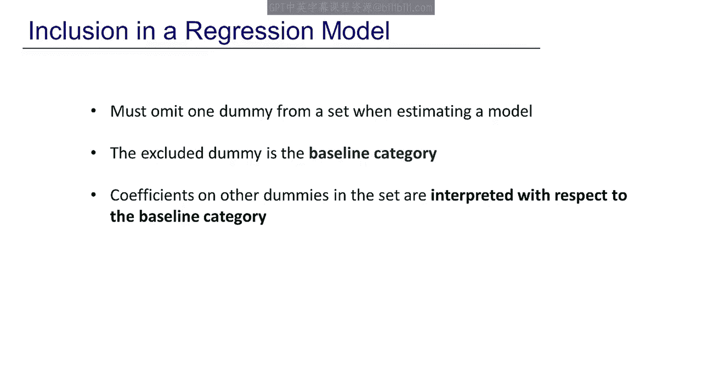
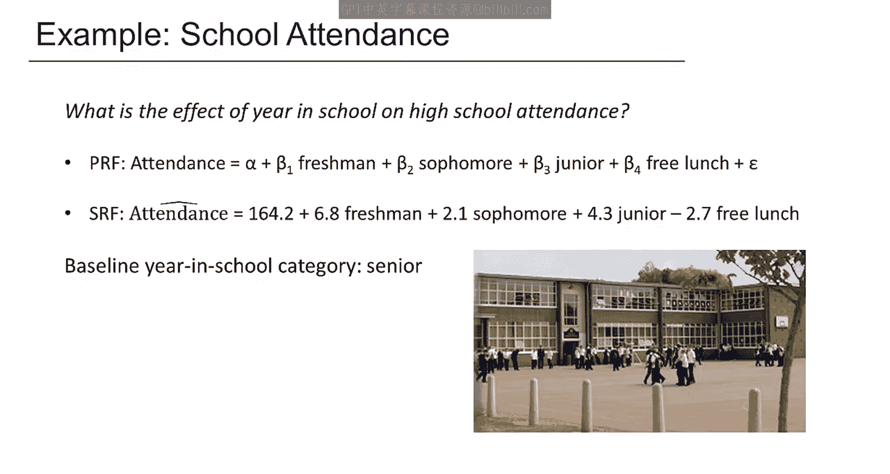
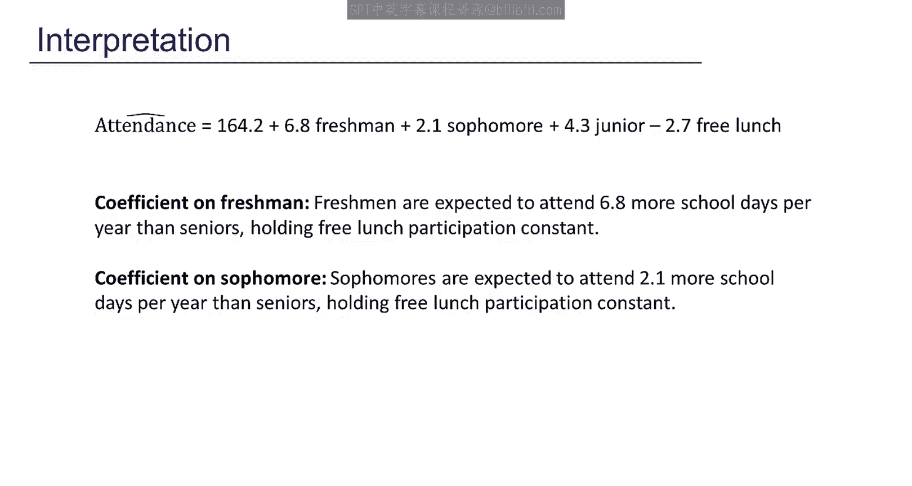
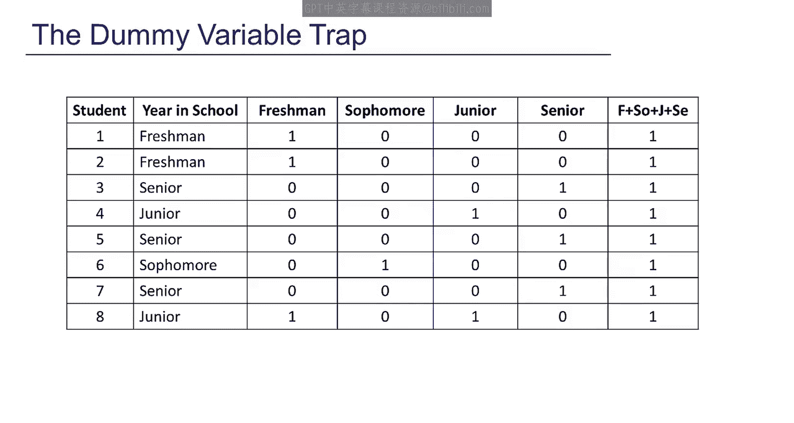
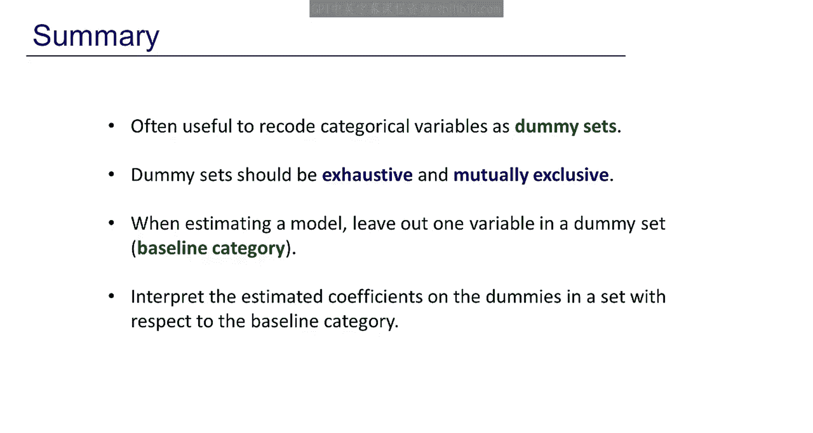

# 数据素养：9：虚拟变量集 📊

在本节课中，我们将学习如何在回归模型中纳入分类变量。具体来说，我们将探讨如何创建和使用虚拟变量集，并解释包含此类变量的回归模型结果。

## 分类变量

上一节我们介绍了回归模型的基本概念，本节中我们来看看如何处理分类变量。分类变量可以通过创建一组虚拟变量的方式纳入回归模型。

例如，我们可能有一个以高中生为分析单位的数据集，我们希望纳入一个衡量学生所在年级的变量。我们可以创建四个虚拟变量：一个代表一年级新生，一个代表二年级学生，一个代表三年级学生，一个代表四年级学生。

或者，我们可能希望纳入一个衡量每个学生居住在美国哪个地区的变量。为此，我们可以创建四个虚拟变量：一个代表东北部，一个代表南部，一个代表中西部，一个代表西部。

要为一个分类变量创建一组虚拟变量，该变量的类别必须是**穷尽的**和**互斥的**。
*   **穷尽**意味着类别包含了所有可能的选项。每个观测值都必须落入一个类别中。
*   **互斥**意味着每个观测值只能落入一个类别，不能同时属于多个类别。

举例来说，假设上面提到的年级变量没有包含“四年级”这个类别，那么这些类别就不是穷尽的。或者，假设地区变量同时包含“西部”和“太平洋西部”，一些居住在华盛顿州的学生可能会被错误地同时归入这两个类别，在这种情况下，类别就不是互斥的。

## 创建虚拟变量集

为了给一个分类变量创建一组虚拟变量，研究者需要为每个类别创建一个虚拟变量。以下幻灯片包含了一个来自更大数据集的八个观测值的表格。

每个观测值代表一名学生。“年级”变量指示每名学生的年级：新生、二年级、三年级或四年级。接下来的四列显示了每个类别对应的虚拟变量。

对于每个观测值，其中一个虚拟变量被设置为 **1**，其他虚拟变量则被设置为 **0**。

例如，请看学生编号2。这名学生是新生，因此“新生”虚拟变量被设置为1，而其他虚拟变量被设置为0。

现在，请看学生编号6。这名学生是二年级学生，因此“二年级”虚拟变量被设置为1，其他虚拟变量被设置为0。

## 在回归模型中使用虚拟变量集

现在我们来讨论如何将一组虚拟变量纳入回归模型。要做到这一点，你必须从该组中**省略**一个虚拟变量。我稍后会解释原因。

被省略的虚拟变量被称为**基线类别**，而该组中其他虚拟变量的系数是相对于这个基线类别来解释的。

研究者可以选择省略哪个类别。通常，研究者会选择最低或最高的类别，因为其他系数是相对于该类别来解释的。

简而言之，选择基线类别的重要性仅在于使系数的解释尽可能有意义。当我们通过一个例子来讲解时，你就会明白我的意思。

## 示例：解释回归系数

假设我们想回答这个问题：年级对高中出勤率有什么影响？我们可以设定一个模型，将学生的出勤率（以上一学年的出勤天数衡量）对“新生”、“二年级”和“三年级”虚拟变量进行回归。我们可能还会在模型中纳入一个衡量社会经济地位的变量，在本例中，我们有一个“免费午餐”虚拟变量，其中1表示该学生参与了学校的免费午餐计划。

我已将总体回归函数和样本回归函数都放在了幻灯片上。你可以看到样本回归函数包含了截距和斜率系数的估计值。

请注意，年级虚拟变量集的基线类别是“四年级”。

现在让我们来解释其中一些估计值。为了清晰起见，我将样本回归函数重新放在了幻灯片顶部。

“新生”虚拟变量的系数如何解释？这个估计值告诉我们，在保持免费午餐参与情况不变的情况下，新生预计比四年级学生每年多出勤 **6.8** 天。

关于这个解释，请注意三点：
1.  系数是相对于基线类别来解释的。
2.  解释中包含了因变量的单位。
3.  我们指出控制变量是保持不变的。

现在来解释“二年级”虚拟变量的系数。这个估计值告诉我们，在保持免费午餐参与情况不变的情况下，二年级学生预计比四年级学生每年多出勤 **2.1** 天。

“三年级”虚拟变量的系数将以类似的方式解释。

## 虚拟变量陷阱

这个表格有助于解释为什么在运行回归模型时，必须从一组虚拟变量中省略一个。

支撑回归系数计算的数学称为矩阵代数，如果其中一个假设变量是常数，或者一组变量的线性组合是常数，就无法进行这种数学运算。

请看表格的最后一列，我将年级虚拟变量集中四个虚拟变量的值进行了求和。请注意，该列全部由1组成。这是合理的，因为每个观测值都落入且仅落入一个类别。

问题在于，这四个虚拟变量的和是一个常数，即一列1。因此，完整的集合不能包含在回归模型中。请记住，变量必须包含变异。

如果你尝试在回归模型中包含一组完整的虚拟变量，你所使用的统计软件程序要么会给你一个错误信息，要么更可能的是，会随意从该组中删除一个虚拟变量。

如果你尝试包含一个变量，而该变量是另一个变量的线性组合，也会出现类似情况。

例如，假设你有一个以年为单位衡量教育程度的变量，然后你创建了一个新变量，该变量等于教育程度变量加上五年。换句话说，新变量中的每个观测值都只是在其原始值上加了五。

如果你试图将这两个衡量指标都包含在回归模型中，你的统计软件程序要么会给你一个错误信息，要么会自动从模型中删除其中一个变量。

你的模型中的每个变量都必须包含变异，并且必须是独立的，即它不是另一个变量的线性组合。

## 总结

本节课中我们一起学习了虚拟变量集的关键要点。

请注意，将分类变量重新编码为虚拟变量集通常很有用。我们将在下一个视频中详细讨论这究竟为何有价值。

虚拟变量集应该是穷尽且互斥的，这意味着每个观测值在该组中只有一个虚拟变量被设置为1，其他虚拟变量则被设置为0。

当使用一组虚拟变量估计回归模型时，必须从该组中省略一个虚拟变量。被省略的类别被称为基线类别，模型中虚拟变量的估计系数是相对于这个类别来解释的。

在接下来的课程中，我们将把这种方法与简单地将分类变量作为线性变量纳入模型的方法进行比较。