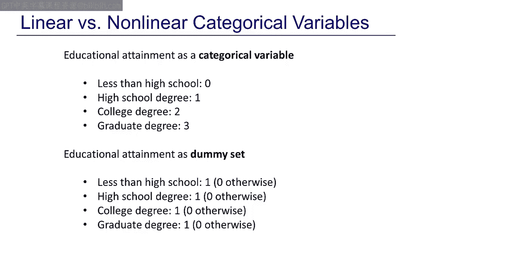
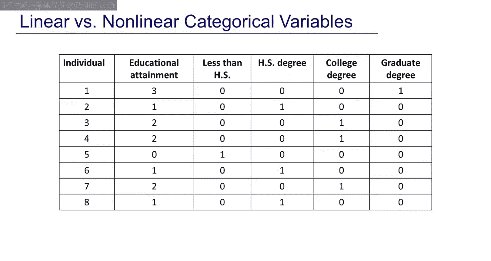
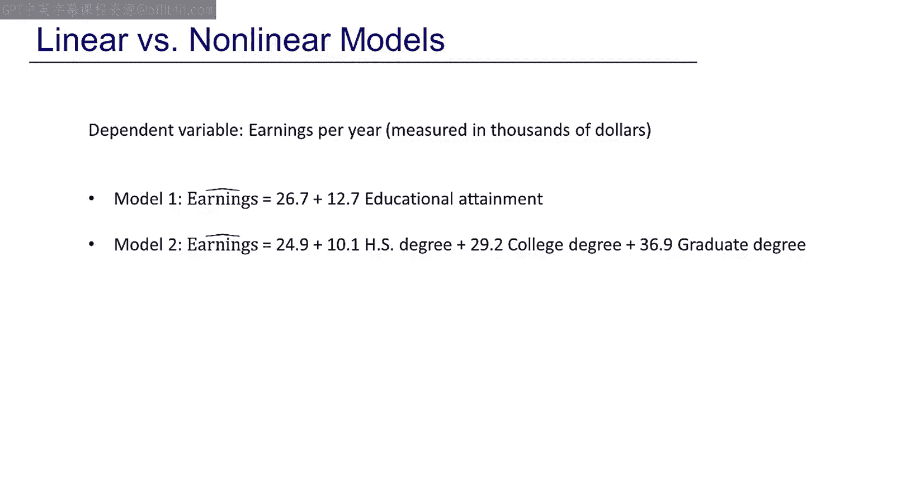
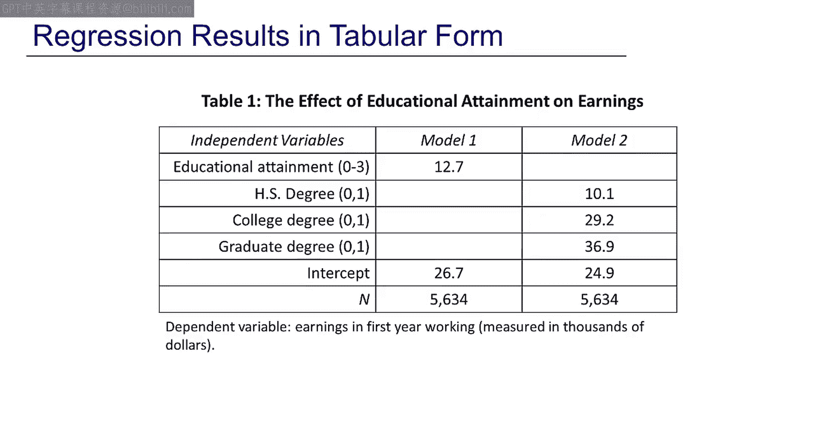
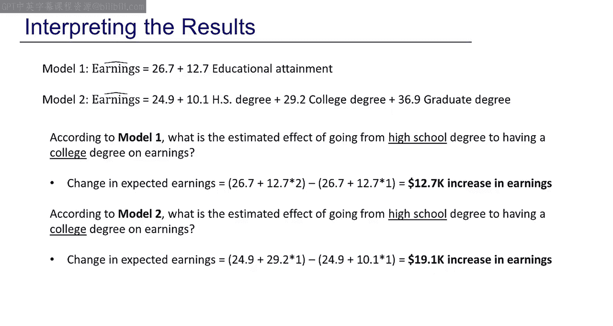
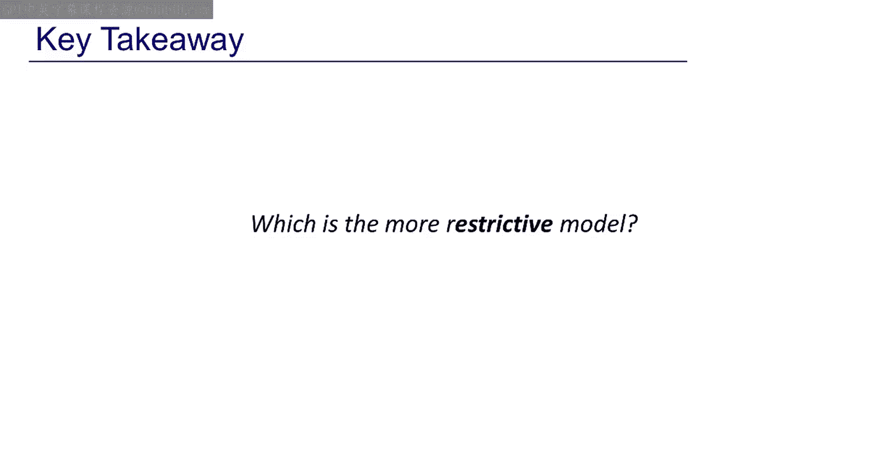

# 约翰霍普金斯大学《数据素养（数据⧸测量⧸回归⧸概率⧸毕业项目）｜Data Literacy》中英字幕（deepseek p40 10_线性与非线性分类变量.zh_en -BV1jXtMemEuh_p40-

Linear versus nonlinearar categorical variables。 Now that you understand the mechanics of creating and using sets of dummy variables。

 let's spend some time discussing why they're valuable。 By the end of this video。

 you should be able to determine whether a categorical variable should be entered linearly or non linearly into a regression model based on your theoretical understanding of that variable。

A categorical variable can either be treated as a linear variable or divided up into a set of dummy variables and therefore treat it as a nonlinear variable。

 Let's use educational attainment as an example。One way to code educational attainment would be to create a variable with four categories。

 less than a high school degree， high school degree， college degree and graduate degree。

 We could assign a value to each of these categories and then include this variable in a regression model。

 For example， we could assign less than a high school degree， the value of 0。 High school degree。

 the value of 1 and so forth。We could also divide the categorical variable up into dummies；

 there would be four dummies in the set， and one of the four would be set to the value of one for each observation in the data set。

This slide presents a table with eight observations from a larger data set。 Each row is a student。

 The educational attainment variable includes the values assigned to each level of education。

 Student number4， for example， has a value of 2， so we know this student has a college degree。

The next four columns include educational attainment as a set of dummy variables。

 You can see that for student number four， the college degree dummy is set to one while the other dummies are set to0。

The rest of this video will explore how these two different ways of coding。

 educational attainment affect the results of the regression model。

Let's suppose we're interested in studying the effect of educational attainment on someone's earnings in the year after they complete their schooling。

This slide presents two estimated regression models。 They both use the same dependent variable。

 which is earnings measured in thousands of dollars。In Model1。

 educational attainment is entered into the model as a linear term， and the coefficient is 12。7。

In Model 2， educational attainment is entered into the model as a set of dummies。

 where less than a high school degree is the baseline category。

 While it can be nice to write out the sample regression functions for simple models。

 it becomes difficult to do this as the number of independent variables increases。

This slide presents the regression results， as you might typically see them presented in an article or report。

Notice that the table has a title and a note at the bottom that identifies the dependent variable。

The independent variables are listed in the first column。

The second column includes the regression results for the first model。

 and the third column includes the regression results for the second model。

 The final row in the data set lists the number of observations used to estimate each model。

Notice that the cells are left blank for variables that were not included in a particular model。

In Model 1， the dummies were not included， and in Model 2。

 the linear version of educational attainment was not included。

Let's now turn to the task of interpreting the results。

I've included the results at the top of the slide to make the interpretation easier。

Let's first consider how the models compare in their estimated effect of going from having less than a high school degree to having a high school degree on expected earnings。

Notice that we need to calculate an expected change in earnings for each model。

 we need to calculate the expected earnings for someone with less than a high school degree and subtract that from the expected earnings for someone with a high school degree。

For Model 1， this expected change in earnings is equal to 26。7 plus 12。7 times 1 26。7 plus 12。

7 times 0， which is a $12。7000 increase in expected earnings。In other words， according to Model 1。

 going from not having a high school degree to having a high school degree is associated with a $12。

7000 increase in predicted earnings。For Model 2， this expected change in earnings is equal to 24。

9 plus 10。1 times 1 minus 24。9， which is a $10。1000 increase in expected earnings。In other words。

 according to Model 2， going from not having a high school degree to having a high school degree is associated with a $10。

1，000 increase in predicted yearly earnings。Now， let's calculate these estimated effects for someone who goes from having a high school degree to having a college degree。

For Model 1， the expected increase in earnings is again $12。7000。 For Model 2。

 the expected increase in earnings is $19。1000。Please feel free to pause the video to walk through these calculations。

For Model 1， I've plugged in the appropriate values of the educational attainment variable。

 and for Model2， I've set the appropriate dummies to either one or0。

These results should not be surprising in Model1， we've constrained educational attainment to have a constant linear effect。

 the effect of any one unit change， whether that's going from less than a high school degree to a high school degree or from a high school degree to a college degree is going to have the same effect on the outcome variable。

In Model 2， we don't make this assumption of a constant or linear effect by creating a set of dummy variables with the categories of education。

 we allow the effect of education to vary across the different categories in Model 2 going from no high school degree to a high school degree is associated with a smaller change in earnings than going from a high school degree to a college degree。

Thinking about the regression results that we just discussed， which is the more restrictive model。

 Model 1 or Model 2？The answer is model 1。 The one in which educational attainment is treated as a linear independent variable。

 meaning each increase in value is associated with the same expected change in the outcome variable。

In Model 2， in contrast， the dummies add flexibility。

 they allow the estimated effect of attaining different levels of education to vary。

If a researcher has a good reason to suspect that the effect of an independent variable is consistent for all values of that variable。

 then it's perfectly fine to treat that variable linearly。If， on the other hand。

 the researcher has a good reason to think that the effect of that variable will change depending on its value。

 it makes more sense to create a set of dummies。This video therefore highlights a theme for the course。

 there is a lot of judgment and decision making that informs a regression analysis。

