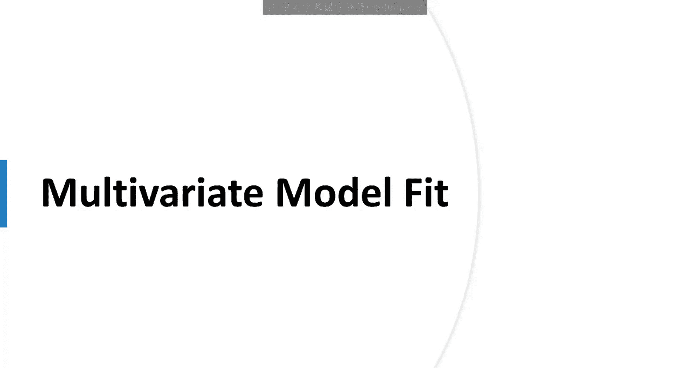
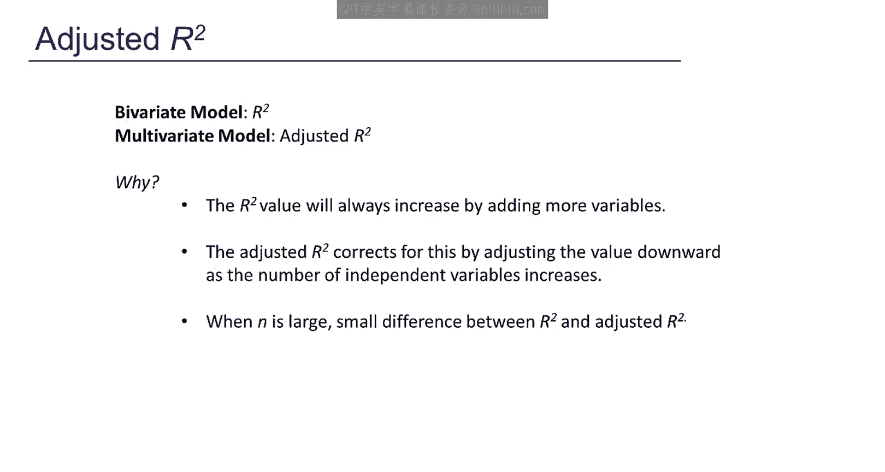
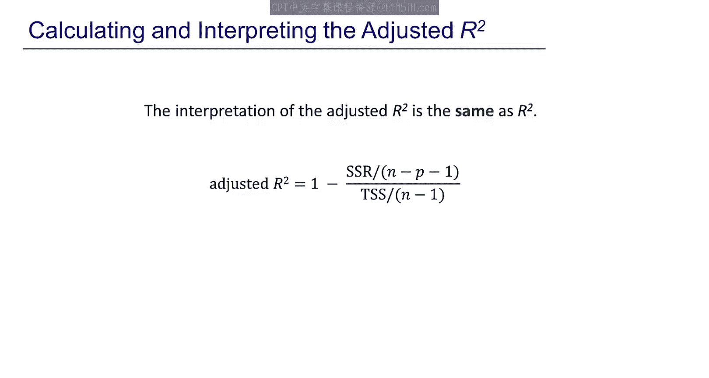
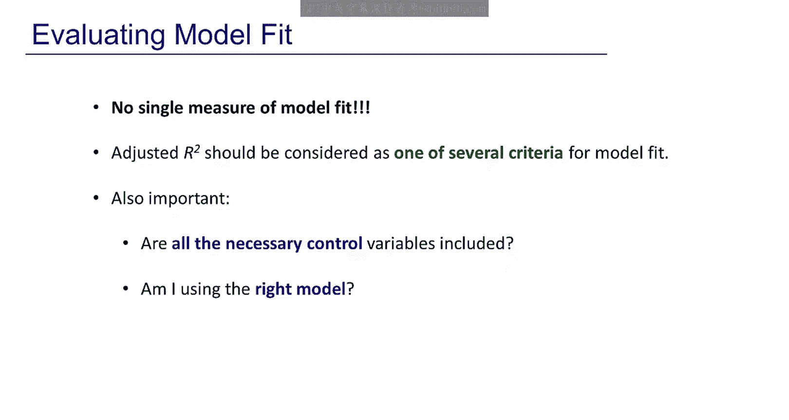

# 约翰霍普金斯大学《数据素养（数据⧸测量⧸回归⧸概率⧸毕业项目）｜Data Literacy》中英字幕（deepseek p41 11_多元模型拟合.zh_en -BV1jXtMemEuh_p41-

Multivariate model fit。After you've developed and run a multivariate model。

 it's important to evaluate whether the model is a good fit for the data。

Keep in mind that model evaluation is a complex process and that model fit and accuracy are spectrums。

 there are very few models that are either completely horrible or near perfect。

There are only models with big problems and models with small problems。 Also。

 remember that a model is just that it's a simplified representation of the world。

 It's meant to provide useful insights， not capture every nuance。 By the end of this video。

 you should be able to interpret the adjusted R squared value as one measure of model fit。

The adjusted r squared value。Previously， we talked about using the R squared value to evaluate model fit with a bivariate regression model。

In the multivariate model context， we will instead use the adjusted R squared value。

There is an important reason for this。The R squared value will always increase by adding more variables。

 If a variable has any explanatory power whatsoever， it will cause the R squared value to increase。

 But another way， the R squared value can never decrease by adding additional variables。

The adjusted r squared value corrects for this by adjusting the value downward as the number of independent variables increases。

In other words， if a new variable has a substantial amount of explanatory power。

 the adjusted r squared value will include a small correction for the addition of that new variable。

 but will increase overall because of the added explanatory power。

If a new variable has very little or no explanatory power。

 the adjusted r squared value will decrease。 Moreover， when the number of observations is very large。

 there will only be a very small difference between the r squared and the adjusted r squared values because the correction for the number of independent variables is outweighed by n。

 the number of observations。

Note that the interpretation for both measures is exactly the same， namely。

 the measures capture the percent of the variation in the dependent variable explained by the independent variables in the model。

The equation on this slide shows you how to calculate the adjusted r squared value。

 though of course in practice， a statistical software program will do this for you。

Notice the inclusion of P， which is the number of independent variables in the model。

 This is the correction that's not included in the calculation of R squared。

It is essential to keep in mind that there is no single measure of model fit。

The adjusted r squared value should be considered as one of several criteria when considering an evaluating model fit。

It's just as important to evaluate whether or not all of the necessary control variables have been included。

 In other words， does the model control for all variables that are correlated with the independent variable of interest and are determinants of the dependent variable？

It's also important to ask whether the regression uses the right model。

 is a line a good fit for the data， would a different type of model be a better fit？

In the final module in this course， we'll discuss some different types of modeling techniques that can be useful if a straightforward linear model is not a good fit for the dynamic that you are studying。

