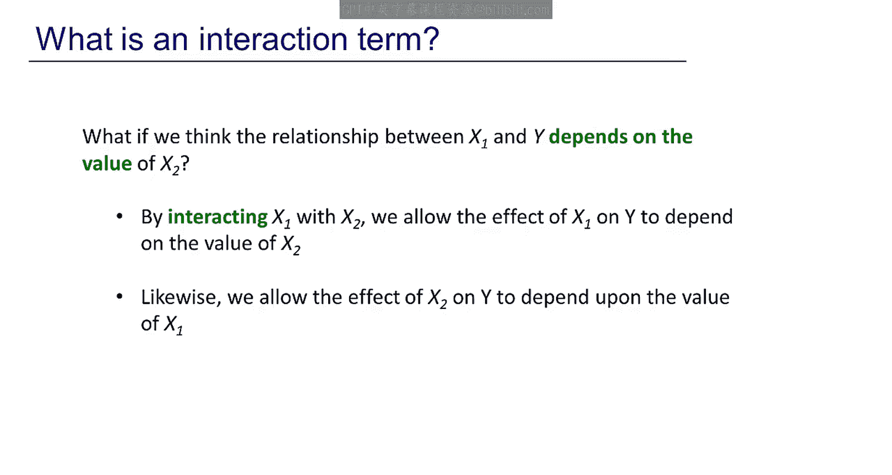
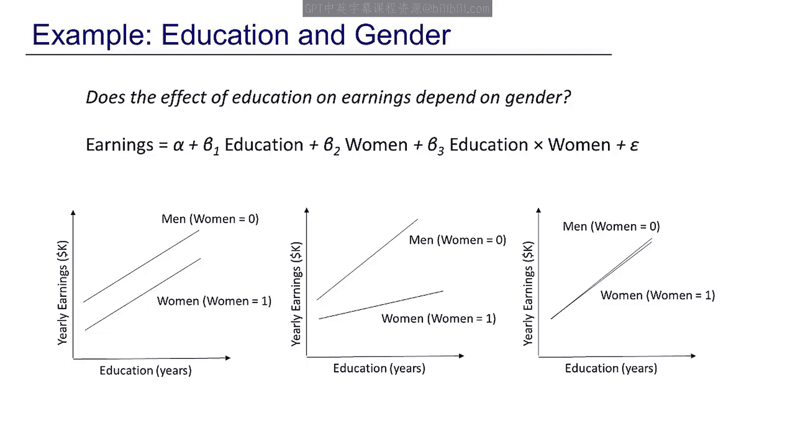
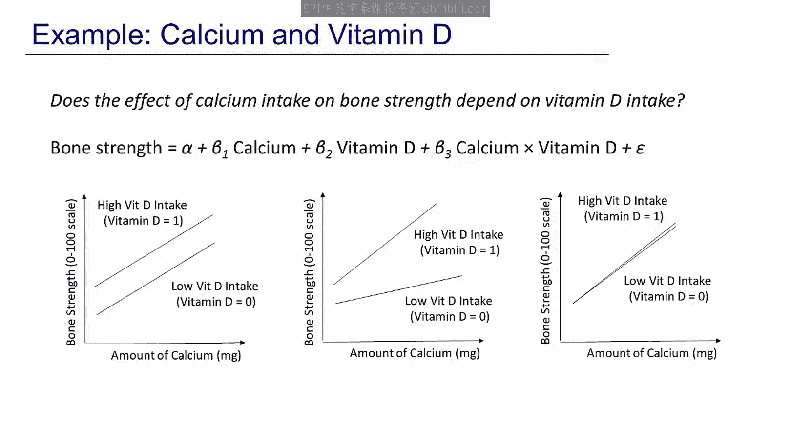
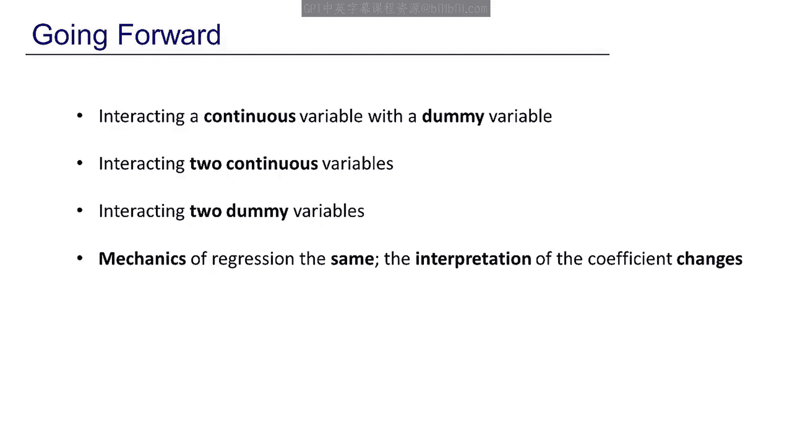

# 约翰霍普金斯大学《数据素养（数据⧸测量⧸回归⧸概率⧸毕业项目）｜Data Literacy》中英字幕（deepseek p42 12_交互项介绍.zh_en -BV1jXtMemEuh_p42-

Interaction terms， introduction。Up to this point， we have used regression models to examine the effect of an independent variable on a dependent variable。

 while holding possible confounders constant。But what if we think the relationship between an independent variable and dependent variable is not so simple。

 what if we think that this relationship depends upon another independent variable？In that case。

 we need to include an interaction term in our regression model by the end of this video you should be able to explain the value of interaction terms in a regression context。

What is an interaction term？If we think that the relationship between x1 and y depends on the value of x2 or vice versa。

 we should interact these two variables and include that interaction term in our regression model I'll walk through the mechanics of how to do this and some examples in a moment。

 The key takeaway from this slide is that by interacting x1 and x2。

 we allow the estimated effect of x1 on Y to depend on x2。 And likewise。

 we allow the estimated effect of x2 on y to depend on x1。

Let's turn to a few examples so you can see what I mean。

Let's consider the question， does the effect of education on earnings depend on gender。

 it may be that the effect of education on earnings is different for men than it is for women。

The three graphs on this slide visualize three different relationships between gender。

 education and earnings that we can model using an interaction term。In the graph on the left。

 the effect of education on earnings is the same for men and women， but men consistently earn more。

The top line shows the relationship between education and earnings for men。

 while the bottom line shows the relationship between education and earnings for women。

The two lines start off in different places， but the slopes of the lines are the same。

In the middle graph， the effect of education on earnings varies between men and women；

 according to this graph， men get a bigger boost from an increase in education than women。

And men start off with higher earnings In other words。

 note that the intercepts and the slopes of the two lines are both different in this scenario。

In the third graph， the effect of education on earnings is about the same for men and women。

The slopes of the lines are almost identical， and both lines start off at about the same place in this scenario there is no interactive effect between gender and education as they relate to earnings。

The equation in the middle of the slide is the PRF that we would use to test for an interactive effect。

 In the next video， we'll discuss how to interpret the results from estimating this kind of PRf。

The results tell us which scenario is supported by the data。

Here's another example， perhaps a researcher wants to study the relationship between calcium。

 vitamin D and bone strength。Theres some existing research that suggests that the effect of calcium on bone strength is influenced by one's vitamin D intake。

 as vitamin D appears to increase calcium absorption。

We could construct a regression model that includes both calcium and vitamin D intake。

 as well as an interaction between these two variables。

Note that whenever you include an interaction term in a model。

 you should always be sure to include the individual variables as well。

This is because you want to allow for maximum flexibility In other words。

 you want to allow the model to reveal a direct effect， an interactive effect or both。

The graphs on this slide parallel those on the previous slide。

 these graphs visualize different scenarios that we could potentially uncover by estimating the PRf。

If we uncovered the graph on the left， that would show that the effect of calcium on bone strength was the same for people who had a high vitamin D intake as for people who had a low vitamin intake。

 but the people in the high vitamin D group consistently have stronger bones。Again。

 the slopes of these two lines are the same， but the intercepts are different。In the middle graph。

 both the intercepts and the slopes are different。 The effect of calcium on bone strength is higher for the high vitamin D intake group。

 The slope of the top line is steeper。In the graph on the right。

 there does not appear to be an interactive effect between calcium intake and vitamin D intake。Again。

 these are all hypothetical outcomes that we might uncover if we were to use data to estimate the PRF on this slide。

The point is that the inclusion of the interaction term allows for all of these possible results。

A model without the interaction term would， by definition。

 assume that the level of one's vitamin D intake had no effect on the relationship between calcium and bone strength。

Put another way， excluding an interaction term assumes that the graph on the right is correct and does not allow for the possibility of the graph on the left or the graph in the middle。

Going forward， we'll discuss the specifics of how to interpret the results from a regression model that includes an interaction term。

In particular， we'll discuss how to interpret regressions in which we interact a continuous variable with a dummy variable。

 regressions in which we interact two continuous variables。

 and regressions in which we interact to dummy variables。

The mechanics of estimating a regression model with an interaction term are basically the same as with a simple multivariate model。

 but the interpretation of the coefficients is quite different。

This is because we can't simply increase one independent variable by one unit and hold all of the others constant。

 remember that with an interaction term， a variable now appears in the model multiple times。

It is therefore impossible to increase x1 by one unit while holding the interaction between x1 and x2 constant。

But although the interpretation is a little bit more complicated。

 you should become comfortable with it after some practice， as with many tasks and statistics。

 it becomes easy， even trivial once you get the hang of it。

