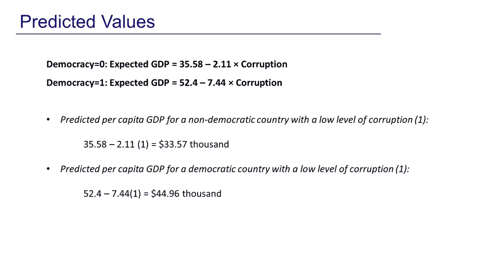

# 约翰霍普金斯大学《数据素养（数据⧸测量⧸回归⧸概率⧸毕业项目）｜Data Literacy》中英字幕（deepseek p43 13_连续变量与虚拟变量的交互.zh_en -BV1jXtMemEuh_p43-

Interacting a continuous and dummy variable。As I mentioned。

 it's relatively straightforward to implement a regression model with an interaction term。

 but the interpretation of the results can be tricky。

 This is because you can't simply interpret the coefficient on one variable while holding the others constant。

The approach to interpreting a model with an interaction term depends on the type of interaction by the end of this video you should be able to interpret the results of a regression model that includes an interaction between a continuous variable and a dummy variable。

Let's begin by breaking down a regression model that includes an interaction term with a continuous variable and a dummy variable。

 Sose we have the model y equals alpha plus beta 1 times x plus beta 2 times d plus beta 3 times x times d plus the error term。

In this model， let X be a continuous variable and D be a dummy variable that can take on the value of 0 or1。

This model allows the effect of x to depend on the value of D and vice versa。

Alpha is the intercept for the group D equals 0。 Why is this， Well， let's set D equal to 0。

 Notice that the model reduces to y equals alpha plus beta 1 times x plus the error term。

 So you can see that alpha is the intercept for the line that captures the relationship between x and y when D equals 0。

Alpha plus beta 2 is the intercept for the group d equals 1。Why is this the case， Well。

 let's now set D equal to1。 Notice that in this case。

 the model reduces to y equals alpha plus beta 1 x plus beta 2 plus beta 3 x times the error term。

All I've done is plug1 in for D， and then let's combine like terms When you do that you get the following y equals the quantity of alpha plus beta 2 plus the quantity of beta 1 plus beta 3 times x plus the error term。

So alpha plus beta 2 is the intercept for the line that captures the relationship between x and y when d equals 1。

Beta 1 is the effect of a1 unit increase in x when d equals0。Why is this Well。

 think about what the regression line would look like for the D equals zero group。

The slope of this line， the coefficient on x， is beta 1。Finally。

 beta 1 plus beta 3 is the effect of a1 unit increase in x when d equals 1。

This comes from the regression line for the D equals one group。 If you combine like terms。

 it becomes clear that the slope of this line， the coefficient on x is beta 1 plus beta 3。

We'll continue to walk through this logic on the next slide。

 but feel free to pause the video here if you need more time to digest the content。

Visualizing the two OLS lines。Here I've once again placed the full model at the top of the slide。

If we set the dummy variable equal to either 1 or0， we can see how the model reduces。

If we set the dummy variable equal to1 and combine like terms。

 we can once again see that the intercept is equal to alpha plus beta 2。

 and the slope is equal to beta 1 plus beta 3。If we set the dummy variable equal to0。

 we see that the intersect is alpha and the slope is beta 1。

These two lines are plotted in the graph on the right。

Notice that beta 2 captures the difference in the intercepts between the two lines。

 and beta 3 captures the difference in the slopes between the two lines。

Spend some time examining and working with this interactive model。

 be sure you understand why and how the model is really composed of two lines it might help to write out the regression lines yourself。

Plug in zero for D and then1 for D and see how the line reduces when you do this。

Let's walk through an example of a model that includes an interaction between a continuous variable and a dummy variable。

 Suppose we want to learn about the interactive effect of democracy and corruption on a country's economic performance。

In other words， we want to know whether the effect of corruption on a country's economy depends on whether or not that country is a democracy。

We might collect data and use the following three variables。

A country's per capita GDP measured in thousands of US dollars。

 a corruption index that measures the perceived level of corruption in a country on a scale of  zero to 10。

And a dummy variable that indicates whether the country is a democracy or not。Our PRF is as follows。

A country's per capita GDP equals alpha plus beta 1 times corruption， plus beta 2 times democracy。

 plus beta 3 times the interaction of corruption and democracy plus the error term。

The next step would be to estimate the model using a data set and then interpret the results。

The estimated model appears at the top of the slide。

We can see that estimated per capita GDP equals 35。58 minus 2。11 times corruption plus 16。

8 times democracy， minus 5。33 times the interaction between corruption and democracy。

We can break down this estimated model into two lines， one for the non Democratic countries。

 and one for the Democratic countries。By doing this。

 we'll be able to see if the effect of corruption on a country's economy is different between these two groups。

If we set the democracy dummy equal to zero， we can see that the estimated model reduces to the following。

Per capita GDP equals 35。58 minus 2。11 times corruption。If we set the democracy dummy equal to1。

 we can see that the estimated model reduces to the following per capita GDP equals 52。4 minus 7。

44 times corruption。Notice that both the intercepts and the slopes are quite different between the two lines。

The difference in slope indicates that changes in perceived corruption have a larger effect in Democratic countries than in non Democratic countries。

We can easily see this difference by visualizing the two lines。

The graph on this slide plots the estimated regression line for both the democratic countries and the non Democratic countries。

Notice that the lines for the democratic countries is much steeper。

 an increase in perceived corruption in democratic countries is associated with a sharper decline in economic performance than the same increase in perceived corruption in non democratic countries。

If you were an expert on this topic， you'd be able to offer insight as to why this might be。

 and perhaps you'd be able to think of other variables that might be useful to consider as part of this analysis。

Another important way to interpret the results of a model that includes an interaction term is to calculate predicted values。

At the top of the slide， I've included the estimated line for the non Democratic countries and the estimated line for the Democratic countries。

 We can calculate the predicted per capita GDP for a non Democratic country with a low level of perceived corruption。

 Let's say one。A country is likely to have an expected per capita GDP of $33。57，000。

We can likewise calculate the predicted per capita GDP for a democratic country with a low level of perceived corruption。

A country like this has an expected per capita GDP of $44。96，000。

If you were presenting the results from this model in a paper or to an audience。

 you could construct a table of predicted values and even show how these predictions would change for different levels of perceived corruption。

The key takeaway point is that developing and estimating a model should not be the end of an analysis。

 a good researcher will give careful thought to interpreting and presenting the results in a way that is meaningful。

