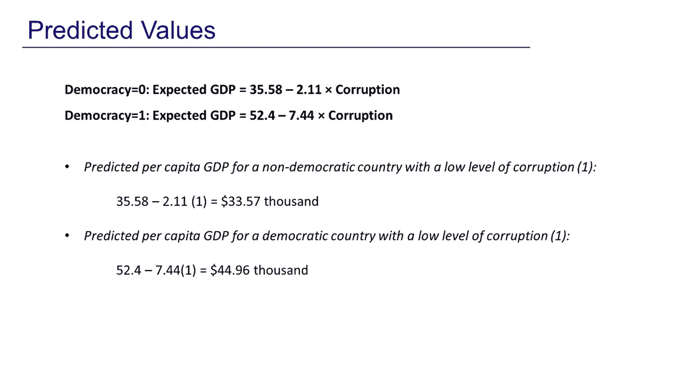

# 数据素养：13：连续变量与虚拟变量的交互 📊

在本节课中，我们将学习如何在回归模型中引入连续变量与虚拟变量的交互项，并掌握其结果的解读方法。交互项的引入相对直接，但结果的解释需要一些技巧，因为你无法在保持其他变量不变的情况下，孤立地解读单个变量的系数。通过本课，你将能够解读包含此类交互项的回归模型结果。

## 交互模型的结构分解

上一节我们提到了交互项的基本概念，本节中我们来看看一个具体的模型结构。假设我们有一个包含连续变量与虚拟变量交互项的回归模型：

**y = α + β₁x + β₂d + β₃(x × d) + ε**

在这个模型中：
*   **x** 是一个连续变量。
*   **d** 是一个虚拟变量，其取值只能为 **0** 或 **1**。
*   **ε** 是误差项。

这个模型允许 **x** 的效应依赖于 **d** 的取值，反之亦然。

*   **α** 是当 **d = 0** 时的截距。原因如下：如果我们令 **d = 0**，模型简化为 **y = α + β₁x + ε**。可见，α 代表了当 **d = 0** 时，描述 **x** 与 **y** 关系的直线的截距。
*   **α + β₂** 是当 **d = 1** 时的截距。原因如下：如果我们令 **d = 1**，模型变为 **y = α + β₁x + β₂ + β₃x + ε**。合并同类项后得到 **y = (α + β₂) + (β₁ + β₃)x + ε**。因此，**α + β₂** 是当 **d = 1** 时，描述 **x** 与 **y** 关系的直线的截距。
*   **β₁** 是当 **d = 0** 时，**x** 每增加一个单位对 **y** 的效应。这对应于 **d = 0** 组回归线的斜率。
*   **β₁ + β₃** 是当 **d = 1** 时，**x** 每增加一个单位对 **y** 的效应。这对应于 **d = 1** 组回归线的斜率。

理解了这个逻辑后，我们接下来通过可视化来加深印象。

## 两条回归线的可视化

上一节我们分解了模型的系数含义，本节我们通过图形来直观理解。模型公式再次展示如下：

**y = α + β₁x + β₂d + β₃(x × d) + ε**

通过为虚拟变量 **d** 代入不同的值，我们可以得到两条独立的回归线：
*   当 **d = 0** 时：截距为 **α**，斜率为 **β₁**。
*   当 **d = 1** 时：截距为 **α + β₂**，斜率为 **β₁ + β₃**。

在右侧的图形中，这两条线被绘制出来。请注意：
*   **β₂** 捕捉了两条线在截距上的差异。
*   **β₃** 捕捉了两条线在斜率上的差异。

花些时间研究这个交互模型，理解它如何由两条线构成会很有帮助。你可以尝试自己写出回归线，分别代入 **d = 0** 和 **d = 1**，观察公式是如何简化的。

## 实例解析：民主制度与腐败的交互影响

理解了理论模型后，我们来看一个具体的例子。假设我们想研究民主制度与腐败对一个国家经济表现的交互影响。换句话说，我们想知道腐败对经济的影响是否取决于该国是否为民主国家。

我们可能收集以下三个变量的数据：
1.  一个国家的人均GDP（以千美元计）。
2.  一个腐败指数，衡量一个国家感知的腐败水平，范围从0到10。
3.  一个虚拟变量，指示该国是否为民主国家。

我们设定的总体回归函数（PRF）如下：
**人均GDP = α + β₁ × 腐败指数 + β₂ × 民主虚拟变量 + β₃ × (腐败指数 × 民主虚拟变量) + ε**

使用数据集估计模型后，我们得到以下结果：
**估计人均GDP = 35.58 - 2.11 × 腐败指数 + 16.8 × 民主虚拟变量 - 5.33 × (腐败指数 × 民主虚拟变量)**

我们可以将这个估计模型分解为两条线：
*   **对于非民主国家（民主虚拟变量 = 0）**：人均GDP = 35.58 - 2.11 × 腐败指数
*   **对于民主国家（民主虚拟变量 = 1）**：人均GDP = (35.58 + 16.8) + (-2.11 - 5.33) × 腐败指数 = 52.38 - 7.44 × 腐败指数

注意，两条线的截距和斜率都有显著差异。斜率的差异表明，感知腐败水平的变化在民主国家比在非民主国家具有更大的经济影响。

## 结果解读：预测值与可视化

除了比较系数，解读包含交互项模型结果的另一个重要方法是计算预测值。

以下是两条估计线：
*   非民主国家：人均GDP = 35.58 - 2.11 × 腐败指数
*   民主国家：人均GDP = 52.38 - 7.44 × 腐败指数

我们可以计算不同情境下的预测人均GDP。例如：
*   对于一个腐败指数较低（假设为1）的非民主国家，其预测人均GDP为：35.58 - 2.11 × 1 = 33.47（千美元）。
*   对于一个腐败指数同样为1的民主国家，其预测人均GDP为：52.38 - 7.44 × 1 = 44.94（千美元）。

如果你要在论文或报告中展示此模型的结果，可以构建一个预测值表格，甚至展示不同腐败水平下预测值的变化。关键在于，开发和估计模型不应该是分析的终点。一个好的研究者会仔细思考如何以有意义的方式解读和呈现结果。

下图直观展示了这两条回归线。可以看到，民主国家的回归线（实线）比非民主国家的回归线（虚线）陡峭得多。这意味着在民主国家，感知腐败的增加与经济表现的下降关联更紧密。

## 总结

本节课中，我们一起学习了如何构建和解读包含连续变量与虚拟变量交互项的回归模型。我们了解到，这样的模型本质上描述了两组（由虚拟变量定义）不同的线性关系。关键步骤包括：将模型分解为对应于虚拟变量不同取值的两个方程，分别解释其截距和斜率的含义，并通过计算预测值或可视化图形来清晰地展示交互效应。掌握这些方法，能够帮助你更深入地理解变量间复杂的关系，并有效地传达你的研究发现。