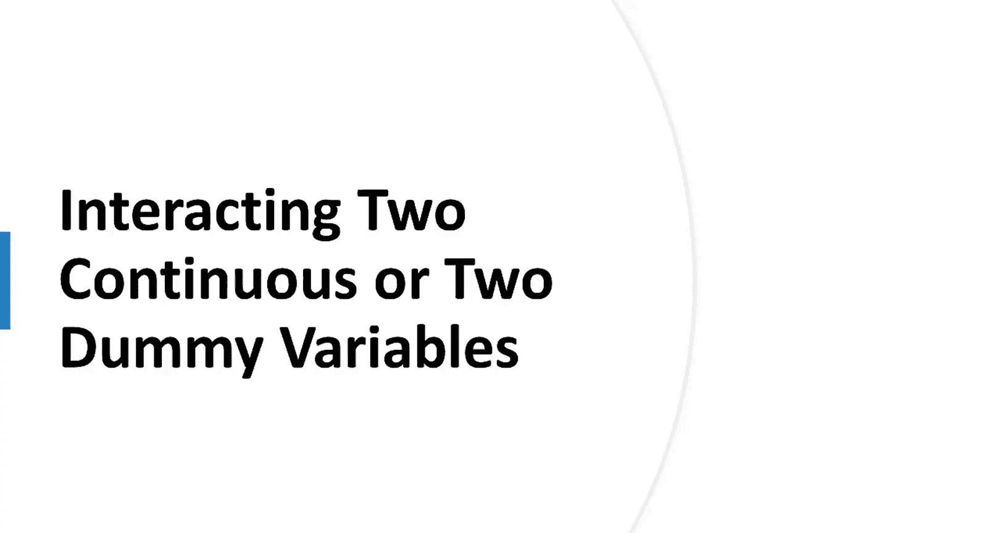
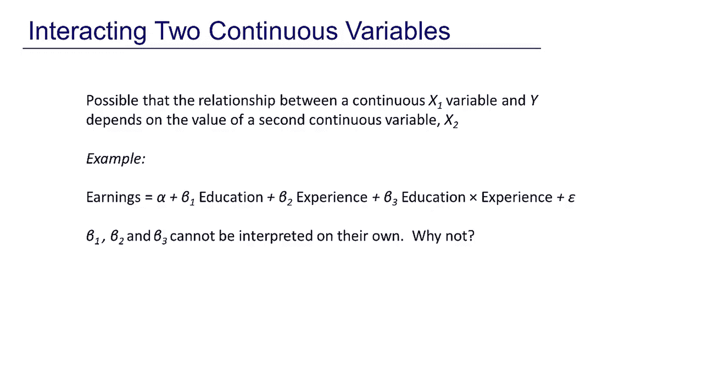
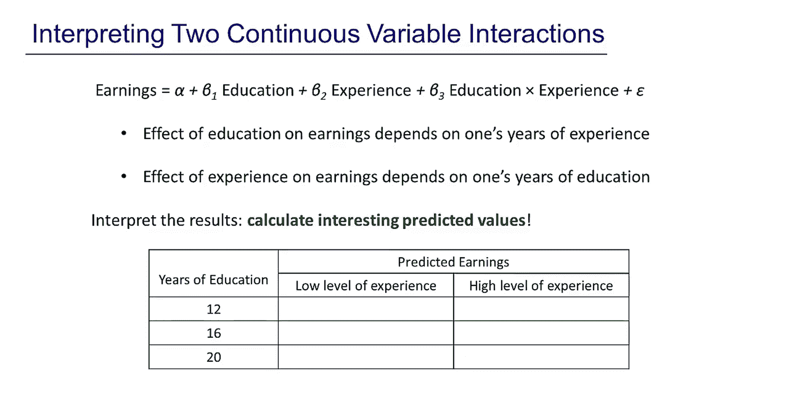
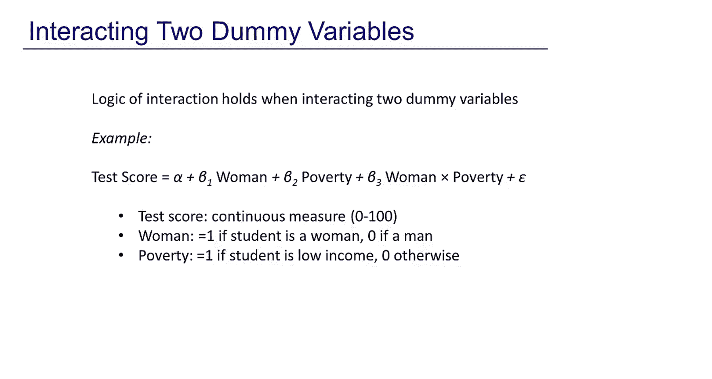
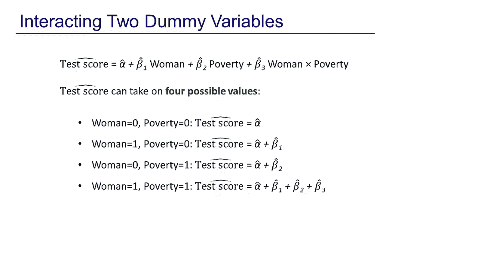
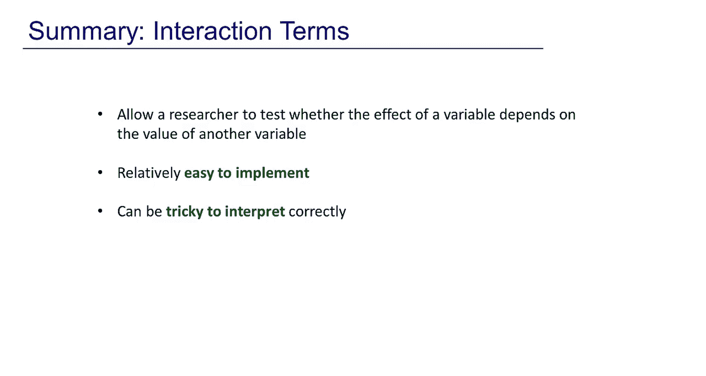

# 约翰霍普金斯大学《数据素养（数据⧸测量⧸回归⧸概率⧸毕业项目）｜Data Literacy》中英字幕（deepseek p44 14_两个连续变量或两个虚拟变量的交互.zh_en -BV1jXtMemEuh_p44-

Interacting two continuous or two dummy variables。In this final video about interaction terms。

 I'll discuss how to interpret models in which there is an interaction term between two continuous variables or between two dummy variables。

 while the overarching logic is the same as before。

 it's nonetheless valuable to consider how these two particular scenarios affect the interpretation of the results。

By the end of this video， you should be able to interpret an estimated regression model that contains these two types of interaction terms。

Interacting to continuous variables。It is certainly possible that the relationship between a continuous x1 variable and y depends on the value of a second continuous variable x2。

As an example， consider that the relationship between education and earnings might depend on one's years of experience To examine this question。

 we could estimate the following model。Earnings equals alpha plus beta 1 times education plus beta 2 times experience plus beta 3 times the interaction of education and experience plus the error term。

If we were to estimate this model with a data set， we would not be able to interpret the three s coefficients。

 beta 1， beta 2 and beta 3 on their own， why not？Think about the usual interpretation of a coefficient in a multivariate model。

 We say that a one unit increase in x1 is associated with a beta 1 hat change in y。

 holding x2 and x3 constant。In the interactive model。

 there are essentially two variables that include x1。

 This means we can't change one of these variables and hold the other one constant。For example。

 if we wanted to interpret the coefficient on education in the model above， beta 1。

 note that we could not increase education by one year and hold the interaction term constant because it contains the education variable。

So to make sense of the coefficients， we need to calculate predicted values。

In this model that we have been discussing， the effect of education on earnings depends upon one's years of experience。

 likewise， the effective years of experience on earnings depends upon one's education。

The best way to interpret the results of a model with this type of interaction is to calculate interesting predicted values。

 This means， for example， that we could calculate the predicted value of earnings for different values of education for both low and high levels of experience。

 A reader would then be able to see how experience moderates the relationship between education and earnings。

I've included an example of this type of table here on the slide。If you had data on these variables。

 you could estimate the model and design a table along these lines。

Interacting two dummy variables。When interacting to dummy variables。

 the same logic of interpretation applies， but the results are even simpler because we're only working with variables that can take on the values of 0 and 1。

 Here's an example。Suppose we want to understand the interactive relationship between gender and poverty in their effect on test scores。

Now suppose that the test score variable is measured on a scale of 0 to 100。

 and gender and poverty are both coded as dummy variables with respect to poverty。

 individuals are assigned to one if they are in a low income bracket and a zero otherwise。

Now suppose that we collected data on these three variables and that we estimate a regression model with an interaction term。

The SRF would be the expected test score for an individual equals alpha hat plus beta1 hat times woman plus beta 2 hat times poverty。

 plus beta 3 hat times the interaction of woman and poverty。

 where woman and poverty are both dummy variables as described earlier。

Because the variables in the model can only take on the values of0 and1。

 the expected value of test score can only take on four possible values。

When woman equals 0 and poverty equals0， the expected value of test score equals alpha hat。

This is the expected value of test score for a man who is not in poverty。

When woman equals 1 and poverty equals 0， the expected value of test score equals alpha hat plus beta 1 hat。

 This is the expected test score value of a woman who is not in poverty。

When woman equals0 and poverty equals1， the expected value of test score equals alpha hat plus beta 2 hat。

This is the expected value of test score for a man who is in poverty。And lastly。

 when woman equals 1 and poverty equals1， the expected value of test score equals alpha hat plus beta 1 hat plus beta 2 hat plus beta 3 hat。

This is the expected test score value of a woman who is in poverty。As always。

 feel free to pause the video so you can work through these calculations。

Plug in a value for women and a value for poverty and see how the model reduces。

Summary we've covered a lot of ground in our discussion of interaction terms to end our discussion。

 I want to highlight the big takeaway points。 Remember that the purpose of an interaction term is to allow the researcher to test whether the effect of one independent variable depends on the value of another independent variable。

Interaction terms are relatively easy to implement。

 the researcher literally multiplies two variables together and then enters that term into the regression model to create the interaction。

Interpreting the results from a model with an interaction term， however， can be tricky。

This is because variables in the interaction term appear in the model twice when presenting the results from these types of models to an audience。

 it can be very helpful to calculate predictive values and present these values in well formatted tables and especially graphs。

