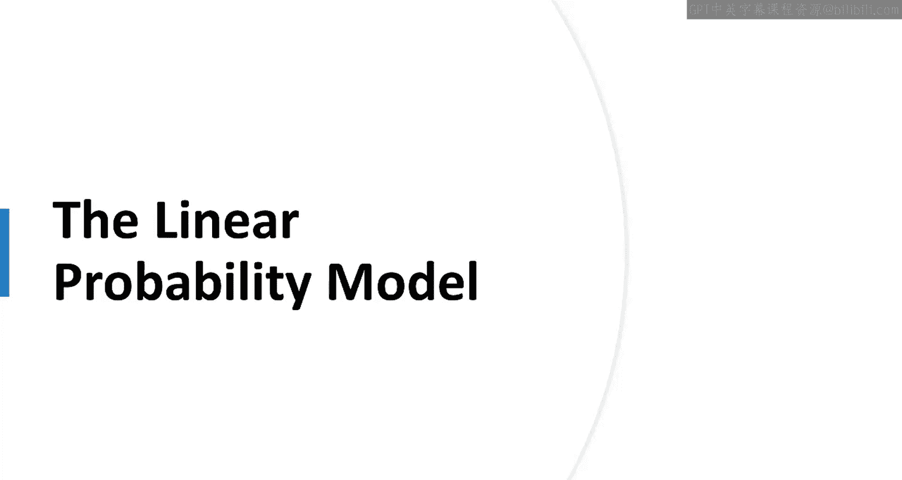
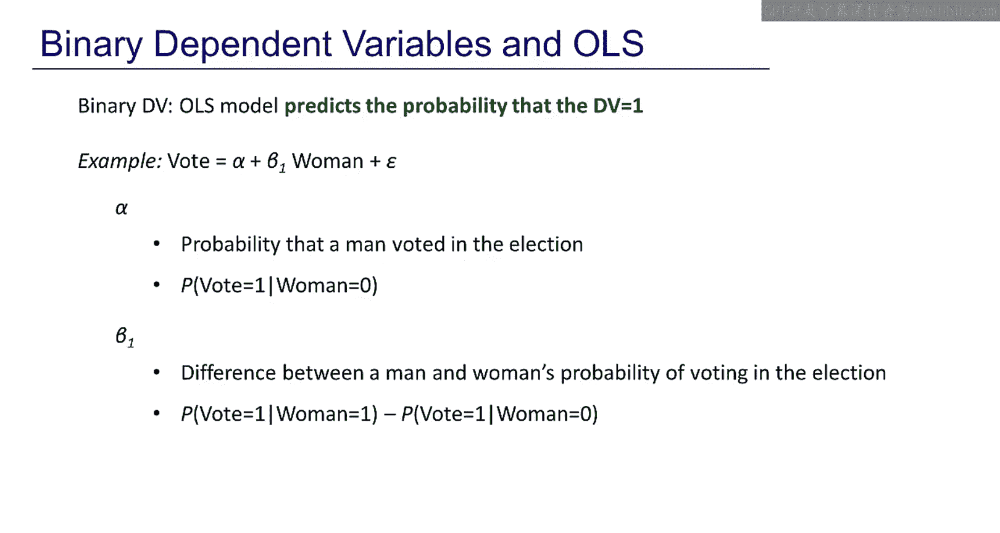
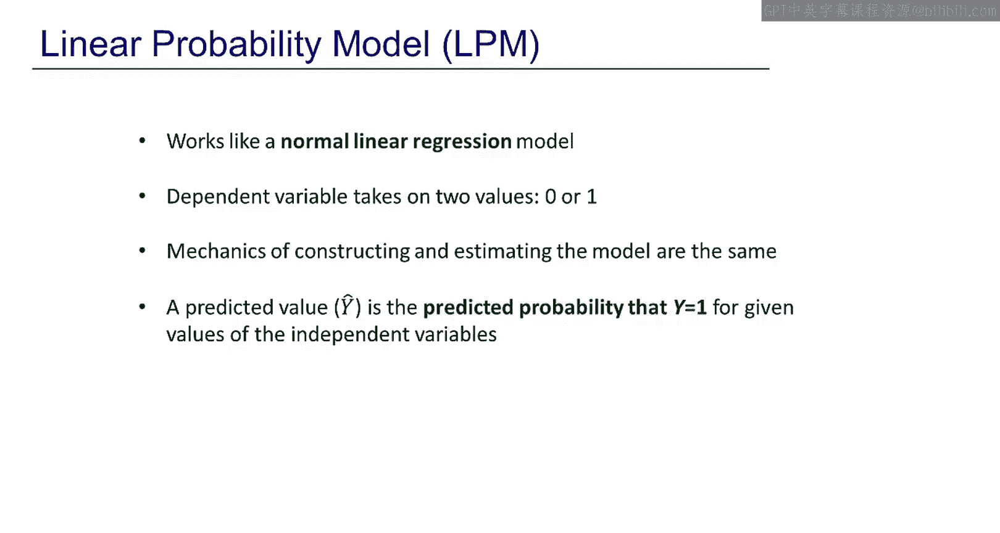
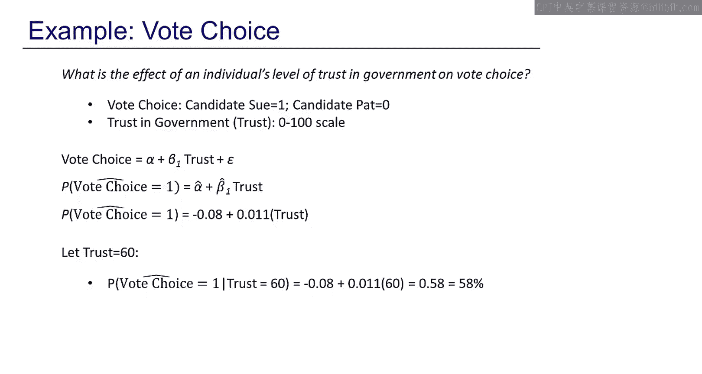
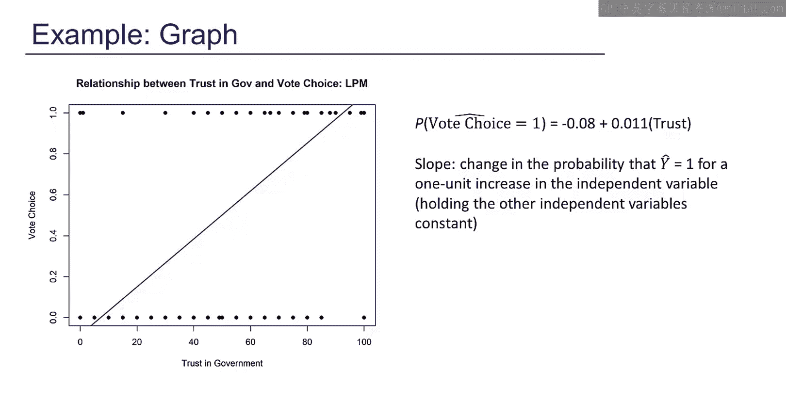
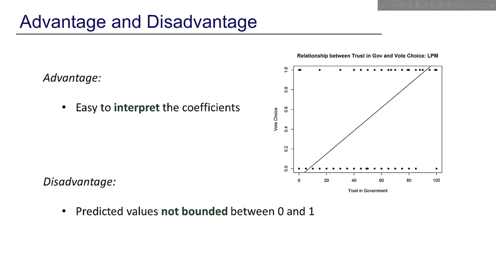

# 约翰霍普金斯大学《数据素养（数据⧸测量⧸回归⧸概率⧸毕业项目）｜Data Literacy》中英字幕（deepseek p45 15_线性概率模型.zh_en -BV1jXtMemEuh_p45-

The linear probability model。Thus far， we have only used dependent variables that can be treated as continuous。

But what should we do if our dependent variable is binary。 For example。

 what if we want to create a model in which the dependent variable is a survey question that asks respondents whether or not they voted in the most recent election with the answer choices being yes or no。

By the end of this video， you should be able to construct and interpret a regression model in which the dependent variable has only two outcomes。

Let's walk through an example of how we might use an OLS model with a binary dependent variable。

Whenever you are working with a binary dependent variable。

 an OLS model will predict the probability that the dependent variable equals  one。For example。

 suppose you want to examine the relationship between gender and voting where both of these variables are binary。

The dependent variable equals one if the person voted and 0 otherwise woman equals one。

 If the person is a woman and 0 otherwise。The PRF would therefore be vote equals alpha plus beta1 times woman plus the error term。

In this model， Alpha will tell us the probability that a man voted in the election。In other words。

 if you set woman to zero， the expected value of vote will tell us the probability that a man voted。

We can write this using notation by saying that alpha is the probability that vote equals1。

 given that woman equals zero。Beta 1 will tell us the difference between a man and woman's probability of voting。

If we increase the independent variable by one unit， meaning we go from a man to a woman。

 beta 1 tells us the expected change in the probability of voting。

We can write this using notation by saying that beta 1 is the probability that vote equals 1。

 given woman equals 1， minus the probability that vote equals1， given woman equals0。

The use of the OLS method with a binary dependent variable is called a linear probability model。

It works like a normal regression model， except the dependent variable can only have two values。

 0 and 1。The mechanics of constructing and estimating the linear probability model are the same as with a normal multivariate model。

The key difference is that a predicted value y hat is always the predicted probability that y equals one forgiven values of the independent variables。

Let's turn to an example。Suppose you want to model an individual's vote choice based on that individual's level of trust in government。

 the dependent variable is votete choice with candidate Sue defined as the one category。

 and candidate Pat defined as the zero category。Trust in government is a scale that ranges from  zero to 100。

The PRF is votete choice equals alpha plus beta1 times trust plus the error term。Using this model。

 we're going to estimate the SRF。The probability that the expected value of vote choice equals1 equals alpha hat plus beta 1 hat times trust。

Using a data set， we can estimate the model and determine that the probability that vote choice equals 1 is equal to negative 0。

08 plus 0。011 times trust。Now， let's calculate a predicted value。

 Suppose we are interested in the predicted vote choice for someone whose trust in government is 60。

If we plug 60 into the estimated model， we see that the predicted value is 0。58。

 This means that this person has a 58% probability of voting for candidate sue since we've defined this candidate as the one category。

This slide presents a graph of the data points and the regression line。

 noticeice that all of the data points fall at either zero or 1 on the Y axis。Remember。

 this is because we are using a binary dependent variable。The regression line runs through the data。

 The slope of the regression line tells us the change in the probability that y hat equals one for a one unit increase in the independent variable。

 Hol the other independent variables in the model constant。

 if there were other independent variables。 In this case， of course。

 we only have one independent variable。

There's a key advantage and disadvantage of using the linear probability model。

The advantage is that it's a simple model， it's easy to estimate and easy to interpret the coefficients because they're interpreted just as they are in a normal multivariate model。

The disadvantage of this model is that the predicted values are not bounded between 0 and 1。

 so you can wind up with predicted values that are less than 0 and greater than1。

You can see this on the graph because we are fitting a line to the data。

 the line will necessarily extend below 0 and above one for certain values of x。

For very high values of the independent variable， you might wind up with a predicted probability greater than one in this case。

This just means that people with this value of the independent variable have a very good chance of falling in the y equals 1 category。

In the next video， we'll discuss the logit and Proate models which bound the predicted values to be between 0 and 1。

