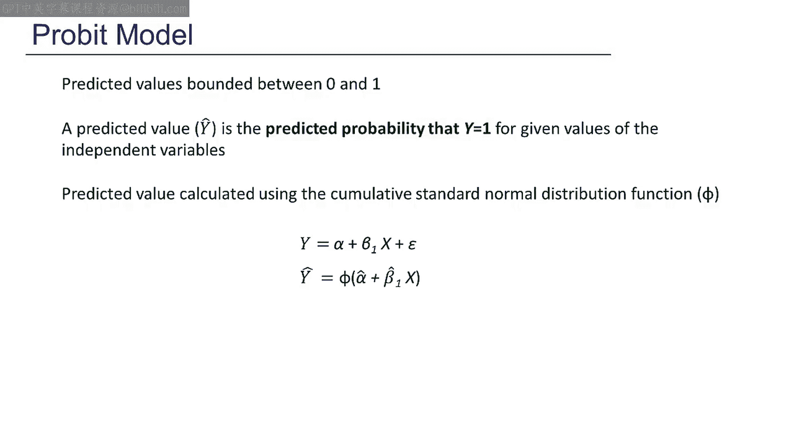
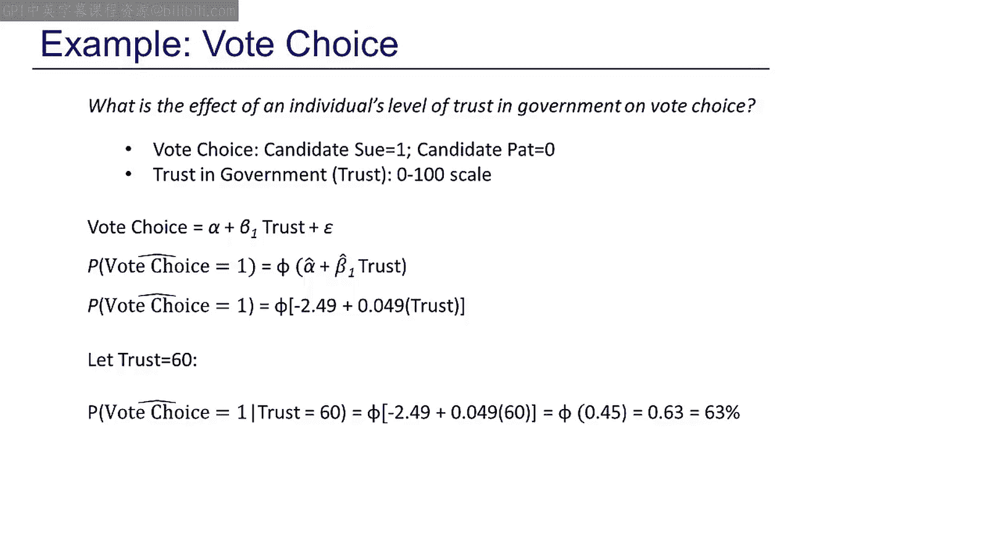
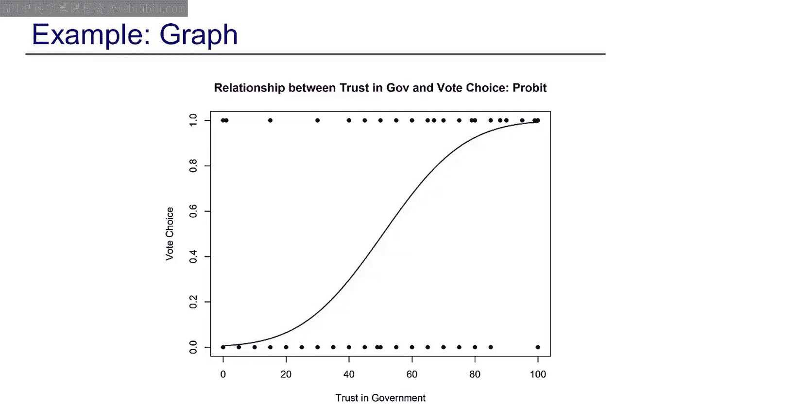
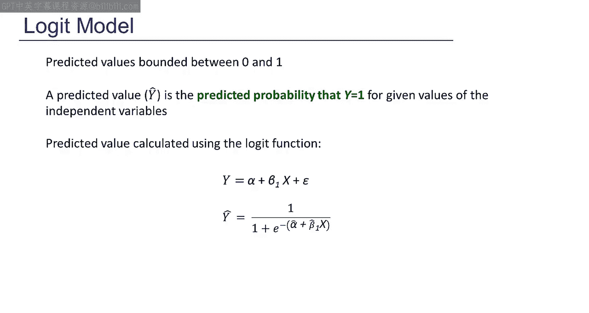
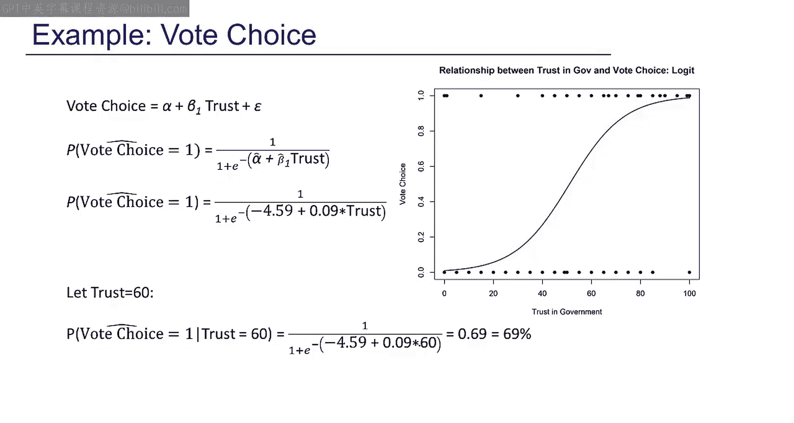
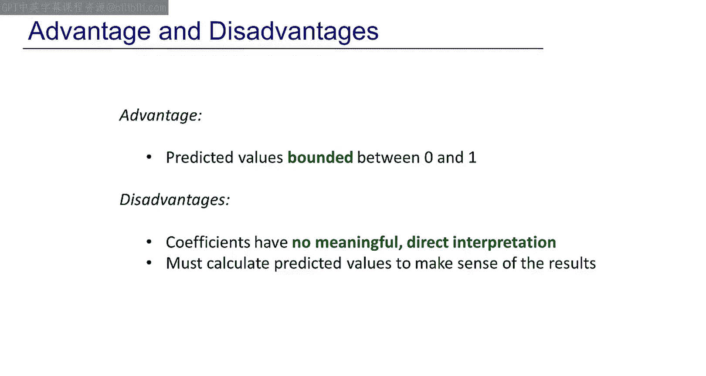

# 约翰霍普金斯大学《数据素养（数据⧸测量⧸回归⧸概率⧸毕业项目）｜Data Literacy》中英字幕（deepseek p46 16_Logit与Probit模型.zh_en -BV1jXtMemEuh_p46-

Logiit and Probate models。Loit and probeate regression models are extensions of the linear probability model。

 As you'll see， however， these models bound the predicted values between 0 and1。

 which is quite handy with a binary dependent variable。By the end of this video。

 you should be able to construct and interpret the results from Logiit and probate models。

The Probate model。As I noted， the predicted values are bounded between  zero and 1 when you use a probate model。

Just as with the linear probability model， a predicted value Y hat is the predicted probability that y equals one for given values of the independent variables。

 In this case， however， we calculate the predicted values differently than with the linear probability model。

In this case， we plug the estimated regression model into the cumulative standard normal distribution function denoted by Phi。

This isn't something you would calculate by hand， you would use a statistical software program to calculate this predicted value。

Let's walk through an example。

Let's return to the vote choice example we used in our discussion about the linear probability model。

As a reminder， we're interested in the relationship between an individual's level of trust and government measured on a zero to 100 point scale。

 and that person's vote choice between two candidates。

 where candidate Sue is designated as the one category and candidate Pat is designated as the zero category。

The PRF is the same as before votete choice equals alpha plus beta 1 times trust plus the error term。

If we estimate a probate model， however， we need to include the Phi function in our SRF。

The SRF is as follows。 the probability that someone's expected vote choice equals1 is equal to phi of alpha hat plus beta 1 hat times trust。

Using a data set and a statistical software package to estimate the model。

 we might determine that the probability that someone's expected vote choice equals 1 is equal to Phi of negative 2。

49 plus 0。049 times trust。In this case， the estimated intercept is negative 2。49。

 and the estimated slope is 0。049。However， we cannot interpret the estimated intercept and slope as we normally would remember the importance of the phi function。

To make sense of the results， we need to calculate predicted values。 For example。

 according to this proate model， what is the predicted vote choice for someone with a trust in government level of 60。

To calculate this predicted value， we would set trust equal to 60 and then calculate the result。

Again， we would need to use a statistical software package to do this because of the P function。

The result turns out to be 0。63， meaning this individual has a 63% probability of supporting candidate Se。

Notice that this value is similar to the result from the linear probability model。

 but not exactly the same。

This slide presents a graph of the data points and the estimated probate line。

The data are the same ones that we used in the previous video to estimate the linear probability model。

In this case， notice that the line has an S shape， this is because of the Phi function。

The Probit model constrains all predicted values to be between0 and 1。

 which works well in the case of a binary dependent variable。

All probeate lines have an S shaped curve。

The Loit model functions very similarly to the Prob model。 In fact。

 there's not a good reason to select one over the other。

 Researchers tend to use either the Loit or proate model with binary dependent variables。

 but there's not a good reason to select one versus the other。Like the Pro model。

 the Loit model bounds the predicted values between0 and 1。

 and like both the Proate model and the linear probability model。

 a predicted value Y hat is the predicted probability that y equals 1 for given values of the independent variables。

The difference is the function that's used to create the S shaped curve。In this case。

 Y hat is calculated using the Loit function。Y hat is equal to1 over1 plus e to the negative value of the SRF。

Again， this isn't something you would ever calculate by hand。When running a Loit model。

 a statistical software program would be able to calculate the predicted values using the estimates of alpha and beta 1 and any other coefficients that were in your model if you were running a multivariate Lot model。

Let's return to our example about vote choice。Just as before。

 the PRF is votete choice equals alpha plus beta 1 times trust plus the error term。

The SRF is that the probability that the expected value of vote choice equals 1 is equal to 1 over 1 plus e to the negative value of alpha hat plus beta1 hat times trust。

Estimating this model using the data set we've been examining reveals that alpha hat in this case is negative 4。

59， and beta 1 hat is 0。09。To calculate a predicted value in this case。

 we would plug these estimated coefficients into the Loit function。

 along with a value of trust in government， let's once again use the example of setting trust in government to 60。

 As usual， a predicted value is the estimated probability that vote choice equals one。

 given that trust is in this case 60。This calculation turns out to be 0。69。

 which means that according to the estimated model。

 there is a 69% chance that an individual with a trust in government level of 60 would vote for candidates sue。

In general， the results from Probit and logit models should be similar。

 though they won't be the same， if the results vary widely。

 then we would say that the results are highly model dependent， which is concerning。

One should certainly be cautious when making decisions based on results that are not robust to slight changes in the model being used。

 In contrast， we should have a lot more confidence in results that stay approximately the same when shifting between similar models。

 such as using a probit versus logit model。

The advantage of Loit and probebate models is that the predicted values are bounded between zero and 1。

Both models generate an S curve that is linear in the middle and curved at the ends。

 such that no predicted value is less than0 or greater than1。

The disadvantages of these models are that the coefficients have no meaningful direct interpretation。

This means that researchers must calculate predicted values to make sense of the results。Nonetheless。

 this is fairly straightforward to do。When using Loit and probebate models。

 it's valuable to present a table of predicted values for interesting values of the independent variables of interest。

 similar to the sample table that I showed you in the video about interaction terms。In summary。

 note that Lod and probebate models are commonly used with binary dependent variables。

 but that the estimated coefficients in these models can't be interpreted in the same way as in an OLS model。

Instead， you can evaluate the results using predicted values。

